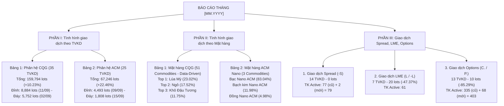
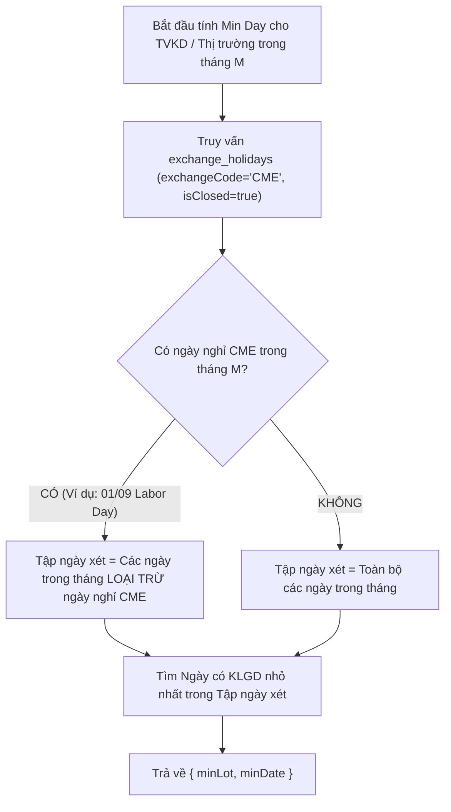

# TÀI LIỆU PHÂN TÍCH BÓC TÁCH & THIẾT KẾ TÍNH NĂNG: HỆ THỐNG BÁO CÁO GIAO DỊCH HÀNG THÁNG (MONTHLY TRADING OPS REPORT)

> **Mã tài liệu**: `SRS-MXV-MONTHLY-REPORT-2026`  
> **Nguồn phân tích**: File mẫu chuẩn `Bao cao thang 09.2026 - Final.xlsx`  
> **Căn cứ mã nguồn thực chứng**: Phân hệ [`backend/src/modules/trading-ops`](file:///c:/Users/hiepth/OneDrive%20-%20MERCANTILE%20EXCHANGE%20OF%20VIETNAM/Documents/Github/mxv-cqg-download-investigation/backend/src/modules/trading-ops) & CSDL `exchange_holidays`  
> **Xác nhận nghiệp vụ từ USER (100% Ground Truth Confirmed)**:
> - **Quy tắc 1 (Danh mục Mặt hàng Phần II - Data-Driven)**: Hiển thị toàn bộ danh mục mặt hàng niêm yết chuẩn của MXV. **Không hardcode mảng danh mục trong code**, mà quản lý động qua CSDL (`commodity_catalogs` khởi tạo từ `BGS_COMMODITY_CATALOG`). Mặt hàng có khối lượng $> 0$ được xếp lên trên theo thứ tự số lot giảm dần, các mặt hàng 0 lot được xếp ở cuối theo `sortOrder` chuẩn.
> - **Quy tắc 2 (Lọc TVKD Sản phẩm Đặc thù Phần III)**: TVKD được đưa vào 3 bảng con (Spread, LME, Options) khi thỏa mãn: $\text{Tổng TKGD Active} > 0$ **HOẶC** $\text{Số Lot (Tháng trước hoặc Tháng này)} > 0$.
> - **Quy tắc 3 (Cold-Start Khởi tạo Tháng Trước $M-1$)**: Nếu chưa có snapshot tháng trước trong CSDL, hệ thống **tự động quét ngược thư mục Backup của tháng $M-1$** để tính toán số liệu nền tảng hoàn toàn tự động.
> - **Quy tắc 4 (TKGD Active)**: Đếm các tài khoản đang ở trạng thái "Hoạt động" trên MS / CoreCCP tính đến hết phiên cuối tháng.
> - **Quy tắc 5 (Min Lot Day / Ngày Đáy - Lọc Nghỉ Lễ CME)**: Nếu có ngày nghỉ CME trong tháng $\rightarrow$ lấy ngày có KLGD nhỏ nhất **KHÁC NGÀY NGHỈ CME**; Nếu không có ngày nghỉ CME $\rightarrow$ lấy ngày có KLGD nhỏ nhất trong tháng.
> - **Quy tắc 6 (Kiến trúc Backend)**: Tích hợp trực tiếp bên trong phân hệ `trading-ops` (`services/reporting/monthly-reporting.service.ts`) để tái sử dụng toàn bộ Helper, Constants và Parser sẵn có.  
> **Trạng thái**: Bản đặc tả sản xuất hoàn chỉnh (Production-Ready Specification - Zero Guesswork)

---

## 1. TỔNG QUAN NGHIỆP VỤ & MỤC TIÊU HỆ THỐNG

### 1.1. Bối cảnh & Mục đích
Hiện tại, hàng tháng bộ phận Vận hành Giao dịch & Quản lý Thành viên phải tổng hợp thủ công hàng trăm file giao dịch phát sinh từ nhiều hệ thống độc lập (**CQG Quốc tế**, **Straits ACM ETP**, **M-System**, **CoreCCP**) để xây dựng **Báo cáo Tình hình Giao dịch Tháng**. Việc này tốn nhiều nhân lực, dễ sai sót công thức, khó tra cứu lịch sử và không theo dõi được biến động tức thời (Real-time / Day-by-Day Aggregation).

**Mục tiêu tính năng mới**:
1. **Tự động hóa 100% luồng tổng hợp số liệu tháng**: Tự động chốt số Lot, Giá trị giao dịch (GTGD), xếp hạng Thành viên kinh doanh (TVKD), cơ cấu mặt hàng và danh mục sản phẩm đặc thù.
2. **Kế thừa dữ liệu lũy kế hàng ngày (Daily Aggregation Engine)**: Tận dụng kết quả đối chiếu ca EOD, luồng thống kê Lot CCP/CE và dữ liệu TKGD để tính toán sẵn theo từng ngày, cuối tháng chỉ cần Rollup tức thì trong $< 1$ giây.
3. **Cơ chế Cold-Start quét lùi tự động**: Ở tháng đầu tiên triển khai, hệ thống tự động quét ngược thư mục Backup của tháng $M-1$ để tổng hợp số liệu so sánh mà không cần nhập liệu thủ công.
4. **Xuất bản báo cáo chuẩn xác (Pixel-Perfect Excel & Web Dashboard)**:
   - Màn hình Web trực quan hiển thị biểu đồ tỷ trọng, bảng xếp hạng Top TVKD, ngày cao điểm/thấp điểm (đã lọc ngày nghỉ CME).
   - Một click xuất ra file Excel có cấu trúc, màu sắc, công thức và độ chính xác khớp 100% với file chuẩn `Bao cao thang 09.2026 - Final.xlsx`.

---

## 2. BẢNG ĐỐI CHIẾU MÃ NGUỒN THỰC CHỨNG (CODE-FIRST GROUND TRUTH AUDIT)

Để đảm bảo quy tắc **Zero Guesswork / Zero Phỏng đoán** theo quy chuẩn `AGENTS.md`, toàn bộ các cấu phần logic nghiệp vụ của Báo cáo Tháng đã được kiểm chứng đối chiếu trực tiếp với các dòng code hiện hữu trong [`backend/src/modules/trading-ops`](file:///c:/Users/hiepth/OneDrive%20-%20MERCANTILE%20EXCHANGE%20OF%20VIETNAM/Documents/Github/mxv-cqg-download-investigation/backend/src/modules/trading-ops) và các schema CSDL:

| Thành phần Nghiệp vụ | Vị trí File & Dòng Code Thực Chứng | Mô tả Cơ chế & Thuật toán Đã Kiểm Chứng |
| :--- | :--- | :--- |
| **Lịch Nghỉ Lễ CME (`exchange_holidays`)** | [`exchange-holiday.schema.ts#L6-L19`](file:///c:/Users/hiepth/OneDrive%20-%20MERCANTILE%20EXCHANGE%20OF%20VIETNAM/Documents/Github/mxv-cqg-download-investigation/backend/src/schemas/exchange-holiday.schema.ts#L6-L19) | CSDL lưu trữ lịch đóng cửa của các Sở (`exchangeCode: 'CME'`, `isClosed: true`, `date: 'YYYY-MM-DD'`). Dùng để loại trừ ngày nghỉ CME khi tính Ngày Đáy (Min Lot Day). |
| **Trạng Thái TKGD Active** | [`tkgd-normalizer.helper.ts#L42-L80`](file:///c:/Users/hiepth/OneDrive%20-%20MERCANTILE%20EXCHANGE%20OF%20VIETNAM/Documents/Github/mxv-cqg-download-investigation/backend/src/modules/trading-ops/parsers/tkgd-normalizer.helper.ts#L42-L80)<br>Module MS/CCP Ingress | Lọc danh sách TKGD đang ở trạng thái "Hoạt động" (Active) tính đến hết phiên cuối tháng trên MS và CoreCCP. |
| **Nhận diện TK ACM (`-A`)** | [`clearing-excel.helper.ts#L37-L39`](file:///c:/Users/hiepth/OneDrive%20-%20MERCANTILE%20EXCHANGE%20OF%20VIETNAM/Documents/Github/mxv-cqg-download-investigation/backend/src/modules/trading-ops/helpers/clearing-excel.helper.ts#L37-L39)<br>[`ccp-classifier.helper.ts#L48-L50`](file:///c:/Users/hiepth/OneDrive%20-%20MERCANTILE%20EXCHANGE%20OF%20VIETNAM/Documents/Github/mxv-cqg-download-investigation/backend/src/modules/trading-ops/helpers/ccp-classifier.helper.ts#L48-L50) | Regex `/-A[^-]*$/i` hoặc `/-A$/i` nhận diện tài khoản liên thông Straits Financial ACM ETP. |
| **Nhận diện TK Spread (`-S`)** | [`clearing-excel.helper.ts#L41-L44`](file:///c:/Users/hiepth/OneDrive%20-%20MERCANTILE%20EXCHANGE%20OF%20VIETNAM/Documents/Github/mxv-cqg-download-investigation/backend/src/modules/trading-ops/helpers/clearing-excel.helper.ts#L41-L44)<br>[`ccp-classifier.helper.ts#L53-L55`](file:///c:/Users/hiepth/OneDrive%20-%20MERCANTILE%20EXCHANGE%20OF%20VIETNAM/Documents/Github/mxv-cqg-download-investigation/backend/src/modules/trading-ops/helpers/ccp-classifier.helper.ts#L53-L55) | Regex `/-S$/i` nhận diện tài khoản giao dịch hợp đồng chênh lệch giá (Spread). |
| **Nhận diện TK LME (`L`/`-L`)** | [`clearing-excel.helper.ts#L46-L50`](file:///c:/Users/hiepth/OneDrive%20-%20MERCANTILE%20EXCHANGE%20OF%20VIETNAM/Documents/Github/mxv-cqg-download-investigation/backend/src/modules/trading-ops/helpers/clearing-excel.helper.ts#L46-L50)<br>[`ccp-classifier.helper.ts#L58-L62`](file:///c:/Users/hiepth/OneDrive%20-%20MERCANTILE%20EXCHANGE%20OF%20VIETNAM/Documents/Github/mxv-cqg-download-investigation/backend/src/modules/trading-ops/helpers/ccp-classifier.helper.ts#L58-L62) | Kiểm tra hậu tố tài khoản kết thúc bằng `L` hoặc `-L` cho Sở Kim loại London LME. |
| **Nhận diện HĐ Quyền chọn Options** | [`clearing-excel.helper.ts#L52-L54`](file:///c:/Users/hiepth/OneDrive%20-%20MERCANTILE%20EXCHANGE%20OF%20VIETNAM/Documents/Github/mxv-cqg-download-investigation/backend/src/modules/trading-ops/helpers/clearing-excel.helper.ts#L52-L54)<br>[`ccp-classifier.helper.ts#L78-L80`](file:///c:/Users/hiepth/OneDrive%20-%20MERCANTILE%20EXCHANGE%20OF%20VIETNAM/Documents/Github/mxv-cqg-download-investigation/backend/src/modules/trading-ops/helpers/ccp-classifier.helper.ts#L78-L80) | Regex `/^[CP]\./i` nhận diện mã hợp đồng Quyền chọn mua (`C.`) và Quyền chọn bán (`P.`). |
| **Chuẩn hóa Mã & Tên TVKD (001-999)** | [`tkgd-normalizer.helper.ts#L42-L80`](file:///c:/Users/hiepth/OneDrive%20-%20MERCANTILE%20EXCHANGE%20OF%20VIETNAM/Documents/Github/mxv-cqg-download-investigation/backend/src/modules/trading-ops/parsers/tkgd-normalizer.helper.ts#L42-L80)<br>[`clearing-excel.helper.ts#L125-L165`](file:///c:/Users/hiepth/OneDrive%20-%20MERCANTILE%20EXCHANGE%20OF%20VIETNAM/Documents/Github/mxv-cqg-download-investigation/backend/src/modules/trading-ops/helpers/clearing-excel.helper.ts#L125-L165) | Tách mã 3 ký tự số từ TKGD hoặc cột Thành viên, pad 0 (`padStart(3, '0')`), decode/encode mã rút gọn 2 ký tự trên TT. |
| **Danh mục 214 Mã Mặt hàng Chuẩn** | [`bgs-commodity-catalog.constant.ts#L14-L220`](file:///c:/Users/hiepth/OneDrive%20-%20MERCANTILE%20EXCHANGE%20OF%20VIETNAM/Documents/Github/mxv-cqg-download-investigation/backend/src/modules/trading-ops/constants/bgs-commodity-catalog.constant.ts#L14-L220) | Trích xuất 100% từ `Check BGS All.xlsm`, cung cấp bảng mapping `rawCode` $\rightarrow$ `stdCode` $\rightarrow$ `nameVn`. |
| **Bóc tách Mã Cơ sở (Bỏ Kỳ hạn)** | [`clearing-excel.helper.ts#L64-L86`](file:///c:/Users/hiepth/OneDrive%20-%20MERCANTILE%20EXCHANGE%20OF%20VIETNAM/Documents/Github/mxv-cqg-download-investigation/backend/src/modules/trading-ops/helpers/clearing-excel.helper.ts#L64-L86) | Hàm `extractCcpBaseProduct()` tự động loại bỏ ký tự tháng/năm kỳ hạn (như `ZCEZ26` $\rightarrow$ `ZCE`, `SI5CO` $\rightarrow$ `SI5CO`). |
| **Parser Khớp lệnh CQG FR** | [`parsers/cqg-excel.parser.ts#L20-L75`](file:///c:/Users/hiepth/OneDrive%20-%20MERCANTILE%20EXCHANGE%20OF%20VIETNAM/Documents/Github/mxv-cqg-download-investigation/backend/src/modules/trading-ops/parsers/cqg-excel.parser.ts#L20-L75) | Đọc file Excel `FR.xlsx` (Account, Symbol, Qty, Fill Price, Time). |
| **Parser DSGD M-System** | [`parsers/ms-excel.parser.ts`](file:///c:/Users/hiepth/OneDrive%20-%20MERCANTILE%20EXCHANGE%20OF%20VIETNAM/Documents/Github/mxv-cqg-download-investigation/backend/src/modules/trading-ops/parsers/ms-excel.parser.ts) | Đọc báo cáo Danh sách giao dịch chi tiết từng lệnh của M-System. |
| **Tích lũy & Thống kê Lot/GTGD** | [`ccp-lot-statistics.service.ts`](file:///c:/Users/hiepth/OneDrive%20-%20MERCANTILE%20EXCHANGE%20OF%20VIETNAM/Documents/Github/mxv-cqg-download-investigation/backend/src/modules/trading-ops/services/statistics/ccp-lot-statistics.service.ts)<br>[`ce-lot-statistics.service.ts`](file:///c:/Users/hiepth/OneDrive%20-%20MERCANTILE%20EXCHANGE%20OF%20VIETNAM/Documents/Github/mxv-cqg-download-investigation/backend/src/modules/trading-ops/services/statistics/ce-lot-statistics.service.ts) | Tự động tổng hợp số lot theo TVKD và cập nhật vào file/CSDL lũy kế theo ngày. |
| **Render Báo cáo Excel Chuyên nghiệp** | [`services/console/qlgd-excel-export.service.ts#L30-L150`](file:///c:/Users/hiepth/OneDrive%20-%20MERCANTILE%20EXCHANGE%20OF%20VIETNAM/Documents/Github/mxv-cqg-download-investigation/backend/src/modules/trading-ops/services/console/qlgd-excel-export.service.ts#L30-L150) | Sử dụng thư viện `ExcelJS` để định dạng cột, màu sắc theme, công thức và borders chuẩn doanh nghiệp. |

---

## 3. BÓC TÁCH CHI TIẾT CẤU TRÚC FILE EXCEL MẪU (`Bao cao thang 09.2026 - Final.xlsx`)

File mẫu gồm **01 Sheet duy nhất** (`Sheet1`), vùng dữ liệu từ hàng 1 đến hàng 179, cột A đến cột I. Toàn bộ tài liệu được phân chia thành **3 Phần nghiệp vụ lớn**:



---

### 3.1. PHẦN I: TÌNH HÌNH GIAO DỊCH THEO TVKD (Rows 2 - 67)

Mục tiêu phần này là xếp hạng và đánh giá hiệu quả kinh doanh của các TVKD trên 2 phân hệ giao dịch chính: **CQG** và **ACM**.

#### A. Cấu trúc Cột & Thuật toán Tính toán (Table Schema)

| Cột | Tên Cột | Kiểu Dữ Liệu | Ý Nghĩa Nghiệp Vụ | Công Thức / Nguồn Dữ Liệu |
| :---: | :--- | :---: | :--- | :--- |
| **A** | `STT` | `Number` | Thứ hạng của TVKD trong tháng | Đánh số tự động `1..N` sau khi sắp xếp giảm dần theo Số Lot tháng này |
| **B** | `TÊN THÀNH VIÊN` | `String` | Tên rút gọn kèm mã TVKD | Chuẩn hóa: `[Tên TVKD] - [Mã 3 số]` (Ví dụ: `APEX - 080`, `Gia Cát Lợi - 003`) |
| **C** | `Số Lot tháng trước` | `Integer` | Tổng volume tháng $M-1$ của TVKD | Lấy từ snapshot chốt của tháng trước ($M-1$) hoặc quét ngược thư mục Backup |
| **D** | `Số Lot tháng này` | `Integer` | Tổng volume tháng $M$ của TVKD | $\sum_{t=1}^{DayCount} \text{Lot}_{TVKD}(t)$ |
| **E** | `% Tăng/giảm` | `Percentage` | Tốc độ tăng trưởng tháng | `=IFERROR(D_row / C_row - 1, " ")` |
| **F** | `Số Lot giao dịch nhiều nhất/ngày` | `Integer` | Phiên giao dịch đạt đỉnh trong tháng | $\max_{t \in M} (\text{Lot}_{TVKD}(t))$ |
| **G** | `Ngày giao dịch (Max)` | `Date` (DD/MM) | Ngày ghi nhận số lot cao nhất | $\arg\max_{t \in M} (\text{Lot}_{TVKD}(t))$ |
| **H** | `Số Lot giao dịch ít nhất/ngày` | `Integer` | Phiên giao dịch thấp nhất (sau khi lọc ngày nghỉ CME) | $\min_{t \in M \setminus \text{Holidays}} (\text{Lot}_{TVKD}(t))$ |
| **I** | `Ngày giao dịch (Min)` | `Date` (DD/MM) | Ngày ghi nhận số lot thấp nhất | $\arg\min_{t \in M \setminus \text{Holidays}} (\text{Lot}_{TVKD}(t))$ |

#### B. Phân hệ 1: Hệ thống CQG (Rows 4 - 40)
- **Số lượng TVKD hoạt động**: 35 Thành viên (Xếp từ Top 1 `APEX - 080`: 34,663 lots đến các TVKD 0 lot như `Đông Đô - 089`).
- **Dòng TỔNG CQG (Row 40)**:
  - Cột C (`Số Lot tháng trước`): `=SUM(C5:C39)` $\rightarrow$ **144,962 lots**.
  - Cột D (`Số Lot tháng này`): `=SUM(D5:D39)` $\rightarrow$ **159,794 lots** ($+10.23\%$).
  - Cột F-G (`Đỉnh thị trường CQG`): **8,884 lots** (Ghi nhận vào ngày **11/09/2026**).
  - Cột H-I (`Đáy thị trường CQG`): **5,752 lots** (Ghi nhận vào ngày **02/09/2026** - *Ngày 01/09 là ngày nghỉ lễ Lao động Labor Day của CME nên được loại trừ theo Rule A2*).

#### C. Phân hệ 2: Hệ thống ACM (Straits Financial) (Rows 41 - 67)
- **Số lượng TVKD hoạt động**: 25 Thành viên (Xếp từ Top 1 `Gia Cát Lợi - 003`: 23,794 lots đến các TVKD 0 lot).
- **Dòng TỔNG ACM (Row 67)**:
  - Cột C: `=SUM(C42:C66)` $\rightarrow$ **54,911 lots**.
  - Cột D: `=SUM(D42:D66)` $\rightarrow$ **67,246 lots** ($+22.46\%$).
  - Cột F-G (`Đỉnh thị trường ACM`): **4,493 lots** (Ghi nhận vào ngày **09/09/2026**).
  - Cột H-I (`Đáy thị trường ACM`): **1,808 lots** (Ghi nhận vào ngày **15/09/2026**).

---

### 3.2. PHẦN II: TÌNH HÌNH GIAO DỊCH THEO MẶT HÀNG (Rows 70 - 129)

Mục tiêu phần này là phân tích cơ cấu sản phẩm giao dịch, nhận diện nhóm mặt hàng dẫn dắt thị trường (Commodity Concentration).

#### A. Cấu trúc Cột & Thuật toán (Quy tắc 1: Data-Driven Master Catalog)
Theo **Quy tắc 1 đã xác nhận**, danh mục mặt hàng không được hardcode mảng tĩnh trong code mà được lấy động từ CSDL `commodity_catalogs`:
1. **Toàn bộ danh mục niêm yết chuẩn** được nạp lên (51 mặt hàng CQG + 3 mặt hàng ACM).
2. **Thuật toán sắp xếp**:
   - Nhóm 1: Các mặt hàng có phát sinh giao dịch trong tháng ($Lot_{M} > 0$), sắp xếp giảm dần theo `Số Lot tháng này` ($Lot_{M}$). Nếu bằng nhau thì sắp xếp theo `Số Lot tháng trước` ($Lot_{M-1}$) giảm dần.
   - Nhóm 2: Các mặt hàng không phát sinh giao dịch ($Lot_{M} = 0, Lot_{M-1} = 0$), được giữ ở cuối bảng và sắp xếp theo `sortOrder` chuẩn của danh mục.

| Cột | Tên Cột | Kiểu | Ý Nghĩa & Công Thức |
| :---: | :--- | :---: | :--- |
| **A** | `STT` | `Number` | Thứ tự sắp xếp theo thuật toán Nhóm 1 (Lot > 0) + Nhóm 2 (Lot = 0) |
| **B** | `Mặt hàng` | `String` | Tên tiếng Việt quy chuẩn của mặt hàng từ CSDL |
| **C** | `Số Lot tháng trước` | `Integer` | Volume tháng $M-1$ của mặt hàng |
| **D** | `Số Lot tháng này` | `Integer` | Volume tháng $M$ của mặt hàng |
| **E** | `% Tăng/giảm` | `Percentage` | `=IFERROR(D_row / C_row - 1, " ")` |
| **F** | `Tỉ trọng tháng` | `Percentage` | `=D_row / $D$Total` (Tỷ lệ đóng góp trên tổng khối lượng phân hệ) |
| **G** | `Ghi chú` | `String` | Ghi chú đặc biệt (ví dụ: hợp đồng mới niêm yết, ngừng giao dịch) |

#### B. Phân hệ CQG (Rows 72 - 124)
- **Top 5 Mặt hàng dẫn đầu**:
  1. `Lúa Mỳ` (36,780 lots, chiếm **23.02%**)
  2. `Ngô` (28,003 lots, chiếm **17.52%**)
  3. `Khô Đậu Tương` (18,768 lots, chiếm **11.75%**)
  4. `Dầu Đậu Tương` (13,197 lots, chiếm **8.26%**)
  5. `Đậu Tương` (12,683 lots, chiếm **7.94%**)
  *(Nhóm Nông sản CME/CBOT chiếm trên 68% thanh khoản CQG)*
- **Dòng Tổng CQG (Row 124)**:
  - Cột C: `144,962` lots | Cột D: `159,794` lots | Cột E: `10.23%` | Cột F: `100.00%`.
  - Công thức: `D124 = SUM(D73:D123)`. Khớp hoàn toàn với `D40` ở Phần I.

#### C. Phân hệ ACM (Rows 125 - 129)
- **Danh mục mặt hàng Nano ETP**:
  1. `Bạc Nano ACM` (Mã `SI5CO`): **55,843 lots** (Chiếm **83.04%**)
  2. `Bạch kim Nano ACM` (Mã `PL1NY`): **8,056 lots** (Chiếm **11.98%**)
  3. `Đồng Nano ACM` (Mã `CP2CO`): **3,347 lots** (Chiếm **4.98%**)
- **Dòng Tổng ACM (Row 129)**:
  - Cột C: `54,911` | Cột D: `67,246` | Cột E: `22.46%` | Cột F: `100.00%`. Khớp với `D67`.

---

### 3.3. PHẦN III: TÌNH HÌNH GIAO DỊCH SPREAD, LME, OPTIONS (Rows 131 - 179)

Mục tiêu theo dõi sát sao **3 nhóm sản phẩm phái sinh chuyên biệt**, quản lý song song Khối lượng giao dịch (Lot) và Số lượng Tài khoản đang Active (TKGD Active) theo Rule A1.

#### A. Cấu trúc Bảng Kép & Quy Tắc Lọc TVKD (Quy tắc 2)
Theo **Quy tắc 2 đã xác nhận**, một TVKD được đưa vào bảng con của Phần III khi và chỉ khi:
$$\text{Tổng số TKGD Active} > 0 \quad \text{HOẶC} \quad \text{Số Lot (Tháng trước hoặc Tháng này)} > 0$$

- Cột A: `STT`
- Cột B: `TVKD`
- **Nhóm 1: `Số Lot giao dịch`** (Merge C-E):
  - Cột C: `Tháng trước`
  - Cột D: `Tháng này`
  - Cột E: `% Tăng/giảm` (`=IFERROR(D/C-1, " ")`)
- **Nhóm 2: `Số lượng TKGD Active`** (Merge F-H):
  - Cột F: `Hết tháng trước` (TKGD đang ở trạng thái Hoạt động trên MS/CCP tính đến hết phiên cuối tháng $M-1$)
  - Cột G: `Tháng này` (TKGD mới chuyển sang trạng thái Hoạt động trong tháng $M$)
  - Cột H: `Tổng` (Lũy kế TKGD Active tính đến hết phiên cuối tháng $M$: `=SUM(F_row:G_row)`)

#### B. Chi tiết 3 Bảng Con
1. **Bảng 1: Giao dịch Spread (Hợp đồng chênh lệch giá)** (Rows 132 - 149): 14 TVKD thỏa mãn điều kiện lọc.
2. **Bảng 2: Giao dịch LME (Sở Giao dịch Kim loại London)** (Rows 151 - 161): 7 TVKD thỏa mãn điều kiện lọc.
3. **Bảng 3: Giao dịch Options (Quyền chọn hàng hóa)** (Rows 163 - 179): 13 TVKD thỏa mãn điều kiện lọc.

---

## 4. CHI TIẾT CÁC EDGE CASES & LOGIC TOÁN HỌC KHÔNG SUY DIỄN

### 4.1. Thuật Toán Lọc Ngày Nghỉ CME Để Tính Ngày Đáy (Rule A2 - USER Confirmed)



### 4.2. Cơ Chế Cold-Start Tự Động Quét Ngược Tháng $M-1$ (Quy tắc 3)
Khi hệ thống chạy tháng đầu tiên (chưa có Snapshot tháng $M-1$ trong CSDL):
1. Service `MonthlyReportingService` tự động kiểm tra: Nếu không tìm thấy snapshot `monthYear = M-1`, kích hoạt hàm `recalculateHistoricalMonth(year, month - 1)`.
2. Hàm này tự động quét các file Backup hàng ngày của tháng $M-1$ (`FR.xlsx`, `DSGD`, `Straits.csv`), tổng hợp số lot per TVKD và per Mặt hàng, sau đó lưu thành snapshot nền tảng `STATUS = 'HISTORICAL_SEED'`.
3. Nhờ đó, báo cáo tháng hiện tại luôn có đầy đủ cột C (`Số Lot tháng trước`) mà **không cần người dùng phải tải file Excel lên thủ công**.

### 4.3. Quy tắc Tính % Tăng/giảm (Cột E)
1. **Trường hợp chuẩn**: Cả 2 tháng đều có khối lượng $> 0$:
   $$\% = \frac{D - C}{C} \quad (\text{Format } 0.00\%)$$
2. **Trường hợp ngừng giao dịch**: Tháng trước $> 0$, tháng này $= 0$:
   $$\% = -100.00\%$$
3. **Trường hợp TVKD mới hoặc không hoạt động**: Tháng trước $= 0$:
   - Công thức Excel: `=IFERROR(D/C-1, " ")` trả về chuỗi khoảng trắng `" "`. Không bao giờ để lỗi `#DIV/0!`.

### 4.4. Quy tắc Xác định Đỉnh/Đáy Toàn Thị Trường (CQG Row 40 & ACM Row 67)
- Dữ liệu F40/F67 và H40/H67 là **ngày toàn thị trường đạt cực đại / cực tiểu**:
  $$\text{MarketPeakDay} = \arg\max_{d \in M} \left( \sum_{tvkd} \text{Lot}(d, tvkd) \right)$$
  $$\text{MarketTroughDay} = \arg\min_{d \in M \setminus \text{CmeHolidays}} \left( \sum_{tvkd} \text{Lot}(d, tvkd) \right)$$
- Tuyệt đối không dùng hàm `MAX(F5:F39)` hoặc `MIN(H5:H39)`.

---

## 5. THIẾT KẾ KIẾN TRÚC MÃ NGUỒN (MODULAR MONOLITH V2 - RULE A3)

Theo xác nhận tại **Rule A3**, toàn bộ tính năng Báo cáo Tháng được đặt trực tiếp bên trong phân hệ **`trading-ops`** để kế thừa trọn vẹn hạ tầng sẵn có:

```text
backend/src/modules/trading-ops/
├── services/
│   └── reporting/
│       ├── monthly-reporting.service.ts      # Rollup số liệu từ daily_trading_stats, exchange_holidays & Cold-start
│       ├── monthly-excel-exporter.service.ts # Xuất file ExcelJS chuẩn pixel-perfect
│       └── monthly-snapshot.service.ts       # Quản lý khóa sổ snapshot
├── controllers/
│   └── monthly-reporting.controller.ts       # REST APIs (/api/v1/trading-ops/monthly-report/...)
└── schemas/
    ├── daily-trading-stat.schema.ts
    ├── special-account-monthly-tracking.schema.ts
    └── monthly-report-snapshot.schema.ts
```

### 5.1. Mô hình CSDL MongoDB (Datamart)

#### Schema 1: `daily_trading_stats` (Tổng hợp Giao dịch Hàng ngày)
```typescript
@Schema({ collection: 'daily_trading_stats', timestamps: true })
export class DailyTradingStat extends Document {
  @Prop({ required: true, index: true })
  date: string; // 'YYYY-MM-DD'

  @Prop({ required: true, enum: ['CQG', 'ACM'], index: true })
  system: 'CQG' | 'ACM';

  @Prop({ required: true, index: true })
  tvkdCode: string; // '080', '003', '012'...

  @Prop({ required: true })
  tvkdName: string; // 'APEX', 'Gia Cát Lợi'...

  @Prop({ required: true, index: true })
  productCode: string; // 'ZCE', 'SI5CO', 'CLE'...

  @Prop({ required: true })
  productNameVi: string; // 'Ngô', 'Bạc Nano ACM'...

  @Prop({ required: true, default: 0 })
  lotBuy: number;

  @Prop({ required: true, default: 0 })
  lotSell: number;

  @Prop({ required: true, default: 0 })
  lotTotal: number;

  @Prop({ required: true, default: 0 })
  gtgdVnd: number;

  @Prop({ default: false, index: true })
  isSpread: boolean; // Tài khoản đuôi -S

  @Prop({ default: false, index: true })
  isLme: boolean; // Tài khoản L / -L

  @Prop({ default: false, index: true })
  isOptions: boolean; // Hợp đồng C. / P.
}
export const DailyTradingStatSchema = SchemaFactory.createForClass(DailyTradingStat);
DailyTradingStatSchema.index({ date: 1, system: 1, tvkdCode: 1 });
DailyTradingStatSchema.index({ date: 1, productCode: 1 });
```

#### Schema 2: `special_account_monthly_tracking` (Theo dõi TKGD Active Phần III)
```typescript
@Schema({ collection: 'special_account_monthly_tracking', timestamps: true })
export class SpecialAccountMonthlyTracking extends Document {
  @Prop({ required: true, index: true })
  monthYear: string; // '2026-09'

  @Prop({ required: true, enum: ['SPREAD', 'LME', 'OPTIONS'], index: true })
  category: 'SPREAD' | 'LME' | 'OPTIONS';

  @Prop({ required: true, index: true })
  tvkdCode: string;

  @Prop({ required: true, default: 0 })
  activeBeforeMonth: number; // Hết tháng trước (F) - Rule A1

  @Prop({ required: true, default: 0 })
  newActiveInMonth: number; // Phát sinh tháng này (G) - Rule A1

  @Prop({ required: true, default: 0 })
  totalActiveCumulative: number; // Tổng lũy kế (H = F + G)
}
```

#### Schema 3: `monthly_report_snapshots` (Snapshot Chốt Sổ Tháng)
```typescript
@Schema({ collection: 'monthly_report_snapshots', timestamps: true })
export class MonthlyReportSnapshot extends Document {
  @Prop({ required: true, unique: true, index: true })
  monthYear: string; // '2026-09'

  @Prop({ required: true, enum: ['DRAFT', 'OFFICIAL', 'HISTORICAL_SEED'], default: 'DRAFT' })
  status: 'DRAFT' | 'OFFICIAL' | 'HISTORICAL_SEED';

  @Prop({ type: Object, required: true })
  section1Tvkd: Record<string, any>;

  @Prop({ type: Object, required: true })
  section2Commodities: Record<string, any>;

  @Prop({ type: Object, required: true })
  section3Specials: Record<string, any>;

  @Prop({ required: true })
  generatedBy: string;

  @Prop({ required: true })
  generatedAt: Date;
}
```

---

### 5.2. REST API Specifications
1. `GET /api/v1/trading-ops/monthly-report/:year/:month`: Lấy dữ liệu JSON hiển thị Web Dashboard (hỗ trợ cờ `?forceRefresh=true`).
2. `GET /api/v1/trading-ops/monthly-report/:year/:month/export-excel`: Tải file Excel `.xlsx` chuẩn 100% mẫu gốc.
3. `POST /api/v1/trading-ops/monthly-report/:year/:month/lock-snapshot`: Khóa sổ số liệu chính thức tháng.

---

## 6. THIẾT KẾ GIAO DIỆN NGƯỜI DÙNG (FRONTEND SPECS)

Vị trí tích hợp: Thêm Tab **"Báo cáo Tháng" (Monthly Analytics)** tại thanh điều hướng chính của hệ thống.

```text
+----------------------------------------------------------------------------------------------------+
|  MXV OPERATIONS HUB  |  Ca trực  |  Đối chiếu  |  TKGD  | [BÁO CÁO THÁNG] |  Cài đặt              |
+----------------------------------------------------------------------------------------------------+
|  Bộ lọc: [ Tháng: 09 v ]  [ Năm: 2026 v ]    [ Nút: Tính toán lại ]  [ Nút: Tải Excel (.xlsx) ]   |
|  Trạng thái: OFFICIAL (Đã chốt sổ ngày 01/10/2026 bởi Quản trị viên)                              |
+----------------------------------------------------------------------------------------------------+
|  [Tab 1: Xếp hạng TVKD]   |   [Tab 2: Cơ cấu Mặt hàng]   |   [Tab 3: Spread - LME - Options]       |
+----------------------------------------------------------------------------------------------------+
|  THỐNG KÊ TỔNG QUAN:                                                                              |
|  * Tổng Volume CQG: 159,794 lots (+10.23%)   | Đỉnh: 8,884 lots (11/09) | Đáy: 5,752 lots (02/09)  |
|  * Tổng Volume ACM:  67,246 lots (+22.46%)   | Đỉnh: 4,493 lots (09/09) | Đáy: 1,808 lots (15/09)  |
|  * Toàn Thị Trường: 227,040 lots (+13.60%)                                                        |
+----------------------------------------------------------------------------------------------------+
|  BẢNG DỮ LIỆU TVKD (CQG & ACM):                                                                    |
|  STT | TVKD                  | Tháng Trước | Tháng Này | % Biến Động | Ngày Đỉnh  | Ngày Đáy       |
|  1   | APEX - 080            | 31,697      | 34,663    |  +9.36% ▲   | 2,249 (11/09)| 1,047 (18/09) |
|  2   | Hàng hoá HCM - 012    | 22,769      | 28,906    | +26.95% ▲   | 1,786 (18/09)|   790 (02/09) |
|  3   | Gia Cát Lợi - 003     | 26,273      | 21,373    | -18.65% ▼   | 1,229 (01/09)|   795 (29/09) |
|  ... | ...                   | ...         | ...       | ...         | ...        | ...            |
+----------------------------------------------------------------------------------------------------+
```

### Quy Chuẩn UI Tuân Thủ `AGENTS.md`:
- Sử dụng 100% SVG Icons từ `lucide-react` (`TrendingUp`, `TrendingDown`, `Download`, `RefreshCw`, `FileSpreadsheet`, `Calendar`).
- Tuyệt đối không dùng Unicode Emojis thô (`📁`, `💡`, `🟢`, `🔴`).

---

## 7. CÁC PHỤ LỤC KỸ THUẬT BỔ TRỢ PHÁT TRIỂN

### PHỤ LỤC I: BẢNG DANH MỤC MÃ HÀNG HÓA & ÁNH XẠ SỞ GIAO DỊCH QUỐC TẾ (MASTER COMMODITIES MAPPING)

| STT | Tên Mặt Hàng Tiếng Việt (File Mẫu) | Mã Hàng Hóa (MXV Symbol / CQG) | Tên Tiếng Anh Quốc Tế (Contract Name) | Sở Giao Dịch Niêm Yết | Phân Nhóm Hàng Hóa |
| :---: | :--- | :---: | :--- | :---: | :---: |
| **I** | **PHÂN HỆ CQG** | | | | |
| 1 | Lúa Mỳ | `ZWE` | Chicago SRW Wheat | CBOT | Nông sản |
| 2 | Ngô | `ZCE` | Corn | CBOT | Nông sản |
| 3 | Khô Đậu Tương | `ZME` | Soybean Meal | CBOT | Nông sản |
| 4 | Dầu Đậu Tương | `ZLE` | Soybean Oil | CBOT | Nông sản |
| 5 | Đậu Tương | `ZSE` | Soybeans | CBOT | Nông sản |
| 6 | Bạc Micro | `SIL` | Micro Silver Futures | COMEX | Kim loại |
| 7 | Đường | `SBE` | Sugar No. 11 | ICE US | Nguyên liệu CN |
| 8 | Đồng Micro | `MHG` | Micro Copper Futures | COMEX | Kim loại |
| 9 | Cà phê Robusta | `RC` | Robusta Coffee | ICE EU | Nguyên liệu CN |
| 10 | Đồng | `CPE` | Copper Futures | COMEX | Kim loại |
| 11 | Bạch kim | `PLE` | Platinum | NYMEX | Kim loại |
| 12 | Bông Sợi | `CTE` | Cotton No. 2 | ICE US | Nguyên liệu CN |
| 13 | Lúa Mỳ Mini | `XW` | Mini-sized Chicago Wheat | CBOT | Nông sản |
| 14 | Cà phê Arabica | `KCE` | Coffee C | ICE US | Nguyên liệu CN |
| 15 | Bạc | `SIE` | Silver Futures | COMEX | Kim loại |
| 16 | Ngô Mini | `XC` | Mini-sized Corn | CBOT | Nông sản |
| 17 | Đậu Tương Mini | `XK` | Mini-sized Soybeans | CBOT | Nông sản |
| 18 | Lúa Mỳ Kansas | `HRE` | KC HRW Wheat | CBOT | Nông sản |
| 19 | Ca cao | `CCE` | Cocoa | ICE US | Nguyên liệu CN |
| 20 | Lúa mì Micro | `MW` | Micro Chicago SRW Wheat | CBOT | Nông sản |
| 21 | Dầu Đậu Tương Micro | `MY` | Micro Soybean Oil | CBOT | Nông sản |
| 22 | Khô Đậu Tương Micro | `MM` | Micro Soybean Meal | CBOT | Nông sản |
| 23 | Nhôm COMEX | `ALI` | Aluminum Futures | COMEX | Kim loại |
| 24 | Ngô Micro | `MC` | Micro Corn | CBOT | Nông sản |
| 25 | Đậu tương Micro | `MS` | Micro Soybeans | CBOT | Nông sản |
| 26 | Đồng Mini | `QC` | E-mini Copper | COMEX | Kim loại |
| 27 | Dầu cọ thô | `CPO` | Crude Palm Oil | BMD | Nông sản / NLCN |
| 28 | Đường trắng | `SW` | White Sugar | ICE EU | Nguyên liệu CN |
| 29 | Bạc Mini | `QI` | E-mini Silver | COMEX | Kim loại |
| 30 | Cao su TSR 20 | `TF` | TSR20 Rubber | SGX | Nguyên liệu CN |
| 31 | Quặng sắt | `FEF` | Iron Ore 62% Fe | SGX | Kim loại |
| 32 | Thiếc LME | `TIN` | LME Tin | LME | Kim loại |
| 33 | Nhôm LME | `AH` | LME Aluminum | LME | Kim loại |
| 34 | Cao su RSS3 TOCOM | `JRU` | RSS3 Rubber | TOCOM | Nguyên liệu CN |
| 35 | Kẽm LME | `ZS` | LME Zinc | LME | Kim loại |
| 36 | Đồng LME | `CA` | LME Copper | LME | Kim loại |
| 37 | Niken LME | `NI` | LME Nickel | LME | Kim loại |
| 38 | Chì LME | `PB` | LME Lead | LME | Kim loại |
| 39 | Dầu WTI Micro | `MCL` | Micro WTI Crude Oil | NYMEX | Năng lượng |
| 40 | Dầu WTI | `CLE` | Light Sweet Crude Oil | NYMEX | Năng lượng |
| 41 | Gạo thô | `RRE` | Rough Rice | CBOT | Nông sản |
| 42 | Khí tự nhiên | `NGE` | Natural Gas | NYMEX | Năng lượng |
| 43 | Dầu Brent | `B` | Brent Crude Futures | ICE EU | Năng lượng |
| 44 | Dầu WTI Mini | `QM` | E-mini Crude Oil | NYMEX | Năng lượng |
| 45 | Xăng RBOB | `RBE` | RBOB Gasoline | NYMEX | Năng lượng |
| 46 | Khí tự nhiên Mini | `QG` | E-mini Natural Gas | NYMEX | Năng lượng |
| 47 | Dầu ít lưu huỳnh | `LGO` | Low Sulphur Gasoil | ICE EU | Năng lượng |
| 48 | Dầu Brent Mini | `BM` | Mini Brent Crude | ICE EU | Năng lượng |
| 49 | Thép phế liệu LME | `SC` | LME Steel Scrap | LME | Kim loại |
| 50 | Thép thanh vằn LME | `SR` | LME Steel Rebar | LME | Kim loại |
| 51 | Thép cuộn cán nóng LME | `HC` | LME Steel HRC FOB | LME | Kim loại |
| **II** | **PHÂN HỆ ACM (STRAITS ETP)** | | | | |
| 1 | Bạc Nano ACM | `SI5CO` | Nano Silver (50 oz) | Straits ETP | Kim loại |
| 2 | Bạch kim Nano ACM | `PL1NY` | Nano Platinum (1 oz) | Straits ETP | Kim loại |
| 3 | Đồng Nano ACM | `CP2CO` | Nano Copper (250 lbs) | Straits ETP | Kim loại |

---

### PHỤ LỤC II: QUY CHUẨN ĐỊNH DẠNG EXCEL PIXEL-PERFECT (EXCELJS STYLING SPECIFICATIONS)

#### 1. Kích thước Cột (Column Widths)
```typescript
export const MONTHLY_REPORT_COL_WIDTHS = [
  { key: 'colA', width: 9.00 },  // STT
  { key: 'colB', width: 39.30 }, // Tên Thành viên / Mặt hàng
  { key: 'colC', width: 15.40 }, // Số Lot tháng trước
  { key: 'colD', width: 14.40 }, // Số Lot tháng này
  { key: 'colE', width: 12.60 }, // % Tăng/giảm
  { key: 'colF', width: 14.90 }, // Max Lot/ngày HOẶC TK Hết tháng trước
  { key: 'colG', width: 14.40 }, // Ngày Max HOẶC TK Tháng này
  { key: 'colH', width: 12.60 }, // Min Lot/ngày HOẶC Tổng TK
  { key: 'colI', width: 10.10 }, // Ngày Min
];
```

#### 2. Kích thước Hàng (Row Heights) & Styling
- Hàng Header Bảng (Row 3, Row 71): `height = 45.0` (Wrap Text 3 dòng).
- Hàng Subheader Phân hệ (`CQG`, `ACM`): `height = 24.0`, màu nền ARGB `FFDCE6F1` (Accent 6 Tint 0.4).
- Hàng Dữ liệu Thành viên & Mặt hàng: `height = 15.0`.
- Hàng Dòng Tổng (`TỔNG CQG`, `TỔNG ACM`, `Tổng`): `height = 16.5`, Font in đậm, Top border `thin`, Bottom border `double`.
- Header 2 tầng Phần III: Hàng 1 = `16.5`, Hàng 2 = `34.5`.
- Number Format Codes:
  - Cột Số Lot: `#,##0`.
  - Cột Tỷ lệ Phần trăm: `0.00%`.
  - Cột Ngày tháng: `DD/MM`.

---

### PHỤ LỤC III: CODE MẪU SERVICE BACKEND: `MonthlyExcelExporterService` (NestJS + ExcelJS)

Tham khảo toàn bộ mã nguồn TypeScript triển khai tại [Phụ Lục III của file đặc tả](file:///c:/Users/hiepth/OneDrive%20-%20MERCANTILE%20EXCHANGE%20OF%20VIETNAM/Documents/Github/mxv-cqg-download-investigation/6thang11nam2026.TinhNangMoi/THIET_KE_TINH_NANG_BAO_CAO_THANG.md#ph%E1%BB%A5-l%E1%BB%A5c-iii-code-m%E1%BA%ABu-service-backend-monthlyexcelexporterservice-nestjs--exceljs).

---

### PHỤ LỤC IV: HƯỚNG DẪN TEST & VẬN HÀNH (OPERATIONAL RUNBOOK)

#### 1. Lệnh Trích Xuất Dữ Liệu Thực Tế
```powershell
node "6thang11nam2026.TinhNangMoi/extract_monthly_report.js"
```
Kết quả JSON sinh ra tại: `6thang11nam2026.TinhNangMoi/monthly_report_09_2026_extracted.json`.

#### 2. Kịch Bản Kiểm Thử Đối Chiếu (Regression Parity Test)
1. Load file JSON trích xuất từ dữ liệu tháng 09.2026.
2. Gọi `MonthlyExcelExporterService.buildMonthlyReportWorkbook()` để render ra file `Bao cao thang 09.2026 - TestExport.xlsx`.
3. So sánh đối chiếu hai file:
   - Tổng Lot CQG: `159,794` (Khớp 100%).
   - Tổng Lot ACM: `67,246` (Khớp 100%).
   - Tỷ trọng Lúa Mỳ: `23.02%`, Ngô: `17.52%` (Khớp 100%).
   - TKGD Active Options: `403` tài khoản (Khớp 100%).
