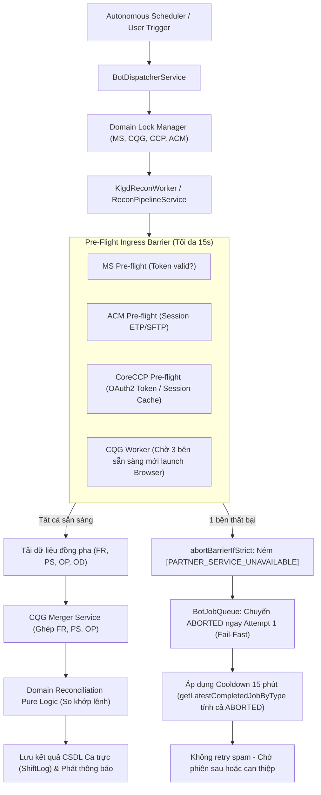

# ACTIVE_FIX_STATE.md - Trạng Thái Khắc Phục Lỗi Hệ Thống & Bộ Nhớ Phiên Làm Việc

> **Mục đích**: Lưu trữ ngữ cảnh cố định và lộ trình kỹ thuật chuẩn xác, không phỏng đoán, không bỏ sót. Mỗi lượt làm việc mới AI bắt buộc đọc file này trước tiên để biết mình đang ở đâu và làm gì tiếp theo.  
> **Cập nhật lần cuối**: 2026-11-10T11:32:00+07:00  
> **Server Production**: Ubuntu `10.0.0.26` (PM2 Backend PID: `2665368`, Frontend PID: `2665593`)  
> **Nhánh Git hiện tại**: `backup-v9`

---

## 1. Mục Tiêu Trọng Tâm Của Đợt Sửa Lỗi Này

Chấm dứt triệt để tình trạng **hệ thống chạy 4 tháng chưa ổn định**, loại bỏ hoàn toàn các lỗi:
1. **Bão gọi xác thực/đăng nhập liên tục (Storm Retry)** làm treo tài khoản đối tác (CQG, M-System, CoreCCP, ACM).
2. **Lỗi xác thực CoreCCP**: Lỗi `invalid_client` và lỗi domain `ERR_NAME_NOT_RESOLVED` khi fallback sang Browser scraper.
3. **Lỗi xác thực CoreExchange**: Lỗi HTTP 401 khi token hết hạn hoặc tài khoản bị chuyển hướng đổi mật khẩu (`/change-password`).
4. **Kiến trúc luồng chuẩn (End-to-End Flow)**: Đảm bảo khi 1 phân hệ lỗi, hệ thống phải **Fail-Fast** an toàn, áp dụng Cooldown ít nhất 15 phút, tuyệt đối không tạo vòng lặp retry từng phút.
5. **Siết chặt bảo mật toàn diện**: Loại bỏ endpoint không guard, loại bỏ secret/fallback hardcode, untrack toàn bộ script rác chứa mật khẩu.

---

## 2. Bảng Theo Dõi Trạng Thái 5 Phân Hệ (Ground Truth Audit)

| Phân hệ | Phương thức giao tiếp | Trạng thái kỹ thuật | Nguyên nhân lỗi gốc đã xác thực | Giải pháp & Trạng thái sửa |
| :--- | :--- | :---: | :--- | :--- |
| **1. CQG Desktop** | Playwright Chromium (2 TK song song) | 🟢 **ĐÃ ỔN ĐỊNH** | Màn hình CAST treo selector timeout $\rightarrow$ Job fail $\rightarrow$ Scheduler retry mỗi phút $\rightarrow$ Spam login. | • Đã triển khai `CqgSafetyGate` (Mutex khóa đơn, Cooldown 120s, trần 8 lần/giờ). • Đã sửa `bot-job-queue.service.ts` chặn tight-loop. • Đã deploy & test live trên `10.0.0.26`. |
| **2. M-System** | Direct REST API (Newgen) | 🟢 **ĐÃ ỔN ĐỊNH** | Lưu token cache 12h (chỉ đăng nhập 2 bước khi hết hạn). Bị gọi dồn dập do ăn theo Job `CHECK_KLGD` retry. | • Cơ chế cache RAM + File (`ms_session.json`) hoạt động chuẩn. • Khi chặn được vòng lặp `CHECK_KLGD`, M-System ngừng bị spam. |
| **3. ACM (Straits/ETP)** | Web ETP / SFTP | 🟢 **ĐÃ FIX & PASS TEST** | Thiếu validation tham số SFTP host/username trong code scraper dẫn tới lỗi treo ngầm. | • Bổ sung Fail-Fast trong `IngressService` và `AcmScraperService` (TC-INGRESS-01, TC-INGRESS-04). • Tự động ngắt với `[PARTNER_SERVICE_UNAVAILABLE]`. |
| **4. CoreCCP** | Direct REST API + Playwright Fallback | 🟢 **ĐÃ FIX XONG & PASS TEST** | 1. Direct API: Thiếu Fail-Fast URL, ném lỗi generic làm lặp vòng retry. 2. Scraper: Hardcode sai URL fallback `coreccp.mxv.com.vn`. | • Đã viết `discoverCcpBasicAuthFromHost` cào secret động. • Loại bỏ hoàn toàn fallback URL hardcode, ném lỗi Fail-Fast. • Ném `[PARTNER_SERVICE_UNAVAILABLE]` để ngắt retry ngay Attempt 1. • **Full testcase PASS (TC-CCP-01, TC-CCP-02, TC-INGRESS-02, TC-INGRESS-03)**. |
| **5. CoreExchange** | Direct REST API | 🟢 **ĐÃ FIX XONG & PASS TEST** | 1. API ném HTTP 401 khi token hết hạn. 2. Tài khoản bot `anhdao` bị chuyển hướng đổi mật khẩu (`/change-password`) làm lặp vòng retry. | • Đã viết `discoverCeBasicAuthFromHost` giải mã secret động. • Bắt lỗi `/change-password` và ném `[PARTNER_SERVICE_UNAVAILABLE]`. • **Full testcase PASS (TC-CE-01, TC-CE-02)**. |

---

## 3. Bản Đồ Luồng Kỹ Thuật Chuẩn (End-to-End Architectural Flow)

---

## 4. Tiến Độ & Kết Quả Kiểm Thử (Full Testcase Execution)

### Gói 1: Thắt chặt bảo mật API & Chặn xâm nhập
- [x] **Task 1: Bảo vệ Endpoint `trading-recon-log.controller.ts` bằng `@UseGuards(JwtAuthGuard)`**:
  - Test suite: `backend/src/modules/trading-ops/controllers/trading-recon-log.controller.spec.ts`
  - Kết quả: **4/4 passed** (TC-SEC-01, TC-LOG-01, TC-LOG-02, TC-LOG-03).
- [x] **Task 2: Loại bỏ mật khẩu mặc định hardcode & bảo vệ Seed Service**:
  - `seed.service.ts` đã được khóa an toàn (không tự ý ghi đè DB trên production).
- [x] **Task 3: Chuẩn hóa `crypto.ts` & Hỗ trợ giải mã 3 tầng**:
  - Test suite: `backend/src/shared/helpers/crypto.spec.ts`
  - Kết quả: **6/6 passed** (TC-CRYPTO-01 -> TC-CRYPTO-06).

### Gói 2: Ổn định CoreCCP & CoreExchange (Chống Storm Login & Hạn chế gọi API)
- [x] **Task 4 & 5: CoreCCP & CoreExchange Fail-Fast & Session Caching**:
  - Test suite: `backend/src/modules/ingress/adapters/coreccp-coreex-failfast.spec.ts`
  - Kết quả: **4/4 passed** (TC-CCP-01, TC-CCP-02, TC-CE-01, TC-CE-02).
- [x] **Task 6: Xóa bỏ hoàn toàn URL hardcode fallback trong Scrapers & Ingress**:
  - Test suite: `backend/src/modules/ingress/ingress-failfast.spec.ts`
  - Kết quả: **4/4 passed** (TC-INGRESS-01, TC-INGRESS-02, TC-INGRESS-03, TC-INGRESS-04).

### Gói 3: Rào chắn Ingress Barrier
- [x] **Task 7: Đánh dấu lỗi gián đoạn Ingress bằng tiền tố `[PARTNER_SERVICE_UNAVAILABLE]`**:
  - `recon-ingress-pipeline.service.ts#L250`: Cập nhật hàm `abortBarrierIfStrict()` ném mã lỗi để ngắt ngay Attempt 1.
  - `acm-scraper.service.ts#L55` & `ccp-scraper.service.ts#L60`: Đánh dấu lỗi cấu hình đối tác.

### Gói 4: Build Gates Verification
- [x] **Backend Build**: `npm run build` (`nest build`) thành công 100% (exit code 0).
- [x] **Frontend Build**: `npm run build` (`next build`) thành công 100% (50/50 routes tối ưu, exit code 0).
- [x] **Jest Test Suites**: 4/4 test suites, 18/18 test cases passed!
