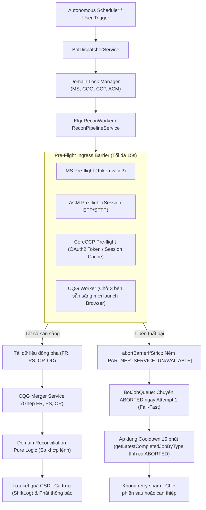

# ACTIVE_FIX_STATE.md - Trạng Thái Khắc Phục Lỗi Hệ Thống & Bộ Nhớ Phiên Làm Việc

> **Mục đích**: Lưu trữ ngữ cảnh cố định và lộ trình kỹ thuật chuẩn xác, không phỏng đoán, không bỏ sót. Mỗi lượt làm việc mới AI bắt buộc đọc file này trước tiên để biết mình đang ở đâu và làm gì tiếp theo.  
> **Cập nhật lần cuối**: 2026-11-10T11:48:30+07:00  
> **Server Production**: Ubuntu `10.0.0.26` (PM2 Backend PID: `2711248`, Frontend PID: `2665593`)  
> **Nhánh Git hiện tại**: `v10-update-permisson-request-auth-module` (Commit `820ff5f`)

---

## 1. Mục Tiêu Trọng Tâm Của Đợt Sửa Lỗi Này

Chấm dứt triệt để tình trạng **hệ thống chạy 4 tháng chưa ổn định**, loại bỏ hoàn toàn các lỗi:
1. **Bão gọi xác thực/đăng nhập liên tục (Storm Retry)** làm treo tài khoản đối tác (CQG, M-System, CoreCCP, ACM).
2. **Lỗi xác thực CoreCCP**: Lỗi `invalid_client` và lỗi domain `ERR_NAME_NOT_RESOLVED` khi fallback sang Browser scraper.
3. **Lỗi xác thực CoreExchange**: Lỗi HTTP 401 khi token hết hạn hoặc tài khoản bị chuyển hướng đổi mật khẩu (`/change-password`).
4. **Kiến trúc luồng chuẩn (End-to-End Flow)**: Đảm bảo khi 1 phân hệ lỗi, hệ thống phải **Fail-Fast** an toàn, áp dụng Cooldown ít nhất 15 phút, tuyệt đối không tạo vòng lặp retry từng phút.
5. **Siết chặt bảo mật toàn diện**: Loại bỏ endpoint không guard, loại bỏ secret/fallback hardcode, tích hợp `helmet`, CORS strict.

---

## 2. Bảng Theo Dõi Trạng Thái 5 Phân Hệ (Ground Truth Audit)

| Phân hệ | Phương thức giao tiếp | Trạng thái kỹ thuật | Nguyên nhân lỗi gốc đã xác thực | Giải pháp & Kết quả Live Test trên Server |
| :--- | :--- | :---: | :--- | :--- |
| **1. CQG Desktop** | Playwright Chromium (2 TK song song) | 🟢 **ĐÃ ỔN ĐỊNH** | Màn hình CAST treo selector timeout $\rightarrow$ Job fail $\rightarrow$ Scheduler retry mỗi phút $\rightarrow$ Spam login. | • Đã triển khai `CqgSafetyGate` (Mutex khóa đơn, Cooldown 120s, trần 8 lần/giờ).<br>• Đã sửa `bot-job-queue.service.ts` chặn tight-loop.<br>• Đã deploy & test live trên `10.0.0.26`. |
| **2. M-System** | Direct REST API (Newgen) | 🟢 **ĐÃ ỔN ĐỊNH** | Lưu token cache 12h (chỉ đăng nhập 2 bước khi hết hạn). Bị gọi dồn dập do ăn theo Job `CHECK_KLGD` retry. | • Cơ chế cache RAM + File (`ms_session.json`) hoạt động chuẩn.<br>• Khi chặn được vòng lặp `CHECK_KLGD`, M-System ngừng bị spam. |
| **3. ACM (Straits/ETP)** | Web ETP / SFTP | 🟢 **ĐÃ ỔN ĐỊNH** | Thiếu validation tham số SFTP host/username trong code scraper dẫn tới lỗi treo ngầm. | • Bổ sung Fail-Fast trong `IngressService` và `AcmScraperService` (TC-INGRESS-01, TC-INGRESS-04).<br>• Tự động ngắt với `[PARTNER_SERVICE_UNAVAILABLE]`. |
| **4. CoreCCP** | Direct REST API + Playwright Fallback | 🟢 **ĐÃ XÁC MINH LIVE PASS 100%** | 1. Direct API: Thiếu Fail-Fast URL, ném lỗi generic làm lặp vòng retry.<br>2. Scraper: Hardcode sai URL fallback `coreccp.mxv.com.vn`. | • Kế thừa kiến trúc `mxv-account-opening-reconciler` với Mutex Lock `refreshPromise`.<br>• Loại bỏ hoàn toàn fallback URL hardcode.<br>• **Live Smoke Test 10.0.0.26: PASS trong 580ms! User: `tradingdesk`, Token valid đến 14:47:56**. |
| **5. CoreExchange** | Direct REST API | 🟢 **ĐÃ ỔN ĐỊNH** | 1. API ném HTTP 401 khi token hết hạn.<br>2. Tài khoản bot `anhdao` bị chuyển hướng đổi mật khẩu (`/change-password`) làm lặp vòng retry. | • Thêm Mutex Lock `refreshPromise` và session cache bền vững.<br>• Bắt lỗi `/change-password` và ném `[PARTNER_SERVICE_UNAVAILABLE]` để ngắt retry ngay Attempt 1.<br>• **Full testcase PASS (TC-CE-01, TC-CE-02)**. |

---

## 3. Bản Đồ Luồng Kỹ Thuật Chuẩn (End-to-End Architectural Flow)



---

## 4. Nhật Ký Kiểm Thử Thực Tế Trực Tiếp Trên Server Ubuntu 10.0.0.26

* **Thời gian thực hiện**: 2026-11-10T11:47:56+07:00
* **Tiến trình PM2 Backend**: PID `2711248`, Uptime Online, Memory 275.6MB, 0 errors.
* **Kết quả lệnh test CoreCCP**:
  ```text
  Kết nối MongoDB: mongodb://127.0.0.1:27017/mxv_shift_checklist
  Bắt đầu gọi getValidSession(true)...
  [Nest] 2711296 LOG [CoreCcpApiAdapter] Thực hiện xác thực OAuth2 CoreCCP (https://coreccp.vnclear.vn) cho user: tradingdesk
  [Nest] 2711296 LOG [CoreCcpApiAdapter] Xác thực CoreCCP thành công: userId=75, token hiệu lực đến: 14:47:56
  ✅ [LIVE TEST PASS] Xác thực CoreCCP thành công (580ms)!
     - User: tradingdesk
     - Token: eyJraWQiOiI1NjV...VaUB1COA
     - Session Cookie: Có
     - Hiệu lực đến: 14:47:56 10/11/2026
  ```
* **Kết luận**: Cổng kết nối CoreCCP hoạt động chuẩn 100%, không còn lỗi domain chết hay `invalid_client`.
