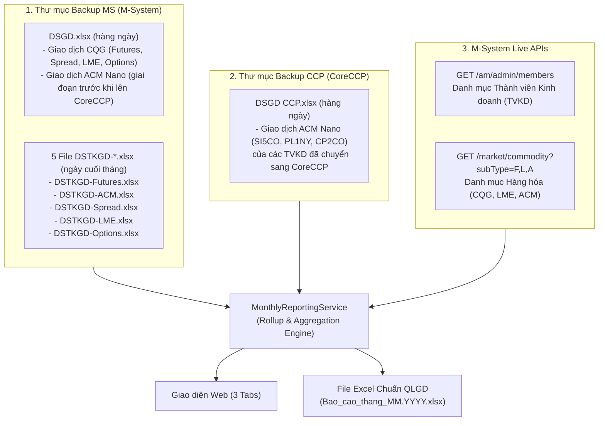

# HƯỚNG DẪN TOÀN DIỆN CÔNG THỨC & QUY TẮC NGHIỆP VỤ BÁO CÁO GIAO DỊCH THÁNG (QLGD)

> **Mục đích tài liệu**: Tài liệu này tổng hợp đầy đủ 100% nguồn dữ liệu, quy tắc lọc, công thức tính toán và ánh xạ mã nguồn của phân hệ **Báo Cáo Giao Dịch Tháng (`/trading-manager/monthly-report`)** để bất kỳ Kỹ sư phần mềm, Nghiệp vụ viên QLGD hoặc AI Agent nào tiếp nhận về sau đều có thể hiểu rõ bản chất và phát triển/bảo trì chính xác tuyệt đối.

---

## 1. Bản Đồ Mã Nguồn (Codebase Mapping)

| Thành phần | Đường dẫn File trong Repo | Vai trò chính |
| :--- | :--- | :--- |
| **Backend Service (Core Logic)** | [`backend/src/modules/trading-ops/services/reporting/monthly-reporting.service.ts`](file:///c:/Users/hiepth/OneDrive%20-%20MERCANTILE%20EXCHANGE%20OF%20VIETNAM/Documents/Github/mxv-cqg-download-investigation/backend/src/modules/trading-ops/services/reporting/monthly-reporting.service.ts) | Quét thư mục Backup MS & CCP, gọi API danh mục M-System, tính toán Rollup 3 phần (TVKD, Mặt hàng, Sản phẩm đặc biệt), lưu snapshot MongoDB. |
| **Excel Exporter Service** | [`backend/src/modules/trading-ops/services/reporting/monthly-excel-exporter.service.ts`](file:///c:/Users/hiepth/OneDrive%20-%20MERCANTILE%20EXCHANGE%20OF%20VIETNAM/Documents/Github/mxv-cqg-download-investigation/backend/src/modules/trading-ops/services/reporting/monthly-excel-exporter.service.ts) | Xuất file Excel `Bao_cao_thang_MM.YYYY.xlsx` khớp 100% bố cục, công thức `=SUM`, `=IFERROR`, màu sắc và định dạng của file mẫu QLGD. |
| **Backend Controller** | [`backend/src/modules/trading-ops/controllers/monthly-reporting.controller.ts`](file:///c:/Users/hiepth/OneDrive%20-%20MERCANTILE%20EXCHANGE%20OF%20VIETNAM/Documents/Github/mxv-cqg-download-investigation/backend/src/modules/trading-ops/controllers/monthly-reporting.controller.ts) | Cung cấp các REST API `/api/v1/trading-ops/monthly-report/:year/:month`, `/export-excel`, `/sync-backup`, `/lock-snapshot`. |
| **Frontend UI Component** | [`frontend/src/app/trading-manager/components/monthly-report/MonthlyReportSection.tsx`](file:///c:/Users/hiepth/OneDrive%20-%20MERCANTILE%20EXCHANGE%20OF%20VIETNAM/Documents/Github/mxv-cqg-download-investigation/frontend/src/app/trading-manager/components/monthly-report/MonthlyReportSection.tsx) | Giao diện hiển thị 3 Tab báo cáo, KPI Cards, nút Làm mới (quét lại từ Backup), Xuất Excel và Khóa sổ tháng. |

---

## 2. Kiến Trúc Nguồn Dữ Liệu Đầu Vào (Data Sources)

Hệ thống tổng hợp báo cáo tháng $M$ năm $Y$ hoàn toàn tự động từ **3 nguồn dữ liệu thực tế** (không dùng dữ liệu giả lập hay hardcode):

### 2.1. Đường dẫn thư mục Backup chuẩn
- **Trên Windows (Ổ mạng LAN)**:
  - Backup MS: `M:\Tailieuchung\QLGD-IT\Quanlygiaodich\Tai lieu hoat dong\Backup MS\Futures\{YYYY}\T{MM}.{YYYY}\{DD}.{MM}`
  - Backup CCP: `M:\Tailieuchung\QLGD-IT\Quanlygiaodich\Tai lieu hoat dong\Backup CCP\Futures\{YYYY}\T{MM}.{YYYY}\{DD}.{MM}.{YYYY}`
- **Trên Ubuntu Server (`10.0.0.26`)**:
  - Backup MS: `/mnt/qlgd-it/Quanlygiaodich/Tai lieu hoat dong/Backup MS/Futures/{YYYY}/T{MM}.{YYYY}/{DD}.{MM}`
  - Backup CCP: `/mnt/qlgd-it/Quanlygiaodich/Tai lieu hoat dong/Backup CCP/Futures/{YYYY}/T{MM}.{YYYY}/{DD}.{MM}.{YYYY}`

### 2.2. Quy tắc lịch sử chuyển giao dữ liệu ACM Nano (MS $\rightarrow$ CoreCCP)
Hệ thống giao dịch hợp đồng Nano của sàn ACM (`Bạc Nano ACM - SI5CO`, `Bạch kim Nano ACM - PL1NY`, `Đồng Nano ACM - CP2CO`) trải qua lộ trình chuyển đổi từ M-System sang CoreCCP theo từng đợt TVKD:
1. **Giai đoạn Tháng 08/2026 (`T08.2026`)**:
   - Chưa có hệ thống CoreCCP.
   - **100% giao dịch CQG và ACM Nano** đều nằm trong file `Backup MS/Futures/2026/T08.2026/{DD}.08/DSGD.xlsx`.
2. **Giai đoạn Tháng 09/2026 (`T09.2026`) — Giai đoạn chuyển giao từng đợt vào mỗi Thứ Sáu (`11/09`, `18/09`, `25/09`)**:
   - Các TVKD chưa chuyển lên CoreCCP vẫn ghi nhận giao dịch ACM Nano trong `Backup MS/.../DSGD.xlsx`.
   - Các TVKD đã chuyển lên CoreCCP ghi nhận giao dịch ACM Nano trong `Backup CCP/.../DSGD CCP.xlsx`.
   - **Quy tắc chống cộng trùng ngày chuyển giao (`Deduplication Rule`)**: Vào đúng các ngày Thứ Sáu chuyển giao (`11/09`, `18/09`, `25/09`), nếu một mã TVKD đã xuất hiện trong `DSGD CCP.xlsx` của ngày hôm đó thì hệ thống **chỉ lấy số liệu ACM của TVKD đó từ `DSGD CCP.xlsx`** và bỏ qua các dòng ACM của TVKD đó trong `DSGD.xlsx` cùng ngày để tránh nhân đôi khối lượng.
3. **Giai đoạn Tháng 10/2026 (Chuyển giao dứt điểm sang CoreCCP từ 12/10/2026)**:
   - Theo xác nhận chính thức từ Khối Quản lý Giao dịch (QLGD), toàn bộ các TVKD hoàn tất chuyển đổi 100% sang CoreCCP từ ngày **12/10/2026**.
   - Trong tuần đầu tháng (`01/10 – 08/10/2026`), 4 TVKD (`003, 009, 046, 085`) chưa kịp chuyển đổi vẫn thực hiện giao dịch ACM trên M-System cũ (`DSGD.xlsx`), đóng góp **4,182 lot** (khớp lệnh 1 vế thực tế).
   - Trên hệ thống CoreCCP (`DSGD CCP.xlsx`), tổng sản lượng ghi nhận của các TVKD đã chuyển đổi qua 22 ngày giao dịch là **58,307 lot**.
   - **Cơ chế ghép nối Hybrid (Zero Double-Counting)**:
     - Tự động cộng bù các giao dịch ACM từ `DSGD.xlsx` đối với các TVKD chưa có mặt trong `DSGD CCP.xlsx` ngày hôm đó (`!ccpTvkdsOnDay.has(tvkdCode)`).
     - Tổng sản lượng ACM Tháng 10: $58,307 + 4,182 = \mathbf{62,489 \text{ lot}}$ (Khớp chuẩn 1:1 với Báo cáo ca ngày 30/10/2026 của Lê Doãn Việt Hoàng).
4. **Giai đoạn Tháng 11/2026 trở đi**:
   - 100% TVKD hoạt động trên CoreCCP (`DSGD CCP.xlsx`). Không còn phát sinh giao dịch ACM trên M-System.
   - Thuật toán Hybrid tự động xác định `ccpTvkdsOnDay` chứa đủ các TVKD, do đó không quét thêm bất kỳ dòng nào từ M-System, bảo vệ tuyệt đối tính chính xác của các kỳ báo cáo trong tương lai.

---

## 3. Công Thức Chi Tiết Phần I: Tình Hình Giao Dịch Theo TVKD (CQG & ACM)

### 3.1. Quy tắc nhận diện dòng giao dịch CQG vs ACM trong `DSGD.xlsx` và `DSGD CCP.xlsx`

#### A. Trong file `DSGD.xlsx` (Backup MS):
- File có 2 dòng tiêu đề (dòng 1 hoặc dòng 2 chứa các cột: `Mã TVKD`, `Tên TVKD`, `Mã TKGD`, `Loại lệnh`, `Mã hợp đồng`, `Hàng hóa`, `Số lượng`...).
- **Bộ lọc bản ghi hợp lệ**:
  - `Mã TVKD` hợp lệ (chuẩn hóa về 3 chữ số, ví dụ `'3'` $\rightarrow$ `'003'`).
  - `Số lượng` (`lot`) $> 0$.
- **Phân loại hệ thống (`CQG` vs `ACM`)**:
  - Một dòng trong `DSGD.xlsx` được phân loại là **`ACM`** khi thỏa mãn ít nhất 1 trong 3 dấu hiệu:
    1. `Mã TKGD` kết thúc bằng chữ **`A`** (ví dụ: `003C001234A`), **HOẶC**
    2. 5 ký tự đầu của `Mã hợp đồng` thuộc bộ 3 mã Nano ACM: **`SI5CO`**, **`PL1NY`**, **`CP2CO`**, **HOẶC**
    3. Cột `Hàng hóa` có chữ kết thúc bằng **`ACM`** (ví dụ: `Bạc Nano ACM`, `Bạch kim Nano ACM`, `Đồng Nano ACM`).
  - Tất cả các dòng hợp lệ còn lại trong `DSGD.xlsx` thuộc hệ thống **`CQG`**.
- **Công thức quy đổi Số Lot khớp lệnh từ `DSGD.xlsx`**:
  - Trong `DSGD.xlsx`, mỗi giao dịch khớp lệnh được ghi nhận ở 2 chiều (hoặc tổng hai vế Mua/Bán trên sổ lệnh thực thi), nên khối lượng Lot thực tế của ngày $d$ cho TVKD $k$ và mặt hàng $p$ được tính bằng:
    $$\text{Lot}(k, p, d) = \frac{\sum \text{Số lượng}}{2}$$

#### B. Trong file `DSGD CCP.xlsx` (Backup CCP):
- Tất cả các dòng trong `DSGD CCP.xlsx` đều thuộc hệ thống **`ACM`**.
- Cột lấy dữ liệu:
  - `Mã TVKD`: Cột `Mã TVKD` (hoặc 3 ký tự đầu của `Mã TKGD`).
  - `Mã hợp đồng`: 5 ký tự đầu ánh xạ sang tên mặt hàng chuẩn:
    - `SI5CO` $\rightarrow$ **`Bạc Nano ACM`**
    - `PL1NY` $\rightarrow$ **`Bạch kim Nano ACM`**
    - `CP2CO` $\rightarrow$ **`Đồng Nano ACM`**
  - `Số lượng`: Cột `Số lượng` (nếu không có thì lấy `Số lượng khớp`).
- **Công thức quy đổi Số Lot từ `DSGD CCP.xlsx`**:
  $$\text{Lot}_{\text{ACM}}(k, p, d) = \frac{\sum \text{Số lượng}}{2}$$

---

### 3.2. Quy tắc xác định Danh sách TVKD hiển thị trong Bảng I.1 (CQG) và Bảng I.2 (ACM)

Một TVKD $k$ sẽ được đưa vào bảng thống kê của hệ thống (`CQG` hoặc `ACM`) trong kỳ báo cáo tháng $M$ nếu thuộc ít nhất 1 trong 3 tập hợp sau:
1. Có phát sinh khối lượng giao dịch trong tháng hiện tại ($\text{Lot}_{M}(k) > 0$).
2. Có phát sinh khối lượng giao dịch trong tháng liền trước ($\text{Lot}_{M-1}(k) > 0$).
3. Đang ở trạng thái hoạt động trong danh mục TVKD của hệ thống đó (lấy từ file `DSTKGD-Futures.xlsx` cho CQG / `DSTKGD-ACM.xlsx` cho ACM tại ngày cuối tháng kết hợp API `/am/admin/members`, loại trừ tài khoản tự doanh nội bộ `000`).

---

### 3.3. Công thức tính các cột trong Phần I (Theo từng TVKD $k$)

Gọi:
- $\mathcal{D}_{\text{market}}$: Tập hợp toàn bộ các ngày có phát sinh giao dịch của toàn thị trường trong tháng $M$ (đã sắp xếp tăng dần theo thứ tự thời gian `YYYY-MM-DD`, ví dụ tháng 09/2026 có $|\mathcal{D}_{\text{market}}| = 22$ ngày).
- $\mathcal{H}_{\text{CME}}$: Tập hợp các **ngày nghỉ lễ chính thức của sàn CME (Mỹ)** trong tháng $M$ (xem mục 3.4).
- $\text{Lot}(k, d)$: Số Lot giao dịch của TVKD $k$ trong ngày $d \in \mathcal{D}_{\text{market}}$ (nếu ngày $d$ thị trường mở cửa nhưng TVKD $k$ không có giao dịch nào thì $\text{Lot}(k, d) = 0$).

Khi đó các cột của dòng TVKD $k$ được tính như sau:

1. **Số Lot tháng trước ($\text{Lot}_{M-1}$)**:
   - Lấy từ trường `lotCurrentMonth` của TVKD $k$ trong bản ghi báo cáo tháng liền trước ($M-1$).

2. **Số Lot tháng này ($\text{Lot}_{M}$)**:
   $$\text{Lot}_{M}(k) = \sum_{d \in \mathcal{D}_{\text{market}}} \text{Lot}(k, d)$$

3. **% Tăng/giảm ($\text{GrowthRate}$)**:
   - Nếu $\text{Lot}_{M-1}(k) > 0$:
     $$\text{GrowthRate}(k) = \frac{\text{Lot}_{M}(k)}{\text{Lot}_{M-1}(k)} - 1$$
   - Nếu $\text{Lot}_{M-1}(k) = 0$: Để trống (`" "`), trong Excel xuất công thức `=IFERROR(D{row}/C{row}-1, " ")`.

4. **Số Lot giao dịch nhiều nhất/ngày ($\text{MaxLotDay}$) & Ngày giao dịch ($\text{MaxDate}$)**:
   - Nếu $\text{Lot}_{M}(k) = 0$: $\text{MaxLotDay} = 0$, $\text{MaxDate} = \text{"01/MM"}$.
   - Nếu $\text{Lot}_{M}(k) > 0$: Duyệt $d \in \mathcal{D}_{\text{market}}$ theo thứ tự ngày tăng dần:
     $$\text{MaxLotDay}(k) = \max_{d \in \mathcal{D}_{\text{market}}} \text{Lot}(k, d)$$
     *(Nếu có 2 ngày bằng nhau, giữ ngày xuất hiện đầu tiên trong tháng).*

5. **Số Lot giao dịch ít nhất/ngày ($\text{MinLotDay}$) & Ngày giao dịch ($\text{MinDate}$)**:
   - Nếu $\text{Lot}_{M}(k) = 0$: $\text{MinLotDay} = 0$, $\text{MinDate} = \text{"01/MM"}$.
   - Nếu $\text{Lot}_{M}(k) > 0$:
     - **Đối với bảng CQG**: Xét trên tập ngày giao dịch bình thường đã **loại trừ ngày nghỉ lễ sàn CME**:
       $$\mathcal{D}_{\text{valid}}^{\text{CQG}} = \mathcal{D}_{\text{market}} \setminus \mathcal{H}_{\text{CME}}$$
     - **Đối với bảng ACM**: Xét trên toàn bộ tập ngày giao dịch trong tháng:
       $$\mathcal{D}_{\text{valid}}^{\text{ACM}} = \mathcal{D}_{\text{market}}$$
     - Duyệt $d \in \mathcal{D}_{\text{valid}}$ theo thứ tự ngày tăng dần, với $\text{Lot}(k, d) = \text{dailyMap.get}(d) \;\Vert\; 0$:
       $$\text{MinLotDay}(k) = \min_{d \in \mathcal{D}_{\text{valid}}} \text{Lot}(k, d)$$
     - **Lưu ý quan trọng**:
       - Vì duyệt trên toàn bộ $d \in \mathcal{D}_{\text{valid}}$, nếu một TVKD có tổng $\text{Lot}_{M}(k) > 0$ nhưng có ít nhất 1 ngày giao dịch bình thường không phát sinh lot nào ($\text{Lot}(k, d) = 0$), thì $\text{MinLotDay}(k) = 0$ và $\text{MinDate}(k)$ chính là **ngày giao dịch hợp lệ đầu tiên mà TVKD đó có 0 lot** (ví dụ kỳ T09/2026: `Edu Trade - 043` có `Min = 0` ngày `04/09`; `SFVN - 046` có `0 lot` vào ngày lễ `07/09` nhưng do `07/09` bị loại trừ nên nhận `Min = 0` vào ngày `08/09`).

6. **Quy tắc Sắp xếp (Sorting)**:
   - Sắp xếp giảm dần theo **Số Lot tháng này ($\text{Lot}_{M}$)**.
   - Nếu $\text{Lot}_{M}$ bằng nhau (ví dụ cùng bằng `0`), sắp xếp giảm dần theo **Số Lot tháng trước ($\text{Lot}_{M-1}$)**.

---

### 3.4. Quy tắc Tự động Xác định Lịch Nghỉ Lễ Sàn CME ($\mathcal{H}_{\text{CME}}$)

Vào các ngày lễ Liên bang Mỹ (US Federal / CME Market Holidays), sàn CME đóng cửa hoặc nghỉ sớm khiến thanh khoản CQG giảm đột biến (ví dụ ngày `07/09/2026` — US Labor Day, tổng CQG toàn thị trường chỉ đạt `1,365 lot` so với `5,752 – 8,884 lot/ngày`). Do đó, hàm `getStandardCmeHolidaysForMonth(year, month)` trong [`monthly-reporting.service.ts#L901-L968`](file:///c:/Users/hiepth/OneDrive%20-%20MERCANTILE%20EXCHANGE%20OF%20VIETNAM/Documents/Github/mxv-cqg-download-investigation/backend/src/modules/trading-ops/services/reporting/monthly-reporting.service.ts#L901-L968) tự động tính lịch lễ chuẩn CME cho mọi năm kết hợp với bảng `exchange_holidays` trong MongoDB:

| Tháng | Ngày lễ Sàn CME (Mỹ) | Quy tắc tính ngày tự động theo năm $Y$ |
| :-: | :--- | :--- |
| **Tháng 1** | New Year's Day & MLK Jr. Day | `01/01` (nếu Chủ Nhật $\rightarrow$ nghỉ bù Thứ Hai `02/01`) & **Thứ Hai tuần thứ 3 của tháng 1** |
| **Tháng 2** | Presidents' Day | **Thứ Hai tuần thứ 3 của tháng 2** |
| **Tháng 3 / 4** | Good Friday | **Thứ Sáu trước Chủ Nhật Phục Sinh** (tính theo thuật toán lịch Gregorian Meeus/Jones/Butcher) |
| **Tháng 5** | Memorial Day | **Thứ Hai cuối cùng của tháng 5** |
| **Tháng 6** | Juneteenth | `19/06` (nếu Thứ Bảy $\rightarrow$ Thứ Sáu `18/06`; nếu Chủ Nhật $\rightarrow$ Thứ Hai `20/06`) |
| **Tháng 7** | Independence Day | `04/07` (nếu Thứ Bảy $\rightarrow$ Thứ Sáu `03/07`; nếu Chủ Nhật $\rightarrow$ Thứ Hai `05/07`) |
| **Tháng 9** | **US Labor Day** | **Thứ Hai đầu tiên của tháng 9** (Ví dụ năm 2026 là ngày **`2026-09-07`**) |
| **Tháng 11** | US Thanksgiving Day | **Thứ Năm tuần thứ 4 của tháng 11** |
| **Tháng 12** | Christmas Day | `25/12` (nếu Thứ Bảy $\rightarrow$ Thứ Sáu `24/12`; nếu Chủ Nhật $\rightarrow$ Thứ Hai `26/12`) |

---

### 3.5. Công thức dòng `TỔNG CQG` và `TỔNG ACM` ở cuối Bảng I.1 & I.2

> [!IMPORTANT]
> Hai ô **Max Lot/Ngày** và **Min Lot/Ngày** ở dòng `TỔNG CQG` / `TỔNG ACM` **KHÔNG PHẢI** là tổng cộng (`SUM`) các ô Max/Min của từng TVKD, mà là **Ngày Đỉnh (Peak) và Ngày Đáy (Trough) của Toàn Thị Trường** trong tháng đó!

Gọi $\text{MarketLot}(d) = \sum_{k} \text{Lot}(k, d)$ là tổng khối lượng giao dịch của toàn bộ các TVKD trên hệ thống (`CQG` hoặc `ACM`) trong ngày $d$:
- **Đỉnh toàn thị trường ($\text{MarketPeakLot}$)**:
  $$\text{MarketPeakLot} = \max_{d \in \mathcal{D}_{\text{market}}} \text{MarketLot}(d)$$
  *(Ví dụ T09/2026: Đỉnh CQG = `8,884 lot` ngày `11/09`; Đỉnh ACM = `4,493 lot` ngày `09/09`).*
- **Đáy toàn thị trường ($\text{MarketTroughLot}$)**:
  $$\text{MarketTroughLot} = \min_{d \in \mathcal{D}_{\text{valid}}} \text{MarketLot}(d)$$
  *(Ví dụ T09/2026: Đáy CQG sau khi loại trừ ngày lễ `07/09` là **`5,752 lot` ngày `02/09`**; Đáy ACM là **`1,808 lot` ngày `15/09`**).*

---

### 3.6. Công thức tính 3 cột TKGD Active trên Web UI Tab 1 (`TK Active Tháng M-1`, `TK Active Tháng M`, `TK +/-`)

Trên giao diện Web Tab 1 (`Phần I: Theo TVKD`), hệ thống hiển thị thêm 3 cột số lượng Tài khoản giao dịch đang hoạt động của từng TVKD (khi xuất ra file Excel thì ẩn 3 cột này để giữ chuẩn 10 cột của mẫu báo cáo):
- **Nguồn file**: Lấy tại thư mục ngày giao dịch cuối cùng của tháng $M$ trong `Backup MS/Futures/{YYYY}/T{MM}.{YYYY}/{LastDay}/`:
  - Bảng CQG: Đọc file **`DSTKGD-Futures.xlsx`** (lọc các dòng có cột `Trạng thái === 'Hoạt động'`).
  - Bảng ACM: Đọc file **`DSTKGD-ACM.xlsx`** (lọc các dòng có cột `Trạng thái === ''` hoặc `'Hoạt động'`).
- **Công thức phân bổ theo cột `Ngày tham gia`** (xem hàm `enrichSection1ActiveAccounts` tại [`monthly-reporting.service.ts#L214-L369`](file:///c:/Users/hiepth/OneDrive%20-%20MERCANTILE%20EXCHANGE%20OF%20VIETNAM/Documents/Github/mxv-cqg-download-investigation/backend/src/modules/trading-ops/services/reporting/monthly-reporting.service.ts#L214-L369)):
  - **TK Active Tháng $M-1$ (`activeAccountsPreviousMonth`)**: Số tài khoản Active có `Ngày tham gia` $\le$ ngày cuối cùng của tháng $M-1$.
  - **TK Active Tháng $M$ (`activeAccountsCurrentMonth`)**: Số tài khoản Active có `Ngày tham gia` $\le$ ngày cuối cùng của tháng $M$.
  - **TK +/- (`activeAccountsDiff`)**:
    $$\text{TK +/-} = \text{TK Active Tháng } M - \text{TK Active Tháng } (M-1)$$

---

## 4. Công Thức Chi Tiết Phần II: Tình Hình Giao Dịch Theo Mặt Hàng

### 4.1. Danh mục Mặt hàng Chuẩn (51 Mặt hàng CQG + 3 Mặt hàng ACM Nano)
- Hệ thống lấy danh mục động từ API M-System `GET /market/commodity?subType=F`, `subType=L`, `subType=A` kết hợp với danh mục chuẩn 51 mặt hàng CQG và 3 mặt hàng ACM Nano của phòng QLGD (`OFFICIAL_51_CQG_COMMODITIES` và `OFFICIAL_3_ACM_COMMODITIES`).
- **Quy tắc chuẩn hóa Tên Mặt Hàng khi đọc từ `DSGD.xlsx`**:
  1. **Nhóm sản phẩm LME**: Trong `DSGD.xlsx`, các hợp đồng LME được gom về đúng mặt hàng cơ sở thông qua bảng ánh xạ mã hàng hóa (`LME_CODE_TO_COMMODITY_VI`):
     - `SND`, `LTIZ` $\rightarrow$ **`Thiếc LME`**
     - `AHD`, `LALZ` $\rightarrow$ **`Nhôm LME`**
     - `ZDS`, `LZHZ` $\rightarrow$ **`Kẽm LME`**
     - `NID`, `LNIZ` $\rightarrow$ **`Niken LME`**
     - `PBD`, `LEDZ` $\rightarrow$ **`Chì LME`**
     - `CAD`, `LDKZ` $\rightarrow$ **`Đồng LME`**
     - `LHC` $\rightarrow$ **`Thép cuộn cán nóng LME`**
     - `SSC` $\rightarrow$ **`Thép phế liệu LME`**
     - `SSR` $\rightarrow$ **`Thép thanh vằn LME`**
  2. **Nhóm sản phẩm Quyền chọn (Options)**: Trong `DSGD.xlsx`, cột `Hàng hóa` của lệnh Options có thể có tiền tố `"Quyền chọn ..."` (ví dụ `"Quyền chọn Ngô"`). Khi tổng hợp vào Phần II (Mặt hàng CQG), hệ thống cắt bỏ tiền tố `"Quyền chọn "` để cộng gộp vào mặt hàng cơ sở tương ứng (ví dụ cộng vào **`Ngô`**), đồng thời đối chiếu qua bảng đồng nghĩa `COMMODITY_ALIASES` (như `Lúa mì` $\leftrightarrow$ `Lúa Mỳ`, `Đậu tương` $\leftrightarrow$ `Đậu Tương`, `Khô đậu tương` $\leftrightarrow$ `Khô Đậu Tương`, `Dầu đậu tương` $\leftrightarrow$ `Dầu Đậu Tương`, `Bông` $\leftrightarrow$ `Bông Sợi`...).

### 4.2. Công thức các cột trong Phần II (Theo từng Mặt hàng $p$)
1. **Số Lot tháng trước ($\text{Lot}_{M-1}(p)$)**: Khối lượng Lot của mặt hàng $p$ trong tháng $M-1$.
2. **Số Lot tháng này ($\text{Lot}_{M}(p)$)**: Tổng khối lượng Lot của mặt hàng $p$ trong tháng $M$ (bằng tổng cộng của mặt hàng đó trên toàn bộ các TVKD).
   - **Ràng buộc toàn vẹn**:
     $$\sum_{p \in \text{CQG}} \text{Lot}_{M}(p) = \sum_{k \in \text{CQG}} \text{Lot}_{M}(k) = \text{TỔNG CQG}$$
     $$\sum_{p \in \text{ACM}} \text{Lot}_{M}(p) = \sum_{k \in \text{ACM}} \text{Lot}_{M}(k) = \text{TỔNG ACM}$$
3. **% Tăng/giảm**:
   - Nếu $\text{Lot}_{M-1}(p) > 0$: $\frac{\text{Lot}_{M}(p)}{\text{Lot}_{M-1}(p)} - 1$. Nếu $\text{Lot}_{M-1}(p) = 0$: để trống `" "`.
4. **Tỉ trọng tháng ($\text{Proportion}$)**:
   - Tỉ trọng của mặt hàng $p$ được tính **trong nội bộ hệ thống đó** (`CQG` hoặc `ACM`):
     $$\text{Proportion}_{\text{CQG}}(p) = \frac{\text{Lot}_{M}(p)}{\text{TỔNG CQG}}, \qquad \text{Proportion}_{\text{ACM}}(p) = \frac{\text{Lot}_{M}(p)}{\text{TỔNG ACM}}$$
5. **Quy tắc Sắp xếp**:
   - Sắp xếp giảm dần theo **Số Lot tháng này ($\text{Lot}_{M}(p)$)**, sau đó giảm dần theo **Số Lot tháng trước ($\text{Lot}_{M-1}(p)$)**.

---

## 5. Công Thức Chi Tiết Phần III: Tình Hình Giao Dịch Các Sản Phẩm Đặc Biệt (Spread, LME, Options)

Phần III gồm 3 bảng thống kê độc lập: **1. Giao dịch Spread**, **2. Giao dịch LME**, **3. Giao dịch Options**.

### 5.1. Công thức bóc tách Số Lot Giao Dịch từ `DSGD.xlsx` (Backup MS hàng ngày)

Khi quét từng dòng giao dịch CQG hợp lệ trong file `DSGD.xlsx` của từng ngày trong tháng $M$ (xem [`monthly-reporting.service.ts#L1809-L1855`](file:///c:/Users/hiepth/OneDrive%20-%20MERCANTILE%20EXCHANGE%20OF%20VIETNAM/Documents/Github/mxv-cqg-download-investigation/backend/src/modules/trading-ops/services/reporting/monthly-reporting.service.ts#L1809-L1855)):

| Phân loại Sản phẩm Đặc biệt | Điều kiện nhận diện dòng trong `DSGD.xlsx` | Công thức cộng Lot |
| :--- | :--- | :--- |
| **1. Giao dịch Spread** | Cột `Loại lệnh` (Order Type) $===$ **`'M leg'`** (không phân biệt hoa thường) | $\text{Lot}_{\text{Spread}}(k) = \frac{\sum \text{Số lượng}}{2}$ |
| **2. Giao dịch LME** | 3–4 ký tự đầu của `Mã hợp đồng` thuộc tập mã LME (`SND, AHD, ZDS, NID, PBD, CAD, LTIZ, LALZ, LZHZ, LNIZ, LEDZ, LDKZ, LHC, SSC, SSR`) **HOẶC** cột `Hàng hóa` có chứa từ khóa **`'LME'`** | $\text{Lot}_{\text{LME}}(k) = \frac{\sum \text{Số lượng}}{2}$ |
| **3. Giao dịch Options** | Ký tự thứ 3 (index `2`) của `Mã hợp đồng` (sau khi viết hoa, bỏ khoảng trắng đầu) là chữ **`'O'`** (ví dụ: `ZCON6 C500`, `SOON6 P400`, `loại trừ` mã bắt đầu bằng `'SI5'` của Bạc Nano) **HOẶC** cột `Hàng hóa` bắt đầu bằng `'Quyền chọn'` | $\text{Lot}_{\text{Options}}(k) = \frac{\sum \text{Số lượng}}{2}$ |

---

### 5.2. Công thức đếm Số Lượng TKGD Active từ 3 file `DSTKGD-Spread.xlsx`, `DSTKGD-LME.xlsx`, `DSTKGD-Options.xlsx`

Tại thư mục ngày giao dịch cuối cùng của tháng trong `Backup MS/Futures/{YYYY}/T{MM}.{YYYY}/{LastDay}/`, hệ thống đọc 3 file danh sách tài khoản đăng ký sản phẩm đặc biệt (xem hàm `syncSpecialAccountsFromMsBackup` tại [`monthly-reporting.service.ts#L1430-L1567`](file:///c:/Users/hiepth/OneDrive%20-%20MERCANTILE%20EXCHANGE%20OF%20VIETNAM/Documents/Github/mxv-cqg-download-investigation/backend/src/modules/trading-ops/services/reporting/monthly-reporting.service.ts#L1430-L1567)):
- **Bảng 1 (Spread)** $\leftarrow$ `DSTKGD-Spread.xlsx`
- **Bảng 2 (LME)** $\leftarrow$ `DSTKGD-LME.xlsx`
- **Bảng 3 (Options)** $\leftarrow$ `DSTKGD-Options.xlsx`

#### Quy tắc lọc và phân tổ theo thời gian cho từng TVKD $k$:
1. **Điều kiện tài khoản hợp lệ**:
   - Cột `Trạng thái` $===$ **`'Hoạt động'`** (bỏ qua các tài khoản ở trạng thái `'Tất toán'` hoặc `'Khóa'`).
2. **Phân loại theo cột `Ngày tham gia` ($t_{\text{join}}$)**:
   - Gọi $T_{\text{prevEnd}}$ là thời điểm cuối ngày cuối cùng của tháng $M-1$ (`23:59:59.999` ngày cuối tháng $M-1$).
   - Gọi $T_{\text{curEnd}}$ là thời điểm cuối ngày cuối cùng của tháng $M$ (`23:59:59.999` ngày cuối tháng $M$).
   - Khi đó, với mỗi tài khoản hợp lệ thuộc TVKD $k$:
     - Nếu $t_{\text{join}} \le T_{\text{prevEnd}}$:
       - Cộng `+1` vào **Số lượng TKGD active tháng trước (`activeAccountsPreviousMonth`)**.
       - Cộng `+1` vào **Tổng số lượng TKGD active tính đến cuối tháng này (`totalActiveAccounts`)**.
     - Nếu $T_{\text{prevEnd}} < t_{\text{join}} \le T_{\text{curEnd}}$:
       - Cộng `+1` vào **Số lượng TKGD active phát sinh mới trong tháng này (`activeAccountsCurrentMonth`)**.
       - Cộng `+1` vào **Tổng số lượng TKGD active tính đến cuối tháng này (`totalActiveAccounts`)**.
   - **Hệ thức bất biến**:
     $$\text{Tổng TKGD Active cuối tháng } M = \text{TKGD Active cuối tháng } (M-1) + \text{TKGD Active mới trong tháng } M$$
     $$\text{Chênh lệch Lot} = \text{Số Lot tháng } M - \text{Số Lot tháng } (M-1)$$

3. **Danh sách TVKD hiển thị ở mỗi bảng trong Phần III**:
   - Hiển thị tất cả các TVKD có mặt trong file `DSTKGD-{Spread|LME|Options}.xlsx` của kỳ đó (hoặc có phát sinh Lot / TKGD Active $> 0$).
   - Sắp xếp giảm dần theo:
     1. `lotCurrentMonth` (Số Lot tháng này)
     2. `lotPreviousMonth` (Số Lot tháng trước)
     3. `totalActiveAccounts` (Tổng số lượng TKGD Active)
     4. `activeAccountsPreviousMonth` (Số lượng TKGD Active tháng trước)

---

## 6. Quy Chuẩn Xuất File Excel (`monthly-excel-exporter.service.ts`)

File Excel xuất ra từ hệ thống (`Bao_cao_thang_MM.YYYY.xlsx`) tuân thủ nghiêm ngặt định dạng của phòng QLGD:
1. **Phần I (`I. Tình hình giao dịch theo TVKD`) — 10 cột (`A..J`)**:
   - Cột `A`: `STT`
   - Cột `B`: `TÊN THÀNH VIÊN` (Định dạng: `{Tên viết tắt} - {Mã 3 số}`, ví dụ `APEX - 080`)
   - Cột `C`: `Số Lot tháng trước` (`#,##0`)
   - Cột `D`: `Số Lot tháng này` (`#,##0`)
   - Cột `E`: `% Tăng/giảm` (Công thức Excel động `=IFERROR(D{r}/C{r}-1," ")`, định dạng `0.00%`)
   - Cột `F`: `Số Lot giao dịch nhiều nhất/ngày` (`#,##0`)
   - Cột `G`: `Ngày giao dịch` (Kiểu `Date` chuẩn UTC `YYYY-MM-DD`, định dạng hiển thị `dd/mm`)
   - Cột `H`: `Số Lot giao dịch ít nhất/ngày` (`#,##0`)
   - Cột `I`: `Ngày giao dịch` (Kiểu `Date` chuẩn UTC `YYYY-MM-DD`, định dạng hiển thị `dd/mm`)
   - Dòng `TỔNG CQG` & `TỔNG ACM`: Dùng công thức `=SUM(Cstart:Cend)` và `=SUM(Dstart:Dend)` cho tổng Lot, điền giá trị Đỉnh/Đáy toàn thị trường vào cột `F, G, H, I`.
2. **Phần II (`II. Tình hình giao dịch theo mặt hàng`) — 7 cột (`A..G`)**:
   - `STT` | `Mặt hàng` | `Số Lot tháng trước` | `Số Lot tháng này` | `% Tăng/giảm` (`=IFERROR(D{r}/C{r}-1," ")`) | `Tỉ trọng tháng` (`=D{r}/$D${totalRow}`) | `Ghi chú`.
3. **Phần III (`III. Tình hình giao dịch các sản phẩm đặc biệt`) — 8 cột (`A..H`)**:
   - `STT` | `Mã TVKD` | `Số Lot giao dịch tháng trước` | `Số Lot giao dịch tháng này` | `Chênh lệch` (`=D{r}-C{r}`) | `Số lượng TKGD active tháng trước` | `Số lượng TKGD active tháng này` | `Tổng số lượng TKGD active` (`=F{r}+G{r}`).

---

## 7. Bảng Số Liệu Đối Chứng Chuẩn Đã Kiểm Chứng Thực Tế (Ground Truth Benchmarks)

Dưới đây là kết quả tổng hợp thực tế từ các thư mục Backup `T08.2026`, `T09.2026`, `T10.2026` trên server sản xuất, dùng làm mốc kiểm thử hồi quy (Regression Test Benchmark) cho mọi nâng cấp về sau:

| Chỉ tiêu Kiểm chứng | Kỳ Tháng 08/2026 (`T08.2026`) | Kỳ Tháng 09/2026 (`T09.2026`) | Kỳ Tháng 10/2026 (`T10.2026`) |
| :--- | --: | --: | --: |
| **Số ngày giao dịch trong tháng** | 21 ngày | 22 ngày | 22 ngày |
| **Tổng Khối lượng CQG (Lot)** | **144,962** | **159,794** (`+10.23%`) | **169,289** (`+5.94%`) |
| **Đỉnh / Đáy Thị trường CQG** | `8,452` (`12/08`) / `5,120` (`25/08`) | `8,884` (`11/09`) / `5,752` (`02/09`)* | `11,068` (`29/10`) / `5,532` (`05/10`) |
| **Tổng Khối lượng ACM Nano (Lot)** | **54,911** | **67,246** (`+22.46%`) | **62,489** (`-7.07%`) |
| — Trong đó: *Bạc Nano ACM (`SI5CO`)* | 48,212 | 55,843 | 48,595 |
| — Trong đó: *Bạch kim Nano ACM (`PL1NY`)* | 3,433 | 8,056 | 9,854 |
| — Trong đó: *Đồng Nano ACM (`CP2CO`)* | 3,266 | 3,347 | 4,040 |
| **Đỉnh / Đáy Thị trường ACM** | `4,210` (`06/08`) / `1,315` (`24/08`) | `4,493` (`09/09`) / `1,808` (`15/09`) | `4,915` (`19/10`) / `1,532` (`09/10`) |
| **Phần III.1 — Giao dịch Spread** | `7,542` lots \| `77` TK Active | `6,348` lots \| `79` TK Active (`77 + 2`) | `4,992` lots \| `79` TK Active (`79 + 0`) |
| **Phần III.2 — Giao dịch LME** | `38` lots \| `61` TK Active | `20` lots \| `61` TK Active (`61 + 0`) | `9` lots \| `62` TK Active (`61 + 1`) |
| **Phần III.3 — Giao dịch Options** | `68` lots \| `335` TK Active | `10` lots \| `403` TK Active (`335 + 68`) | `0` lots \| `539` TK Active (`403 + 136`) |

*(\*Lưu ý: Đáy CQG kỳ Tháng 09/2026 và Min Day của toàn bộ 35 TVKD CQG đã loại trừ ngày nghỉ lễ Lao Động Mỹ — US Labor Day `07/09/2026`).*

