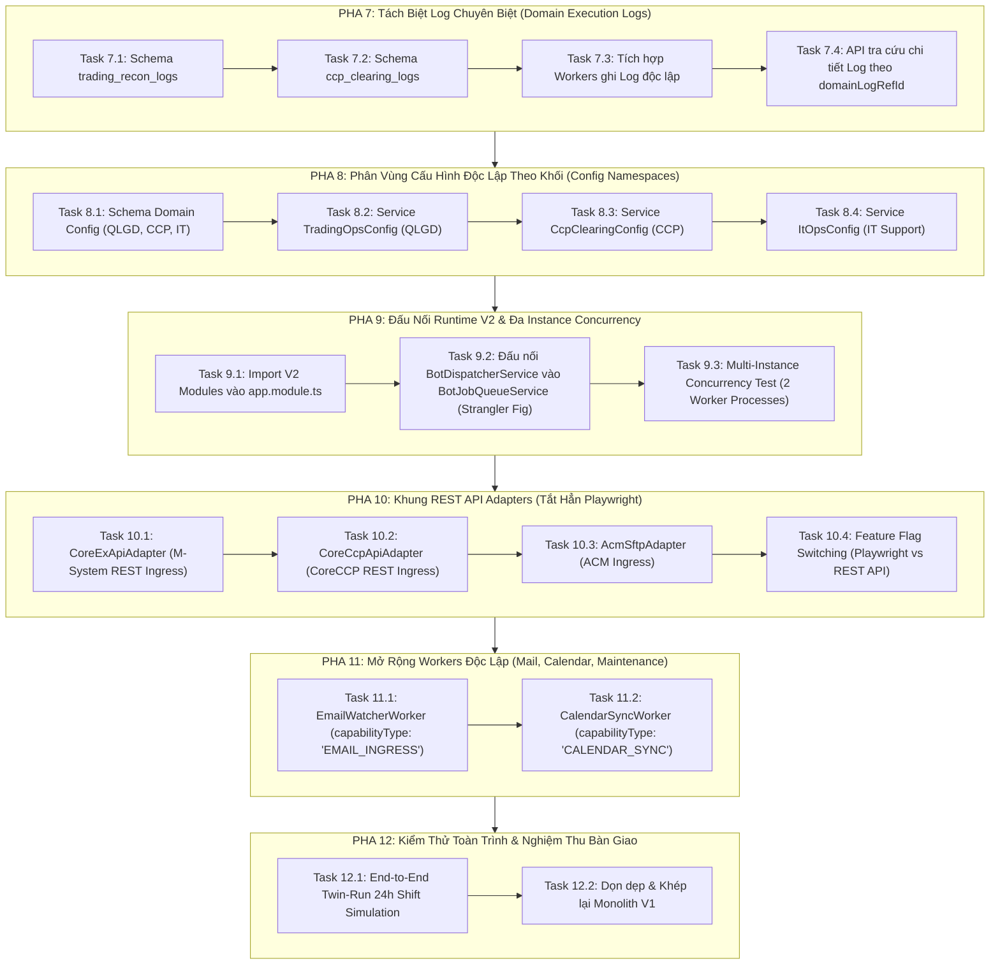

# KẾ HOẠCH CHUYỂN ĐỔI TIẾP THEO (STAGE 2: RUNTIME INTEGRATION & PRODUCTION CUTOVER)
## CHUYỂN GIAO TOÀN DIỆN: TÁCH LOG ĐỘC LẬP — CẤU HÌNH RIÊNG TỪNG KHỐI — ĐA INSTANCE CONCURRENCY — TẮT PLAYWRIGHT THAY BẰNG REST API

---

> **Mã kế hoạch**: `MXV-MODULAR-STAGE-2-ATOMIC-TASKS-2026`  
> **Kế thừa trực tiếp từ**: [KE_HOACH_TONG_CHUYEN_DOI_MODULAR_MONOLITH_ATOMIC_TASKS.md](file:///c:/Users/hiepth/OneDrive%20-%20MERCANTILE%20EXCHANGE%20OF%20VIETNAM/Documents/Github/mxv-cqg-download-investigation/KE_HOACH_TONG_CHUYEN_DOI_MODULAR_MONOLITH_ATOMIC_TASKS.md) (Giai đoạn 1 đã hoàn thành 100%)  
> **Nguyên tắc bất biến**: **"KHÔNG LÀM CẢ CỤC — CHIA NHỎ TỪNG TASK — XÁC MINH TEST/BUILD SAU MỖI BƯỚC — KHÔNG MẤT CODE HAY LOẠN LOGIC"**  
> **Tiêu chuẩn kiểm soát**: [AGENTS.md](file:///c:/Users/hiepth/OneDrive%20-%20MERCANTILE%20EXCHANGE%20OF%20VIETNAM/Documents/Github/mxv-cqg-download-investigation/.agents/AGENTS.md).

---

## 1. MỤC TIÊU CỐT LÕI & ĐỊNH HƯỚNG KIẾN TRÚC GIAI ĐOẠN 2

Giai đoạn 1 đã xây dựng thành công 100% khung sườn và lõi nghiệp vụ của 4 module V2 (`ingress`, `trading-ops`, `ccp-clearing`, `checklist-hub`).  
**Giai đoạn 2 này tập trung vào 4 bài toán vận hành thực tế then chốt:**

1. 📂 **Log Độc Lập Cho Tool Module (Domain Execution Logs)**:
   - Toàn bộ bảng kê chi tiết so khớp lệnh, bảng kê diff, dữ liệu thống kê thô được lưu vào collection riêng (`trading_recon_logs`, `ccp_clearing_logs`).
   - CSDL Ca trực (`ShiftLog`) chỉ lưu ID tham chiếu `domainLogRefId` và các chỉ số tóm tắt (metrics) $\rightarrow$ **Bảo vệ tuyệt đối giới hạn MongoDB 16MB document limit và chống lag UI Web**.

2. 🔐 **Cấu Hình Riêng Biệt Từng Khối (Domain Configuration Namespaces)**:
   - Tách biệt hoàn toàn tài khoản mật khẩu, thư mục lưu trữ, endpoint giữa các khối: **QLGD** (M-System, CQG, ACM), **CCP** (CoreCCP, Clearing), **IT Ops** (Mail, Telegram, SSH).
   - Triệt tiêu 100% nguy cơ tranh chấp tài nguyên, ghi đè đường dẫn hay xung đột credential.

3. ⚡ **Mở Rộng Đa Instance Không Xung Đột (Horizontal Multi-Instance Concurrency)**:
   - Đưa cơ chế khóa nguyên tử MongoDB (`findOneAndUpdate({ status: 'PENDING' }, { $set: { status: 'PROCESSING', lockedBy: instanceId } })`) của `BotDispatcherService` vào vận hành thực tế.
   - Hỗ trợ triển khai nhiều Node.js worker/container cùng lúc để xử lý song song các tác vụ nặng (vừa cào dữ liệu, vừa tính toán lot, vừa đọc email) mà **không bị tranh chấp hay chạy trùng Job (Zero Race Conditions)**.

4. 🌐 **Tắt Hẳn Playwright — Chuyển Sang Gọi REST/gRPC API (Playwright Sunsetting)**:
   - Xây dựng sẵn các REST/gRPC API Adapters (`CoreExApiAdapter`, `CoreCcpApiAdapter`, `AcmApiAdapter`) tuân thủ `IIngressPort`.
   - Kết nối qua cờ Feature Flag: Khi sàn chính thức mở API, hệ thống tự động ngắt trình duyệt Playwright và chuyển 100% sang HTTP calls mà không phải sửa bất kỳ dòng code tính toán nào.

---

## 2. BẢN ĐỒ LỘ TRÌNH 6 PHA & 18 NHIỆM VỤ NGUYÊN TỬ (ATOMIC TASKS)



---

## 3. CHI TIẾT TỪNG NHIỆM VỤ NGUYÊN TỬ (ATOMIC SPECIFICATIONS)

---

### PHA 7: TÁCH BIỆT LOG CHUYÊN BIỆT & BẢO VỆ CSDL CA TRỰC (`domain-logs`)

> **Mục tiêu**: Tuyệt đối không nhét bảng kê so khớp hàng nghìn dòng lệnh vào `ShiftLog`. Tạo các collection lưu log chuyên ngành độc lập.

#### Task 7.1: Tạo Mongoose Schema `TradingReconLog` (`trading_recon_logs`)
- **Vị trí file**: `backend/src/modules/trading-ops/schemas/trading-recon-log.schema.ts`
- **Mục tiêu**: Lưu trữ toàn bộ dữ liệu đối soát chi tiết của QLGD.
- **Cấu trúc trường dữ liệu (Schema Definition)**:
  ```typescript
  @Schema({ timestamps: true, collection: 'trading_recon_logs' })
  export class TradingReconLog extends Document {
    @Prop({ required: true, index: true })
    reconType: 'KLGD' | 'PRE_EOD' | 'NEGATIVE_MARGIN';

    @Prop({ required: true, index: true })
    tradingDate: string; // YYYY-MM-DD

    @Prop({ required: false, index: true })
    shiftLogId?: string;

    @Prop({ required: false, index: true })
    taskId?: string;

    @Prop({ required: true, default: false })
    passed: boolean;

    @Prop({ type: Object, default: {} })
    totals: Record<string, number>; // totalDSGD, totalFR, totalNano, differ, ...

    @Prop({ type: Array, default: [] })
    mismatchedTrades: Array<{
      source: string;
      maLenh?: string;
      maTKGD: string;
      maHD: string;
      giaKhop: number;
      klGiaoDich: number;
      ngayGio: string;
      reason: string;
    }>;

    @Prop({ type: Array, default: [] })
    mismatchedPositions: Array<{
      account: string;
      symbol: string;
      msPosition: number;
      cqgPosition: number;
      differ: number;
    }>;

    @Prop({ type: Array, default: [] })
    negativeMarginAccounts: Array<{ account: string; margin: number }>;

    @Prop({ type: Date, default: null })
    cutoffTime?: Date;
  }
  ```
- **Tiêu chuẩn nghiệm thu (DoD)**: Schema được export sạch sẽ, có đầy đủ indexes cho `tradingDate`, `reconType`, `shiftLogId`.

#### Task 7.2: Tạo Mongoose Schema `CcpClearingLog` (`ccp_clearing_logs`)
- **Vị trí file**: `backend/src/modules/ccp-clearing/schemas/ccp-clearing-log.schema.ts`
- **Mục tiêu**: Lưu trữ toàn bộ bảng kê thống kê Lot, giá trị giao dịch bù trừ CCP.
- **Cấu trúc trường dữ liệu (Schema Definition)**:
  ```typescript
  @Schema({ timestamps: true, collection: 'ccp_clearing_logs' })
  export class CcpClearingLog extends Document {
    @Prop({ required: true, index: true })
    tradingDate: string; // YYYY-MM-DD

    @Prop({ required: false, index: true })
    shiftLogId?: string;

    @Prop({ required: false, index: true })
    taskId?: string;

    @Prop({ type: Object, default: {} })
    summary: Record<string, number>; // dsgdTotal, frTotal, ttmTotal, opTotal, ...

    @Prop({ type: Array, default: [] })
    byProduct: Array<{ maSP: string; klm: number; klb: number; total: number }>;

    @Prop({ type: Array, default: [] })
    byTvkd: Array<{ tvkd: string; klm: number; klb: number; total: number }>;

    @Prop({ type: Array, default: [] })
    validations: Array<{ field: string; expected: number; actual: number; passed: boolean }>;
  }
  ```
- **Tiêu chuẩn nghiệm thu (DoD)**: Schema export sạch sẽ, index `tradingDate`.

#### Task 7.3: Cập Nhật Workers Ghi Log Độc Lập & Trả Về `domainLogRefId`
- **File tác động**:
  - `backend/src/modules/trading-ops/workers/klgd-recon.worker.ts`
  - `backend/src/modules/trading-ops/workers/pre-eod-recon.worker.ts`
  - `backend/src/modules/trading-ops/workers/negative-margin.worker.ts`
  - `backend/src/modules/ccp-clearing/workers/ccp-lot.worker.ts`
- **Quy tắc chuyển đổi**:
  1. Worker nhận kết quả tính toán thô.
  2. Ghi bản ghi chi tiết vào `TradingReconLog` hoặc `CcpClearingLog`.
  3. Lấy `_id` của bản ghi vừa lưu gắn vào `domainLogRefId` của `TaskExecutionResult`.
  4. Trả về `summary` ngắn gọn và `metrics` tổng quan (tuyệt đối không nhồi nhét mảng hàng nghìn phần tử vào `TaskExecutionResult`).
- **Tiêu chuẩn nghiệm thu (DoD)**:
  - `TaskExecutionResult.domainLogRefId` luôn có giá trị ObjectId hợp lệ.
  - Test Jest xác nhận log được lưu vào collection riêng.

#### Task 7.4: Xây Dựng REST API Tra Cứu Log Chi Tiết Theo `domainLogRefId`
- **Vị trí file**:
  - `backend/src/modules/trading-ops/controllers/trading-recon-log.controller.ts`
  - `backend/src/modules/ccp-clearing/controllers/ccp-clearing-log.controller.ts`
- **Mục tiêu**: Cung cấp endpoint cho Frontend bấm "Xem chi tiết đối soát" hoặc "Tải Excel kết quả" mà không làm nặng payload của ca trực:
  - `GET /api/v1/trading-ops/recon-logs/:id`
  - `GET /api/v1/ccp-clearing/logs/:id`
- **Tiêu chuẩn nghiệm thu (DoD)**: Endpoint trả về chi tiết bảng kê khớp lệnh theo chuẩn REST JSON có phân trang nếu số dòng > 500.

---

### PHA 8: PHÂN VÙNG CẤU HÌNH ĐỘC LẬP THEO KHỐI (`domain-configs`)

> **Mục tiêu**: Loại bỏ việc nhồi nhét cấu hình của tất cả các phòng ban vào một mớ hỗn độn trong `system_settings`. Phân chia rõ ràng thành 3 khối tự quản: QLGD, CCP, IT Support.

#### Task 8.1: Schema Cấu Hình Phân Vùng `DomainConfig`
- **Vị trí file**: `backend/src/schemas/domain-config.schema.ts`
- **Mục tiêu**: Quản lý cấu hình có namespace theo khối:
  ```typescript
  @Schema({ timestamps: true, collection: 'domain_configs' })
  export class DomainConfig extends Document {
    @Prop({ required: true, unique: true, index: true })
    namespace: 'QLGD' | 'CCP' | 'IT_OPS' | 'RISK';

    @Prop({ type: Object, default: {} })
    storagePaths: Record<string, string>; // baseDir, dailyPattern, backupRoot

    @Prop({ type: Object, default: {} })
    credentials: Record<string, any>; // encrypted bot logins

    @Prop({ type: Object, default: {} })
    businessThresholds: Record<string, number>; // warningRate, differThreshold

    @Prop({ type: String, default: null })
    updatedBy?: string;
  }
  ```
- **Tiêu chuẩn nghiệm thu (DoD)**: Schema có unique index trên trường `namespace`.

#### Task 8.2: Service Cấu Hình Khối Quản Lý Giao Dịch (`TradingOpsConfigService`)
- **Vị trí file**: `backend/src/modules/trading-ops/services/trading-ops-config.service.ts`
- **Phạm vi quản lý**:
  - Đường dẫn Backup M-System, CQG, ACM (`storagePaths.ms`, `storagePaths.cqg`, `storagePaths.acm`).
  - Tài khoản bot cào M-System, CQG TK1, CQG TK2.
  - Ngưỡng giờ cắt phiên (`sessionStartTime`, mặc định `05:00`).
- **Tiêu chuẩn nghiệm thu (DoD)**: Cung cấp method `getConfig(): Promise<ITradingOpsConfig>`, tự động fallback về biến môi trường `.env` nếu CSDL chưa khởi tạo.

#### Task 8.3: Service Cấu Hình Khối Bù Trừ CCP (`CcpClearingConfigService`)
- **Vị trí file**: `backend/src/modules/ccp-clearing/services/ccp-clearing-config.service.ts`
- **Phạm vi quản lý**:
  - Đường dẫn Backup 25 báo cáo CCP (`storagePaths.ccpBackup`, `storagePaths.tradingCheckCcp`).
  - Tài khoản đăng nhập cổng CoreCCP.
  - Danh mục hàng hóa và tỷ lệ tính lot bù trừ.
- **Tiêu chuẩn nghiệm thu (DoD)**: Cung cấp method `getConfig(): Promise<ICcpClearingConfig>`.

#### Task 8.4: Service Cấu Hình Khối Kỹ Thuật IT (`ItOpsConfigService`)
- **Vị trí file**: `backend/src/modules/checklist-hub/services/it-ops-config.service.ts`
- **Phạm vi quản lý**:
  - Thông số SMTP gửi mail cảnh báo (`smtp.host`, `smtp.port`, `smtp.user`, `smtp.pass`).
  - Telegram Bot Token & Chat ID kênh trực ca.
  - Tần suất quét Job ngầm (`queuePollIntervalMs`).
- **Tiêu chuẩn nghiệm thu (DoD)**: Cung cấp method `getConfig(): Promise<IItOpsConfig>`.

---

### PHA 9: ĐẤU NỐI RUNTIME V2 VÀO `AppModule` & BẬT ĐIỀU PHỐI ĐA INSTANCE

> **Mục tiêu**: Đưa toàn bộ các Module V2 vào đồ thị phụ thuộc (DI Graph) của ứng dụng chính và kích hoạt khả năng chạy song song đa instance.

#### Task 9.1: Import V2 Modules Vào `backend/src/app.module.ts`
- **File tác động**: `backend/src/app.module.ts`
- **Nội dung thay đổi**:
  - Thêm `IngressModule`, `TradingOpsModule`, `CcpClearingModule`, `ChecklistHubModule` vào mảng `imports`.
  - Giữ nguyên các module V1 cũ để đảm bảo các API hiện tại của Frontend vẫn hoạt động bình thường.
- **Tiêu chuẩn nghiệm thu (DoD)**:
  - `npm run build` hoặc `nest build` hoàn thành với Exit code 0.
  - Server dev `npm run start:dev` reload mượt mà, không gặp lỗi vòng tròn dependency (Circular Dependency).

#### Task 9.2: Tích Hợp `BotDispatcherService` Vào `BotJobQueueService` (Strangler Fig Delegation)
- **File tác động**: `backend/src/modules/bot-engine/bot-job-queue.service.ts`
- **Nội dung thay đổi**:
  - Inject `BotDispatcherService` vào `BotJobQueueService`.
  - Khi `processQueue()` quét thấy Job thuộc các năng lực V2 (`CHECK_KLGD`, `CHECK_PRE_EOD`, `CHECK_NEGATIVE_MARGIN`, `CCP_LOT_STATS`):
    - Chuyển tiếp việc xử lý sang `botDispatcherService.acquireAndProcessNextJob()`.
    - Sử dụng cơ chế khóa nguyên tử MongoDB Atomic Lock thay vì cờ RAM `this.isProcessing = true`.
- **Tiêu chuẩn nghiệm thu (DoD)**:
  - Khóa nguyên tử được kích hoạt: Mỗi khi Worker nhận Job, trường `lockedBy` được gán mã Instance (`inst_<pid>_<random>`).

#### Task 9.3: Kiểm Thử Đa Instance Song Song (Multi-Instance Concurrency Test)
- **Vị trí file**: `backend/src/tests/concurrency/multi-instance-queue.spec.ts`
- **Kịch bản kiểm thử**:
  1. Khởi tạo 2 instance `BotDispatcherService` độc lập (giả lập 2 worker process khác nhau chạy song song).
  2. Tạo 10 jobs `PENDING` trong CSDL.
  3. Cả 2 instance cùng gọi vòng lặp xử lý `acquireAndProcessNextJob()` đồng thời.
  4. Assert kết quả:
     - 10 jobs được phân chia cho 2 instance xử lý.
     - **CHÍNH XÁC 0 JOB BỊ XỬ LÝ TRÙNG LẶP (Zero Double-Execution)**.
     - Tổng số lần thực thi thành công = 10.
- **Tiêu chuẩn nghiệm thu (DoD)**: Jest test `PASS src/tests/concurrency/multi-instance-queue.spec.ts`.

---

### PHA 10: XÂY DỰNG KHUNG REST/gRPC API ADAPTERS (PLAYWRIGHT SUNSETTING)

> **Mục tiêu**: Hiện thực hóa chỉ đạo "về sau sẽ off Playwright hết, viết mới hết theo gọi API". Xây dựng cầu nối để chuyển đổi không gián đoạn.

#### Task 10.1: Xây Dựng `CoreExApiAdapter` (M-System Direct Ingress)
- **Vị trí file**: `backend/src/modules/ingress/adapters/coreex-api.adapter.ts`
- **Mục tiêu**: Triển khai interface `IIngressPort`:
  - Thay vì bật Chromium đăng nhập M-System và click nút tải Excel, adapter gọi trực tiếp HTTP REST API của CoreEX (truyền JWT token/Session cookie) để stream file `DSGD`, `TTM`, `TTTT` trực tiếp về đĩa.
- **Tiêu chuẩn nghiệm thu (DoD)**: Implement đầy đủ `IIngressPort.downloadReport()`.

#### Task 10.2: Xây Dựng `CoreCcpApiAdapter` (CoreCCP Direct Ingress)
- **Vị trí file**: `backend/src/modules/ingress/adapters/coreccp-api.adapter.ts`
- **Mục tiêu**: Triển khai interface `IIngressPort`:
  - Gọi HTTP API của CoreCCP để tải trực tiếp 25 file báo cáo bù trừ theo định dạng JSON hoặc stream file.
- **Tiêu chuẩn nghiệm thu (DoD)**: Implement đầy đủ `IIngressPort.downloadReport()`.

#### Task 10.3: Xây Dựng `AcmSftpAdapter` (ACM Native Ingress)
- **Vị trí file**: `backend/src/modules/ingress/adapters/acm-sftp.adapter.ts`
- **Mục tiêu**: Kết nối trực tiếp qua thư viện SFTP Client (`ssh2-sftp-client`) để tải file Straits CSV, loại bỏ hoàn toàn các bước click chuột giả lập.
- **Tiêu chuẩn nghiệm thu (DoD)**: Tải đúng file Straits CSV theo ngày phiên.

#### Task 10.4: Cơ Chế Chuyển Đổi Tức Thì Qua Feature Flag (Zero-Downtime Sunsetting Switch)
- **File tác động**: `backend/src/modules/ingress/ingress.service.ts`
- **Logic chuyển đổi**:
  ```typescript
  async downloadReport(params: IngressDownloadParams): Promise<IngressDownloadResult> {
    const useApi = await this.settingsService.getSetting('INGRESS_MODE', 'PLAYWRIGHT');
    
    if (useApi === 'REST_API') {
      // Gọi trực tiếp REST API Adapters (CoreExApiAdapter, CoreCcpApiAdapter)
      return this.apiAdapter.downloadReport(params);
    }
    
    // Mặc định: Dùng Playwright Scrapers hiện tại
    return this.playwrightScraper.downloadReport(params);
  }
  ```
- **Tiêu chuẩn nghiệm thu (DoD)**:
  - Khi Admin đổi giá trị setting `INGRESS_MODE` từ `PLAYWRIGHT` sang `REST_API`, hệ thống chuyển đổi ngay lập tức lúc runtime mà không cần build lại code hay khởi động lại server.

---

### PHA 11: MỞ RỘNG WORKERS ĐỘC LẬP (MAIL, CALENDAR, OCR)

> **Mục tiêu**: Biến các tác vụ phụ trợ (đọc mail, đồng bộ lịch) thành các Worker độc lập tuân thủ chuẩn `IBotWorker` để Dispatcher có thể điều phối mượt mà.

#### Task 11.1: Tạo `EmailWatcherWorker`
- **Vị trí file**: `backend/src/modules/checklist-hub/workers/email-watcher.worker.ts`
- **Năng lực định danh**: `capabilityType: 'EMAIL_ATTACHMENT_INGRESS'`
- **Nhiệm vụ**: Tự động quét hòm thư Exchange/Office 365, bóc tách file đính kèm (EOD, Straits CSV) và lưu vào đúng thư mục ngày làm việc.
- **Tiêu chuẩn nghiệm thu (DoD)**: Implement `IBotWorker`.

#### Task 11.2: Tạo `CalendarSyncWorker`
- **Vị trí file**: `backend/src/modules/checklist-hub/workers/calendar-sync.worker.ts`
- **Năng lực định danh**: `capabilityType: 'CALENDAR_SYNC'`
- **Nhiệm vụ**: Tự động đồng bộ ngày nghỉ lễ, ngày giao dịch bù trừ của các sở liên thông (CME, LME, ICE).
- **Tiêu chuẩn nghiệm thu (DoD)**: Implement `IBotWorker`.

---

### PHA 12: KIỂM THỬ KHÉP KÍN TOÀN TRÌNH & NGHIỆM THU BÀN GIAO (FULL CUTOVER)

> **Mục tiêu**: Chạy mô phỏng ca trực hoàn chỉnh 24h, chứng minh tính ổn định tuyệt đối và hoàn tất chuyển đổi.

#### Task 12.1: Kịch Bản Test Mô Phỏng Toàn Trình Ca Trực 24h (End-to-End Shift Simulation)
- **Vị trí file**: `backend/src/tests/e2e/modular-shift-e2e.spec.ts`
- **Chuỗi quy trình kiểm chứng**:
  1. Mở ca trực mới (`ShiftLifecycleService.startShift()`).
  2. Dispatcher tiếp nhận Job `CHECK_KLGD` $\rightarrow$ `KlgdReconWorker` tính toán $\rightarrow$ Ghi log chi tiết vào `TradingReconLog` $\rightarrow$ Trả về metrics tóm tắt cho ca trực.
  3. Dispatcher tiếp nhận Job `CHECK_PRE_EOD` $\rightarrow$ `PreEodReconWorker` đối soát 3 bên.
  4. Dispatcher tiếp nhận Job `CCP_LOT_STATS` $\rightarrow$ `CcpLotWorker` thống kê bù trừ $\rightarrow$ Ghi log vào `CcpClearingLog`.
  5. Dispatcher tiếp nhận Job `CHECK_NEGATIVE_MARGIN` $\rightarrow$ `NegativeMarginWorker` quét tài khoản âm.
  6. Bàn giao ca & đóng ca trực (`ShiftLifecycleService.completeShift()`).
  7. Assert: Toàn bộ quy trình diễn ra trơn tru, CSDL `ShiftLog` không bị phình to, 0 lỗi phát sinh.
- **Tiêu chuẩn nghiệm thu (DoD)**: `PASS src/tests/e2e/modular-shift-e2e.spec.ts`.

#### Task 12.2: Đồng Bộ Lên Nhánh Refactor & Khép Lại Kế Hoạch
- **Nhiệm vụ**:
  1. Đồng bộ toàn bộ mã nguồn sang worktree `mxv-modular-refactor`.
  2. Tạo commit theo quy chuẩn Git Conventional Commits.
  3. Cập nhật nhật ký [CHANGELOG_AI.md](file:///c:/Users/hiepth/OneDrive%20-%20MERCANTILE%20EXCHANGE%20OF%20VIETNAM/Documents/Github/mxv-cqg-download-investigation/CHANGELOG_AI.md).

---

## 4. MA TRẬN PHÂN CHIA NHIỆM VỤ NGUYÊN TỬ (ATOMIC TASKS SUMMARY TABLE)

| Mã Task | Phân Hệ | File Thực Hiện | Nhiệm Vụ Cụ Thể | Lệnh Kiểm Chứng |
| :--- | :--- | :--- | :--- | :--- |
| **Task 7.1** | `trading-ops` | `trading-recon-log.schema.ts` | Tạo Schema lưu log đối soát QLGD độc lập | `nest build` |
| **Task 7.2** | `ccp-clearing`| `ccp-clearing-log.schema.ts` | Tạo Schema lưu log thống kê CCP độc lập | `nest build` |
| **Task 7.3** | `workers` | Cập nhật 4 Workers | Ghi chi tiết vào collection riêng, trả `domainLogRefId` | `jest twin-run` |
| **Task 7.4** | `controllers`| 2 Log Controllers | REST API xem chi tiết log theo ID | `nest build` |
| **Task 8.1** | `shared` | `domain-config.schema.ts` | Schema quản lý cấu hình phân vùng theo namespace | `nest build` |
| **Task 8.2** | `trading-ops` | `trading-ops-config.service.ts`| Service quản lý cấu hình riêng khối QLGD | `nest build` |
| **Task 8.3** | `ccp-clearing`| `ccp-clearing-config.service.ts`| Service quản lý cấu hình riêng khối CCP | `nest build` |
| **Task 8.4** | `checklist-hub`| `it-ops-config.service.ts` | Service quản lý cấu hình riêng khối IT | `nest build` |
| **Task 9.1** | `core` | `backend/src/app.module.ts` | Đấu nối 4 V2 Modules vào đồ thị DI chính | `nest build` (Exit 0) |
| **Task 9.2** | `bot-engine` | `bot-job-queue.service.ts` | Ủy quyền xử lý Job sang `BotDispatcherService` | `nest build` |
| **Task 9.3** | `tests` | `multi-instance-queue.spec.ts` | Test chứng minh 0% race condition trên 2 workers | `jest multi-instance` |
| **Task 10.1**| `ingress` | `coreex-api.adapter.ts` | REST API Adapter cho M-System (thay Playwright) | `nest build` |
| **Task 10.2**| `ingress` | `coreccp-api.adapter.ts` | REST API Adapter cho CoreCCP (thay Playwright) | `nest build` |
| **Task 10.3**| `ingress` | `acm-sftp.adapter.ts` | SFTP Native Adapter cho ACM Straits CSV | `nest build` |
| **Task 10.4**| `ingress` | `ingress.service.ts` | Feature Flag chuyển đổi tức thì Playwright $\rightarrow$ API | `nest build` |
| **Task 11.1**| `checklist-hub`| `email-watcher.worker.ts` | Worker độc lập tải đính kèm email ca trực | `nest build` |
| **Task 11.2**| `checklist-hub`| `calendar-sync.worker.ts` | Worker độc lập đồng bộ lịch giao dịch sàn | `nest build` |
| **Task 12.1**| `tests` | `modular-shift-e2e.spec.ts` | Mô phỏng toàn trình 24h ca trực V2 | `jest e2e` |
| **Task 12.2**| `git` | CHANGELOG & Git Commit | Nghiệm thu và đóng băng mốc hoàn thành | `git status` |

---

## 5. CAM KẾT KỶ LUẬT THỰC THI (DISCIPLINE PROTOCOL)

1. **Tuyệt đối không gộp code (Atomic Execution)**: Mỗi lượt thực thi chỉ xử lý duy nhất 1 Task nguyên tử.
2. **Kiểm chứng sau từng bước**: Sau mỗi Task, AI bắt buộc chạy `nest build` và test liên quan trước khi chuyển task.
3. **Bảo tồn Server nền**: Không bao giờ gây gián đoạn tiến trình `npm run start:dev` đang chạy trên máy người dùng.
4. **Không động vào Database thật**: Mọi bài test dùng database giả lập / test schema riêng biệt, bảo vệ tuyệt đối dữ liệu ca trực thật.
