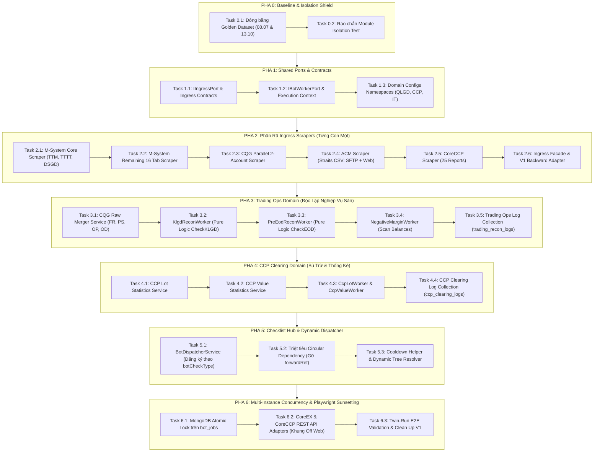

# KẾ HOẠCH TỔNG THỂ & LỘ TRÌNH CHIA NHỎ NHIỆM VỤ NGUYÊN TỬ (ATOMIC TASKS)
## CHUYỂN ĐỔI KIẾN TRÚC: MONOLITH V1 ➔ MODULAR MONOLITH V2

---

> **Mã kế hoạch**: `MXV-ATOMIC-MIGRATION-PLAN-2026-V2`  
> **Phiên bản**: 2.0 (Đã thẩm định sâu & điều chỉnh chống mất logic)  
> **Mục tiêu tối thượng**: **BẢO TOÀN 100% CODE VÀ LOGIC NGHIỆP VỤ — TUYỆT ĐỐI KHÔNG LÀM CẢ CỤC — CHIA NHỎ TỪNG TASK — XÁC MINH TEST/BUILD SAU MỖI BƯỚC**  
> **Cơ sở thực chứng**: Chuẩn kiến trúc [report-dev](file:///c:/Users/hiepth/OneDrive%20-%20MERCANTILE%20EXCHANGE%20OF%20VIETNAM/Documents/Github/mxv-modular-refactor/report-dev) & Quy chuẩn thay đổi [AGENTS.md](file:///c:/Users/hiepth/OneDrive%20-%20MERCANTILE%20EXCHANGE%20OF%20VIETNAM/Documents/Github/mxv-cqg-download-investigation/.agents/AGENTS.md).

---

## 1. BÁO CÁO THẨM ĐỊNH LẠI (CRITICAL REVIEW) & CÁC ĐIỀU CHỈNH CỐT LÕI

Qua rà soát thực tế toàn bộ 5.382 dòng code của `rpa-downloader.service.ts` (204KB), hệ thống `reconciliation/services` (210KB), `bot-job-queue.service.ts` và cơ chế điều phối ca trực, chúng tôi nhận diện **5 rủi ro chí mạng khiến AI hay làm mất code/loạn logic** và đã đưa ra **5 điều chỉnh điều chỉnh tương ứng trong kế hoạch này**:

| STT | Rủi ro gây mất code / loạn logic | Nguyên nhân gốc rễ | Điều chỉnh bắt buộc trong Plan V2 |
| :--- | :--- | :--- | :--- |
| **1** | **Bóc tách "cả cục" file 5.382 dòng** (`rpa-downloader.service.ts`) | AI cố gắng viết lại hoặc chia service quá lớn dẫn tới cắt bớt các hàm helper, regex, cấu hình timeout hoặc xử lý DOM phức tạp. | **Chia nhỏ Phase 2 thành 6 Task nguyên tử riêng biệt**: Tách riêng M-System Core (TTM, TTTT, DSGD) $\rightarrow$ Tách M-System 16 Tab $\rightarrow$ Tách CQG 2 tài khoản $\rightarrow$ Tách ACM $\rightarrow$ Tách CCP 25 files $\rightarrow$ Tạo Facade Adapter tương thích ngược 100%. |
| **2** | **Viết lại thuật toán đối soát đã chạy chuẩn** | AI cố gắng "tái cấu trúc cho đẹp" các thuật toán đối chiếu trong `reconciliation/services/` làm sai lệch kết quả tài chính. | **Nguyên tắc "Đóng gói, không viết lại"**: Giữ nguyên 100% logic toán trong `klgd-recon.service.ts` và `pre-eod-recon.service.ts`. Chỉ bọc bên ngoài bằng `IBotWorker` Adapter để gọi qua Dispatcher. |
| **3** | **Xóa code cũ khi code mới chưa kiểm chứng** | Vội vàng xóa class cũ hoặc gỡ import làm gãy nhánh dev đang chạy server cho người dùng (`npm run start:dev`). | **Áp dụng mẫu thiết kế Strangler Fig & Twin-Run (Chạy kép)**: Code mới được tạo song song trong module mới. Code cũ ở V1 chuyển thành Facade gọi sang code mới. Cả 2 cùng tồn tại và trả kết quả so sánh 1:1 trước khi ngắt vĩnh viễn code cũ. |
| **4** | **Phình to Document CSDL Ca trực (16MB Limit)** | Gộp toàn bộ chi tiết so khớp lệnh, bảng kê diff, danh sách tài khoản vào `ShiftLog`. | **Tách riêng 2 Collection log độc lập**: `trading_recon_logs` và `ccp_clearing_logs`. Ca trực (`ShiftLog`) chỉ lưu tóm tắt (Summary DTO) và trường tham chiếu `domainLogRefId`. |
| **5** | **Xung đột Job khi chạy nhiều Instance (Concurrency)** | Cờ `isProcessing = true` trong RAM chỉ an toàn trên 1 Node.js process, sẽ bị race condition khi chạy multi-instance. | **Nâng cấp Atomic Queue**: Sử dụng lệnh nguyên tử `botJobModel.findOneAndUpdate({ status: 'PENDING' }, { $set: { status: 'PROCESSING', lockedBy: instanceId } })` trên MongoDB. |

---

## 2. BẢN ĐỒ LỘ TRÌNH 7 PHA & 22 NHIỆM VỤ NGUYÊN TỬ (ATOMIC TASKS)

---

## 3. CHI TIẾT TỪNG NHIỆM VỤ NGUYÊN TỬ (ATOMIC TASK BREAKDOWN)

---

### 🛡️ PHA 0: CHUẨN BỊ & ĐÓNG BĂNG MẪU BẢO CHỨNG (BASELINE & SHIELD)
*Mục đích: Thiết lập rào chắn và thước đo chuẩn trước khi đụng vào code logic.*

#### Task 0.1: Đóng Băng Mẫu Dữ Liệu Đối Soát (Golden Dataset Freezing)
- **Mục tiêu**: Lưu trữ cố định bộ file báo cáo mẫu chuẩn của ngày `08.07` và ngày gần nhất vào thư mục test để dùng làm căn cứ kiểm tra đối ứng 1:1.
- **Phạm vi cô lập**: Chỉ tạo file test và thư mục fixture, không sửa bất kỳ dòng code backend nào.
- **File tác động**:
  - Tạo mới: `backend/src/tests/fixtures/golden_dataset/`
  - Tạo mới: `backend/src/tests/golden-baseline.spec.ts`
- **Kho Logic Bắt Buộc Bảo Tồn**:
  - Số lệnh khớp, số lot chênh lệch của ngày mẫu phải ra đúng kết quả mong đợi đã biết trước.
- **Tiêu chuẩn nghiệm thu (DoD)**: Chạy `npx jest src/tests/golden-baseline.spec.ts` thành công (Pass).

#### Task 0.2: Rào Chắn Chống Nhập Xuyên Module (Module Isolation Boundary Test)
- **Mục tiêu**: Xây dựng test tự động quét cây thư mục, cấm mọi hành vi deep-import xuyên module (học theo `report-dev/test/boundary/module-isolation.test.ts`).
- **Phạm vi cô lập**: 1 file test duy nhất.
- **File tác động**:
  - Đã tạo: `backend/src/tests/boundary/module-isolation.spec.ts`
- **Tiêu chuẩn nghiệm thu (DoD)**: Chạy `npx jest src/tests/boundary/module-isolation.spec.ts` đạt kết quả Pass.

---

### 🔌 PHA 1: XÂY DỰNG TẦNG HỢP ĐỒNG DÙNG CHUNG (SHARED PORTS & CONTRACTS)
*Mục đích: Thiết lập bộ khung interface chuẩn (Ports) độc lập, không phụ thuộc vào bất kỳ thư viện hay framework cụ thể nào.*

#### Task 1.1: Tạo Cổng Kéo Dữ Liệu (`IIngressPort` & Ingress Contracts)
- **Mục tiêu**: Định nghĩa interface chuẩn cho mọi hành động tải báo cáo từ bên ngoài (Web scraping, SFTP, REST API, gRPC).
- **Phạm vi cô lập**: Chỉ tạo 2 file khai báo TypeScript types/interfaces trong `src/shared/`.
- **File tác động**:
  - Tạo mới: `backend/src/shared/ports/ingress.port.ts`
  - Tạo mới: `backend/src/shared/contracts/ingress-result.contract.ts`
- **Kho Logic Bắt Buộc Bảo Tồn**:
  - `IngressResult` **bắt buộc phải có `outputDirectory: string` và danh sách `files: IngressFileDetail[]`** mang đường dẫn tuyệt đối (`absolutePath`), kích thước file, và timestamp. Không để downstream module tự đoán mò đường dẫn ổ đĩa.
- **Tiêu chuẩn nghiệm thu (DoD)**: `npx nest build` Exit code 0.

#### Task 1.2: Tạo Cổng Thực Thi Bot Worker (`IBotWorker` & Execution Contracts)
- **Mục tiêu**: Định nghĩa interface thống nhất cho mọi Worker xử lý nghiệp vụ sàn.
- **Phạm vi cô lập**: Chỉ tạo 2 file interface trong `src/shared/`.
- **File tác động**:
  - Tạo mới: `backend/src/shared/ports/bot-worker.port.ts`
  - Tạo mới: `backend/src/shared/contracts/bot-execution.contract.ts`
- **Kho Logic Bắt Buộc Bảo Tồn**:
  - `TaskExecutionContext` truyền vào: `{ taskId, shiftId, botCheckType, targetDate, parameters }`.
  - `TaskExecutionResult` trả về: `{ status: 'SUCCESS' | 'FAILED' | 'WARNING', summary: string, metrics: Record<string, any>, domainLogRefId?: string }`.
  - Worker **tuyệt đối không được chứa logic cập nhật Database ca trực** (`ShiftLog`), việc cập nhật ca trực do Dispatcher của ca trực đảm nhiệm.
- **Tiêu chuẩn nghiệm thu (DoD)**: `npx nest build` Exit code 0.

#### Task 1.3: Thiết Lập Namespace Cấu Hình Độc Lập Cho Từng Khối
- **Mục tiêu**: Phân tách cấu hình tài khoản, mật khẩu, đường dẫn lưu trữ theo từng phân hệ (QLGD, CCP, IT, Giám sát rủi ro) để tránh tranh chấp tài nguyên.
- **Phạm vi cô lập**: Tạo các file interface cấu hình trong `src/shared/domain-configs/`.
- **File tác động**:
  - Tạo mới: `backend/src/shared/domain-configs/trading-ops.config.ts` (Tài khoản M-System, CQG, Straits, đường dẫn QLGD)
  - Tạo mới: `backend/src/shared/domain-configs/ccp-clearing.config.ts` (Tài khoản CoreCCP, đường dẫn CCP)
  - Tạo mới: `backend/src/shared/domain-configs/it-ops.config.ts` (Đường dẫn sao lưu, thông số IT)
- **Tiêu chuẩn nghiệm thu (DoD)**: `npx nest build` Exit code 0.

---

### 📥 PHA 2: PHÂN RÃ TẦNG KÉO DỮ LIỆU (INGRESS LAYER & SCRAPERS)
*Mục đích: Bóc tách file 5.382 dòng `rpa-downloader.service.ts` thành các service nhỏ gọn, mỗi service chỉ phục vụ 1 nguồn dữ liệu, đồng thời giữ nguyên Facade cũ để V1 không bị gãy.*

#### Task 2.1: Bóc Tách M-System Core Scraper (`ms-scraper.service.ts`)
- **Mục tiêu**: Chuyển các hàm tải 3 báo cáo cốt lõi của M-System (`TTM`, `TTTT`, `DSGD`) và cơ chế đăng nhập ASP.NET ra service riêng.
- **Phạm vi cô lập**: Tạo 1 file mới duy nhất `ms-scraper.service.ts`. Không sửa code V1 ở bước này.
- **File tác động**:
  - Tạo mới: `backend/src/modules/ingress/scrapers/ms-scraper.service.ts`
- **Kho Logic Bắt Buộc Bảo Tồn 100%**:
  - Giữ cơ chế giữ session cookie của AWS ALB: `AWSELB` và `AWSELBCORS`.
  - Giữ cơ chế tự phát hiện và bypass đăng nhập trùng phiên: `ensureLoggedIn()`.
  - Bộ selector cho nút Export Excel và cờ chờ file tải về không bị timeout.
- **Tiêu chuẩn nghiệm thu (DoD)**: Chạy test độc lập `node src/scripts/test_ms_download_ttm_tttt.js` tải thành công cả 2 file.

#### Task 2.2: Bóc Tách M-System Remaining 16 Tab Scraper (`ms-tab-scraper.service.ts`)
- **Mục tiêu**: Chuyển 16 báo cáo M-System còn lại (DSTKGD Futures, LME, Spread, Options, TLKQHSKQ, NR, Trader, DSLDK, DSLCK...) sang service con.
- **Phạm vi cô lập**: Tạo 1 file `ms-tab-scraper.service.ts` kế thừa/sử dụng helper `MSystemTabNavigatorHelper`.
- **File tác động**:
  - Tạo mới: `backend/src/modules/ingress/scrapers/ms-tab-scraper.service.ts`
- **Kho Logic Bắt Buộc Bảo Tồn 100%**:
  - Tên menu chuẩn, selector FontAwesome 5 `fas fa-file-csv`.
  - Cơ chế retry khi click menu bị lag.
- **Tiêu chuẩn nghiệm thu (DoD)**: `node src/scripts/test_ms_tab_downloads.js` chạy thành công.

#### Task 2.3: Bóc Tách CQG Parallel 2-Account Scraper (`cqg-scraper.service.ts`)
- **Mục tiêu**: Bóc tách logic khởi chạy song song 2 trình duyệt CQG1 và CQG2 để tải đồng thời 4 cặp file thô (`FR1+FR2`, `OP1+OP2`, `PS1+PS2`, `OD1+OD2`).
- **Phạm vi cô lập**: Tạo 1 file mới `cqg-scraper.service.ts`.
- **File tác động**:
  - Tạo mới: `backend/src/modules/ingress/scrapers/cqg-scraper.service.ts`
- **Kho Logic Bắt Buộc Bảo Tồn 100%**:
  - Cơ chế mở song song 2 browser context độc lập với 2 tài khoản CQG khác nhau.
  - Đo lường và kiểm tra chênh lệch thời gian `mtime` giữa 2 file để đảm bảo dữ liệu cùng thời điểm.
- **Tiêu chuẩn nghiệm thu (DoD)**: `node src/scripts/check_cqg_job.js` hoặc script test CQG tải đủ 8 file thô từ 2 tài khoản.

#### Task 2.4: Bóc Tách ACM Straits Scraper (`acm-scraper.service.ts`)
- **Mục tiêu**: Bóc tách logic tải báo cáo Straits CSV từ ACM (bao gồm cả phương thức Web ETP giải Captcha và SFTP Client).
- **Phạm vi cô lập**: Tạo 1 file mới `acm-scraper.service.ts`.
- **File tác động**:
  - Tạo mới: `backend/src/modules/ingress/scrapers/acm-scraper.service.ts`
- **Kho Logic Bắt Buộc Bảo Tồn 100%**:
  - Bộ nhận diện file chuẩn: Chỉ chấp nhận file có tên chứa từ khóa `Straits` (ví dụ `Straits*.csv`), tuyệt đối không nhận nhầm `Fill.xlsx` hay `Order.xlsx`.
  - Cơ chế fallback tự động: Ưu tiên SFTP, nếu SFTP mất kết nối mới fallback sang Web.
- **Tiêu chuẩn nghiệm thu (DoD)**: Chạy test tải ACM ra file Straits CSV hợp lệ.

#### Task 2.5: Bóc Tách CoreCCP Scraper (`ccp-scraper.service.ts`)
- **Mục tiêu**: Bóc tách logic tải 25 báo cáo từ hệ thống CoreCCP.
- **Phạm vi cô lập**: Tạo 1 file mới `ccp-scraper.service.ts`.
- **File tác động**:
  - Tạo mới: `backend/src/modules/ingress/scrapers/ccp-scraper.service.ts`
- **Kho Logic Bắt Buộc Bảo Tồn 100%**:
  - Phân trang bảng báo cáo CCP và kiểm tra tải đủ 25 file không sót file nào.
- **Tiêu chuẩn nghiệm thu (DoD)**: `node src/scripts/test_ccp_download_25_files.js` tải đủ 25 file.

#### Task 2.6: Xây Dựng Ingress Facade & V1 Backward Compatibility Wrapper
- **Mục tiêu**: Tạo `IngressModule` gom 5 Scraper trên, đồng thời bọc lớp Adapter bên trong `rpa-downloader.service.ts` cũ để code Monolith V1 gọi các hàm cũ vẫn chạy trơn tru 100%.
- **Phạm vi cô lập**: Tạo `ingress.module.ts`, `ingress.service.ts` và sửa nhẹ `rpa-downloader.service.ts` ủy quyền lời gọi.
- **File tác động**:
  - Tạo mới: `backend/src/modules/ingress/ingress.service.ts`
  - Tạo mới: `backend/src/modules/ingress/ingress.module.ts`
  - Chỉnh sửa (Ủy quyền): `backend/src/modules/bot-engine/rpa-downloader.service.ts`
- **Tiêu chuẩn nghiệm thu (DoD)**: `npx nest build` Exit code 0, server dev đang chạy không báo bất kỳ lỗi nào.

---

### 📊 PHA 3: ĐỘC LẬP HÓA NGHIỆP VỤ QUẢN LÝ GIAO DỊCH (TRADING OPS DOMAIN)
*Mục đích: Đưa toàn bộ thuật toán ghép file và đối soát khớp lệnh tài chính về Pure Logic (100% độc lập với Playwright và ca trực).*

#### Task 3.1: Di Dời Bộ Ghép File Thô CQG (`cqg-merger.service.ts`)
- **Mục tiêu**: Chuyển logic ghép 4 cặp file thô từ `cqg-sync.service.ts` sang service độc lập trong module `trading-ops`.
- **Phạm vi cô lập**: Tạo 1 file mới `cqg-merger.service.ts`.
- **File tác động**:
  - Tạo mới: `backend/src/modules/trading-ops/services/cqg-merger.service.ts`
- **Kho Logic Bắt Buộc Bảo Tồn 100%**:
  - **Quy tắc cắt bỏ 2 dòng footer tổng kết**: Cắt chính xác 2 dòng cuối của `FR1` và `FR2` (`row.values.slice(0, -2)`).
  - **Quy tắc chuẩn hóa đuôi tài khoản**:
    - `F$` $\rightarrow$ `""` (Không hậu tố)
    - `L$` $\rightarrow$ `"-L"`
    - `S$` $\rightarrow$ `"-S"`
  - Ghép đúng 4 cặp file: `FR1+FR2 -> FR.xlsx`, `PS1+PS2 -> PS.xlsx`, `OP1+OP2 -> OP.xlsx`, `OD1+OD2 -> Od.xlsx`.
- **Tiêu chuẩn nghiệm thu (DoD)**: So sánh file output ghép bởi service mới với file mẫu chuẩn của C# IT Tool: Khớp 100% số dòng và nội dung.

#### Task 3.2: Đóng Gói Worker Đối Soát Trong Phiên (`KlgdReconWorker`)
- **Mục tiêu**: Đóng gói logic `checkKLGD()` (MS vs CQG trong phiên) vào Worker chuẩn implement `IBotWorker`.
- **Phạm vi cô lập**: Tận dụng logic đã có trong `backend/src/modules/reconciliation/services/klgd-recon.service.ts`, bọc qua Worker mới.
- **File tác động**:
  - Tạo mới: `backend/src/modules/trading-ops/workers/klgd-recon.worker.ts`
- **Kho Logic Bắt Buộc Bảo Tồn 100%**:
  - Công thức so khớp mã hợp đồng, kỳ hạn, số lượng lot, chiều Mua/Bán, mức giá.
  - Nhận diện `botCheckType: 'CHECK_KLGD'`.
- **Tiêu chuẩn nghiệm thu (DoD)**: Chạy đối chiếu bộ dữ liệu Golden Dataset ngày `08.07` ra đúng 0 lệch.

#### Task 3.3: Đóng Gói Worker Đối Soát Pre-EOD 3 Bên (`PreEodReconWorker`)
- **Mục tiêu**: Đóng gói logic `checkPreEOD()` (chốt 3 bên MS vs CQG vs Straits cuối ngày) vào Worker chuẩn implement `IBotWorker`.
- **Phạm vi cô lập**: Tận dụng `backend/src/modules/reconciliation/services/pre-eod-recon.service.ts`, bọc qua Worker mới.
- **File tác động**:
  - Tạo mới: `backend/src/modules/trading-ops/workers/pre-eod-recon.worker.ts`
- **Kho Logic Bắt Buộc Bảo Tồn 100%**:
  - Tính toán ngày làm việc liền trước T-1 qua `WorkingCalendarService` (bỏ qua thứ 7, Chủ Nhật và ngày lễ).
  - Thuật toán loại trừ giao dịch EFP, phân bổ theo từng kỳ hạn mở/tất toán.
  - Nhận diện `botCheckType: 'CHECK_PRE_EOD'`.
- **Tiêu chuẩn nghiệm thu (DoD)**: Chạy kiểm thử ra kết quả khớp 100% với `CheckPreEodRunner.exe` của C#.

#### Task 3.4: Đóng Gói Worker Quét Ký Quỹ Âm (`NegativeMarginWorker`)
- **Mục tiêu**: Bóc tách logic quét tài khoản vi phạm tỷ lệ ký quỹ sau phiên EOD sang `NegativeMarginWorker`.
- **Phạm vi cô lập**: Tạo Worker mới trong `trading-ops`.
- **File tác động**:
  - Tạo mới: `backend/src/modules/trading-ops/workers/negative-margin.worker.ts`
  - Tạo mới: `backend/src/modules/trading-ops/services/margin-checker.service.ts`
- **Kho Logic Bắt Buộc Bảo Tồn 100%**:
  - Đọc file `Balances` và phát hiện chính xác các tài khoản có tỷ lệ ký quỹ ròng dưới ngưỡng cảnh báo / âm tiền.
- **Tiêu chuẩn nghiệm thu (DoD)**: Test phát hiện đúng danh sách tài khoản vi phạm từ file mẫu.

#### Task 3.5: Tách Collection Log Riêng Cho Trading Ops (`trading_recon_logs`)
- **Mục tiêu**: Tạo collection MongoDB độc lập `trading_recon_logs` để lưu toàn bộ chi tiết so khớp lệnh, bảng kê diff, danh sách tài khoản mà không làm phình to `ShiftLog`.
- **Phạm vi cô lập**: Tạo schema Mongoose mới và service lưu log trong `trading-ops`.
- **File tác động**:
  - Tạo mới: `backend/src/modules/trading-ops/schemas/trading-recon-log.schema.ts`
  - Tạo mới: `backend/src/modules/trading-ops/services/trading-recon-log.service.ts`
- **Tiêu chuẩn nghiệm thu (DoD)**: Worker trả về `domainLogRefId` trỏ tới bản ghi log chi tiết trong MongoDB.

---

### 🏛️ PHA 4: ĐỘC LẬP HÓA NGHIỆP VỤ BÙ TRỪ CCP (CCP CLEARING DOMAIN)
*Mục đích: Tách toàn bộ tính toán Macro Lot và Giá trị CCP thành domain độc lập.*

#### Task 4.1: Di Dời Logic Thống Kê Số Lot Bù Trừ CCP (`lot-statistics.service.ts`)
- **Mục tiêu**: Chuyển đổi logic tính toán thống kê số lot từ macro C# / `bot-job-queue.service.ts` sang service TypeScript độc lập.
- **Phạm vi cô lập**: Tạo service mới trong `modules/ccp-clearing/`.
- **File tác động**:
  - Tạo mới: `backend/src/modules/ccp-clearing/services/lot-statistics.service.ts`
- **Kho Logic Bắt Buộc Bảo Tồn 100%**:
  - Công thức gom nhóm số lot theo từng rổ hàng hóa (Nông sản, Kim loại, Năng lượng, Nguyên liệu công nghiệp) và từng nhóm Thành viên Kinh doanh.
- **Tiêu chuẩn nghiệm thu (DoD)**: So sánh kết quả tính với tool Excel Macro của CCP: Sai số = 0.

#### Task 4.2: Di Dời Logic Thống Kê Giá Trị Giao Dịch CCP (`value-statistics.service.ts`)
- **Mục tiêu**: Chuyển đổi logic tính giá trị giao dịch và tỷ giá quy đổi tiền tệ sang service độc lập.
- **Phạm vi cô lập**: Tạo service mới trong `modules/ccp-clearing/`.
- **File tác động**:
  - Tạo mới: `backend/src/modules/ccp-clearing/services/value-statistics.service.ts`
- **Kho Logic Bắt Buộc Bảo Tồn 100%**:
  - Tỷ giá USD/VND và công thức nhân giá trị danh nghĩa theo bước giá từng mặt hàng.
- **Tiêu chuẩn nghiệm thu (DoD)**: Kết quả tính khớp 100% với báo cáo CCP.

#### Task 4.3: Đóng Gói `CcpLotWorker` & `CcpValueWorker` (`IBotWorker`)
- **Mục tiêu**: Đóng gói 2 service tính toán trên vào Worker chuẩn để Dispatcher ca trực có thể gọi tự động.
- **Phạm vi cô lập**: Tạo 2 Worker trong `modules/ccp-clearing/workers/`.
- **File tác động**:
  - Tạo mới: `backend/src/modules/ccp-clearing/workers/ccp-lot.worker.ts`
  - Tạo mới: `backend/src/modules/ccp-clearing/workers/ccp-value.worker.ts`
- **Tiêu chuẩn nghiệm thu (DoD)**: Worker nhận `TaskExecutionContext` và trả về `TaskExecutionResult`.

#### Task 4.4: Tách Collection Log Riêng Cho CCP Clearing (`ccp_clearing_logs`)
- **Mục tiêu**: Tạo collection MongoDB độc lập `ccp_clearing_logs` lưu dữ liệu chi tiết thống kê lot và giá trị của CCP.
- **Phạm vi cô lập**: Tạo schema và service log trong `ccp-clearing`.
- **File tác động**:
  - Tạo mới: `backend/src/modules/ccp-clearing/schemas/ccp-clearing-log.schema.ts`
  - Tạo mới: `backend/src/modules/ccp-clearing/services/ccp-clearing-log.service.ts`
- **Tiêu chuẩn nghiệm thu (DoD)**: `npx nest build` Pass.

---

### 🔄 PHA 5: TÁI CẤU TRÚC KHỐI CA TRỰC & BỘ ĐIỀU PHỐI ĐỘNG (CHECKLIST HUB & DISPATCHER)
*Mục đích: Làm sạch hoàn toàn module ca trực (`shifts`, `shift-jobs`, `bot-engine`), triệt tiêu phụ thuộc vòng lặp `forwardRef`, biến Checklist thành bộ khung điều phối thuần túy.*

#### Task 5.1: Xây Dựng `BotDispatcherService` (Dynamic Capability Dispatching)
- **Mục tiêu**: Xây dựng bộ điều phối động theo mô hình của `report-dev/src/shared/dispatchers/`:
  - Worker tự đăng ký với Dispatcher qua token hoặc decorator dựa trên `botCheckType`.
  - Dispatcher nhận lệnh $\rightarrow$ Tra cứu Worker phù hợp $\rightarrow$ Gọi `worker.execute(context)`.
- **Phạm vi cô lập**: Tạo service mới trong `modules/checklist-hub/dispatcher/`.
- **File tác động**:
  - Tạo mới: `backend/src/modules/checklist-hub/dispatcher/bot-dispatcher.service.ts`
  - Tạo mới: `backend/src/modules/checklist-hub/dispatcher/bot-dispatcher.module.ts`
- **Kho Logic Bắt Buộc Bảo Tồn 100%**:
  - **Zero Hardcoded Task ID**: Bot chỉ bắt theo `botCheckType` (`CHECK_KLGD`, `CHECK_PRE_EOD`, `CHECK_MARGIN`, `CCP_LOT_STATS`), tuyệt đối không bắt theo ID chuỗi tĩnh.
  - **Cơ chế Cooldown 15 phút**: Sử dụng `shouldEnqueueNewJob()` để tránh spam job khi thiếu file.
- **Tiêu chuẩn nghiệm thu (DoD)**: Dispatcher điều phối thành công các Worker mà Checklist Module không cần import bất kỳ class nào của `trading-ops` hay `ccp-clearing`.

#### Task 5.2: Triệt Tiêu Phụ Thuộc Vòng Lặp (`forwardRef`)
- **Mục tiêu**: Gỡ bỏ vĩnh viễn 2 lệnh `forwardRef()` trong `recon-jobs.handler.ts` (giữa `ReconciliationService` và `CcpCeDownloaderService`).
- **Phạm vi cô lập**: Chuyển việc gọi chéo sang cơ chế Dependency Injection qua Port Interface hoặc Dispatcher.
- **File tác động**:
  - Chỉnh sửa: `backend/src/modules/bot-engine/handlers/recon-jobs.handler.ts`
  - Chỉnh sửa: `backend/src/modules/bot-engine/bot-engine.module.ts`
- **Tiêu chuẩn nghiệm thu (DoD)**: Khởi động NestJS không còn bất kỳ dòng cảnh báo Circular Dependency nào trên console.

#### Task 5.3: Chuẩn Hóa Cây Gia Phả Tác Vụ Động (Dynamic Tree Resolver)
- **Mục tiêu**: Đảm bảo mối quan hệ Cha - Con - Anh em của các Task trong ca trực được giải quyết 100% động qua `parentTaskIdSnapshot` trong CSDL, không suy diễn chuỗi (như cấm cộng chuỗi `_s1`, `_s2`).
- **Phạm vi cô lập**: Tinh chỉnh hàm helper giải quyết Task trong Checklist Hub.
- **File tác động**:
  - Tạo mới: `backend/src/modules/checklist-hub/helpers/task-hierarchy.helper.ts`
- **Tiêu chuẩn nghiệm thu (DoD)**: Test unit cho cây tác vụ với các ID ngẫu nhiên (UUID) chạy pass 100%.

---

### 🚀 PHA 6: ATOMIC QUEUE MULTI-INSTANCE & SẴN SÀNG OFF PLAYWRIGHT
*Mục đích: Sẵn sàng mở rộng hệ thống thành nhiều Instance chạy song song không tranh chấp và chuẩn bị hạ tầng đón nhận CoreEX / CoreCCP API thật.*

#### Task 6.1: Nâng Cấp Atomic Lock Trên MongoDB Cho `bot_jobs` Queue
- **Mục tiêu**: Thay thế cờ RAM `this.isProcessing = true` trong `bot-job-queue.service.ts` bằng lệnh khóa nguyên tử cấp cơ sở dữ liệu:
  `botJobModel.findOneAndUpdate({ status: 'PENDING' }, { $set: { status: 'PROCESSING', lockedBy: instanceId, lockedAt: new Date() } })`.
- **Phạm vi cô lập**: Nâng cấp phương thức lấy job trong `bot-job-queue.service.ts`.
- **File tác động**:
  - Chỉnh sửa: `backend/src/modules/bot-engine/bot-job-queue.service.ts`
- **Tiêu chuẩn nghiệm thu (DoD)**: Khởi chạy 2 tiến trình Node.js độc lập cùng trỏ vào 1 CSDL, tạo 10 job liên tiếp $\rightarrow$ Cả 2 tiến trình chia đều việc xử lý, 0 job bị chạy trùng lặp (Zero Race Condition).

#### Task 6.2: Xây Dựng Khung CoreEx & CoreCcp REST API Adapters (Playwright Sunsetting Bridge)
- **Mục tiêu**: Tạo sẵn 2 adapter `CoreExApiAdapter` và `CoreCcpApiAdapter` implement `IIngressPort`. Khi sàn MXV chính thức cấp endpoint API REST/gRPC, chỉ cần cấu hình URL/Token là hệ thống tự động chuyển sang gọi API trực tiếp và tắt hẳn trình duyệt Playwright mà không cần sửa bất kỳ dòng code tính toán nào.
- **Phạm vi cô lập**: Tạo 2 adapter trong `modules/ingress/adapters/`.
- **File tác động**:
  - Tạo mới: `backend/src/modules/ingress/adapters/coreex-api.adapter.ts`
  - Tạo mới: `backend/src/modules/ingress/adapters/coreccp-api.adapter.ts`
- **Tiêu chuẩn nghiệm thu (DoD)**: Adapter implement đầy đủ interface `IIngressPort`.

#### Task 6.3: Kiểm Thử Toàn Trình Song Song (Twin-Run Validation) & Chốt Di Dời
- **Mục tiêu**: Chạy kiểm thử đối chiếu kép (Twin-Run) giữa hệ thống cũ Monolith V1 và hệ thống mới Modular Monolith V2 trên toàn bộ quy trình ca trực thực tế.
- **Phạm vi cô lập**: Chạy test kiểm thử toàn diện.
- **Kho Logic Bắt Buộc Bảo Tồn**:
  - Kết quả đối soát KLGD, Pre-EOD, Quét ký quỹ, Thống kê Lot CCP của V1 và V2 phải khớp nhau 100% (Diff = 0).
- **Tiêu chuẩn nghiệm thu (DoD)**:
  1. `npx jest src/tests/boundary/module-isolation.spec.ts` Pass (0 vi phạm).
  2. `npx nest build` Exit code 0.
  3. Báo cáo Twin-Run ghi nhận sai lệch = 0.

---

## 4. QUY TẮC BẢO VỆ CHỐNG MẤT CODE & CHỐNG LOẠN (ZERO-LOGIC-LOSS PROTOCOL)

Để giải quyết triệt để vấn đề "hay chuyển đổi bị mất code hoặc logic hoặc bị loạn", AI Assistant cam kết tuân thủ tuyệt đối **6 Kỷ Luật Sắt** sau đây trong suốt quá trình thực thi:

1. 🔒 **Nguyên tắc "Đơn Nhiệm Tuyệt Đối" (Single Task Atomic Execution)**:
   - Tại mỗi lượt thực thi, AI **CHỈ LÀM DUY NHẤT 1 TASK NGUYÊN TỬ** (ví dụ: đang làm Task 1.1 thì tuyệt đối không đụng vào Task 1.2 hay Phase 2).
   - Khi hoàn thành Task đó, phải chạy lệnh build/test kiểm chứng ngay lập tức. Chỉ khi kết quả Pass thì mới kết thúc lượt và xin chỉ đạo tiếp tục.
2. 🛡️ **Nguyên tắc "Bảo Tồn Nguyên Trạng Thuật Toán" (Pure Logic Freezing)**:
   - Toàn bộ các phép tính toán tài chính (so khớp lot, giá, mã hợp đồng, quy đổi USD, cắt 2 dòng footer, hậu tố tài khoản, session cookie AWS ALB, lịch T-1...) được di dời theo hình thức **BẢO TỒN NGUYÊN TRẠNG**. Tuyệt đối không "sáng tạo", không "rút gọn" và không thay đổi công thức.
3. 🌉 **Nguyên tắc "Cây Đa Bóp Cổ" (Strangler Fig & Facade Delegation)**:
   - Tuyệt đối không xóa bất kỳ file hoặc hàm cũ nào của Monolith V1.
   - Code cũ được giữ nguyên signature, bên trong chỉ đóng vai trò Adapter chuyển tiếp lời gọi sang module V2 mới. Điều này đảm bảo Server dev (`npm run start:dev`) đang chạy cho người dùng không bao giờ bị đứt gãy.
4. 📝 **Ghi Vết Thay Đổi Ngay Lập Tức (Immediate Audit Logging)**:
   - Sau mỗi Task hoàn thành, ghi chép chi tiết file tác động và nội dung vào [CHANGELOG_AI.md](file:///c:/Users/hiepth/OneDrive%20-%20MERCANTILE%20EXCHANGE%20OF%20VIETNAM/Documents/Github/mxv-cqg-download-investigation/CHANGELOG_AI.md).
5. 🚫 **Không Đụng Vào Dữ Liệu Production (Zero DB Mutation)**:
   - Tuyệt đối không chạy script xóa/sửa dữ liệu thực tế trong MongoDB (ShiftLogs, Templates, Users).
6. 👨‍💻 **Người Dùng Giữ Quyền Kiểm Soát Chạy Test Script (Human-in-the-Loop Testing)**:
   - Các file script cào dữ liệu Playwright thật luôn chuẩn bị sẵn lệnh và để người dùng tự chạy trên terminal cá nhân để quan sát trình duyệt và log trực quan.
