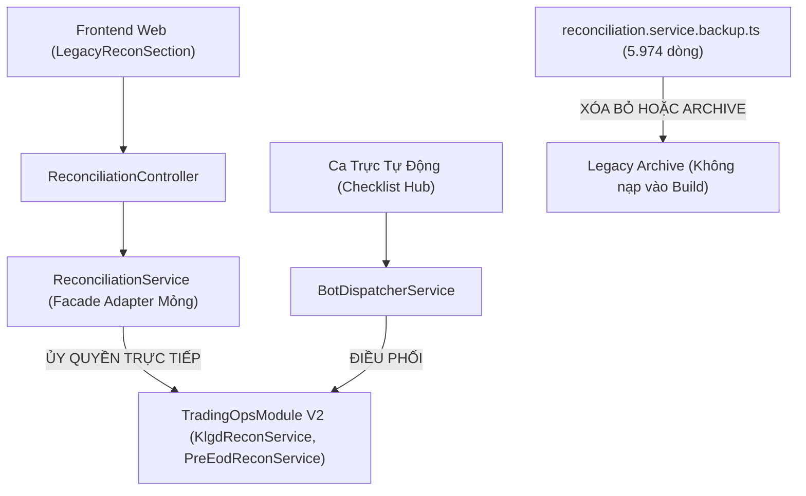

# BÁO CÁO PHÂN TÍCH CHUYÊN SÂU & ĐÁNH GIÁ TÁC ĐỘNG KỸ THUẬT
## Lộ Trình Gom Mã Nguồn Cũ (Legacy) & Áp Dụng Mô Hình Thin Adapter (Strangler Fig)

---

### I. HIỆN TRẠNG MÃ NGUỒN THỰC TẾ (GROUND TRUTH AUDIT)

Qua việc kiểm tra trực tiếp mã nguồn của dự án bằng công cụ đọc code, cấu trúc thực tế của phân hệ đối chiếu giao dịch hiện tại như sau:

#### 1. File Rác Tĩnh Thực Sự Cần Xử Lý
* **Đường dẫn**: [`backend/src/modules/reconciliation/reconciliation.service.backup.ts`](file:///c:/Users/hiepth/OneDrive%20-%20MERCANTILE%20EXCHANGE%20OF%20VIETNAM/Documents/Github/mxv-cqg-download-investigation/backend/src/modules/reconciliation/reconciliation.service.backup.ts)
* **Kích thước**: **5.974 dòng code** (228.5 KB).
* **Đặc điểm**: Bắt đầu bằng cờ `// @ts-nocheck` ([L1](file:///c:/Users/hiepth/OneDrive%20-%20MERCANTILE%20EXCHANGE%20OF%20VIETNAM/Documents/Github/mxv-cqg-download-investigation/backend/src/modules/reconciliation/reconciliation.service.backup.ts#L1)).
* **Hiện trạng sử dụng**: **0%**. Không có bất kỳ module, controller, hay script nào import file này. Đây là tệp sao lưu nguyên khối (Monolith backup) từ một đợt refactor trước đó bị bỏ quên.
* **Tác động**: Làm nặng ổ đĩa, gây nhiễu công cụ tìm kiếm code (grep/search) và làm chậm quá trình quét của IDE.

---

#### 2. Cấu Trúc File `ReconciliationService` Hiện Tại
* **Đường dẫn**: [`backend/src/modules/reconciliation/reconciliation.service.ts`](file:///c:/Users/hiepth/OneDrive%20-%20MERCANTILE%20EXCHANGE%20OF%20VIETNAM/Documents/Github/mxv-cqg-download-investigation/backend/src/modules/reconciliation/reconciliation.service.ts)
* **Kích thước**: **360 dòng code** (9.6 KB).
* **Bản chất thực tế**: File này **thực chất đã được cấu trúc thành một Facade (Bộ điều hướng)**, không chứa trực tiếp 6.000 dòng tính toán. Nó đang ủy quyền tới 6 sub-services nội bộ thuộc thư mục `modules/reconciliation/services/` ([L50-L57](file:///c:/Users/hiepth/OneDrive%20-%20MERCANTILE%20EXCHANGE%20OF%20VIETNAM/Documents/Github/mxv-cqg-download-investigation/backend/src/modules/reconciliation/reconciliation.service.ts#L50-L57)):
  1. `KlgdReconService` (`modules/reconciliation/services/klgd-recon.service.ts`)
  2. `PreEodReconService` (`modules/reconciliation/services/pre-eod-recon.service.ts`)
  3. `CcpReconService` (`modules/reconciliation/services/ccp-recon.service.ts`)
  4. `CqgSyncReconService` (`modules/reconciliation/services/cqg-sync-recon.service.ts`)
  5. `ReconConsoleSummaryService` (`modules/reconciliation/services/recon-console-summary.service.ts`)
  6. `DsgdBeforeEodService` (`modules/reconciliation/services/dsgd-before-eod.service.ts`)

---

#### 3. Mối Liên Kết Phụ Thuộc Từ Frontend
* **Controller**: [`backend/src/modules/reconciliation/reconciliation.controller.ts`](file:///c:/Users/hiepth/OneDrive%20-%20MERCANTILE%20EXCHANGE%20OF%20VIETNAM/Documents/Github/mxv-cqg-download-investigation/backend/src/modules/reconciliation/reconciliation.controller.ts)
* **Các Endpoint Đang Phục Vụ Frontend**:
  - `POST /api/v1/reconciliation/check-klgd` ([L107](file:///c:/Users/hiepth/OneDrive%20-%20MERCANTILE%20EXCHANGE%20OF%20VIETNAM/Documents/Github/mxv-cqg-download-investigation/backend/src/modules/reconciliation/reconciliation.controller.ts#L107))
  - `POST /api/v1/reconciliation/check-eod` ([L331](file:///c:/Users/hiepth/OneDrive%20-%20MERCANTILE%20EXCHANGE%20OF%20VIETNAM/Documents/Github/mxv-cqg-download-investigation/backend/src/modules/reconciliation/reconciliation.controller.ts#L331))
  - `POST /api/v1/reconciliation/check-pre-eod` ([L901](file:///c:/Users/hiepth/OneDrive%20-%20MERCANTILE%20EXCHANGE%20OF%20VIETNAM/Documents/Github/mxv-cqg-download-investigation/backend/src/modules/reconciliation/reconciliation.controller.ts#L901))
  - `GET /api/v1/reconciliation/console-summary` ([L1378](file:///c:/Users/hiepth/OneDrive%20-%20MERCANTILE%20EXCHANGE%20OF%20VIETNAM/Documents/Github/mxv-cqg-download-investigation/backend/src/modules/reconciliation/reconciliation.controller.ts#L1378))
* **Màn Hình UI Tiêu Thụ**:
  - `LegacyReconSection.tsx` ([L1316-L1328](file:///c:/Users/hiepth/OneDrive%20-%20MERCANTILE%20EXCHANGE%20OF%20VIETNAM/Documents/Github/mxv-cqg-download-investigation/frontend/src/app/trading-manager/components/legacy-ms-cqg/LegacyReconSection.tsx#L1316-L1328))
  - `LegacyBackupThongKeSection.tsx`

---

### II. MA TRẬN ĐỐI CHIẾU TRÙNG LẶP (DUPLICATION AUDIT)

Hiện tại, hệ thống đang tồn tại **sự trùng lặp thuật toán** giữa 2 phân hệ:

| Nghiệp Vụ | V1 Cũ (`modules/reconciliation/`) | V2 Chuẩn Kiến Trúc (`modules/trading-ops/`) | Đánh Giá Tác Động |
| :--- | :--- | :--- | :--- |
| **Đối Chiếu KLGD** | `reconciliation/services/klgd-recon.service.ts` | `trading-ops/services/klgd-recon.service.ts` | **Trùng lặp 100% logic**. Nếu sửa thuật toán ở V2, V1 không được cập nhật $\rightarrow$ Kết quả khi chạy ca tự động (V2) và bấm nút tay trên Web (V1) có nguy cơ lệch nhau. |
| **Chốt Pre-EOD 3 Bên** | `reconciliation/services/pre-eod-recon.service.ts` | `trading-ops/services/pre-eod-recon.service.ts` | **Trùng lặp 100% logic**. Cần quy về 1 nguồn chân lý duy nhất. |
| **Ghép File CQG** | `cqg/cqg-sync.service.ts` | `trading-ops/services/cqg-merger.service.ts` | V2 đã hoàn thiện độc lập và kiểm chứng Twin-Run. |
| **Quét Ký Quỹ Âm** | `reconciliation/reconciliation.service.ts` | `trading-ops/services/margin-checker.service.ts` | V2 độc lập, cắm vào Worker. |

---

### III. ĐÁNH GIÁ RỦI RO NẾU THỰC HIỆN SAI

1. **Rủi ro Xóa Ngay (Big Bang Delete)**:
   - Nếu xóa `modules/reconciliation/` ngay lập tức $\rightarrow$ `ReconciliationController` lỗi biên dịch $\rightarrow$ Toàn bộ màn hình Đối chiếu tay trên Frontend chết hoàn toàn (Lỗi 404/500).
2. **Rủi ro Di Chuyển Ngay Sang Thư Mục `legacy/`**:
   - Nếu bê cả folder `modules/reconciliation/` sang `src/legacy/reconciliation/` mà không cập nhật các import path trong `app.module.ts`, `bot-engine.module.ts`, `reconciliation.controller.ts` $\rightarrow$ Đứt gãy toàn bộ đường ống Dependency Injection của NestJS.
3. **Rủi ro Duy Trì 2 Nơi Song Song Lâu Dài**:
   - Vi phạm nguyên tắc DRY (Don't Repeat Yourself) và Single Source of Truth. Người bảo trì sau này sẽ không biết sửa logic ở đâu khi sàn thay đổi định dạng file.

---

### IV. LỘ TRÌNH CHUYỂN ĐỔI CHUẨN XÁC (STRANGLER FIG PROTOCOL)

Dựa trên dữ liệu thực tế, giải pháp tối ưu được chia làm **3 giai đoạn có kiểm soát**:

#### Giai Đoạn 1: Dọn Dẹp File Chết (Thực hiện ngay - Rủi ro 0%)
- Di chuyển hoặc xóa bỏ file thừa `backend/src/modules/reconciliation/reconciliation.service.backup.ts`.
- **Kết quả**: Giảm ngay 5.974 dòng code rác không sử dụng, làm sạch kết quả tìm kiếm mã nguồn.

#### Giai Đoạn 2: Hợp Nhất Nguồn Chân Lý Sang V2 (Thin Adapter Delegation)
- Trong `backend/src/modules/reconciliation/reconciliation.module.ts`:
  - Import `TradingOpsModule`.
- Trong `backend/src/modules/reconciliation/reconciliation.service.ts`:
  - Thay vì inject sub-service cũ `reconciliation/services/klgd-recon.service.ts`, ta inject `KlgdReconService` từ `modules/trading-ops/services/klgd-recon.service.ts`.
  - Thay vì inject sub-service cũ `reconciliation/services/pre-eod-recon.service.ts`, ta inject `PreEodReconService` từ `modules/trading-ops/services/pre-eod-recon.service.ts`.
- **Kết quả**: 
  - Toàn bộ tính toán từ nút bấm tay trên Frontend và ca trực tự động của Bot **chạy chung 1 bộ não duy nhất tại V2 (`trading-ops`)**.
  - Không cần sửa bất kỳ dòng code nào trên Frontend.
  - Các sub-service trùng lặp cũ trong `modules/reconciliation/services/` có thể được dọn dẹp an toàn.

#### Giai Đoạn 3: Khai Tử Hoàn Toàn (Chỉ Khi Frontend Nâng Cấp)
- Khi Frontend được phát triển phiên bản UI mới gọi trực tiếp vào API V2 (`/api/v1/trading-ops/`), lúc này `modules/reconciliation/` sẽ được chuyển trọn vẹn vào `src/legacy/` hoặc gỡ bỏ hoàn toàn.
