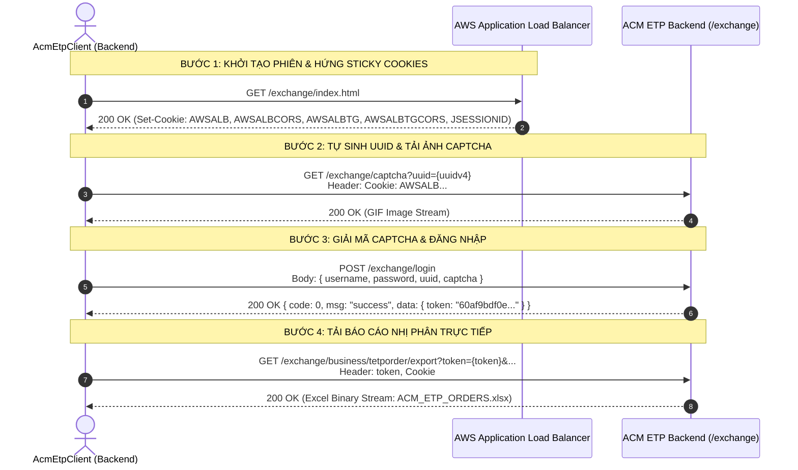

# ĐẶC TẢ KỸ THUẬT PHÂN HỆ ACM ETP API INGRESS CLIENT

## 1. Kiến Trúc Phiên Làm Việc (AWS ALB Sticky Session + UUID + Captcha)



---

## 2. Danh Mục Endpoint REST API Báo Cáo ACM ETP Đã Giải Mã Thành Công

| STT | Mã Báo Cáo | Tên Nghiệp Vụ | Loại Thao Tác | Endpoint REST API | Query Parameters |
| :---: | :--- | :--- | :---: | :--- | :--- |
| 1 | **`ACM_ETP_ORDERS`** | **Sổ lệnh ETP** | Xuất File Excel | `GET /exchange/business/tetporder/export` | `token`, `brokerid`, `investorid`, `direction`, `comboffsetflag`, `instrumentid`, `orderstatus`, `tradingfirmid`, `orderref`, `ordersysid` |
| 2 | **`ACM_ETP_ORDERS`** | **Sổ lệnh ETP** | Phân trang JSON | `GET /exchange/business/tetporder/page` | `page`, `limit`, `order`, `orderField`, `_t` |
| 3 | **`ACM_ETP_TRADES`** | **Khớp lệnh ETP** | Xuất File Excel | `GET /exchange/business/tetptrade/export` | `token`, `brokerid`, `investorid`, `direction`, `offsetflag`, `instrumentid`, `startTradedate`, `endTradedate`, `minPrice`, `maxPrice` |
| 4 | **`ACM_ETP_TRADES`** | **Khớp lệnh ETP** | Phân trang JSON | `GET /exchange/business/tetptrade/page` | `page`, `limit`, `order`, `orderField`, `_t` |
| 5 | **`SYS_NAV`** | **Xác thực Token** | JSON Menu | `GET /exchange/sys/menu/nav` | Header `token` |

---

## 3. Quy Cách Headers Bắt Buộc

Khi gửi request tới ACM ETP, backend yêu cầu:
```http
token: 60af9bdf0e1a1d596a93158dc69a06a0
Cookie: JSESSIONID=...; language=en; token=60af9bdf0e...; AWSALB=...; AWSALBCORS=...; AWSALBTG=...; AWSALBTGCORS=...
Referer: https://acm-etp.acmmex.com/exchange/index.html
Accept: text/html,application/xhtml+xml,application/xml;q=0.9,*/*;q=0.8
User-Agent: Mozilla/5.0 (Windows NT 10.0; Win64; x64) AppleWebKit/537.36
```
