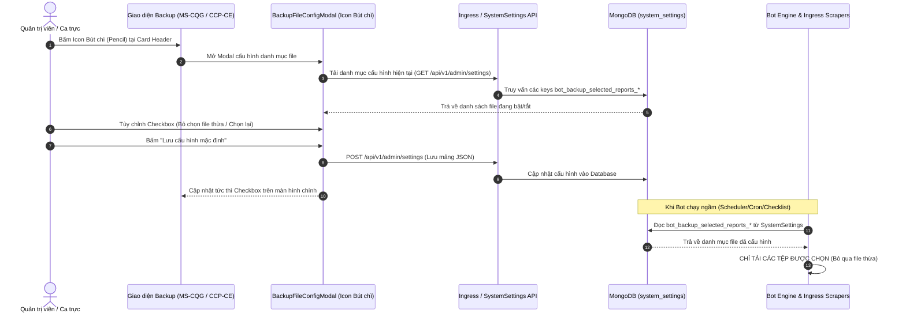

# ĐẶC TẢ THIẾT KẾ KIẾN TRÚC & GIAO DIỆN: CẤU HÌNH TỆP SAO LƯU MẶC ĐỊNH (BACKUP FILE CONFIGURATION)

> **Dự án**: MXV Modular Refactor — Phân hệ Quản Lý Giao Dịch (Trading Operations & Ingress)  
> **Tài liệu**: Đặc tả thiết kế kỹ thuật (Technical Design Document - TDD)  
> **Mục tiêu**: Bổ sung icon bút chì trên giao diện các trang `/trading-manager/backup/ms-cqg` và `/trading-manager/backup/ccp-ce` để cấu hình danh mục file mặc định cần tải, lưu trữ vào CSDL MongoDB, ngăn chặn tình trạng tải thừa các file không dùng đến khi chạy thủ công hoặc chạy ngầm tự động.  
> **Trạng thái**: Bản thảo thiết kế hoàn chỉnh (Sẵn sàng phát triển)

---

## 1. TỔNG QUAN & MỤC TIÊU NGHIỆP VỤ

### 1.1. Bối cảnh
Hệ thống hiện tại hỗ trợ thu thập và sao lưu dữ liệu giao dịch từ 5 nguồn chính:
1. **M-System (MS)**: 20 báo cáo Core MXV.
2. **CQG**: 9 tệp khớp lệnh và sổ lệnh từ 2 tài khoản CQG.
3. **CoreCCP (VNCLEAR)**: 25 báo cáo thanh toán bù trừ, ký quỹ và rủi ro.
4. **CoreEX (CE / ACM)**: 12 báo cáo liên thông sàn giao dịch tập trung CE.
5. **ACM (Straits Financial)**: 4 tệp Web ETP & SFTP Server.

### 1.2. Vấn đề hiện tại (Problem Statement)
1. **Frontend không nhớ cấu hình**: Các checkbox trên giao diện ([LegacyBackupThongKeSection.tsx](file:///c:/Users/hiepth/OneDrive%20-%20MERCANTILE%20EXCHANGE%20OF%20VIETNAM/Documents/Github/mxv-modular-refactor/frontend/src/app/trading-manager/components/legacy-ms-cqg/LegacyBackupThongKeSection.tsx) và [CcpCeBackupThongKeSection.tsx](file:///c:/Users/hiepth/OneDrive%20-%20MERCANTILE%20EXCHANGE%20OF%20VIETNAM/Documents/Github/mxv-modular-refactor/frontend/src/app/trading-manager/components/core-ccp/CcpCeBackupThongKeSection.tsx)) luôn được khởi tạo cứng là `true` (chọn tất cả). Mỗi lần người dùng tải lại trang (F5) hoặc chuyển tab, trạng thái bị đặt lại về ban đầu.
2. **Lãng phí tài nguyên máy chủ**: Rất nhiều tệp hiện tại chưa dùng đến trong ca trực hàng ngày (như 5 file Market Maker `DSL_MM, DSLDK_MM, DSLCK_MM, DSLDH_MM, DSGD_MM` luôn rỗng 0 dòng, file `ORDERBOOK_ALL_MM`, các file sao kê tài khoản chưa phát sinh).
3. **Tiến trình Bot chạy ngầm tự động (Scheduler/Cron)**: Khi chạy ngầm, bot không nhận danh sách lọc từ giao diện nên luôn tự động fallback về tải toàn bộ 100% tệp ([ccp-ce-download.handler.ts#L92](file:///c:/Users/hiepth/OneDrive%20-%20MERCANTILE%20EXCHANGE%20OF%20VIETNAM/Documents/Github/mxv-modular-refactor/backend/src/modules/ingress/handlers/ccp-ce-download.handler.ts#L92)), kéo dài thời gian hoàn thành tác vụ ca trực từ 2 - 3 lần.

### 1.3. Mục tiêu thiết kế
* Cung cấp **Icon Bút chì (Pencil Icon)** trực quan trên giao diện:
  - Cho phép người dùng mở Modal xem toàn bộ danh mục file của từng phân hệ.
  - Bật/tắt checkbox các file mong muốn lưu trữ mặc định.
  - Cung cấp nút thao tác nhanh: **"Bỏ chọn các file thừa / rỗng"**, **"Chọn tất cả"**, **"Khôi phục mặc định"**.
* **Lưu cấu hình vào Database (MongoDB `system_settings`)**:
  - Khi lưu, cấu hình có hiệu lực vĩnh viễn cho đến khi được thay đổi tiếp.
  - Checkbox trên UI tự động đồng bộ theo cấu hình đã lưu.
  - **Scheduler & Bot chạy tự động đọc cấu hình này từ CSDL** để chỉ tải đúng các tệp cần thiết, triệt tiêu hoàn toàn việc tải thừa.

---

## 2. PHÂN TÍCH HIỆN TRẠNG MÃ NGUỒN (AS-IS CODE AUDIT)

### 2.1. Frontend
* **Trang MS – CQG** ([LegacyBackupThongKeSection.tsx#L304-L345](file:///c:/Users/hiepth/OneDrive%20-%20MERCANTILE%20EXCHANGE%20OF%20VIETNAM/Documents/Github/mxv-modular-refactor/frontend/src/app/trading-manager/components/legacy-ms-cqg/LegacyBackupThongKeSection.tsx#L304-L345)):
  ```typescript
  // Trạng thái khởi tạo cứng trong useState:
  const [msReports, setMsReports] = useState<Record<string, boolean>>({
    NKTTHT: true, 'DSTKGD-Futures': true, ...
  });
  const [cqgReports, setCqgReports] = useState<Record<string, boolean>>({
    FR1: true, FR2: true, ...
  });
  ```
* **Trang CCP – CE** ([CcpCeBackupThongKeSection.tsx#L125-L147](file:///c:/Users/hiepth/OneDrive%20-%20MERCANTILE%20EXCHANGE%20OF%20VIETNAM/Documents/Github/mxv-modular-refactor/frontend/src/app/trading-manager/components/core-ccp/CcpCeBackupThongKeSection.tsx#L125-L147)):
  ```typescript
  const [ccpReports, setCcpReports] = useState<Record<string, boolean>>(() =>
    Object.fromEntries(CORE_CCP_REPORTS_LIST.map((r) => [r.key, true]))
  );
  const [ceReports, setCeReports] = useState<Record<string, boolean>>(() =>
    Object.fromEntries(CORE_EX_REPORTS_LIST.map((r) => [r.key, true]))
  );
  ```

### 2.2. Backend & Ingress Trigger
* [ingress-download.controller.ts#L69-L83](file:///c:/Users/hiepth/OneDrive%20-%20MERCANTILE%20EXCHANGE%20OF%20VIETNAM/Documents/Github/mxv-modular-refactor/backend/src/modules/ingress/controllers/ingress-download.controller.ts#L69-L83):
  Khi gọi `triggerDownload` mà không truyền mảng `targets`, backend tự gán mảng tĩnh cứng `defaultTargets` thay vì lấy từ DB.
* [ccp-ce-download.handler.ts#L92](file:///c:/Users/hiepth/OneDrive%20-%20MERCANTILE%20EXCHANGE%20OF%20VIETNAM/Documents/Github/mxv-modular-refactor/backend/src/modules/ingress/handlers/ccp-ce-download.handler.ts#L92):
  ```typescript
  const reportCodes = reports && reports.length > 0 ? reports : ['FULL'];
  ```
  Nếu Scheduler chạy ngầm không truyền `reports`, handler mặc định tải toàn bộ (`FULL`).

---

## 3. KIẾN TRÚC GIẢI PHÁP TỔNG THỂ (TO-BE ARCHITECTURE)

### 3.1. Sơ đồ luồng dữ liệu (Data Flow Diagram)



---

## 4. ĐẶC TẢ CSDL & CẤU HÌNH HỆ THỐNG (SYSTEM SETTINGS)

Hệ thống tái sử dụng bảng MongoDB [system_settings](file:///c:/Users/hiepth/OneDrive%20-%20MERCANTILE%20EXCHANGE%20OF%20VIETNAM/Documents/Github/mxv-modular-refactor/backend/src/modules/system-settings/system-settings.service.ts) để tuân thủ nguyên tắc Zero-Schema-Break.

### 4.1. Bảng danh mục Cấu hình Keys

| Cấu hình Key (`key`) | Phân hệ | Kiểu dữ liệu | Giá trị mặc định (Gợi ý tối ưu) |
| :--- | :---: | :---: | :--- |
| `bot_backup_selected_reports_ms` | M-System | JSON Array String | `["DSGD","DSLDK","DSLCK","DSLH","DSLK","TTM","TTTT","NR","QLTKGD","DSQLKQ","DSTKGD-Futures","DSTKGD-Spread","DSTKGD-LME","DSTKGD-ACM","DSTrader","market truoc 6h","NKTTHT"]` |
| `bot_backup_selected_reports_cqg` | CQG | JSON Array String | `["FR1","FR2","PS1","PS2","OP1","OP2","OD1","OD2"]` *(Tạm bỏ file AS thừa)* |
| `bot_backup_selected_reports_ccp` | CoreCCP | JSON Array String | `["DSL","DSLDK","DSLCK","DSLDH","DSGD","TTM","TTTT","QLTTTKGD","QLTTTVKD","DSQLKQ_TKGD","DSQLKQ_TVKD","NR","DSTKGD","GTT","HH","HD","TYGIA","EOD"]` *(Bỏ 5 file MM rỗng: DSL_MM, DSLDK_MM, DSLCK_MM, DSLDH_MM, DSGD_MM)* |
| `bot_backup_selected_reports_ce` | CoreEX | JSON Array String | `["DSGD","DSL","DSLCK","DSLDK","DSLH","GTT","HH","HD","TTM"]` *(Bỏ các file rỗng 0 dòng: SESSION_CONFIG, SESSION_INFO, DSGD_ALL, DSGD_MM)* |
| `bot_backup_selected_reports_acm` | ACM Straits | JSON Array String | `["FILL","ORDER","SFTP_CSV"]` *(Bỏ file sao kê XLS phụ nếu không cần)* |

---

## 5. ĐẶC TẢ GIAO DIỆN NGƯỜI DÙNG (FRONTEND SPECIFICATIONS)

### 5.1. Vị trí đặt Icon Bút chì (`Pencil` từ `lucide-react`)

1. **Trên từng Card Header**:
   - Đặt cạnh tiêu đề Card (ví dụ bên phải nhãn `Backup MS`, `Backup CQG`, `Backup CoreCCP`, `Backup CoreEX`):
   ```tsx
   <div style={{ display: 'flex', alignItems: 'center', gap: '8px' }}>
     <span style={{ fontSize: '0.86rem', fontWeight: 800 }}>Backup CoreCCP</span>
     <button
       type="button"
       onClick={() => handleOpenConfigModal('CCP')}
       className="btn-icon"
       style={{
         padding: '4px',
         borderRadius: '4px',
         border: '1px solid var(--border-color)',
         backgroundColor: 'var(--bg-input)',
         cursor: 'pointer',
       }}
       title="Cấu hình danh mục tệp tải mặc định cho CoreCCP"
     >
       <Pencil size={13} color="var(--text-secondary)" />
     </button>
   </div>
   ```

2. **Trên Header Bar chung của Trang**:
   - Bổ sung nút bấm cạnh bộ chọn Ngày phiên:
   ```tsx
   <button
     type="button"
     onClick={() => handleOpenConfigModal('ALL')}
     className="btn btn-secondary"
     style={{ display: 'flex', alignItems: 'center', gap: '6px', fontSize: '0.8rem' }}
   >
     <Sliders size={14} />
     <span>Cấu hình tệp mặc định</span>
   </button>
   ```

### 5.2. Thiết kế Component `BackupFileConfigModal.tsx`

* **Tiêu đề Modal**: `Cấu hình danh mục tệp sao lưu mặc định`
* **Tabs phân hệ**:
  - Tab 1: `M-System (MS)`
  - Tab 2: `CQG Data`
  - Tab 3: `VNCLEAR CoreCCP`
  - Tab 4: `Core Exchange (CE)`
  - Tab 5: `ACM (Straits)`
* **Danh sách hiển thị từng tệp**:
  - Checkbox chọn/bỏ chọn
  - Mã báo cáo (`key`)
  - Tên file lưu (`filename`)
  - Phân loại Tag:
    * `Cốt lõi (Bắt buộc)`: Màu xanh lá (`#10b981`)
    * `Khuyên dùng`: Màu xanh dương (`#3b82f6`)
    * `Chưa dùng / Có thể bỏ`: Màu hổ phách (`#f59e0b`)
    * `Market Maker (Rỗng 0 dòng)`: Màu xám (`#6b7280`)
* **Thanh tác vụ nhanh (Quick Action Bar)**:
  - Button `Chọn tất cả` (`CheckSquare` icon).
  - Button `Bỏ chọn file thừa/rỗng` (`Filter` icon) — *Tự động bỏ tick các file MM và file không phát sinh dữ liệu*.
  - Button `Khôi phục mặc định` (`RotateCcw` icon).
* **Footer Modal**:
  - Button `Hủy bỏ` (Đóng modal không lưu).
  - Button `Lưu cấu hình mặc định` (`Save` icon) — *Gọi API lưu vào `system_settings` và cập nhật state ở component cha*.

---

## 6. ĐẶC TẢ TẦNG BACKEND & THỰC THI (BACKEND SPECIFICATIONS)

### 6.1. Helper lấy danh mục cấu hình ([ingress-helper.ts](file:///c:/Users/hiepth/OneDrive%20-%20MERCANTILE%20EXCHANGE%20OF%20VIETNAM/Documents/Github/mxv-modular-refactor/backend/src/modules/ingress/helpers))
Xây dựng hàm tiện ích tái sử dụng:
```typescript
export async function getEffectiveReportTargets(
  settingsService: SystemSettingsService,
  systemKey: 'MS' | 'CQG' | 'CCP' | 'CE' | 'ACM',
  explicitReports?: string[],
): Promise<string[]> {
  // 1. Nếu lời gọi truyền đích danh reports -> Ưu tiên sử dụng
  if (explicitReports && explicitReports.length > 0) {
    return explicitReports;
  }

  // 2. Đọc từ CSDL MongoDB system_settings
  const settingKey = `bot_backup_selected_reports_${systemKey.toLowerCase()}`;
  const savedConfig = await settingsService.getSetting(settingKey, '');
  if (savedConfig) {
    try {
      const parsed = JSON.parse(savedConfig);
      if (Array.isArray(parsed) && parsed.length > 0) {
        return parsed;
      }
    } catch {}
  }

  // 3. Fallback về danh mục khuyến nghị cốt lõi
  return RECOMMENDED_DEFAULT_TARGETS[systemKey];
}
```

### 6.2. Cập nhật IngressDownloadController ([ingress-download.controller.ts](file:///c:/Users/hiepth/OneDrive%20-%20MERCANTILE%20EXCHANGE%20OF%20VIETNAM/Documents/Github/mxv-modular-refactor/backend/src/modules/ingress/controllers/ingress-download.controller.ts))
* Trong các endpoint `POST trigger-download`, `POST trigger-ccp-download`, `POST trigger-ce-download`:
  Thay thế toàn bộ logic fallback hardcode tĩnh bằng lệnh gọi `await getEffectiveReportTargets(...)`.

### 6.3. Cập nhật Job Handlers ([ccp-ce-download.handler.ts](file:///c:/Users/hiepth/OneDrive%20-%20MERCANTILE%20EXCHANGE%20OF%20VIETNAM/Documents/Github/mxv-modular-refactor/backend/src/modules/ingress/handlers/ccp-ce-download.handler.ts))
* Khi handler thực thi `DOWNLOAD_CCP_REPORT` hoặc `DOWNLOAD_CE_REPORT`:
  Kiểm tra mảng `reportCodes`. Nếu là tiến trình chạy tự động (không truyền reports cụ thể), bot sẽ đọc từ CSDL để chỉ tải các file được phép tải.

---

## 7. KẾ HOẠCH TRIỂN KHAI THEO GIAI ĐOẠN (IMPLEMENTATION ROADMAP)

### Giai đoạn 1: Backend Service & API Helper
* Tạo constants danh mục file và phân loại (Requisite / Optional / Unused) tại `src/shared/constants/backup-report-catalogs.constant.ts`.
* Thêm hàm `getEffectiveReportTargets` trong `backend/src/modules/ingress/helpers/`.
* Tích hợp đọc cấu hình CSDL vào [ingress-download.controller.ts](file:///c:/Users/hiepth/OneDrive%20-%20MERCANTILE%20EXCHANGE%20OF%20VIETNAM/Documents/Github/mxv-modular-refactor/backend/src/modules/ingress/controllers/ingress-download.controller.ts) và [ccp-ce-download.handler.ts](file:///c:/Users/hiepth/OneDrive%20-%20MERCANTILE%20EXCHANGE%20OF%20VIETNAM/Documents/Github/mxv-modular-refactor/backend/src/modules/ingress/handlers/ccp-ce-download.handler.ts).

### Giai đoạn 2: Frontend Modal Component
* Tạo component `BackupFileConfigModal.tsx` tại `frontend/src/app/trading-manager/components/modals/`.
* Xây dựng giao diện danh mục file, nhóm theo phân hệ, hỗ trợ phân loại Tag, checkbox và các nút thao tác nhanh.

### Giai đoạn 3: Tích hợp Giao diện 2 trang Backup
* Cập nhật [LegacyBackupThongKeSection.tsx](file:///c:/Users/hiepth/OneDrive%20-%20MERCANTILE%20EXCHANGE%20OF%20VIETNAM/Documents/Github/mxv-modular-refactor/frontend/src/app/trading-manager/components/legacy-ms-cqg/LegacyBackupThongKeSection.tsx) (trang `/trading-manager/backup/ms-cqg`):
  - Gắn icon `Pencil` vào Header của Card MS, CQG, ACM.
  - Khi load trang, đọc cấu hình từ CSDL để khởi tạo checkbox thay vì gán cứng `true`.
* Cập nhật [CcpCeBackupThongKeSection.tsx](file:///c:/Users/hiepth/OneDrive%20-%20MERCANTILE%20EXCHANGE%20OF%20VIETNAM/Documents/Github/mxv-modular-refactor/frontend/src/app/trading-manager/components/core-ccp/CcpCeBackupThongKeSection.tsx) (trang `/trading-manager/backup/ccp-ce`):
  - Gắn icon `Pencil` vào Header của Card CCP, CE, ACM.
  - Khởi tạo checkbox động theo cấu hình DB.

### Giai đoạn 4: Kiểm thử & Đảm bảo Chất lượng
* Kiểm thử lưu cấu hình qua giao diện Web và kiểm tra bản ghi trong MongoDB `system_settings`.
* Kiểm thử F5 reload trang: các checkbox giữ nguyên đúng trạng thái đã cấu hình.
* Kiểm thử kích hoạt tải tự động: Bot chỉ tải đúng danh mục tệp đã cấu hình, không còn tải các tệp Market Maker hay tệp rỗng thừa.
* Chạy `npx tsc --noEmit` & `npm run build` trên cả Frontend và Backend để đảm bảo zero lint/compile error.
