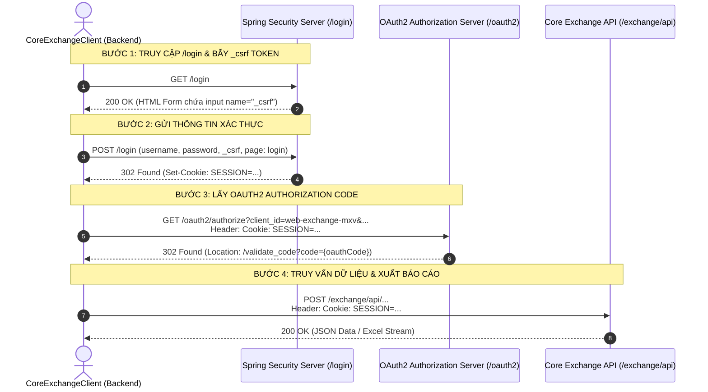

# ĐẶC TẢ KỸ THUẬT PHÂN HỆ CORE EXCHANGE (CE) API INGRESS CLIENT

## 1. Kiến Trúc Xác Thực (CSRF + Session Cookie + OAuth2 Authorize Code)

---

## 2. Thông Số Cấu Hình Mặc Định

| Tham Số | Giá Trị Môi Trường UAT | Ý Nghĩa |
| :--- | :--- | :--- |
| `baseUrl` | `https://uat-coreexchange.mxv.com.vn` | Host ứng dụng Core Exchange |
| `clientId` | `web-exchange-mxv` | Client ID ứng dụng Web SPA |
| `redirectUri` | `https://uat-coreexchange.mxv.com.vn/validate_code` | URI nhận Authorization Code |
| `username` | `hieptruong` | Tài khoản quản trị kiểm thử |
| `password` | `Taovipko0!` | Mật khẩu xác thực |

---

## 3. Danh Mục Báo Cáo Cốt Lõi Trên Core Exchange (CE)

| STT | Mã Báo Cáo | Tên Nghiệp Vụ | URL Route Gốc | File Kết Xuất Chuẩn | Nhóm Phân Hệ |
| :---: | :--- | :--- | :--- | :--- | :--- |
| 1 | **`DSL`** | **Sổ lệnh tổng hợp CE** | `/ORDERS/ORDERBOOK_ALL_ACM` | `DSL ACM CE.xlsx` | Quản lý sổ lệnh |
| 2 | **`DSGD`** | **Danh sách giao dịch CE** | `/ORDERS/ORDERMATCH_DETAIL_ACM` | `DSGD ACM CE.xlsx` | Quản lý sổ lệnh |
| 3 | **`DSLCK`** | **Lệnh chờ khớp CE** | `/ORDERS/ORDERBOOK_ACM` (Tab: Lệnh chờ khớp) | `DSLCK ACM CE.xlsx` | Quản lý sổ lệnh |
| 4 | **`DSLDK`** | **Lệnh đã khớp CE** | `/ORDERS/ORDERBOOK_ACM` (Tab: Lệnh đã khớp) | `DSLDK ACM CE.xlsx` | Quản lý sổ lệnh |
| 5 | **`DSLH`** | **Lệnh hủy CE** | `/ORDERS/ORDERBOOK_ACM` (Tab: Lệnh đã hủy) | `DSLH ACM CE.xlsx` | Quản lý sổ lệnh |
| 6 | **`GTT`** | **Giá thanh toán ACM** | `/PRODUCT/SETTLEMENT` | `GTT ACM.xlsx` | Quản lý sản phẩm |
| 7 | **`HH`** | **Hàng hóa ACM** | `/PRODUCT/COMMODITY` | `HH ACM.xlsx` | Quản lý sản phẩm |
| 8 | **`SESSION_INFO`** | **Thông tin phiên trong ngày** | `/SESSIONMNG/SESSION_INFO` | `SESSION_INFO.xlsx` | Quản lý phiên giao dịch |
