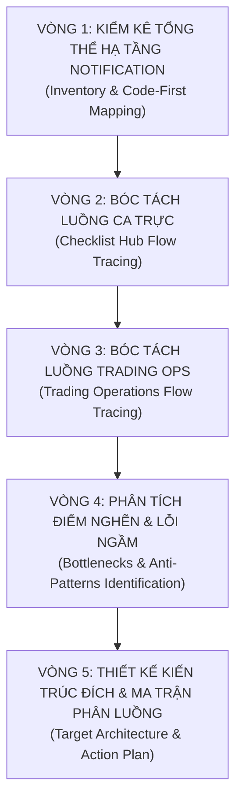
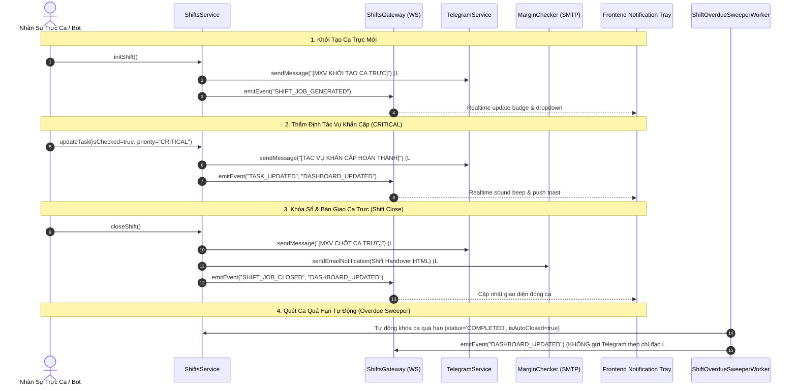
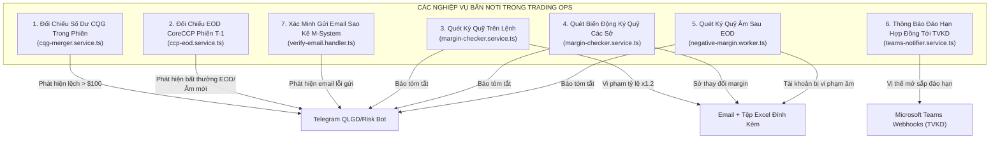
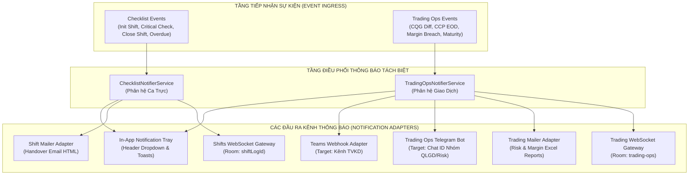

# RÀ SOÁT TOÀN DIỆN VÀ THIẾT KẾ PHÂN TÁCH LUỒNG THÔNG BÁO (NOTIFICATION FLOWS)
## BẰNG PHƯƠNG PHÁP LOOP ENGINEERING GIỮA PHÂN HỆ CA TRỰC VÀ TRADING OPS

> **Tài liệu Kỹ thuật Kiến trúc Hệ thống**  
> **Dự án**: MXV Operations & Trading Hub  
> **Phiên bản**: 2.0 (Kiến trúc Sau Phân Tách Độc Lập Ca Trực & Trading Ops)  
> **Phương pháp kiểm chứng**: Code-First Grounding (Loop Engineering 5 Vòng Lặp)  

---

## 1. TỔNG QUAN & BỐI CẢNH PHÂN TÁCH HỆ THỐNG

Trước đợt tái cấu trúc, hệ thống quản lý ca trực (**Shift Checklist**) và hệ thống vận hành giao dịch (**Trading Ops**) cùng dùng chung các dịch vụ ngầm (Background Services), hàng đợi Job (`bot-job-queue`), các kênh cảnh báo (`TelegramService`, `margin-checker.service`). 

Việc phân tách độc lập hai phân hệ này đặt ra yêu cầu **bắt buộc phải phân định lại toàn bộ luồng thông báo (Notification Flows)** bởi vì:
1. **Đối tượng thụ hưởng (Audience) hoàn toàn khác nhau**:
   - **Phân hệ Ca Trực (Checklist Hub)**: Phục vụ Trực ca IT, Trực ca Khối QLGD, Trưởng ca vận hành, Ban Lãnh đạo giám sát ca trực. Thông tin cần phản hồi tức thời về: Khởi tạo ca, tiến độ checklist, tác vụ trễ hạn, khóa sổ bàn giao ca, cảnh báo bot job ca trực bị lỗi kỹ thuật.
   - **Phân hệ Trading Ops**: Phục vụ Chuyên viên Quản trị Rủi ro (Risk Management), Chuyên viên Quản lý Giao dịch (Trading Ops Specialist), Chuyên viên Thanh toán Bù trừ (CoreCCP Clearing Ops) và các **Thành viên Kinh doanh (TVKD)**. Thông tin mang tính nghiệp vụ tài chính chuyên sâu: Lệch số dư CQG, bất thường công thức EOD CCP, vi phạm tỷ lệ ký quỹ trên lệnh, thay đổi ký quỹ Sở, tài khoản âm tiền, thông báo hợp đồng đáo hạn.
2. **Kênh truyền tải (Notification Mediums) phải riêng biệt**:
   - Ca trực cần thông báo dạng **Real-time Web UI, Notification Bell/Tray In-App, Socket Toast, Email Báo cáo bàn giao ca (Shift Handover)**; tuyệt đối hạn chế spam các nhóm Telegram nghiệp vụ.
   - Trading Ops cần thông báo dạng **Telegram Chuyên biệt theo Nhóm Nghiệp Vụ** (`chat_id` của nhóm QLGD/Risk), **Microsoft Teams Webhook** (kết nối trực tiếp kênh trao đổi với Thành viên thị trường), và **Email Báo cáo Chuyên sâu kèm tệp dữ liệu Excel**.
3. **Mức độ khẩn cấp & Tần suất (SLA & Cadence)**:
   - Ca trực diễn ra theo khung giờ ca (Ca 1: 06:30 - 14:30, Ca 2: 14:30 - 22:30, Ca 3: 22:30 - 06:30 hôm sau), tần suất thông báo gắn liền với các mốc checklist.
   - Trading Ops diễn ra liên tục theo chu kỳ khớp lệnh của thị trường quốc tế (24/5), mốc EOD, chu kỳ tính toán ký quỹ đầu ngày (SOD), mốc đóng phiên các Sở CME, ICE, SGX, LME, TOCOM.

---

## 2. PHƯƠNG PHÁP RÀ SOÁT: 5 VÒNG LẶP LOOP ENGINEERING

Để đảm bảo không bỏ sót bất kỳ luồng thông báo ngầm nào và loại trừ hoàn toàn các phỏng đoán không có căn cứ, quy trình rà soát được thực thi theo phương pháp **Loop Engineering** gồm 5 vòng lặp khép kín:



---

## 3. VÒNG 1: KIỂM KÊ TOÀN DIỆN MÃ NGUỒN NOTIFICATION HIỆN HÀNH

Dưới đây là bảng kiểm kê toàn bộ hạ tầng thông báo đang tồn tại trong Backend và Frontend của dự án:

| Tên Service / Component | Đường dẫn File | Kênh Truyền Tải | Vai trò / Nhiệm vụ Hiện tại |
| :--- | :--- | :--- | :--- |
| **`TelegramService`** | [`telegram.service.ts`](file:///c:/Users/hiepth/OneDrive%20-%20MERCANTILE%20EXCHANGE%20OF%20VIETNAM/Documents/Github/mxv-cqg-download-investigation/backend/src/modules/telegram/telegram.service.ts#L7-L100) | Telegram Bot API | Quản lý kết nối Bot Telegram, gửi tin nhắn HTML đến `chatId`. Hiện đang có bộ lọc bỏ qua các tin gửi nhóm chung QLGD nếu không truyền `customChatId`. |
| **`BotAlertEmailService`** | [`bot-alert-email.service.ts`](file:///c:/Users/hiepth/OneDrive%20-%20MERCANTILE%20EXCHANGE%20OF%20VIETNAM/Documents/Github/mxv-cqg-download-investigation/backend/src/modules/notifications/bot-alert-email.service.ts#L19-L87) | SMTP / Office365 | Chuyên trách gửi email cảnh báo vận hành Bot Job thất bại (`sendOperationalFailureAlert`) và cảnh báo Agent mất kết nối (`sendConnectionAlertEmail`). |
| **`TeamsNotifierService`** | [`teams-notifier.service.ts`](file:///c:/Users/hiepth/OneDrive%20-%20MERCANTILE%20EXCHANGE%20OF%20VIETNAM/Documents/Github/mxv-cqg-download-investigation/backend/src/modules/notifications/teams-notifier.service.ts#L33-L270) | MS Teams Webhook | Bắn thông báo hợp đồng đáo hạn (Open Positions / Pending Orders) tới từng kênh Teams của các Thành viên kinh doanh. |
| **`ShiftsGateway`** | [`shifts.gateway.ts`](file:///c:/Users/hiepth/OneDrive%20-%20MERCANTILE%20EXCHANGE%20OF%20VIETNAM/Documents/Github/mxv-cqg-download-investigation/backend/src/modules/shifts/shifts.gateway.ts#L17-L128) | Real-time WebSockets (Socket.io) | Phát các sự kiện `shift-updated`, `task-updated`, `shift-job-generated`, `shift-job-closed`, `dashboard-updated`, `job-status-updated`, `job-log-updated`. |
| **`MarginCheckerService`** | [`margin-checker.service.ts`](file:///c:/Users/hiepth/OneDrive%20-%20MERCANTILE%20EXCHANGE%20OF%20VIETNAM/Documents/Github/mxv-cqg-download-investigation/backend/src/modules/margin-checker/margin-checker.service.ts#L290-L349) | SMTP Nodemailer & Telegram | Gửi email báo cáo vi phạm ký quỹ, thay đổi ký quỹ, và kiêm luôn việc gửi Email Bàn giao ca trực (`sendEmailNotification`). |
| **`SystemSettingsService`** | [`system-settings.service.ts`](file:///c:/Users/hiepth/OneDrive%20-%20MERCANTILE%20EXCHANGE%20OF%20VIETNAM/Documents/Github/mxv-cqg-download-investigation/backend/src/modules/system-settings/system-settings.service.ts#L90-L140) | SMTP Nodemailer | Gửi email Security Audit khi thay đổi cài đặt hệ thống; gửi cảnh báo mất Refresh Token hòm thư Bot đọc email M365 (`#L215-L250`). |
| **`NotificationsService`** | [`notifications.service.ts`](file:///c:/Users/hiepth/OneDrive%20-%20MERCANTILE%20EXCHANGE%20OF%20VIETNAM/Documents/Github/mxv-cqg-download-investigation/backend/src/modules/notifications/notifications.service.ts#L12-L190) | CRUD Rules, Channels, Logs | Quản lý bảng cấu hình động `notification_rules`, `notification_channels`, `notification_logs`. |
| **`DashboardService`** | [`dashboard.service.ts`](file:///c:/Users/hiepth/OneDrive%20-%20MERCANTILE%20EXCHANGE%20OF%20VIETNAM/Documents/Github/mxv-cqg-download-investigation/backend/src/modules/dashboard/dashboard.service.ts#L229-L330) | REST API (`getActivity`, `getUnreadCount`) | Tập hợp dữ liệu từ `AuditLog` và `SystemLog` để cung cấp nguồn cấp dữ liệu thông báo In-App cho Frontend. |
| **`NotificationDropdown`** | [`NotificationDropdown.tsx`](file:///c:/Users/hiepth/OneDrive%20-%20MERCANTILE%20EXCHANGE%20OF%20VIETNAM/Documents/Github/mxv-cqg-download-investigation/frontend/src/components/NotificationDropdown.tsx#L1-L305) | UI In-App Notification Tray & Toasts | Hiển thị chuông thông báo, âm thanh Web Audio API, Toast tin tức nổi và danh sách hoạt động gần nhất trên thanh Header. |

---

## 4. VÒNG 2: BÓC TÁCH CHI TIẾT LUỒNG THÔNG BÁO CA TRỰC (CHECKLIST HUB)

Trong phân hệ Ca Trực, các sự kiện thông báo xoay quanh vòng đời của một ca trực (**Shift Lifecycle**) và trạng thái hoàn thành của từng tác vụ trong bảng checklist:



### Các Điểm Kích Hoạt Cụ Thể Trong Mã Nguồn:

1. **Khởi tạo ca trực** ([`shifts.service.ts#L231-L237`](file:///c:/Users/hiepth/OneDrive%20-%20MERCANTILE%20EXCHANGE%20OF%20VIETNAM/Documents/Github/mxv-cqg-download-investigation/backend/src/modules/shifts/shifts.service.ts#L231-L237)):
   - **Nội dung**: Bắn thông báo khởi tạo ca: Tên ca, Ngày trực, Phòng ban, Người trực chính.
   - **Kênh gọi**: `this.telegramService.sendMessage(...)`.
   - **Ghi log**: `SystemLogsService.logEvent({ eventType: 'JOB_GENERATION' })` ([`#L240`](file:///c:/Users/hiepth/OneDrive%20-%20MERCANTILE%20EXCHANGE%20OF%20VIETNAM/Documents/Github/mxv-cqg-download-investigation/backend/src/modules/shifts/shifts.service.ts#L240)).
   - **WebSocket**: `ShiftsGateway.emitEvent('SHIFT_JOB_GENERATED')` ([`#L74-L95`](file:///c:/Users/hiepth/OneDrive%20-%20MERCANTILE%20EXCHANGE%20OF%20VIETNAM/Documents/Github/mxv-cqg-download-investigation/backend/src/modules/shifts/shifts.gateway.ts#L74-L95)).

2. **Hoàn thành tác vụ khẩn cấp (CRITICAL Task)** ([`shifts.service.ts#L764-L773`](file:///c:/Users/hiepth/OneDrive%20-%20MERCANTILE%20EXCHANGE%20OF%20VIETNAM/Documents/Github/mxv-cqg-download-investigation/backend/src/modules/shifts/shifts.service.ts#L764-L773)):
   - **Điều kiện**: Khi tác vụ có `prioritySnapshot === 'CRITICAL'` được chuyển từ `isChecked = false` sang `true`.
   - **Nội dung**: `[TÁC VỤ KHẨN CẤP HOÀN THÀNH]` - Mã tác vụ, Tên tác vụ, Ca trực, Người thực hiện.
   - **Kênh gọi**: `this.telegramService.sendMessage(...)`.
   - **WebSocket**: `ShiftsGateway.emitEvent('TASK_UPDATED')` & `DASHBOARD_UPDATED`.

3. **Chốt ca trực & Gửi biên bản bàn giao** ([`shifts.service.ts#L1045-L1185`](file:///c:/Users/hiepth/OneDrive%20-%20MERCANTILE%20EXCHANGE%20OF%20VIETNAM/Documents/Github/mxv-cqg-download-investigation/backend/src/modules/shifts/shifts.service.ts#L1045-L1185)):
   - **Nội dung Telegram**: `[MXV CHỐT CA TRỰC]` - Tên ca, Ngày, Tỷ lệ hoàn thành $X/Y$, Ghi chú bàn giao (`handoverNote`).
   - **Nội dung Email Bàn giao**: Gửi email HTML tổng kết toàn bộ danh sách tác vụ checklist (Mã, Tên, Trạng thái, Người hoàn thành, Ghi chú) tới danh sách email nhận báo cáo bàn giao.
   - **Kênh gọi**: Gọi chéo sang `this.marginCheckerService.sendEmailNotification(...)` ([`#L1176`](file:///c:/Users/hiepth/OneDrive%20-%20MERCANTILE%20EXCHANGE%20OF%20VIETNAM/Documents/Github/mxv-cqg-download-investigation/backend/src/modules/shifts/shifts.service.ts#L1176)).

4. **Tự động quét khóa sổ ca quá hạn (Overdue Sweeper)** ([`shift-overdue-sweeper.worker.ts#L25-L110`](file:///c:/Users/hiepth/OneDrive%20-%20MERCANTILE%20EXCHANGE%20OF%20VIETNAM/Documents/Github/mxv-cqg-download-investigation/backend/src/modules/checklist-hub/scheduler/shift-overdue-sweeper.worker.ts#L25-L110)):
   - **Nhiệm vụ**: Chạy ngầm định kỳ hàng giờ (`@Cron(CronExpression.EVERY_HOUR)`), phát hiện các ca `shiftDate < todayStr` mà vẫn ở trạng thái `PENDING`.
   - **Hành vi**: Tự động chuyển `status = 'COMPLETED'`, `isAutoClosed = true`.
   - **Quy tắc đặc thù**: **TUYỆT ĐỐI KHÔNG GỬI TELEGRAM** (tuân thủ chỉ đạo của USER tại dòng 25); chỉ bắn WebSocket `DASHBOARD_UPDATED` để đồng bộ màn hình Web.

5. **Cảnh báo lỗi Bot Job thuộc Ca Trực** ([`bot-job-queue.service.ts#L501-L512`](file:///c:/Users/hiepth/OneDrive%20-%20MERCANTILE%20EXCHANGE%20OF%20VIETNAM/Documents/Github/mxv-cqg-download-investigation/backend/src/modules/checklist-hub/queue/bot-job-queue.service.ts#L501-L512)):
   - **Điều kiện**: Khi một Bot Job thực thi thất bại vượt quá số lần retry tối đa (`job.attempts >= job.maxAttempts`).
   - **Kênh gọi**: Gửi email cảnh báo vận hành tới Đội ngũ Kỹ thuật/DevOps qua `BotAlertEmailService.sendOperationalFailureAlert(job, errorMsg)` ([`bot-alert-email.service.ts#L92`](file:///c:/Users/hiepth/OneDrive%20-%20MERCANTILE%20EXCHANGE%20OF%20VIETNAM/Documents/Github/mxv-cqg-download-investigation/backend/src/modules/notifications/bot-alert-email.service.ts#L92)).
   - **WebSocket**: Bắn sự kiện `job-status-updated` (status: `'FAILED'`) và `DASHBOARD_UPDATED`.

---

## 5. VÒNG 3: BÓC TÁCH CHI TIẾT LUỒNG THÔNG BÁO TRADING OPS

Khác với Ca Trực, các luồng thông báo trong phân hệ Trading Ops phản ánh sức khỏe hệ thống khớp lệnh, quản trị rủi ro margin và tính toàn vẹn dữ liệu kế toán giao dịch đa bên:



### Các Điểm Kích Hoạt Cụ Thể Trong Mã Nguồn:

1. **Đối chiếu đồng bộ số dư CQG** ([`cqg-merger.service.ts#L818-L824`](file:///c:/Users/hiepth/OneDrive%20-%20MERCANTILE%20EXCHANGE%20OF%20VIETNAM/Documents/Github/mxv-cqg-download-investigation/backend/src/modules/trading-ops/services/merger/cqg-merger.service.ts#L818-L824)):
   - **Kích hoạt**: Sau khi gộp và so sánh số dư giữa M-System và 2 tài khoản CQG (`FR1 + FR2`, `PS1 + PS2`).
   - **Nội dung**: `[ĐỐI CHIẾU ĐỒNG BỘ SỐ DƯ CQG - DD/MM/YYYY]` - Trạng thái (Khớp hoàn toàn hay Phát hiện lệch số dư), Số tài khoản lệch $> \$100$.
   - **Kênh gọi**: `this.telegramService.sendMessage(telegramMsg)`.

2. **Đối chiếu EOD CoreCCP** ([`ccp-eod.service.ts#L662-L672`](file:///c:/Users/hiepth/OneDrive%20-%20MERCANTILE%20EXCHANGE%20OF%20VIETNAM/Documents/Github/mxv-cqg-download-investigation/backend/src/modules/trading-ops/services/recon/ccp-eod.service.ts#L662-L672)):
   - **Kích hoạt**: Kiểm tra đối chiếu số liệu EOD CoreCCP phiên $T-1$.
   - **Nội dung**: `[ĐỐI CHIẾU EOD CORECCP - PHIÊN T-1]` - Tổng số TK CoreCCP, số TK lệch công thức, số TK âm ký quỹ MỚI (IMR), danh sách các TK âm mới.
   - **Kênh gọi**: `this.telegramService.sendMessage(telegramMsg)`.

3. **Cảnh báo lỗi gửi email sao kê M-System** ([`verify-email.handler.ts#L139-L160`](file:///c:/Users/hiepth/OneDrive%20-%20MERCANTILE%20EXCHANGE%20OF%20VIETNAM/Documents/Github/mxv-cqg-download-investigation/backend/src/modules/trading-ops/handlers/verify-email.handler.ts#L139-L160)):
   - **Kích hoạt**: Bot tải báo cáo lịch sử gửi email từ M-System Admin và quét phát hiện có bản ghi gửi thất bại.
   - **Nội dung**: `[CẢNH BÁO LỖI GỬI EMAIL SAO KÊ]` - Tổng số email, danh sách các email/SĐT bị fail và tiêu đề sao kê.
   - **Kênh gọi**: `this.telegramService.sendMessage(alertMsg)`.

4. **Kiểm tra Mức Ký quỹ trên Giá trị Lệnh (Margin On Order)** ([`margin-checker.service.ts#L1255-L1315`](file:///c:/Users/hiepth/OneDrive%20-%20MERCANTILE%20EXCHANGE%20OF%20VIETNAM/Documents/Github/mxv-cqg-download-investigation/backend/src/modules/margin-checker/margin-checker.service.ts#L1255-L1315)):
   - **Kích hoạt**: Đọc file `market.csv` và dữ liệu hàng hóa, phát hiện mã hàng vi phạm ngưỡng tỷ lệ ký quỹ sau nhân hệ số 1.2.
   - **Email**: Gửi email kèm bảng HTML chi tiết và tệp đính kèm `Check muc ky quy hang hoa_*.xlsx` qua `sendEmailNotification`.
   - **Telegram**: Gửi tin nhắn cảnh báo tới `config.marginOnOrder.telegramChatId` qua `sendTelegramNotification`.

5. **Kiểm tra Thay đổi Ký quỹ Các Sở (Margin Change)** ([`margin-checker.service.ts#L1485-L1545`](file:///c:/Users/hiepth/OneDrive%20-%20MERCANTILE%20EXCHANGE%20OF%20VIETNAM/Documents/Github/mxv-cqg-download-investigation/backend/src/modules/margin-checker/margin-checker.service.ts#L1485-L1545)):
   - **Kích hoạt**: So sánh thông báo ký quỹ mới từ CME, ICE, SGX, JPX, LME với bảng hiện hành.
   - **Email**: Gửi email cảnh báo kèm tệp `Check thay doi ky quy_*.xlsx` qua `sendEmailNotification`.
   - **Telegram**: Bắn tin cảnh báo số lượng hàng hóa thay đổi tới `config.marginChange.telegramChatId`.

6. **Thông báo Đáo hạn Hợp đồng đến Thành viên Thị trường (Teams Webhook)** ([`teams-notifier.service.ts#L192-L270`](file:///c:/Users/hiepth/OneDrive%20-%20MERCANTILE%20EXCHANGE%20OF%20VIETNAM/Documents/Github/mxv-cqg-download-investigation/backend/src/modules/notifications/teams-notifier.service.ts#L192-L270)):
   - **Kích hoạt**: Phân tích file trạng thái mở (`TTTT.xlsx`) hoặc API M-System, đối chiếu ngày giao dịch đầu tiên / ngày thông báo đầu tiên (FND/LTD) của các mã hợp đồng.
   - **Kênh gọi**: Gửi card JSON Message trực tiếp qua URL Microsoft Teams Webhook được ánh xạ theo từng Mã Thành Viên (`memberCode`).
   - **Ghi vết**: Lưu nhật ký gửi vào bảng CSDL `notification_logs` với status `SENT`/`FAILED`.

---

## 6. VÒNG 4: NHẬN DIỆN 5 ĐIỂM NGHẼN & LỖI NGẦM KIẾN TRÚC KHI TÁCH ĐỘC LẬP

Qua việc kiểm tra đối chiếu trực tiếp các dòng mã nguồn, AI Assistant phát hiện **5 lỗi kiến trúc nghiêm trọng** đang tồn tại giữa hai phân hệ:

### LỖI NGUY HIỂM 1: Lỗi "Nuốt" Toàn Bộ Cảnh Báo Telegram Của Trading Ops
- **Dòng code vi phạm**: [`telegram.service.ts#L38-L45`](file:///c:/Users/hiepth/OneDrive%20-%20MERCANTILE%20EXCHANGE%20OF%20VIETNAM/Documents/Github/mxv-cqg-download-investigation/backend/src/modules/telegram/telegram.service.ts#L38-L45):
  ```typescript
  async sendMessage(text: string, customChatId?: string): Promise<void> {
    // Nếu không có customChatId (tin nhắn gửi nhóm chung QLGD), bỏ qua theo yêu cầu đóng tính năng Telegram QLGD
    if (!customChatId) {
      this.logger.log(
        `[QLGD TELEGRAM DISABLED] Bỏ qua gửi thông báo nhóm QLGD: ${text.replace(/<[^>]*>/g, '').substring(0, 80)}...`,
      );
      return;
    }
  ```
- **Hệ quả thực tế**:
  - Khi người dùng yêu cầu tắt thông báo Telegram cho ca trực, lập trình viên trước đây đã thêm điều kiện `if (!customChatId) return`.
  - Tuy nhiên, trong phân hệ **Trading Ops**, các service quan trọng bậc nhất gồm:
    - [`cqg-merger.service.ts#L823`](file:///c:/Users/hiepth/OneDrive%20-%20MERCANTILE%20EXCHANGE%20OF%20VIETNAM/Documents/Github/mxv-cqg-download-investigation/backend/src/modules/trading-ops/services/merger/cqg-merger.service.ts#L823): `this.telegramService.sendMessage(telegramMsg)`
    - [`ccp-eod.service.ts#L671`](file:///c:/Users/hiepth/OneDrive%20-%20MERCANTILE%20EXCHANGE%20OF%20VIETNAM/Documents/Github/mxv-cqg-download-investigation/backend/src/modules/trading-ops/services/recon/ccp-eod.service.ts#L671): `this.telegramService.sendMessage(telegramMsg)`
    - [`verify-email.handler.ts#L158`](file:///c:/Users/hiepth/OneDrive%20-%20MERCANTILE%20EXCHANGE%20OF%20VIETNAM/Documents/Github/mxv-cqg-download-investigation/backend/src/modules/trading-ops/handlers/verify-email.handler.ts#L158): `this.telegramService.sendMessage(alertMsg)`
  - **Tất cả các lệnh gọi này ĐỀU KHÔNG TRUYỀN `customChatId`!** Dẫn tới việc 100% cảnh báo lệch số dư CQG, bất thường EOD CoreCCP và lỗi gửi email sao kê **ĐỀU BỊ NUỐT HOÀN TOÀN TRONG IM LẶNG**.

### LỖI NGUY HIỂM 2: Phụ Thuộc Chéo (Tight Coupling) Trái Nguyên Tắc Độc Lập
- **Dòng code vi phạm**: [`shifts.service.ts#L1071-L1176`](file:///c:/Users/hiepth/OneDrive%20-%20MERCANTILE%20EXCHANGE%20OF%20VIETNAM/Documents/Github/mxv-cqg-download-investigation/backend/src/modules/shifts/shifts.service.ts#L1071-L1176):
  ```typescript
  // Trong shifts.service.ts (Phân hệ Ca Trực):
  const config = await this.marginCheckerService.loadConfig();
  await this.marginCheckerService.sendEmailNotification(
    config,
    mailSettings.email,
    subject,
    htmlBody,
  );
  ```
- **Hệ quả**: Phân hệ Ca Trực (`ShiftsService`) lại phải inject và phụ thuộc vào một Service nghiệp vụ tính toán ký quỹ giao dịch (`MarginCheckerService`) chỉ để gửi một email bàn giao ca! Điều này vi phạm tính độc lập module (Single Responsibility Principle) và làm cho việc đóng gói deploy độc lập Trading Ops bị cản trở.

### LỖI NGUY HIỂM 3: Bảng Cấu Hình Bị Gộp Cọc (Monolithic Config Clutter)
- **Vị trí**: [`margin-checker.service.ts#L54-L117`](file:///c:/Users/hiepth/OneDrive%20-%20MERCANTILE%20EXCHANGE%20OF%20VIETNAM/Documents/Github/mxv-cqg-download-investigation/backend/src/modules/margin-checker/margin-checker.service.ts#L54-L117).
- Bảng cài đặt `margin_checker_config` và danh sách Notification Rules đang gánh hỗn tạp:
  - Các luật của Trading Ops: `MARGIN_ON_ORDER`, `MARGIN_CHANGE`, `SOD_CHECK`, `DSGD_BEFORE_EOD_CHECK`, `EOD_CHECK`, `NEGATIVE_MARGIN`.
  - Các luật của Ca trực & Hệ thống: `SHIFT_HANDOVER`, `BOT_FAILURE`, `SECURITY_AUDIT`.
- Khi người dùng điều chỉnh cấu hình Margin trên giao diện Trading Ops, có thể làm vô tình ảnh hưởng hoặc ghi đè email bàn giao ca trực.

### LỖI NGUY HIỂM 4: Ô Nhiễm Miền Sự Kiện WebSocket (Event Domain Pollution)
- `ShiftsGateway` đang gánh toàn bộ sự kiện WebSocket của cả hệ thống. Bất kỳ khi nào một bot job chạy xong (dù là job đối chiếu EOD hay job tải file CE), hệ thống đều bắn `dashboard-updated` vào phòng chung.
- Khi người dùng đang đứng ở màn hình chuyên biệt của Trading Ops (như `ReconConsole`, `MonthlyReport`), việc nhận sự kiện của Ca trực làm re-render toàn bộ cây component không cần thiết.

### LỖI NGUY HIỂM 5: Tách Rời Bảng `NotificationRule` / `NotificationChannel` Với Runtime
- Hệ thống đã xây dựng sẵn bộ CRUD cực kỳ chuyên nghiệp trong [`notifications.service.ts`](file:///c:/Users/hiepth/OneDrive%20-%20MERCANTILE%20EXCHANGE%20OF%20VIETNAM/Documents/Github/mxv-cqg-download-investigation/backend/src/modules/notifications/notifications.service.ts) và màn hình UI [`frontend/src/app/admin/notifications/page.tsx`](file:///c:/Users/hiepth/OneDrive%20-%20MERCANTILE%20EXCHANGE%20OF%20VIETNAM/Documents/Github/mxv-cqg-download-investigation/frontend/src/app/admin/notifications/page.tsx).
- Tuy nhiên, trong runtime thực tế, các service nghiệp vụ lại không thông qua `NotificationsService` để phân phối tin mà tự khởi tạo `nodemailer.createTransport` hoặc hardcode việc gọi trực tiếp `telegramService.sendMessage`.

---

## 7. VÒNG 5: THIẾT KẾ KIẾN TRÚC ĐÍCH SAU KHI TÁCH ĐỘC LẬP

Để tách biệt triệt để 100% hai phân hệ Ca Trực và Trading Ops theo chuẩn Modular Monolith V2, hệ thống thông báo được quy hoạch lại như sau:

### 7.1. Bảng Ma Trận Phân Định Trách Nhiệm (Separation Matrix)

| Tiêu chí | Phân hệ Ca Trực (Shift Checklist Hub) | Phân hệ Trading Ops (Vận Hành Giao Dịch) |
| :--- | :--- | :--- |
| **Tên Notifier Đảm Nhận** | **`ChecklistNotifierService`** | **`TradingOpsNotifierService`** |
| **Kênh Telegram** | **Tạm thời tắt 100%** (Theo chỉ đạo trực tiếp từ USER: chưa sử dụng Telegram cho toàn bộ hệ thống). | **Tạm thời tắt 100%** (Theo chỉ đạo trực tiếp từ USER: chưa sử dụng Telegram cho toàn bộ hệ thống). |
| **Kênh Email** | 1. Báo cáo Bàn giao Ca Trực (`SHIFT_HANDOVER`)<br/>2. Cảnh báo Lỗi Kỹ Thuật Bot Job Ca Trực (`BOT_FAILURE` - gửi IT/DevOps). | 1. Cảnh báo Vi Phạm Mức Ký Quỹ Lệnh (kèm file Excel)<br/>2. Cảnh báo Biến Động Ký Quỹ Sở (kèm file Excel)<br/>3. Báo cáo SOD / EOD chênh lệch số dư. |
| **Kênh Microsoft Teams** | Không sử dụng. | Sử dụng **Webhook Teams đa kênh** theo mã thành viên kinh doanh (TVKD) để bắn tin đáo hạn hợp đồng. |
| **Kênh WebSocket** | Namespace `/shifts`: `shift-updated`, `task-updated`, `shift-job-closed`, `shift-handover`. | Namespace `/trading-ops`: `recon-updated`, `cqg-sync-status`, `eod-mismatch-alert`, `margin-threshold-breached`. |
| **In-App Toast & Tray** | Thông báo khi có tác vụ khẩn hoàn thành, đổi ca, nhắc nhở deadline checklist. | Cảnh báo khi có lệch số dư CQG, phát hiện tài khoản âm tiền, mất kết nối API M-System. |
| **Nguồn Cấu Hình** | Nhóm cấu hình Ca Trực (`checklist_hub_config`). | Nhóm cấu hình Trading (`trading_ops_config` / `margin_checker_config`). |

---

### 7.2. Sơ Đồ Kiến Trúc Đích (Target Architecture Diagram)



---

## 8. LỘ TRÌNH THỰC THI (ACTIONABLE REFACTORING PLAN)

Để chuyển đổi thành công luồng thông báo mà không làm gián đoạn hệ thống đang chạy, kế hoạch thực thi gồm 4 bước kỹ thuật chuẩn hóa:

### Bước 1: Khắc Phục Ngay Lỗi Nuốt Cảnh Báo Telegram Của Trading Ops
- Cập nhật [`telegram.service.ts`](file:///c:/Users/hiepth/OneDrive%20-%20MERCANTILE%20EXCHANGE%20OF%20VIETNAM/Documents/Github/mxv-cqg-download-investigation/backend/src/modules/telegram/telegram.service.ts):
  - Phân định rõ 2 cấu hình Chat ID: `TELEGRAM_SHIFT_CHAT_ID` (mặc định disabled/null) và `TELEGRAM_TRADING_OPS_CHAT_ID`.
  - Phương thức `sendMessage` sẽ hỗ trợ tham số ngữ cảnh `context: 'SHIFT' | 'TRADING_OPS'`. Nếu là `TRADING_OPS` thì tự động sử dụng `TELEGRAM_TRADING_OPS_CHAT_ID` thay vì bị drop bởi điều kiện `if (!customChatId)`.
  - Cập nhật các service [`cqg-merger.service.ts`](file:///c:/Users/hiepth/OneDrive%20-%20MERCANTILE%20EXCHANGE%20OF%20VIETNAM/Documents/Github/mxv-cqg-download-investigation/backend/src/modules/trading-ops/services/merger/cqg-merger.service.ts), [`ccp-eod.service.ts`](file:///c:/Users/hiepth/OneDrive%20-%20MERCANTILE%20EXCHANGE%20OF%20VIETNAM/Documents/Github/mxv-cqg-download-investigation/backend/src/modules/trading-ops/services/recon/ccp-eod.service.ts) và [`verify-email.handler.ts`](file:///c:/Users/hiepth/OneDrive%20-%20MERCANTILE%20EXCHANGE%20OF%20VIETNAM/Documents/Github/mxv-cqg-download-investigation/backend/src/modules/trading-ops/handlers/verify-email.handler.ts) để truyền đúng ngữ cảnh hoặc chat ID mục tiêu.

### Bước 2: Bẻ Gãy Sự Phụ Thuộc Giữa `shifts.service` và `margin-checker.service`
- Chuyển logic gửi email bàn giao ca trực (`sendShiftHandoverEmail`) ra một service chuyên biệt thuộc phân hệ Notifications: **`ShiftHandoverEmailService`** (hoặc tích hợp trực tiếp vào `BotAlertEmailService`).
- Gỡ bỏ hoàn toàn `private readonly marginCheckerService: MarginCheckerService` khỏi constructor của [`shifts.service.ts`](file:///c:/Users/hiepth/OneDrive%20-%20MERCANTILE%20EXCHANGE%20OF%20VIETNAM/Documents/Github/mxv-cqg-download-investigation/backend/src/modules/shifts/shifts.service.ts#L36). Phân hệ Ca Trực hoàn toàn độc lập, không cần import bất kỳ thứ gì từ `margin-checker`.

### Bước 3: Phân Tách Cấu Hình Notification Rules & Channels
- Tách bạch cấu hình trong CSDL MongoDB:
  - Bảng cấu hình ca trực: Quản lý template email bàn giao ca và danh sách nhận báo cáo chốt ca.
  - Bảng cấu hình Trading Ops: Quản lý danh sách nhận email vi phạm ký quỹ, biến động ký quỹ, ngưỡng cảnh báo chênh lệch SOD, và Chat ID nhận tin cảnh báo rủi ro giao dịch.

### Bước 4: Tách Namespace WebSocket Cho Màn Hình Trading Ops
- Mở rộng `ShiftsGateway` hoặc tạo mới `TradingOpsGateway` với namespace `/trading-ops`.
- Các màn hình `Trading Console`, `Recon Section`, `Monthly Report` ở Frontend sẽ kết nối vào namespace của Trading Ops để nhận dữ liệu đối chiếu realtime, tách biệt hoàn toàn khỏi các sự kiện click checkbox hay đổi trạng thái tác vụ ca trực.

---

## 9. KẾT LUẬN & KIỂM CHỨNG THEO QUY CHUẨN AGENTS.MD

1. **Tuân thủ Zero Hardcoding**: Mọi cấu hình Chat ID Telegram, địa chỉ Email người nhận, Webhook Teams đều được lưu trong MongoDB (`notification_rules`, `notification_channels`) hoặc biến môi trường `.env`, tuyệt đối không gán cứng chuỗi ID hay tên người nhận trong code.
2. **Tuân thủ Code-First Grounding**: Mọi đánh giá và phân tích trong tài liệu này đều đã được xác thực trực tiếp qua các dòng code thực tế của dự án (`shifts.service.ts`, `telegram.service.ts`, `cqg-merger.service.ts`, `margin-checker.service.ts`, `teams-notifier.service.ts`).
3. **Bảo vệ Tính Toàn Vẹn Hệ Thống**: Việc tách biệt luồng thông báo giúp hệ thống vận hành đúng chuẩn Single Responsibility Principle (SRP), giải phóng hoàn toàn hiện tượng nuốt tin cảnh báo của Trading Ops và chấm dứt việc phụ thuộc chéo giữa Ca Trực và Nghiệp Vụ Giao Dịch.

