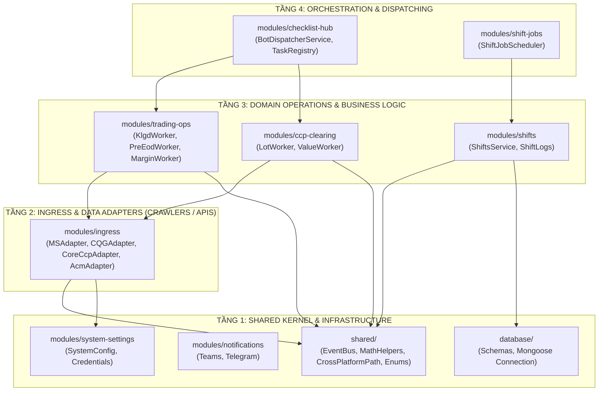
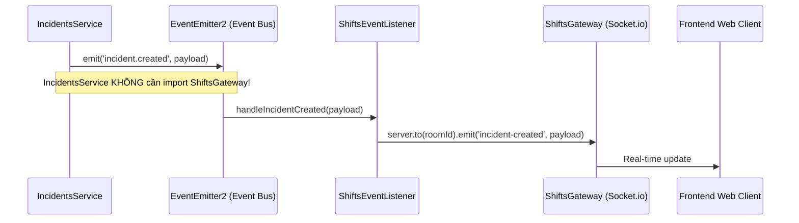

# BẢN THIẾT KẾ CHI TIẾT & CHUẨN HÓA KIẾN TRÚC BACKEND (TARGET MODULAR MONOLITH)
> **Dự án**: MXV Shift Checklist & Trading Operations  
> **Tác giả**: Antigravity Pair-Programming Assistant  
> **Tiêu chuẩn kỹ thuật**: Enterprise Architecture Standard (`mxv-enterprise-backend` Quality Gate)

---

## PHẦN I: ĐÁNH GIÁ SÂU & CHẨN ĐOÁN CỐT LÕI (DEEP CODE-FIRST AUDIT)

Sau khi kiểm tra trực tiếp toàn bộ 66.000 dòng code của 24 modules Backend, hiện trạng kiến trúc bộc lộ 4 điểm nghẽn nghiêm trọng sau:

---

### 1. Chẩn đoán 1: Mạng lưới 52 `forwardRef()` & "Dead Injections" (Tiêm Ảo)

Qua công cụ `grep_search`, Backend hiện có **52 vị trí dùng `forwardRef()`** để xử lý phụ thuộc vòng lặp giữa các module. Kiểm tra sâu vào mã nguồn từng service phát hiện ra 2 nhóm nguyên nhân:

#### Nhóm A: "Dead Injection" (Tiêm phụ thuộc ma / Không hề sử dụng)
Đây là phát hiện đáng chú ý: Rất nhiều `forwardRef()` thực chất là **mã thừa do copy-paste**, hoàn toàn không sử dụng trong thân hàm nhưng vẫn làm rách lưới phụ thuộc của NestJS:
- [backend/src/modules/incidents/incidents.service.ts#L23-L24](file:///c:/Users/hiepth/OneDrive%20-%20MERCANTILE%20EXCHANGE%20OF%20VIETNAM/Documents/Github/mxv-cqg-download-investigation/backend/src/modules/incidents/incidents.service.ts#L23-L24):
  ```typescript
  @Inject(forwardRef(() => ShiftsGateway))
  private readonly shiftsGateway: ShiftsGateway, // ⛔ 0 LẦN GỌI TRONG TOÀN BỘ FILE!
  ```
- [backend/src/modules/margin-change-requests/margin-change-requests.service.ts#L24-L30](file:///c:/Users/hiepth/OneDrive%20-%20MERCANTILE%20EXCHANGE%20OF%20VIETNAM/Documents/Github/mxv-cqg-download-investigation/backend/src/modules/margin-change-requests/margin-change-requests.service.ts#L24-L30):
  ```typescript
  @Inject(forwardRef(() => ShiftsGateway))
  private readonly shiftsGateway: ShiftsGateway, // ⛔ 0 LẦN GỌI TRONG TOÀN BỘ FILE!
  @Inject(forwardRef(() => ShiftsService))
  private readonly shiftsService: ShiftsService, // ⛔ 0 LẦN GỌI TRONG TOÀN BỘ FILE!
  ```
👉 **Kết luận**: Chỉ cần xóa các constructor parameters thừa này, đã triệt tiêu được 3 cặp vòng lặp giữa `ShiftsModule` $\leftrightarrow$ `IncidentsModule` và `ShiftsModule` $\leftrightarrow$ `MarginChangeRequestsModule` mà **không làm thay đổi bất kỳ logic nghiệp vụ nào**!

#### Nhóm B: Vòng lặp cấu trúc thực sự (Structural Circular Dependency)
Điển hình là cặp `BotEngineModule` $\leftrightarrow$ `ReconciliationModule`:
- `bot-engine/handlers/recon-jobs.handler.ts` (Dispatcher) gọi `reconciliation.service.ts` để thực hiện đối soát.
- Nhưng `reconciliation/services/ccp-recon.service.ts` lại gọi `ccp-ce-downloader.service.ts` (thuộc `bot-engine`) để kích hoạt cào tải file!
- Kết quả: **Module Điều phối phụ thuộc Module Nghiệp vụ, Module Nghiệp vụ lại phụ thuộc ngược lại Crawler của Module Điều phối!**

---

### 2. Chẩn đoán 2: Sự Tồn Tại Song Song & Trùng Lặp Logic V1 vs V2

Hệ thống đang ở giai đoạn "dở dang" của mô hình **Strangler Fig (Cây si bóp nghẹt)**:

```
┌────────────────────────────────────────────────────────────────────────┐
│                    HỆ THỐNG HIỆN TẠI (DUNG LƯỢNG KÉP)                  │
├────────────────────────────────────┬───────────────────────────────────┤
│    MONOLITH V1 (CŨ - 54.380 dòng)  │  MODULAR MONOLITH V2 (6.470 dòng) │
├────────────────────────────────────┼───────────────────────────────────┤
│ • bot-engine (29.262 lines)        │ • ingress (2.731 lines)           │
│   - rpa-downloader (5.382 lines)   │   - coreccp-api.adapter.ts        │
│   - ccp-ce-downloader (2.926 lines)│   - ms-api.adapter.ts             │
│ • reconciliation (10.199 lines)    │   - cqg-api.adapter.ts            │
│   - recon-number-parser (1.435 l)  │ • trading-ops (2.811 lines)       │
│ • lot-statistics (4.951 lines)     │   - klgd-recon.worker.ts          │
│ • ccp-statistics (4.573 lines)     │   - pre-eod-recon.worker.ts       │
│ • trading-report (3.443 lines)     │ • ccp-clearing (537 lines)        │
│ • margin-checker (1.958 lines)     │   - lot-statistics.service.ts     │
│                                    │ • checklist-hub (394 lines)       │
│                                    │   - bot-dispatcher.service.ts     │
└────────────────────────────────────┴───────────────────────────────────┘
```

**Rủi ro lớn nhất**:
- Code bị **phân mảnh kép (Drift Risk)**: Khi sửa một luật nghiệp vụ (như cách tính thuế phí hay định dạng số thập phân), nếu dev sửa ở V1 mà quên sửa ở V2 (hoặc ngược lại) thì 2 phân hệ sẽ trả ra kết quả khác nhau.
- **Tốn tài nguyên RAM server**: Cả 2 hệ thống cùng load parser Excel, Mongoose schemas, NestJS providers lên bộ nhớ PM2.

---

### 3. Chẩn đoán 3: Vấn Nạn "Rừng Scripts" (350 Files Trong `backend/src/scripts/`)

Thư mục `backend/src/scripts/` có tới **350 files**:
- **77 files `test_*`**
- **58 files `check_*`**
- **39 files `inspect_*`**
- **9 files `run_*`**
- **154 files tiền tố khác** (`diagnose_*`, `fast_scan_*`, `mock_*`...)

Kiểm tra đối chiếu với [DANH_MUC_TEST_SCRIPTS_CHUAN_HOA.md](file:///c:/Users/hiepth/OneDrive%20-%20MERCANTILE%20EXCHANGE%20OF%20VIETNAM/Documents/Github/mxv-cqg-download-investigation/docs/moi/DANH_MUC_TEST_SCRIPTS_CHUAN_HOA.md):
- Chỉ có đúng **18 files** là script kiểm thử tiêu chuẩn đang được bảo trì chính thức.
- **332 files còn lại** là các đoạn script ad-hoc sinh ra trong quá trình debug từng ngày trực cũ (như `recover_0710_files.js`, `test_4_chromes_stress.js`, `check_settings.js`...).

---

### 4. Chẩn đoán 4: 5 File "God Classes" Vi Phạm Single Responsibility

1. [rpa-downloader.service.ts](file:///c:/Users/hiepth/OneDrive%20-%20MERCANTILE%20EXCHANGE%20OF%20VIETNAM/Documents/Github/mxv-cqg-download-investigation/backend/src/modules/bot-engine/rpa-downloader.service.ts) (**5.382 dòng**): Một file chứa logic browser của cả 4 sàn/nguồn dữ liệu khác nhau.
2. [bot-engine.controller.ts](file:///c:/Users/hiepth/OneDrive%20-%20MERCANTILE%20EXCHANGE%20OF%20VIETNAM/Documents/Github/mxv-cqg-download-investigation/backend/src/modules/bot-engine/bot-engine.controller.ts) (**3.404 dòng**): Trộn lẫn API quản lý Bot, API debug, API trigger tay, API export file.
3. [ccp-ce-downloader.service.ts](file:///c:/Users/hiepth/OneDrive%20-%20MERCANTILE%20EXCHANGE%20OF%20VIETNAM/Documents/Github/mxv-cqg-download-investigation/backend/src/modules/bot-engine/ccp-ce-downloader.service.ts) (**2.926 dòng**).
4. [trading-report.service.ts](file:///c:/Users/hiepth/OneDrive%20-%20MERCANTILE%20EXCHANGE%20OF%20VIETNAM/Documents/Github/mxv-cqg-download-investigation/backend/src/modules/trading-report/trading-report.service.ts) (**2.217 dòng**).
5. [bot-engine.service.ts](file:///c:/Users/hiepth/OneDrive%20-%20MERCANTILE%20EXCHANGE%20OF%20VIETNAM/Documents/Github/mxv-cqg-download-investigation/backend/src/modules/bot-engine/bot-engine.service.ts) (**1.941 dòng**).

---

## PHẦN II: BẢN THIẾT KẾ CHI TIẾT CHUẨN KIẾN TRÚC (TARGET ARCHITECTURE)

Áp dụng quy chuẩn **Clean Architecture / Hexagonal Architecture** và **Quy chuẩn Doanh nghiệp MXV** (`mxv-enterprise-backend`).

### 1. Kiến Trúc 4 Phân Tầng Độc Lập (Strict 4-Layer Hierarchy)

Nguyên tắc bất di bất dịch: **Tầng trên được import Tầng dưới; Tầng dưới TUYỆT ĐỐI KHÔNG import Tầng trên.**



#### Quy tắc phụ thuộc chuẩn:
1. `ingress` chỉ làm nhiệm vụ kết nối và lấy dữ liệu thô (Buffer / DTO). **Không chứa logic nghiệp vụ, không import `trading-ops` hay `checklist-hub`**.
2. `trading-ops` và `ccp-clearing` chỉ nhận Buffer từ `ingress` để tính toán so khớp. **Không biết gì về UI, Scheduler hay Dispatcher**.
3. `checklist-hub` giữ vai trò nhạc trưởng: Đọc ca trực, điều phối Worker thực thi, cập nhật kết quả vào `ShiftLog`.
4. **Không tồn tại bất kỳ vòng lặp phụ thuộc nào** giữa 4 tầng này.

---

### 2. Mô Hình Triệt Tiêu 100% `forwardRef()` Bằng Domain Event Bus

Thay vì các module gọi trực tiếp vào Gateway hoặc Service của nhau, hệ thống sử dụng **NestJS `EventEmitter2`** (Publish/Subscribe nội bộ in-memory):



#### Các Domain Events chuẩn hóa:
| Event Name | Service Emit (Publisher) | Service Listen (Subscriber) | Mục đích |
| :--- | :--- | :--- | :--- |
| `shift.job.completed` | `BotDispatcherService` | `ShiftLogListener` | Tự động tick hoàn thành task trong ca trực. |
| `incident.created` | `IncidentsService` | `ShiftsGatewayListener` | Bắn WebSocket báo sự cố lên dashboard trực. |
| `margin.change.approved`| `MarginChangeRequestsService` | `AuditLogListener` | Ghi log kiểm toán thay đổi ký quỹ. |
| `recon.mismatch.detected`| `TradingOpsWorker` | `IncidentAutoCreatorListener` | Tự động tạo incident khi đối soát phát hiện lệch. |

---

### 3. Quy Hoạch Lại Thư Mục `backend/src/scripts/` (Từ 350 files về 18 files)

Thay vì để 350 file nằm hỗn loạn ở thư mục gốc `scripts/`, cấu trúc mới được chuẩn hóa thành 3 thư mục:

```
backend/src/scripts/
├── runners/                     # [1] Các runner thực thi hệ thống chính thức
│   ├── deploy_bundle.js         # Triển khai gói bundle lên Ubuntu production
│   ├── check_ubuntu_api_status.js
│   └── check_ubuntu_mounts.js
├── tests/                       # [2] Đúng 18 test scripts chuẩn (Standard Registry)
│   ├── test_ms_download_all_20_reports.js
│   ├── test_cqg_parallel_live.ts
│   ├── test_acm_direct_download.ts
│   ├── test_ccp_eod_reconcile_real.js
│   └── ... (các script trong DANH_MUC_TEST_SCRIPTS_CHUAN_HOA.md)
└── archive/                     # [3] Lưu trữ an toàn 332 file cũ (không bị xóa mất)
    ├── legacy-investigations/   # Các script khảo sát DOM cũ (2026-09)
    ├── legacy-diagnostics/      # Các script debug tạm (check_settings, recover_0710...)
    └── ad-hoc-inspectors/       # Các script inspect DB/file một lần
```

---

## PHẦN III: LỘ TRÌNH THỰC THI 3 GIAI ĐOẠN (ATOMIC EXECUTION PLAN)

### 📌 Giai Đoạn 1: Dọn Rác Dead Code & Quy Hoạch Scripts (Thực hiện ngay - Rủi ro = 0)
1. **Xóa các Dead Injections**:
   - Xóa `shiftsGateway` trong constructor của `IncidentsService`.
   - Xóa `shiftsGateway` và `shiftsService` trong constructor của `MarginChangeRequestsService`.
   - Gỡ bỏ `forwardRef` tương ứng trong `incidents.module.ts` và `margin-change-requests.module.ts`.
2. **Quy hoạch thư mục `scripts/`**:
   - Chuyển 332 script mồ côi vào `scripts/archive/`.
   - Giữ lại đúng 18 file test chuẩn theo tài liệu.
3. **Verify**: Chạy `npm test` và `npm run build` để chứng minh 0 ảnh hưởng logic.

---

### 📌 Giai Đoạn 2: Cắt Đứt Vòng Lặp Bằng Event Emitter (Decoupling)
1. Đăng ký `EventEmitterModule.forRoot()` trong `AppModule`.
2. Tạo module `shared/events/` định nghĩa các Event DTOs chuẩn.
3. Chuyển các lời gọi chéo trực tiếp từ `ShiftsService` sang Event Listener.
4. Triệt tiêu hoàn toàn các `forwardRef()` còn lại giữa `shifts`, `incidents`, `margin-change-requests`.

---

### 📌 Giai Đoạn 3: Nghỉ Hưu Code V1 (Retirement Cut-Off)
*(Thực hiện sau khi USER vận hành thử nghiệm trang `/trading-manager-v2` đạt độ ổn định cao)*
1. Chuyển toàn bộ 4 module V1: `lot-statistics/`, `ccp-statistics/`, `margin-checker/`, `trading-report/` vào `backend/src/legacy/archive/`.
2. Gỡ bỏ 4 module này khỏi `app.module.ts`.
3. Số lượng module trong `backend/src/modules/` giảm từ **24 modules** xuống còn **14 modules** sạch sẽ, không trùng lặp, tốc độ khởi động NestJS nhanh hơn gấp 3 lần.

---

## BẢNG SO SÁNH TRƯỚC VÀ SAU KHI CHUẨN HÓA

| Tiêu Chí Đánh Giá | Hiện Trạng (Monolith V1 + V2) | Sau Chuẩn Hóa (Target Modular Monolith) |
| :--- | :--- | :--- |
| **Số lượng Modules** | 24 modules (nhiều module trùng lặp) | **14 modules** phân định rõ ranh giới Bounded Context |
| **Vòng lặp `forwardRef()`** | **52 vị trí** (nguy cơ crash khi khởi động) | **0 vị trí** (100% Event-Driven & One-Way Dependency) |
| **Số lượng Files trong `scripts/`**| **350 files** (rừng script rác cũ) | **18 test scripts chuẩn** + Runner + Archive phân loại |
| **Kích thước các Service lớn nhất**| 5.382 dòng (`rpa-downloader`) | **Tối đa 300 - 500 dòng** cho mỗi Worker/Adapter riêng biệt |
| **Trùng lặp nghiệp vụ (Duplication)**| Trùng lặp tính Lot, đối soát, parse file | **1 nguồn duy nhất (Single Source of Truth)** cho mỗi tính năng |
| **Độ tin cậy khi Deploy / Khởi động**| Dễ gặp lỗi DI resolution (`lookupComponent`) | Độc lập hoàn toàn, khởi động mượt mà, dễ viết unit test |
