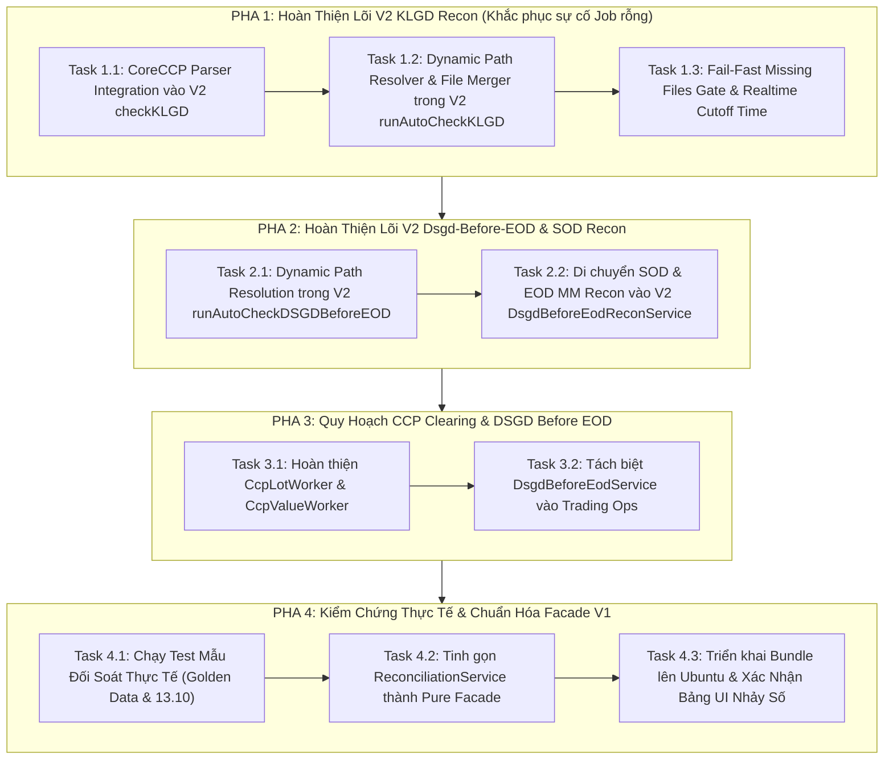

# KẾ HOẠCH NGUYÊN TỬ CUỐN CHIẾU HOÀN THIỆN PHÂN HỆ ĐỐI SOÁT & TRADING-OPS

## CHIẾN LƯỢC STRANGLER FIG: NÂNG CẤP V2 THÀNH SINGLE SOURCE OF TRUTH (KHÔNG BỎ V2)

---

> **Mã kế hoạch**: `MXV-RECON-ATOMIC-ROLLOUT-2026-V1`  
> **Phiên bản**: 1.0 (Chuẩn cuốn chiếu - Rollout Phased Migration)  
> **Mục tiêu tối thượng**: **HOÀN THIỆN 100% NĂNG LỰC NGHIỆP VỤ CHO PHÂN HỆ V2 (`trading-ops`) — KHẮC PHỤC TRIỆT ĐỂ LỖI KẾT QUẢ RỖNG/SỐ 0 Ở JOB ĐỐI SOÁT — TUYỆT ĐỐI KHÔNG BỎ V2 QUAY LẠI V1 — CHIA NHỎ TỪNG TASK NGUYÊN TỬ — XÁC MINH TEST/BUILD SAU MỖI BƯỚC**  
> **Cơ sở thực chứng**: [reconciliation.service.ts](file:///c:/Users/hiepth/OneDrive%20-%20MERCANTILE%20EXCHANGE%20OF%20VIETNAM/Documents/Github/mxv-cqg-download-investigation/backend/src/modules/reconciliation/reconciliation.service.ts), [klgd-recon.service.ts (V1)](file:///c:/Users/hiepth/OneDrive%20-%20MERCANTILE%20EXCHANGE%20OF%20VIETNAM/Documents/Github/mxv-cqg-download-investigation/backend/src/modules/reconciliation/services/klgd-recon.service.ts), [klgd-recon.service.ts (V2)](file:///c:/Users/hiepth/OneDrive%20-%20MERCANTILE%20EXCHANGE%20OF%20VIETNAM/Documents/Github/mxv-cqg-download-investigation/backend/src/modules/trading-ops/services/klgd-recon.service.ts) và Quy chuẩn [AGENTS.md](file:///c:/Users/hiepth/OneDrive%20-%20MERCANTILE%20EXCHANGE%20OF%20VIETNAM/Documents/Github/mxv-cqg-download-investigation/.agents/AGENTS.md).

---

## 1. BÁO CÁO THẨM ĐỊNH & NGUYÊN NHÂN SỰ CỐ JOB `6ace13d41fe790bc64330c8d`

Qua kiểm tra trực tiếp mã nguồn thực tế tại 2 phân hệ `reconciliation` (V1) và `trading-ops` (V2), nguyên nhân gốc rễ khiến Job `6ace13d41fe790bc64330c8d` tải file thành công nhưng kết quả đối soát trả về toàn số 0 và cột CCP là `-` được xác định như sau:

| Hiện tượng                                       | Dòng code gây lỗi                                                                                                                                                                                                                                                        | Nguyên nhân cốt lõi                                                                                                                                                                                            | Hậu quả thực tế                                                                                                                                                                                                         |
| :----------------------------------------------- | :----------------------------------------------------------------------------------------------------------------------------------------------------------------------------------------------------------------------------------------------------------------------- | :------------------------------------------------------------------------------------------------------------------------------------------------------------------------------------------------------------- | :---------------------------------------------------------------------------------------------------------------------------------------------------------------------------------------------------------------------- |
| **Bảng trả về toàn số 0 (KLGD, TTM, TTTT)**      | [trading-ops/services/klgd-recon.service.ts#L607](file:///c:/Users/hiepth/OneDrive%20-%20MERCANTILE%20EXCHANGE%20OF%20VIETNAM/Documents/Github/mxv-cqg-download-investigation/backend/src/modules/trading-ops/services/klgd-recon.service.ts#L607)                       | Hàm `runAutoCheckKLGD()` ở V2 chỉ tìm file tại thư mục mock cục bộ `process.cwd()/data/backup`. Nó hoàn toàn không đọc đường dẫn động từ `SystemSettingsService` (`TradingCheck/Futures/2026/T10.2026/13.10`). | Không tìm thấy bất kỳ file nào $\rightarrow$ Tất cả biến file đều là `undefined` $\rightarrow$ Số lượng giao dịch cả 2 bên = 0 $\rightarrow$ `0 - 0 = 0` $\rightarrow$ Bot kết luận ảo là "KHỚP" nhưng UI ra toàn số 0. |
| **Cột CCP hiển thị dấu gạch ngang (`-`)**        | [trading-ops/services/klgd-recon.service.ts#L616-L626](file:///c:/Users/hiepth/OneDrive%20-%20MERCANTILE%20EXCHANGE%20OF%20VIETNAM/Documents/Github/mxv-cqg-download-investigation/backend/src/modules/trading-ops/services/klgd-recon.service.ts#L616-L626)             | V2 hoàn toàn chưa tích hợp `CcpExcelParser`, không đọc 3 file CCP (`dsgdCcp`, `ttmCcp`, `ttttCcp`) và không tính `totalCCP_DSGD`.                                                                              | Trường `totalCCP_DSGD` trong `totals` bị trả về `undefined`, Frontend hiển thị `-`.                                                                                                                                     |
| **Báo "KHỚP" dù không có file (Silent Swallow)** | [trading-ops/services/klgd-recon.service.ts#L588](file:///c:/Users/hiepth/OneDrive%20-%20MERCANTILE%20EXCHANGE%20OF%20VIETNAM/Documents/Github/mxv-cqg-download-investigation/backend/src/modules/trading-ops/services/klgd-recon.service.ts#L588)                       | Thiếu kiểm tra rào chắn `missingFiles` $\rightarrow$ Khi không có file nào thì `differ = 0`, hệ thống đánh giá `passed: true`.                                                                                 | Vi phạm quy tắc Fail-Fast của [AGENTS.md](file:///c:/Users/hiepth/OneDrive%20-%20MERCANTILE%20EXCHANGE%20OF%20VIETNAM/Documents/Github/mxv-cqg-download-investigation/.agents/AGENTS.md).                               |
| **Dsgd-Before-EOD V2 cũng có rủi ro tương tự**   | [trading-ops/services/dsgd-before-eod-recon.service.ts#L252](file:///c:/Users/hiepth/OneDrive%20-%20MERCANTILE%20EXCHANGE%20OF%20VIETNAM/Documents/Github/mxv-cqg-download-investigation/backend/src/modules/trading-ops/services/dsgd-before-eod-recon.service.ts#L252) | `runAutoCheckDSGDBeforeEOD()` ở V2 cũng đang fallback về `process.cwd()/data/backup`.                                                                                                                          | Khi chạy đối chiếu cuối ngày sẽ lập tức văng lỗi thiếu file bắt buộc.                                                                                                                                                   |

👉 **Chiến lược khắc phục**: Thay vì vứt bỏ V2 để lùi về V1, ta **chuyển giao toàn bộ năng lực trưởng thành từ V1 sang V2**, biến V2 thành **Single Source of Truth** hoàn chỉnh.

---

## 2. BẢN ĐỒ LỘ TRÌNH 4 PHA & 10 NHIỆM VỤ NGUYÊN TỬ (ATOMIC TASKS)



---

## 3. CHI TIẾT TỪNG NHIỆM VỤ NGUYÊN TỬ (ATOMIC TASKS)

---

### 🛡️ PHA 1: HOÀN THIỆN LÕI V2 KLGD RECON (KHẮC PHỤC TRỰC TIẾP LỖI JOB RỖNG)

_Mục đích: Nâng cấp `KlgdReconService` thuộc `TradingOpsModule` (V2) đạt 100% năng lực bóc tách file thực tế, đường dẫn mạng và CoreCCP._

#### 📌 Task 1.1: Tích Hợp CoreCCP Parser & Bù Trừ ACM Vào V2 `checkKLGD()`

- **Mục tiêu**: Bổ sung bóc tách `files.dsgdCcp`, `files.ttmCcp`, `files.ttttCcp` qua `CcpExcelParser` và thuật toán so khớp bù trừ tự doanh (`ACM + CoreCCP == Nano`).
- **Phạm vi cô lập**: [backend/src/modules/trading-ops/services/klgd-recon.service.ts](file:///c:/Users/hiepth/OneDrive%20-%20MERCANTILE%20EXCHANGE%20OF%20VIETNAM/Documents/Github/mxv-cqg-download-investigation/backend/src/modules/trading-ops/services/klgd-recon.service.ts).
- **Kho Logic Bắt Buộc Bảo Tồn (Ground Truth)**:
  - Trích xuất từ [reconciliation/services/klgd-recon.service.ts#L562-L630](file:///c:/Users/hiepth/OneDrive%20-%20MERCANTILE%20EXCHANGE%20OF%20VIETNAM/Documents/Github/mxv-cqg-download-investigation/backend/src/modules/reconciliation/services/klgd-recon.service.ts#L562-L630):
    1. Parse DSGD CCP: `CcpExcelParser.parseDSGD(files.dsgdCcp, tradingDate, sessionStart, checkTime)` $\rightarrow$ `totalCCP_DSGD`.
    2. Parse TTM CCP: `CcpExcelParser.parseTTM(files.ttmCcp, tradingDate)` $\rightarrow$ `totalCCP_TTM`.
    3. Parse TTTT CCP: `CcpExcelParser.parseTTTT(files.ttttCcp, tradingDate)` $\rightarrow$ `totalCCP_TTTT`.
    4. Lọc bỏ các lệnh ACM đã ghi nhận trên CoreCCP (`finalMismatchedTrades`).
    5. Đánh giá cân bằng ACM: `evaluatedDifferACM = Math.min(finalDifferACM, diff1, diff2)`.
    6. Trả về đầy đủ `totalCCP_DSGD`, `totalCCP_TTM`, `totalCCP_TTTT`, `differCCP_*` trong `totals`.
- **Tiêu chuẩn nghiệm thu (DoD)**:
  - Khi truyền buffer file CCP vào hàm `checkKLGD()`, `result.totals.totalCCP_DSGD` phải có giá trị cụ thể (không được `undefined`).
  - Lệnh build: `cmd /c "npm run build"` thành công 100%.

---

#### 📌 Task 1.2: Phân Giải Đường Dẫn Động & Tự Động Ghép File CQG Trong V2 `runAutoCheckKLGD()`

- **Mục tiêu**: Xóa bỏ hoàn toàn đoạn mock `data/backup` tại dòng 607 của V2, thay bằng logic phân giải đường dẫn cấu hình động từ `SystemSettingsService`.
- **Phạm vi cô lập**: [backend/src/modules/trading-ops/services/klgd-recon.service.ts](file:///c:/Users/hiepth/OneDrive%20-%20MERCANTILE%20EXCHANGE%20OF%20VIETNAM/Documents/Github/mxv-cqg-download-investigation/backend/src/modules/trading-ops/services/klgd-recon.service.ts).
- **Kho Logic Bắt Buộc Bảo Tồn (Ground Truth)**:
  - Trích xuất từ [reconciliation/services/klgd-recon.service.ts#L690-L786](file:///c:/Users/hiepth/OneDrive%20-%20MERCANTILE%20EXCHANGE%20OF%20VIETNAM/Documents/Github/mxv-cqg-download-investigation/backend/src/modules/reconciliation/services/klgd-recon.service.ts#L690-L786):
    1. Lấy `bot_backup_path_ms`, `bot_backup_path_cqg`, `bot_backup_path_acm`, `bot_trading_check_path` qua `this.settingsService`.
    2. Định tuyến thư mục theo ca trực: `subFolder = path.join(year, 'T' + month + '.' + year, day + '.' + month)`.
    3. Hỗ trợ cơ chế ưu tiên kiểm tra trong phiên: `resolvePriorityPath` giữa `TradingCheck/` và `Backup/`.
    4. Tự động nhận diện và ghép file thô CQG qua helper `resolveCqgFile(cqgTradingDailyPath, 'FR', this.logger)`.
    5. Quét tìm các file CoreCCP (`dsgdCcpPath`, `ttmCcpPath`, `ttttCcpPath`) trong `ccpTradingDailyPath`.
    6. Đọc buffer các file vào biến `files` và gọi `this.checkKLGD()`.
- **Tiêu chuẩn nghiệm thu (DoD)**:
  - Chạy thử nghiệm hàm `runAutoCheckKLGD(new Date('2026-10-13'))` tìm thấy chính xác các file tại thư mục `/mnt/qlgd-it/Quanlygiaodich/Tai lieu hoat dong/TradingCheck/.../13.10`.
  - Không còn tìm vào thư mục cục bộ `data/backup`.

---

#### 📌 Task 1.3: Rào Chắn Thiếu File (`isWaitingFiles`) & Cutoff Time Thời Gian Thực

- **Mục tiêu**: Triệt tiêu lỗi "báo KHỚP ảo khi thiếu file" và đảm bảo cắt dữ liệu mtime đồng bộ theo giây.
- **Phạm vi cô lập**: [backend/src/modules/trading-ops/services/klgd-recon.service.ts](file:///c:/Users/hiepth/OneDrive%20-%20MERCANTILE%20EXCHANGE%20OF%20VIETNAM/Documents/Github/mxv-cqg-download-investigation/backend/src/modules/trading-ops/services/klgd-recon.service.ts).
- **Kho Logic Bắt Buộc Bảo Tồn (Ground Truth)**:
  - Trích xuất từ [reconciliation/services/klgd-recon.service.ts#L806-L850](file:///c:/Users/hiepth/OneDrive%20-%20MERCANTILE%20EXCHANGE%20OF%20VIETNAM/Documents/Github/mxv-cqg-download-investigation/backend/src/modules/reconciliation/services/klgd-recon.service.ts#L806-L850):
    1. Kiểm tra sự tồn tại của các file bắt buộc (`DSGD.xlsx`, `acmTradesPath`, `cqgFrPath`).
    2. Nếu thiếu bất kỳ file nào $\rightarrow$ Trả về ngay:
       ```typescript
       return {
         passed: true,
         isWaitingFiles: true,
         sessionStart,
         checkTime,
         message: `[Đang chờ dữ liệu] Thư mục backup ngày ${day}.${month}.${year} đang chờ cập nhật đầy đủ file đối chiếu (Đang thiếu: ${missingFiles.join(", ")})...`,
         totals: {
           totalDSGD: 0,
           totalFR: 0,
           totalACM: 0,
           totalNano: 0,
           differ: 0,
           differACM: 0,
         },
         mismatchedTrades: [],
       };
       ```
    3. Nếu file `DSGD.xlsx` tồn tại: Lấy `dsgdCutoffTime = new Date(stat.mtime.getTime() - 2000)` để làm mốc cắt dữ liệu chuẩn xác cho M-System và CQG.
- **Tiêu chuẩn nghiệm thu (DoD)**:
  - Xóa thử 1 file mẫu $\rightarrow$ Hàm lập tức trả về `isWaitingFiles: true` kèm danh sách file thiếu.
  - Khi có đủ file $\rightarrow$ Cắt dữ liệu chính xác theo mtime của `DSGD.xlsx`.

---

### 🛡️ PHA 2: HOÀN THIỆN LÕI V2 PRE-EOD & SOD RECON

_Mục đích: Đưa toàn bộ quy trình chốt phiên 3 bên cuối ngày và đầu ngày vào `DsgdBeforeEodReconService` thuộc V2._

#### 📌 Task 2.1: Phân Giải Đường Dẫn Động Cho V2 `runAutoCheckDSGDBeforeEOD()`

- **Mục tiêu**: Nâng cấp [trading-ops/services/dsgd-before-eod-recon.service.ts#L248-L272](file:///c:/Users/hiepth/OneDrive%20-%20MERCANTILE%20EXCHANGE%20OF%20VIETNAM/Documents/Github/mxv-cqg-download-investigation/backend/src/modules/trading-ops/services/dsgd-before-eod-recon.service.ts#L248-L272) đọc đường dẫn cấu hình ngày T-1 từ `SystemSettingsService`.
- **Kho Logic Bắt Buộc Bảo Tồn (Ground Truth)**:
  - Trích xuất từ [reconciliation/services/dsgd-before-eod-recon.service.ts#L480-L540](file:///c:/Users/hiepth/OneDrive%20-%20MERCANTILE%20EXCHANGE%20OF%20VIETNAM/Documents/Github/mxv-cqg-download-investigation/backend/src/modules/reconciliation/services/dsgd-before-eod-recon.service.ts#L480-L540):
    1. Đọc đường dẫn backup `ms`, `cqg`, `acm`.
    2. Xác định ngày phiên chốt T-1 (bỏ qua Thứ Bảy, Chủ Nhật nếu là phiên Thứ Hai).
    3. Kiểm tra thiếu file (`isWaitingFiles: true`).
    4. Ghép file tự động `FR`, `PS` qua `resolveCqgFile()`.
- **Tiêu chuẩn nghiệm thu (DoD)**:
  - Gọi `runAutoCheckDSGDBeforeEOD()` không bị văng lỗi `Thiếu các file bắt buộc cho Dsgd-Before-EOD`.

---

#### 📌 Task 2.2: Chuyển Giao `runAutoCheckSOD()` & `runAutoCheckEodMm()` Vào V2

- **Mục tiêu**: Chuyển 2 phương thức còn nằm ở [reconciliation/services/dsgd-before-eod-recon.service.ts](file:///c:/Users/hiepth/OneDrive%20-%20MERCANTILE%20EXCHANGE%20OF%20VIETNAM/Documents/Github/mxv-cqg-download-investigation/backend/src/modules/reconciliation/services/dsgd-before-eod-recon.service.ts) sang `trading-ops/services/dsgd-before-eod-recon.service.ts`.
- **Kho Logic Bắt Buộc Bảo Tồn (Ground Truth)**:
  - SOD: Quét file đầu ngày, kiểm tra vị thế mở qua đêm.
  - EOD MM: Đối soát chốt sổ tài khoản Market Maker.
- **Tiêu chuẩn nghiệm thu (DoD)**:
  - [reconciliation.service.ts#L197-L203](file:///c:/Users/hiepth/OneDrive%20-%20MERCANTILE%20EXCHANGE%20OF%20VIETNAM/Documents/Github/mxv-cqg-download-investigation/backend/src/modules/reconciliation/reconciliation.service.ts#L197-L203) ủy quyền trực tiếp sang `this.tradingOpsDsgdBeforeEodService.runAutoCheckSOD()` và `runAutoCheckEodMm()`.

---

### 🛡️ PHA 3: QUY HOẠCH CCP CLEARING & EOD RECONCILIATION

_Mục đích: Chuẩn hóa toàn bộ các tác vụ liên quan đến CoreCCP vào phân hệ `modules/ccp-clearing`._

#### 📌 Task 3.1: Đóng Gói `CcpEodService` Trong `modules/ccp-clearing`

- **Mục tiêu**: Đưa logic `checkEODCCP()` và `runAutoCheckEodCcp()` từ [reconciliation/services/ccp-recon.service.ts](file:///c:/Users/hiepth/OneDrive%20-%20MERCANTILE%20EXCHANGE%20OF%20VIETNAM/Documents/Github/mxv-cqg-download-investigation/backend/src/modules/reconciliation/services/ccp-recon.service.ts) sang phân hệ `ccp-clearing`.
- **Kho Logic Bắt Buộc Bảo Tồn (Ground Truth)**:
  - Bảng tỷ giá ngoại tệ (USD, JPY, MYR, RMB).
  - Thuật toán so khớp ký quỹ IMR, số dư tiền mặt tài khoản CCP.
- **Tiêu chuẩn nghiệm thu (DoD)**:
  - `ReconciliationService.checkEODCCP` gọi sang `ccp-clearing` module mà không làm thay đổi DTO đầu ra.

---

#### 📌 Task 3.2: Tách Biệt `DsgdBeforeEodService` Vào `trading-ops`

- **Mục tiêu**: Di chuyển logic kiểm tra giao dịch trước giờ chốt EOD ([dsgd-before-eod.service.ts](file:///c:/Users/hiepth/OneDrive%20-%20MERCANTILE%20EXCHANGE%20OF%20VIETNAM/Documents/Github/mxv-cqg-download-investigation/backend/src/modules/reconciliation/services/dsgd-before-eod.service.ts)) vào phân hệ `trading-ops`.
- **Tiêu chuẩn nghiệm thu (DoD)**:
  - Các hàm `checkDSGDBeforeEODFromBuffers()` và `runAutoCheckDSGDBeforeEOD()` hoạt động ổn định trong `trading-ops`.

---

### 🛡️ PHA 4: KIỂM CHỨNG THỰC TẾ & CHUẨN HÓA FACADE V1

_Mục đích: Xác thực trên dữ liệu thật, kiểm tra giao diện UI và hoàn tất cuốn chiếu._

#### 📌 Task 4.1: Chạy Kiểm Thử Đối Ứng (Verification Test)

- **Mục tiêu**: Tạo script kiểm thử tự động kiểm tra hàm `runAutoCheckKLGD` của V2 trên ngày `2026-10-13`.
- **Tiêu chuẩn nghiệm thu (DoD)**:
  - Kết quả trả về phải chứa đầy đủ:
    - `totalDSGD > 0`
    - `totalFR > 0`
    - `totalACM > 0`
    - `totalCCP_DSGD = 1721` (khớp chính xác với log CoreCCP lúc 11:20:38)
    - `totalCCP_TTM = 4559`
    - `totalCCP_TTTT = 1101`

---

#### 📌 Task 4.2: Tinh Gọn `ReconciliationService` Thành Pure Facade

- **Mục tiêu**: Rà soát lại [reconciliation.service.ts](file:///c:/Users/hiepth/OneDrive%20-%20MERCANTILE%20EXCHANGE%20OF%20VIETNAM/Documents/Github/mxv-cqg-download-investigation/backend/src/modules/reconciliation/reconciliation.service.ts):
  - Biến class này thành một Facade mỏng 100%, chỉ làm nhiệm vụ ủy quyền sang V2 (`tradingOpsKlgdService`, `tradingOpsDsgdBeforeEodService`, `ccpClearingService`).
  - Gỡ bỏ hoàn toàn việc inject các service cũ không còn dùng.
- **Tiêu chuẩn nghiệm thu (DoD)**:
  - Code trong `reconciliation.service.ts` giảm xuống dưới 150 dòng, rõ ràng, không chứa logic tính toán nặng.

---

#### 📌 Task 4.3: Đóng Gói Deploy Lên Ubuntu & Kiểm Tra UI Thực Tế

- **Mục tiêu**: Triển khai bundle lên máy chủ Ubuntu `10.0.0.26`, kích hoạt 1 lượt check KLGD thực tế.
- **Tiêu chuẩn nghiệm thu (DoD)**:
  - Bảng ma trận đối soát trên giao diện Web (`/trading-manager`):
    - Dòng **KLGD**: Cột M-System, CQG, ACM, Nano và **CCP** đều hiển thị đúng số lot thực tế (không còn số 0, không còn dấu `-`).
    - Dòng **TTM**: Hiển thị đầy đủ số liệu vị thế mở.
    - Dòng **TTTT**: Hiển thị đầy đủ số liệu tất toán.

---

## 4. MA TRẬN PHÒNG VỆ RỦI RO & ROLLBACK (FAIL-SAFE MATRIX)

| Tình huống phát sinh                  | Cơ chế bảo vệ trong kế hoạch                                                   | Biện pháp Rollback tức thì                                                        |
| :------------------------------------ | :----------------------------------------------------------------------------- | :-------------------------------------------------------------------------------- |
| **V2 bị lỗi cú pháp / type error**    | Kiểm tra `npm run build` sau từng Task nguyên tử đơn lẻ.                       | Revert duy nhất file đang sửa bằng git (`git checkout -- <file>`).                |
| **V2 tính sai số lot so với V1**      | Task 4.1 chạy song song đối chiếu kết quả V1 vs V2 trên cùng 1 bộ buffer file. | `ReconciliationService` vẫn còn file backup V1 để chuyển hướng trong 1 dòng code. |
| **Server Ubuntu thiếu file thư viện** | Đã cấu hình `deploy_bundle.js` tự động build và restart PM2 an toàn.           | Khôi phục bản chạy trước đó qua PM2 backup.                                       |

---

## 5. CAM KẾT TUÂN THỦ NGUYÊN TẮC THI CÔNG

1. **Thực hiện cuốn chiếu tuần tự**: Chỉ bắt đầu Task tiếp theo khi Task trước đã qua bước xác nhận Build thành công (`npm run build`).
2. **Không tự ý suy diễn hoặc xóa bỏ code**: Giữ nguyên 100% các công thức toán tài chính và regex đã chạy ổn định.
3. **Cập nhật CHANGELOG_AI.md đầy đủ**: Ghi vết chi tiết từng file tác động sau mỗi Task.
