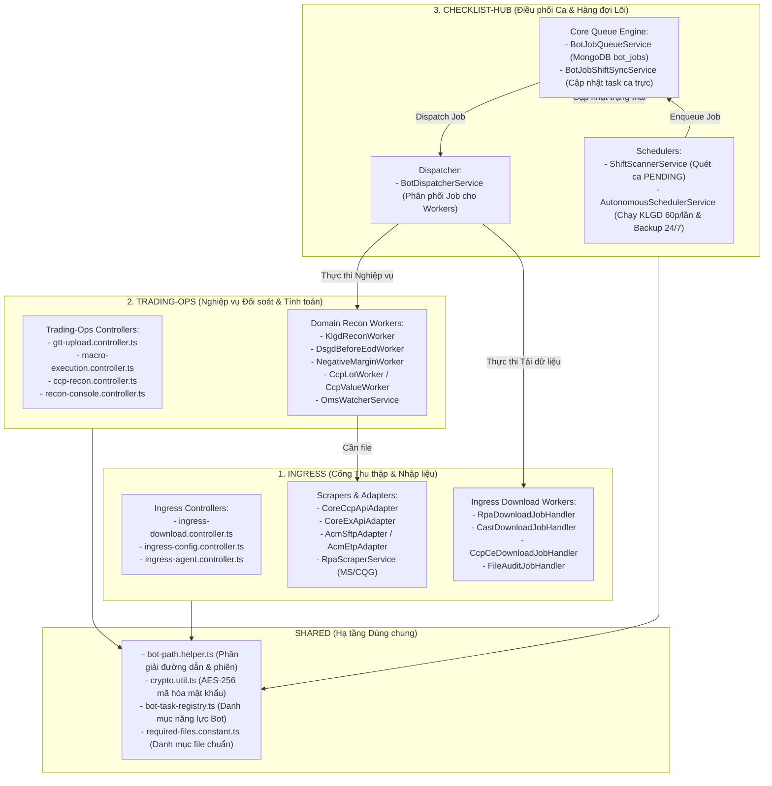

# KẾ HOẠCH TOÀN DIỆN KHAI TỬ PHÂN HỆ BOT-ENGINE & CHUYỂN DỊCH SANG MODULAR MONOLITH V2

> **Mục tiêu**: Khai tử hoàn toàn thư mục phân hệ lai `backend/src/modules/bot-engine/`, giải phóng 21 files cồng kềnh, phân bổ toàn bộ chức năng về đúng 3 phân hệ cốt lõi của Kiến trúc Modular V2: **`ingress`**, **`trading-ops`**, **`checklist-hub`** và **`shared`**.  
> **Thời gian lập**: 26/10/2026  
> **Nguyên tắc kỹ thuật**: Strict Ground Truth Guard (AGENTS.md) — 100% Zero Breaking Changes, bảo toàn Multi-Route Aliases để Frontend không lỗi 404, bảo toàn cơ chế Atomic Lock của hàng đợi `bot_jobs`.

---

## 1. TỔNG QUAN KIẾN TRÚC ĐÍCH: "TAM GIÁC KIẾN TRÚC VÀNG" (THE CLEAN TRINITY)

Sau khi khai tử `bot-engine`, hệ thống Backend vận hành theo mô hình phân tầng Modular Monolith chuẩn Enterprise:

---

## 2. MA TRẬN PHÂN BỔ CHI TIẾT 21 FILES CỦA BOT-ENGINE

| STT | File Gốc trong `bot-engine/` | File Đích Sau Khi Chuyển Dịch | Phân Hệ Chủ Quản | Trạng Thái / Ghi Chú |
| :---: | :--- | :--- | :---: | :--- |
| **I** | **HẠ TẦNG DÙNG CHUNG (SHARED)** | | | |
| 1 | `utils/crypto.ts` | `shared/utils/crypto.util.ts` | **`shared`** | Mã hóa/Giải mã AES-256 dùng chung. |
| 2 | `helpers/bot-path.helper.ts` | `shared/helpers/bot-path.helper.ts` | **`shared`** | Phân giải session, ngày cuối tuần, Map toObject. |
| 3 | `constants/required-files.constant.ts` | `shared/constants/required-files.constant.ts` | **`shared`** | Danh mục 25 file CCP, 10 file CE, MS, ACM. |
| 4 | `constants/bot-task-registry.ts` | `shared/constants/bot-task-registry.ts` | **`shared`** | Danh mục Năng lực Bot, SLA và ánh xạ tác vụ. |
| 5 | `helpers/scheduler-config-seeder.helper.ts`| `modules/checklist-hub/helpers/scheduler-config-seeder.helper.ts` | **`checklist-hub`** | Seeder giờ sao lưu theo mùa đông/hè. |
| 6 | `helpers/bot-job-dedup.helper.ts` | `modules/checklist-hub/helpers/bot-job-dedup.helper.ts` | **`checklist-hub`** | Chặn spam Job trong khoảng cooldown 15p. |
| **II** | **PHÂN HỆ INGRESS (CỔNG THU THẬP)** | | | |
| 7 | `controllers/bot-ingress.controller.ts` | `modules/ingress/controllers/ingress-download.controller.ts` | **`ingress`** | API kích hoạt tải file (`trigger-cast`, `trigger-ce`, `audit-ce`...). Route alias: `['api/v1/ingress', 'api/v1/bot-engine']`. |
| 8 | `controllers/bot-config.controller.ts` | `modules/ingress/controllers/ingress-config.controller.ts` | **`ingress`** | Quản lý thông tin đăng nhập sàn và test connection. Route alias: `['api/v1/ingress/config', 'api/v1/bot-engine']`. |
| 9 | `controllers/bot-agent.controller.ts` | `modules/ingress/controllers/ingress-agent.controller.ts` | **`ingress`** | Giao tiếp với tool RPA Agent (heartbeat, poll-jobs, report). Route alias: `['api/v1/ingress/agent', 'api/v1/bot-engine/agent']`. |
| 10 | `services/agent-heartbeat.service.ts` | `modules/ingress/services/agent-heartbeat.service.ts` | **`ingress`** | Quét nhịp tim máy trạm RPA Agent mỗi 60s. |
| 11 | `handlers/rpa-download.handler.ts` | `modules/ingress/handlers/rpa-download.handler.ts` | **`ingress`** | Tải báo cáo M-System qua Scraper. |
| 12 | `handlers/cast-download.handler.ts` | `modules/ingress/handlers/cast-download.handler.ts` | **`ingress`** | Tải báo cáo CQG CAST. |
| 13 | `handlers/ccp-ce-download.handler.ts` | `modules/ingress/handlers/ccp-ce-download.handler.ts` | **`ingress`** | Tải báo cáo CoreCCP & CoreEX. |
| 14 | `handlers/file-audit.handler.ts` | `modules/ingress/handlers/file-audit.handler.ts` | **`ingress`** | Kiểm tra đủ file và kích hoạt tải bù tự động. |
| **III**| **PHÂN HỆ TRADING-OPS (NGHIỆP VỤ ĐỐI SOÁT)** | | | |
| 15 | `controllers/bot-gtt.controller.ts` | `modules/trading-ops/controllers/gtt-upload.controller.ts` | **`trading-ops`** | Upload file GTT, market.csv, hang_hoa.xlsx. Route alias: `['api/v1/trading-ops', 'api/v1/bot-engine']`. |
| 16 | `controllers/bot-macro.controller.ts` | `modules/trading-ops/controllers/macro-execution.controller.ts` | **`trading-ops`** | Chạy macro VBA thống kê lot & giá trị. Route alias: `['api/v1/trading-ops', 'api/v1/bot-engine']`. |
| 17 | `handlers/verify-email.handler.ts` | `modules/trading-ops/workers/verify-email.worker.ts` | **`trading-ops`** | Bóc tách lịch sử gửi sao kê email từ M-System. |
| 18 | `watchers/oms-watcher.service.ts` | `modules/trading-ops/services/oms/oms-watcher.service.ts` | **`trading-ops`** | Giám sát cờ EOD và sổ lệnh tạo lập thị trường (MM). |
| **IV** | **PHÂN HỆ CHECKLIST-HUB (ĐIỀU PHỐI & HÀNG ĐỢI)** | | | |
| 19 | `bot-job-queue.service.ts` | `modules/checklist-hub/queue/bot-job-queue.service.ts` | **`checklist-hub`** | Quản lý hàng đợi `bot_jobs` (Atomic Lock), đồng bộ kết quả vào ca trực (`syncJobToChecklist`). |
| 20 | `scheduler.service.ts` | `modules/checklist-hub/scheduler/autonomous-scheduler.service.ts` | **`checklist-hub`** | Runner tự hành 24/7 (KLGD 60p, Backup EOD). **Xóa bỏ đoạn quét ca trực trùng lặp (L366-L442)**. |
| 21 | `controllers/bot-jobs.controller.ts` | `modules/checklist-hub/controllers/checklist-bot-jobs.controller.ts` | **`checklist-hub`** | Quản lý Job API (download-zip, cancel, submit-captcha). Route alias: `['api/v1/checklist-hub/jobs', 'api/v1/bot-engine/jobs', 'api/v1/bot-engine']`. |
| 22 | `core/job-handler.interface.ts` & `core/job-handler.registry.ts` | Tích hợp vào `BotDispatcherService` | **`checklist-hub`** | Thống nhất cơ chế Handler V1 và Worker V2 thành một Registry duy nhất. |
| 23 | `watchers/email-watcher.service.ts` | Đã có `EmailWatcherWorker` | **`checklist-hub`** | Tích hợp thẳng vào `EmailWatcherWorker` hiện hữu. |
| **V** | **XÓA BỎ VĨNH VIỄN (ZOMBIE CODE)** | | | |
| 24 | `bot-engine.service.ts` | **XÓA BỎ HOÀN TOÀN** | **N/A** | 100% dead code, không còn class nào tham chiếu. Logic parse email đã có trong `TeamsNotifierService`. |
| 25 | `bot-engine.module.ts` | **XÓA BỎ HOÀN TOÀN** | **N/A** | Thư mục `bot-engine` được xóa sạch sau khi gỡ bỏ khỏi `app.module.ts`. |

---

## 3. LỘ TRÌNH THỰC THI 5 BƯỚC AN TOÀN TUYỆT ĐỐI (PHASED EXECUTION)

### Bước 1: Di dời Hạ tầng Dùng chung (`shared`)
- Đưa `bot-path.helper.ts`, `crypto.ts`, `bot-task-registry.ts`, `required-files.constant.ts` vào `src/shared/`.
- Cập nhật các module tham chiếu trỏ về `src/shared/`.
- **Kiểm tra**: `cmd /c "npm run build"` tại Backend $\rightarrow$ Exit code 0.

### Bước 2: Tách & Chuyển giao các Controller & Handler về `ingress`
- Tạo thư mục `backend/src/modules/ingress/controllers/`.
- Chuyển `bot-ingress.controller.ts` $\rightarrow$ `ingress-download.controller.ts`.
- Chuyển `bot-config.controller.ts` $\rightarrow$ `ingress-config.controller.ts`.
- Chuyển `bot-agent.controller.ts` $\rightarrow$ `ingress-agent.controller.ts`.
- Chuyển các handlers (`rpa-download`, `cast-download`, `ccp-ce-download`, `file-audit`) sang `ingress`.
- Đăng ký Controllers & Providers vào `ingress.module.ts`.
- **Kiểm tra**: Backend build thành công.

### Bước 3: Tách & Chuyển giao các Controller & Worker về `trading-ops`
- Chuyển `bot-gtt.controller.ts` $\rightarrow$ `modules/trading-ops/controllers/gtt-upload.controller.ts`.
- Chuyển `bot-macro.controller.ts` $\rightarrow$ `modules/trading-ops/controllers/macro-execution.controller.ts`.
- Chuyển `oms-watcher.service.ts` $\rightarrow$ `modules/trading-ops/services/oms/oms-watcher.service.ts`.
- Đăng ký vào `trading-ops.module.ts`.
- **Kiểm tra**: Backend build thành công.

### Bước 4: Di dời Hàng đợi Lõi & Lập lịch tự hành vào `checklist-hub`
- Chuyển `bot-job-queue.service.ts` $\rightarrow$ `modules/checklist-hub/queue/bot-job-queue.service.ts`.
- Chuyển `scheduler.service.ts` $\rightarrow$ `modules/checklist-hub/scheduler/autonomous-scheduler.service.ts` (cắt bỏ phần quét ca lặp).
- Chuyển `bot-jobs.controller.ts` $\rightarrow$ `modules/checklist-hub/controllers/checklist-bot-jobs.controller.ts`.
- Cập nhật `checklist-hub.module.ts`.
- **Kiểm tra**: Backend build thành công.

### Bước 5: Khai tử hoàn toàn `bot-engine`
- Xóa bỏ `bot-engine.service.ts`.
- Gỡ bỏ `BotEngineModule` khỏi `app.module.ts`.
- Xóa toàn bộ thư mục `backend/src/modules/bot-engine/`.
- Chạy kiểm tra toàn diện cả Backend và Frontend:
  - `cmd /c "npm run build"` (Backend) $\rightarrow$ Exit Code 0.
  - `cmd /c "npm run build"` (Frontend) $\rightarrow$ Exit Code 0.
- Ghi nhật ký vào `CHANGELOG_AI.md`.

---
*Tài liệu này là căn cứ kỹ thuật chính thức để thực hiện ngay lập tức quá trình khai tử bot-engine theo chỉ đạo của USER.*
