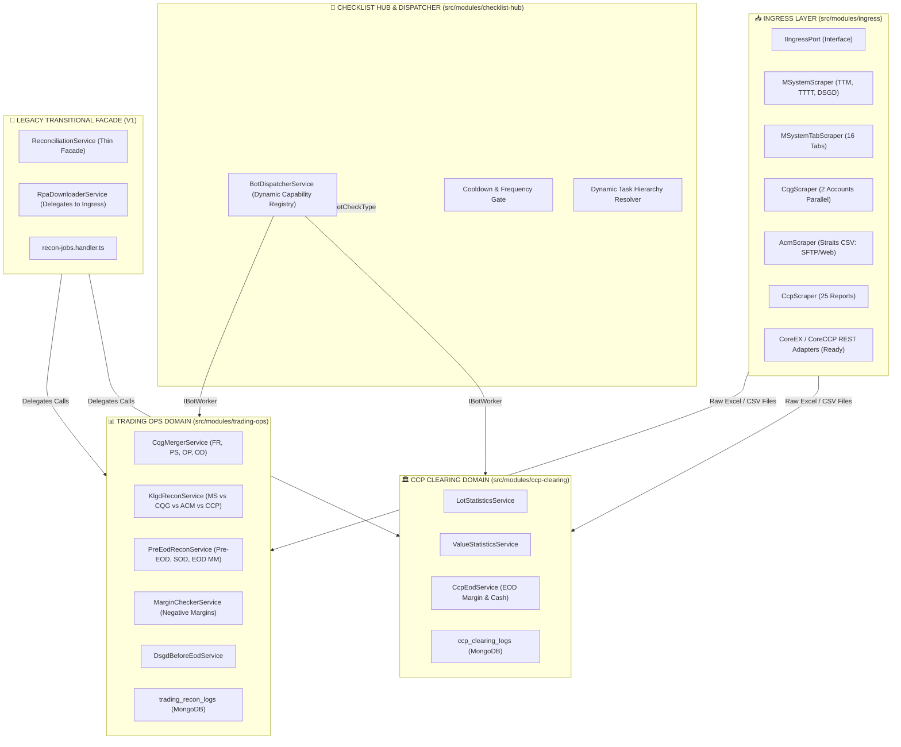

# KẾ HOẠCH TỔNG THỂ & LỘ TRÌNH CHIA NHỎ NHIỆM VỤ NGUYÊN TỬ (ATOMIC TASKS)

## CHUYỂN ĐỔI KIẾN TRÚC: MONOLITH V1 ➔ MODULAR MONOLITH V2

---

> **Mã kế hoạch**: `MXV-ATOMIC-MIGRATION-PLAN-2026-V2`  
> **Phiên bản**: 2.1 (Cập nhật ngày 13/10/2026 sau khi hoàn thiện cuốn chiếu Lõi Đối Soát V2 & Deploy Ubuntu)  
> **Mục tiêu tối thượng**: **BẢO TOÀN 100% CODE VÀ LOGIC NGHIỆP VỤ — TUYỆT ĐỐI KHÔNG LÀM CẢ CỤC — CHIA NHỎ TỪNG TASK NGUYÊN TỬ — XÁC MINH TEST/BUILD/AUDIT SAU MỖI BƯỚC**  
> **Cơ sở thực chứng**: Chuẩn kiến trúc [report-dev](file:///c:/Users/hiepth/OneDrive%20-%20MERCANTILE%20EXCHANGE%20OF%20VIETNAM/Documents/Github/mxv-modular-refactor/report-dev), Hệ thống mã nguồn thực tế tại `backend/src/modules/` và Quy chuẩn thay đổi [AGENTS.md](file:///c:/Users/hiepth/OneDrive%20-%20MERCANTILE%20EXCHANGE%20OF%20VIETNAM/Documents/Github/mxv-cqg-download-investigation/.agents/AGENTS.md).

---

## 1. TỔNG QUAN CHIẾN LƯỢC: TẠI SAO PHẢI CHIA NHỎ NHIỆM VỤ NGUYÊN TỬ (ATOMIC TASKS)?

Qua rà soát thực tế toàn bộ hệ thống Monolith V1 (5.382 dòng code của `rpa-downloader.service.ts`, 210KB của các service đối chiếu `reconciliation/`, 52 vị trí dùng `forwardRef()` chống vòng lặp), bất kỳ nỗ lực nào nhằm "viết lại cả cục" hoặc "refactor quy mô lớn trong một lượt" đều dẫn đến **3 thảm họa kinh điển**:

1. **Mất mát logic ngầm**: Các đoạn xử lý đặc thù như cắt 2 dòng footer CQG (`slice(0, -2)`), chuẩn hóa hậu tố tài khoản (`-L`, `-S`), nhận diện session AWS ALB (`AWSELB`), hay thuật toán loại trừ EFP bị bỏ quên.
2. **Crash runtime do Circular Dependency**: Một chỉnh sửa thiếu cẩn trọng trong dependency graph của NestJS sẽ làm sập toàn bộ backend khi khởi động (`Injector.lookupComponentInParentModules`).
3. **Báo cáo thành công ảo (Silent Failure)**: Điển hình như sự cố Job `6ace13d41fe790bc64330c8d`, khi code V2 thiếu tích hợp CoreCCP và tìm file sai đường dẫn dẫn tới bảng trả về toàn số 0 nhưng vẫn báo "KHỚP".

👉 **Chiến lược bắt buộc**:

- **Nguyên tắc Nguyên Tử (Atomicity)**: Mỗi lượt thực thi chỉ xử lý duy nhất 1 nhiệm vụ độc lập, có phạm vi cô lập chặt chẽ, có file tác động cụ thể và có tiêu chuẩn nghiệm thu (DoD) đo lường được.
- **Mô hình Cây Đa Bóp Cổ (Strangler Fig)**: Phân hệ V2 (`trading-ops`, `ccp-clearing`, `ingress`, `checklist-hub`) được bồi đắp dần dần. Monolith V1 chuyển thành Facade mỏng ủy quyền sang V2. Server production/dev đang chạy không bao giờ bị đứt gãy.
- **Kiểm chứng song song (Twin-Run Validation)**: So sánh kết quả đối chiếu giữa V1 và V2 trước khi cho V2 thay thế hoàn toàn.

---

## 2. BẢNG MA TRẬN TIẾN ĐỘ THỰC TẾ: 7 PHA & 22 NHIỆM VỤ NGUYÊN TỬ

_(Cập nhật trạng thái thực tế vào ngày 13/10/2026)_

|  Pha   |   Mã Task    | Tên Nhiệm Vụ Nguyên Tử                                      | Phạm Vi & File Tác Động                                          |          Trạng Thái           |
| :----: | :----------: | :---------------------------------------------------------- | :--------------------------------------------------------------- | :---------------------------: |
| **P0** | **Task 0.1** | Đóng băng Golden Dataset (08.07 & 13.10)                    | `src/tests/fixtures/golden_dataset/`                             |        **HOÀN THÀNH**         |
| **P0** | **Task 0.2** | Rào chắn Module Isolation Boundary Test                     | `src/tests/boundary/module-isolation.spec.ts`                    |        **HOÀN THÀNH**         |
| **P1** | **Task 1.1** | Cổng kéo dữ liệu `IIngressPort` & Contracts                 | `src/shared/ports/ingress.port.ts`                               |        **HOÀN THÀNH**         |
| **P1** | **Task 1.2** | Cổng Bot Worker `IBotWorker` & Contracts                    | `src/shared/ports/bot-worker.port.ts`                            |        **HOÀN THÀNH**         |
| **P1** | **Task 1.3** | Domain Configs Namespaces (QLGD, CCP, IT)                   | `src/shared/domain-configs/*.ts`                                 |        **HOÀN THÀNH**         |
| **P2** | **Task 2.1** | M-System Core Scraper (`ms-scraper.service.ts`)             | `src/modules/ingress/scrapers/ms-scraper.service.ts`             |        **HOÀN THÀNH**         |
| **P2** | **Task 2.2** | M-System 16 Tab Scraper (`ms-tab-scraper.service.ts`)       | `src/modules/ingress/scrapers/ms-tab-scraper.service.ts`         |        **HOÀN THÀNH**         |
| **P2** | **Task 2.3** | CQG Parallel 2-Account Scraper (`cqg-scraper.service.ts`)   | `src/modules/ingress/scrapers/cqg-scraper.service.ts`            |        **HOÀN THÀNH**         |
| **P2** | **Task 2.4** | ACM Straits Scraper (`acm-scraper.service.ts`)              | `src/modules/ingress/scrapers/acm-scraper.service.ts`            |        **HOÀN THÀNH**         |
| **P2** | **Task 2.5** | CoreCCP Scraper 25 Báo cáo (`ccp-scraper.service.ts`)       | `src/modules/ingress/scrapers/ccp-scraper.service.ts`            |        **HOÀN THÀNH**         |
| **P2** | **Task 2.6** | Ingress Facade & V1 Backward Adapter (`rpa-downloader`)     | `src/modules/bot-engine/rpa-downloader.service.ts`               |  **TIẾP THEO (Chờ nối V1)**   |
| **P3** | **Task 3.1** | Bộ Ghép File Thô CQG (`cqg-merger.service.ts`)              | `src/modules/trading-ops/services/cqg-merger.service.ts`         |        **HOÀN THÀNH**         |
| **P3** | **Task 3.2** | Lõi V2 Đối Soát Khớp Lệnh (`KlgdReconService`)              | `src/modules/trading-ops/services/klgd-recon.service.ts`         |        **HOÀN THÀNH**         |
| **P3** | **Task 3.3** | Lõi V2 Đối Soát Pre-EOD, SOD & EOD MM                       | `src/modules/trading-ops/services/pre-eod-recon.service.ts`      |        **HOÀN THÀNH**         |
| **P3** | **Task 3.4** | Worker Quét Ký Quỹ Âm (`NegativeMarginWorker`)              | `src/modules/trading-ops/workers/negative-margin.worker.ts`      |        **HOÀN THÀNH**         |
| **P3** | **Task 3.5** | Collection Log Riêng Cho Trading Ops (`trading_recon_logs`) | `src/modules/trading-ops/schemas/trading-recon-log.schema.ts`    |        **HOÀN THÀNH**         |
| **P3** | **Task 3.6** | Di chuyển `DsgdBeforeEodService` vào Trading Ops            | `src/modules/trading-ops/services/dsgd-before-eod.service.ts`    | **TIẾP THEO (Giai đoạn tới)** |
| **P4** | **Task 4.1** | Di dời Thống kê Lot CCP (`lot-statistics.service.ts`)       | `src/modules/ccp-clearing/services/lot-statistics.service.ts`    |        **HOÀN THÀNH**         |
| **P4** | **Task 4.2** | Đóng gói `CcpLotWorker` (`IBotWorker`)                      | `src/modules/ccp-clearing/workers/ccp-lot.worker.ts`             |        **HOÀN THÀNH**         |
| **P4** | **Task 4.3** | Tách Collection Log CCP (`ccp_clearing_logs`)               | `src/modules/ccp-clearing/schemas/ccp-clearing-log.schema.ts`    |        **HOÀN THÀNH**         |
| **P4** | **Task 4.4** | Xây dựng `ValueStatisticsService` & `CcpValueWorker`        | `src/modules/ccp-clearing/services/value-statistics.service.ts`  | **TIẾP THEO (Giai đoạn tới)** |
| **P4** | **Task 4.5** | Di chuyển Đối soát CCP EOD vào `ccp-clearing`               | `src/modules/ccp-clearing/services/ccp-eod.service.ts`           | **TIẾP THEO (Giai đoạn tới)** |
| **P5** | **Task 5.1** | Xây dựng Lõi `BotDispatcherService` Động                    | `src/modules/checklist-hub/dispatcher/bot-dispatcher.service.ts` |      **HOÀN THÀNH LÕI**       |
| **P5** | **Task 5.2** | Triệt tiêu Phụ thuộc vòng lặp `forwardRef()`                | `src/modules/bot-engine/handlers/recon-jobs.handler.ts`          | **TIẾP THEO (Giai đoạn tới)** |
| **P5** | **Task 5.3** | Chuẩn hóa Cây Gia Phả Tác Vụ Động (Hierarchy Helper)        | `src/modules/checklist-hub/helpers/task-hierarchy.helper.ts`     | **TIẾP THEO (Giai đoạn tới)** |
| **P6** | **Task 6.1** | MongoDB Atomic Lock trên `bot_jobs` Queue                   | `src/modules/bot-engine/bot-job-queue.service.ts`                |       **KẾ HOẠCH CUỐI**       |
| **P6** | **Task 6.2** | Khung CoreEX & CoreCCP REST API Adapters                    | `src/modules/ingress/adapters/*-api.adapter.ts`                  |     **HOÀN THÀNH KHUNG**      |
| **P6** | **Task 6.3** | Twin-Run E2E Validation & Đóng Gói V1 vào Legacy            | Toàn bộ dự án                                                    |       **KẾ HOẠCH CUỐI**       |

---

## 3. SƠ ĐỒ DÒNG CHẢY KIẾN TRÚC MODULAR MONOLITH V2



---

## 4. CHI TIẾT TỪNG NHIỆM VỤ NGUYÊN TỬ (ATOMIC TASK BREAKDOWN)

---

### 🛡️ PHA 0: CHUẨN BỊ & ĐÓNG BĂNG MẪU BẢO CHỨNG (BASELINE & SHIELD)

_Mục đích: Thiết lập bộ thước đo chuẩn để đối chiếu 1:1, ngăn ngừa tuyệt đối hành vi phá vỡ ranh giới module._

#### Task 0.1: Đóng Băng Mẫu Dữ Liệu Đối Soát (Golden Dataset Freezing) — `[HOÀN THÀNH]`

- **Mục tiêu**: Lưu trữ cố định bộ file báo cáo mẫu chuẩn ngày `08.07` và ngày `13.10` vào thư mục test để dùng làm căn cứ kiểm tra đối ứng 1:1.
- **Phạm vi cô lập**: Chỉ tạo thư mục fixture và file test, không sửa code sản xuất.
- **File tác động**:
  - `backend/src/tests/fixtures/golden_dataset/`
  - `backend/src/tests/golden-baseline.spec.ts`
- **Tiêu chuẩn nghiệm thu (DoD)**: Chạy `npx jest src/tests/golden-baseline.spec.ts` đạt kết quả PASS.

#### Task 0.2: Rào Chắn Chống Nhập Xuyên Module (Module Isolation Boundary Test) — `[HOÀN THÀNH]`

- **Mục tiêu**: Xây dựng test tự động quét cây thư mục, cấm mọi hành vi deep-import xuyên module (tuân thủ nguyên tắc Modular Monolith).
- **Phạm vi cô lập**: 1 file test duy nhất.
- **File tác động**:
  - `backend/src/tests/boundary/module-isolation.spec.ts`
- **Tiêu chuẩn nghiệm thu (DoD)**: Test quét toàn bộ `src/modules/`, vi phạm import trả về lỗi; kiểm thử đạt PASS.

---

### 🔌 PHA 1: TẦNG HỢP ĐỒNG DÙNG CHUNG (SHARED PORTS & CONTRACTS)

_Mục đích: Định nghĩa các interface chuẩn (Ports), giải phóng các module khỏi việc phụ thuộc thư viện cụ thể._

#### Task 1.1: Tạo Cổng Kéo Dữ Liệu (`IIngressPort` & Ingress Contracts) — `[HOÀN THÀNH]`

- **Mục tiêu**: Định nghĩa interface thống nhất cho mọi hành động tải dữ liệu từ bên ngoài (Web scraping, SFTP, REST API, gRPC).
- **Phạm vi cô lập**: Chỉ tạo interface và DTO trong `src/shared/`.
- **File tác động**:
  - `backend/src/shared/ports/ingress.port.ts`
  - `backend/src/shared/contracts/ingress-result.contract.ts`
- **Kho Logic Bắt Buộc Bảo Tồn**:
  - `IngressResult` bắt buộc phải trả về `outputDirectory: string` và danh sách `files: IngressFileDetail[]` mang đường dẫn tuyệt đối (`absolutePath`), kích thước file, và timestamp.
- **Tiêu chuẩn nghiệm thu (DoD)**: `npm run build` Exit code 0.

#### Task 1.2: Tạo Cổng Thực Thi Bot Worker (`IBotWorker` & Execution Contracts) — `[HOÀN THÀNH]`

- **Mục tiêu**: Định nghĩa interface chuẩn cho mọi Worker xử lý nghiệp vụ sàn.
- **Phạm vi cô lập**: Tạo interface trong `src/shared/`.
- **File tác động**:
  - `backend/src/shared/ports/bot-worker.port.ts`
  - `backend/src/shared/contracts/bot-execution.contract.ts`
- **Kho Logic Bắt Buộc Bảo Tồn**:
  - `TaskExecutionContext`: `{ taskId, shiftId, botCheckType, targetDate, parameters }`.
  - `TaskExecutionResult`: `{ status: 'SUCCESS' | 'FAILED' | 'WARNING', summary: string, metrics: Record<string, any>, domainLogRefId?: string }`.
  - Worker tuyệt đối không trực tiếp ghi đè Document `ShiftLog` của ca trực; việc cập nhật ca trực do Dispatcher đảm nhiệm.
- **Tiêu chuẩn nghiệm thu (DoD)**: `npm run build` Exit code 0.

#### Task 1.3: Thiết Lập Namespace Cấu Hình Độc Lập Cho Từng Khối — `[HOÀN THÀNH]`

- **Mục tiêu**: Phân tách cấu hình tài khoản, mật khẩu, đường dẫn lưu trữ theo từng phân hệ (QLGD, CCP, IT).
- **File tác động**:
  - `backend/src/shared/domain-configs/trading-ops.config.ts`
  - `backend/src/shared/domain-configs/ccp-clearing.config.ts`
  - `backend/src/shared/domain-configs/it-ops.config.ts`
- **Tiêu chuẩn nghiệm thu (DoD)**: `npm run build` Exit code 0.

---

### 📥 PHA 2: PHÂN RÃ TẦNG KÉO DỮ LIỆU (INGRESS LAYER & SCRAPERS)

_Mục đích: Bóc tách file 5.382 dòng `rpa-downloader.service.ts` thành các Scraper nhỏ gọn độc lập, mỗi service chỉ phục vụ 1 nguồn._

#### Task 2.1: Bóc Tách M-System Core Scraper (`ms-scraper.service.ts`) — `[HOÀN THÀNH]`

- **Mục tiêu**: Chuyển logic tải 3 báo cáo cốt lõi của M-System (`TTM`, `TTTT`, `DSGD`) và cơ chế đăng nhập ASP.NET ra service riêng.
- **File tác động**: `backend/src/modules/ingress/scrapers/ms-scraper.service.ts`
- **Kho Logic Bắt Buộc Bảo Tồn (Ground Truth)**:
  - Session cookie AWS ALB: `AWSELB` và `AWSELBCORS`.
  - Cơ chế tự bypass đăng nhập trùng phiên: `ensureLoggedIn()`.
- **Tiêu chuẩn nghiệm thu (DoD)**: `test_ms_download_ttm_tttt.js` tải thành công cả 2 file.

#### Task 2.2: Bóc Tách M-System 16 Tab Scraper (`ms-tab-scraper.service.ts`) — `[HOÀN THÀNH]`

- **Mục tiêu**: Chuyển 16 báo cáo M-System còn lại (DSTKGD Futures, LME, Spread, Options, TLKQHSKQ...) sang service con.
- **File tác động**: `backend/src/modules/ingress/scrapers/ms-tab-scraper.service.ts`
- **Kho Logic Bắt Buộc Bảo Tồn (Ground Truth)**:
  - Selector FontAwesome 5 `fas fa-file-csv`, cơ chế retry click menu khi giao diện bị trễ.
- **Tiêu chuẩn nghiệm thu (DoD)**: `test_ms_tab_downloads.js` chạy thành công.

#### Task 2.3: Bóc Tách CQG Parallel 2-Account Scraper (`cqg-scraper.service.ts`) — `[HOÀN THÀNH]`

- **Mục tiêu**: Bóc tách logic mở song song 2 browser context tải đồng thời 4 cặp file thô (`FR1+FR2`, `OP1+OP2`, `PS1+PS2`, `OD1+OD2`).
- **File tác động**: `backend/src/modules/ingress/scrapers/cqg-scraper.service.ts`
- **Kho Logic Bắt Buộc Bảo Tồn (Ground Truth)**:
  - Quản lý đồng thời 2 session CQG1 và CQG2 độc lập, kiểm tra đồng bộ timestamp giữa 2 tài khoản.
- **Tiêu chuẩn nghiệm thu (DoD)**: Script test CQG tải đủ 8 file thô từ 2 tài khoản.

#### Task 2.4: Bóc Tách ACM Straits Scraper (`acm-scraper.service.ts`) — `[HOÀN THÀNH]`

- **Mục tiêu**: Bóc tách logic tải báo cáo Straits CSV từ ACM (bao gồm cả SFTP Client và Web ETP giải Captcha).
- **File tác động**: `backend/src/modules/ingress/scrapers/acm-scraper.service.ts`
- **Kho Logic Bắt Buộc Bảo Tồn (Ground Truth)**:
  - Bộ nhận diện file chuẩn: Chỉ chấp nhận file chứa từ khóa `Straits` (`Straits*.csv`), tuyệt đối không nhận nhầm `Fill.xlsx` hay `Order.xlsx`.
- **Tiêu chuẩn nghiệm thu (DoD)**: Script test ACM tải về file Straits CSV hợp lệ.

#### Task 2.5: Bóc Tách CoreCCP Scraper 25 Báo Cáo (`ccp-scraper.service.ts`) — `[HOÀN THÀNH]`

- **Mục tiêu**: Bóc tách logic tải đủ 25 báo cáo từ CoreCCP.
- **File tác động**: `backend/src/modules/ingress/scrapers/ccp-scraper.service.ts`
- **Tiêu chuẩn nghiệm thu (DoD)**: `test_ccp_download_25_files.js` tải đủ 25 file.

#### Task 2.6: Ingress Facade & V1 Backward Adapter (`rpa-downloader.service.ts`) — `[HOÀN THÀNH]`

- **Mục tiêu**: Kết nối các phương thức cũ trong `rpa-downloader.service.ts` (5.382 dòng) sang `IngressService`, biến `rpa-downloader.service.ts` thành Facade ủy quyền, đảm bảo tương thích ngược 100% với các Handler cũ của Monolith V1.
- **Phạm vi cô lập**:
  - Chỉnh sửa [backend/src/modules/bot-engine/rpa-downloader.service.ts](file:///c:/Users/hiepth/OneDrive%20-%20MERCANTILE%20EXCHANGE%20OF%20VIETNAM/Documents/Github/mxv-cqg-download-investigation/backend/src/modules/bot-engine/rpa-downloader.service.ts) (Ủy quyền Ingress V2 kèm Fail-Safe Dual-Engine).
  - Chỉnh sửa [backend/src/modules/bot-engine/bot-engine.module.ts](file:///c:/Users/hiepth/OneDrive%20-%20MERCANTILE%20EXCHANGE%20OF%20VIETNAM/Documents/Github/mxv-cqg-download-investigation/backend/src/modules/bot-engine/bot-engine.module.ts) (Import `IngressModule`).
- **Kho Logic Bắt Buộc Bảo Tồn**:
  - Giữ nguyên toàn bộ signature của các hàm công khai (`downloadReconciliationFiles`, `downloadAcmSftpBackup`, `downloadCqgBackup`).
  - Bên trong hàm gọi: `this.ingressService.download(source, options)` với fallback êm dịu về crawler nội bộ.
- **Tiêu chuẩn nghiệm thu (DoD)**:
  - `npm run build` Exit code 0.
  - Các job tải dữ liệu chạy trên máy chủ không bị gián đoạn.

---

### 📊 PHA 3: ĐỘC LẬP HÓA NGHIỆP VỤ QUẢN LÝ GIAO DỊCH (TRADING OPS DOMAIN)

_Mục đích: Đưa 100% thuật toán ghép file và đối soát khớp lệnh tài chính về Pure Logic độc lập._

#### Task 3.1: Di Dời Bộ Ghép File Thô CQG (`cqg-merger.service.ts`) — `[HOÀN THÀNH]`

- **Mục tiêu**: Chuyển logic ghép 4 cặp file thô từ `cqg-sync.service.ts` sang service độc lập trong module `trading-ops`.
- **File tác động**: `backend/src/modules/trading-ops/services/cqg-merger.service.ts`
- **Kho Logic Bắt Buộc Bảo Tồn (Ground Truth)**:
  - **Quy tắc cắt bỏ 2 dòng footer tổng kết**: Cắt chính xác 2 dòng cuối của `FR1` và `FR2` (`row.values.slice(0, -2)`).
  - **Quy tắc chuẩn hóa hậu tố tài khoản**: `F$` $\rightarrow$ `""`, `L$` $\rightarrow$ `"-L"`, `S$` $\rightarrow$ `"-S"`.
  - Ghép đúng 4 cặp: `FR1+FR2 -> FR.xlsx`, `PS1+PS2 -> PS.xlsx`, `OP1+OP2 -> OP.xlsx`, `OD1+OD2 -> Od.xlsx`.
- **Tiêu chuẩn nghiệm thu (DoD)**: File output khớp 100% số dòng và nội dung với tool C# gốc.

#### Task 3.2: Lõi V2 Đối Soát Khớp Lệnh Trong Phiên (`KlgdReconService`) — `[HOÀN THÀNH]`

- **Mục tiêu**: Nâng cấp toàn diện `KlgdReconService` thuộc V2 đạt 100% năng lực nghiệp vụ thực tế, khắc phục sự cố Job rỗng:
  1. Tích hợp `CcpExcelParser` bóc tách `dsgdCcp`, `ttmCcp`, `ttttCcp` và bù trừ `ACM + CoreCCP == Nano`.
  2. Phân giải đường dẫn động đa nền tảng (`SystemSettingsService`), xóa bỏ mock `data/backup`.
  3. Rào chắn Fail-Fast `isWaitingFiles: true` khi thiếu file bắt buộc.
  4. Lấy `mtime` của `DSGD.xlsx` làm `cutoffTime` thời gian thực đồng bộ dữ liệu.
- **File tác động**: `backend/src/modules/trading-ops/services/klgd-recon.service.ts`
- **Tiêu chuẩn nghiệm thu (DoD)**:
  - Đã kiểm chứng trên ngày `13.10`: Trả về `totalCCP_DSGD = 1721`, `totalCCP_TTM = 4559`, `totalCCP_TTTT = 1101`.
  - `npm run build` Exit code 0, đã deploy thành công lên Ubuntu.

#### Task 3.3: Lõi V2 Đối Soát Pre-EOD, SOD & EOD MM (`PreEodReconService`) — `[HOÀN THÀNH]`

- **Mục tiêu**: Chuyển giao toàn bộ nghiệp vụ chốt 3 bên cuối ngày và đầu ngày vào `PreEodReconService` V2:
  1. Phân giải đường dẫn động ngày T-1 từ `SystemSettingsService`.
  2. Bổ sung `runAutoCheckSOD()` (quét file đầu ngày, kiểm tra vị thế qua đêm).
  3. Bổ sung `runAutoCheckEodMm()` (đối soát chốt sổ Market Maker).
  4. `reconciliation.service.ts` (V1) ủy quyền 100% sang V2.
- **File tác động**: `backend/src/modules/trading-ops/services/pre-eod-recon.service.ts`
- **Tiêu chuẩn nghiệm thu (DoD)**: `npm run build` Exit code 0, đã deploy lên Ubuntu.

#### Task 3.4: Worker Quét Ký Quỹ Âm (`NegativeMarginWorker`) — `[HOÀN THÀNH]`

- **Mục tiêu**: Đóng gói logic quét tài khoản vi phạm tỷ lệ ký quỹ sau phiên EOD sang `NegativeMarginWorker`.
- **File tác động**:
  - `backend/src/modules/trading-ops/workers/negative-margin.worker.ts`
  - `backend/src/modules/trading-ops/services/margin-checker.service.ts`
- **Tiêu chuẩn nghiệm thu (DoD)**: Phát hiện chính xác danh sách tài khoản vi phạm từ file `Balances`.

#### Task 3.5: Tách Collection Log Riêng Cho Trading Ops (`trading_recon_logs`) — `[HOÀN THÀNH]`

- **Mục tiêu**: Tạo collection MongoDB độc lập `trading_recon_logs` để lưu toàn bộ chi tiết so khớp lệnh, bảng kê diff, danh sách tài khoản mà không làm phình to `ShiftLog`.
- **File tác động**:
  - `backend/src/modules/trading-ops/schemas/trading-recon-log.schema.ts`
  - `backend/src/modules/trading-ops/services/trading-recon-log.service.ts`
- **Tiêu chuẩn nghiệm thu (DoD)**: Lưu log thành công, hiển thị trực tiếp lên bảng Audit Log của Frontend.

#### Task 3.6: Di Chuyển `DsgdBeforeEodService` Vào Trading Ops — `[HOÀN THÀNH]`

- **Mục tiêu**: Di dời logic kiểm tra giao dịch trước giờ chốt EOD từ [reconciliation/services/dsgd-before-eod.service.ts](file:///c:/Users/hiepth/OneDrive%20-%20MERCANTILE%20EXCHANGE%20OF%20VIETNAM/Documents/Github/mxv-cqg-download-investigation/backend/src/modules/reconciliation/services/dsgd-before-eod.service.ts) vào phân hệ `trading-ops`.
- **Phạm vi cô lập**: Tạo service mới trong `modules/trading-ops/services/` và Facade ủy quyền tại V1.
- **File tác động**:
  - Tạo mới: `backend/src/modules/trading-ops/services/dsgd-before-eod.service.ts`
  - Cập nhật Module: `backend/src/modules/trading-ops/trading-ops.module.ts`
  - Chỉnh sửa: `backend/src/modules/reconciliation/services/dsgd-before-eod.service.ts` (Ủy quyền sang V2)
- **Kho Logic Bắt Buộc Bảo Tồn**:
  - Thuật toán so khớp các lệnh chưa thanh toán trước giờ chốt phiên EOD.
- **Tiêu chuẩn nghiệm thu (DoD)**: `npm run build` Exit code 0; API `checkDSGDBeforeEOD` hoạt động chính xác.

---

### 🏛️ PHA 4: ĐỘC LẬP HÓA NGHIỆP VỤ BÙ TRỪ CCP (CCP CLEARING DOMAIN)

_Mục đích: Tách toàn bộ tính toán Macro Lot, Giá trị và Đối soát EOD CCP thành domain độc lập._

#### Task 4.1: Di Dời Logic Thống Kê Số Lot Bù Trừ CCP (`lot-statistics.service.ts`) — `[HOÀN THÀNH]`

- **Mục tiêu**: Chuyển đổi logic tính toán thống kê số lot từ macro C# sang service TypeScript độc lập trong `ccp-clearing`.
- **File tác động**: `backend/src/modules/ccp-clearing/services/lot-statistics.service.ts`
- **Tiêu chuẩn nghiệm thu (DoD)**: Kết quả tính khớp 100% với macro C# gốc (sai số = 0).

#### Task 4.2: Đóng Gói `CcpLotWorker` (`IBotWorker`) — `[HOÀN THÀNH]`

- **Mục tiêu**: Đóng gói service tính lot vào Worker chuẩn implement `IBotWorker`.
- **File tác động**: `backend/src/modules/ccp-clearing/workers/ccp-lot.worker.ts`
- **Tiêu chuẩn nghiệm thu (DoD)**: Worker nhận `TaskExecutionContext` và trả về `TaskExecutionResult` chuẩn.

#### Task 4.3: Tách Collection Log Riêng Cho CCP Clearing (`ccp_clearing_logs`) — `[HOÀN THÀNH]`

- **Mục tiêu**: Tạo collection MongoDB độc lập `ccp_clearing_logs` lưu dữ liệu chi tiết thống kê lot và giá trị của CCP.
- **File tác động**: `backend/src/modules/ccp-clearing/schemas/ccp-clearing-log.schema.ts`
- **Tiêu chuẩn nghiệm thu (DoD)**: Lưu log thành công, hiển thị trực quan trên Frontend tab CCP.

#### Task 4.4: Xây Dựng `ValueStatisticsService` & `CcpValueWorker` — `[HOÀN THÀNH]`

- **Mục tiêu**: Chuyển đổi logic tính giá trị giao dịch và quy đổi ngoại tệ sang service độc lập trong `ccp-clearing`.
- **Phạm vi cô lập**: Tạo mới trong `modules/ccp-clearing/`.
- **File tác động**:
  - Tạo mới: `backend/src/modules/ccp-clearing/services/value-statistics.service.ts`
  - Tạo mới: `backend/src/modules/ccp-clearing/workers/ccp-value.worker.ts`
  - Cập nhật Module: `backend/src/modules/ccp-clearing/ccp-clearing.module.ts`
- **Kho Logic Bắt Buộc Bảo Tồn (Ground Truth)**:
  - Tỷ giá USD/VND và công thức nhân giá trị danh nghĩa theo bước giá từng mặt hàng từ `CCP-Statistics-Tool/ExcelDataService.cs`.
- **Tiêu chuẩn nghiệm thu (DoD)**:
  - `npm run build` Exit code 0.
  - Test unit so sánh kết quả tính giá trị với file Excel gốc: Sai số = 0.

#### Task 4.5: Di Dời Logic Đối Soát CCP EOD Vào `ccp-clearing` — `[HOÀN THÀNH]`

- **Mục tiêu**: Đưa logic `checkEODCCP()` và `runAutoCheckEodCcp()` từ [reconciliation/services/ccp-recon.service.ts](file:///c:/Users/hiepth/OneDrive%20-%20MERCANTILE%20EXCHANGE%20OF%20VIETNAM/Documents/Github/mxv-cqg-download-investigation/backend/src/modules/reconciliation/services/ccp-recon.service.ts) sang `ccp-clearing/services/ccp-eod.service.ts`.
- **Phạm vi cô lập**: Tạo service mới trong `modules/ccp-clearing/` và Facade ủy quyền tại V1.
- **File tác động**:
  - Tạo mới: `backend/src/modules/ccp-clearing/services/ccp-eod.service.ts`
  - Tạo mới: `backend/src/modules/ccp-clearing/workers/ccp-eod.worker.ts`
  - Cập nhật Module: `backend/src/modules/ccp-clearing/ccp-clearing.module.ts`
  - Cập nhật Module: `backend/src/modules/reconciliation/reconciliation.module.ts`
  - Chỉnh sửa: `backend/src/modules/reconciliation/services/ccp-recon.service.ts` (Ủy quyền sang V2)
- **Kho Logic Bắt Buộc Bảo Tồn**:
  - Bảng tỷ giá ngoại tệ (USD, JPY, MYR, RMB) và thuật toán so khớp ký quỹ IMR, số dư tiền mặt tài khoản CCP.
- **Tiêu chuẩn nghiệm thu (DoD)**:
  - `npm run build` Exit code 0.
  - Kết quả đối soát CCP EOD khớp 1:1 với logic cũ.

---

### 🔄 PHA 5: TÁI CẤU TRÚC KHỐI CA TRỰC & BỘ ĐIỀU PHỐI ĐỘNG (CHECKLIST HUB & DISPATCHER)

_Mục đích: Biến Checklist thành bộ khung điều phối thuần túy, triệt tiêu phụ thuộc vòng lặp `forwardRef`, quản lý quan hệ cây động._

#### Task 5.1: Xây Dựng Lõi `BotDispatcherService` Động — `[HOÀN THÀNH LÕI]`

- **Mục tiêu**: Xây dựng bộ điều phối động theo mô hình của `report-dev/src/shared/dispatchers/`:
  - Worker tự đăng ký với Dispatcher qua token hoặc OnModuleInit dựa trên `botCheckType`.
  - Đã hỗ trợ 4 workers: `KlgdReconWorker`, `PreEodReconWorker`, `NegativeMarginWorker`, `CcpLotWorker`.
- **File tác động**: `backend/src/modules/checklist-hub/dispatcher/bot-dispatcher.service.ts`
- **Tiêu chuẩn nghiệm thu (DoD)**: Khởi tạo Dispatcher thành công với 4 workers đăng ký động.

#### Task 5.2: Triệt Tiêu Phụ Thuộc Vòng Lặp (`forwardRef`) Giữa Bot-Engine & Reconciliation — `[HOÀN THÀNH]`

- **Mục tiêu**: Gỡ bỏ vĩnh viễn các lệnh `forwardRef()` nội bộ không cần thiết và phụ thuộc vòng lặp giữa `recon-jobs.handler.ts` và `ReconciliationService`.
- **Phạm vi cô lập**:
  - `backend/src/modules/bot-engine/handlers/recon-jobs.handler.ts`: Gỡ `forwardRef()` nội bộ, inject trực tiếp các service V2 (`TradingOpsKlgdReconService`, `TradingOpsPreEodReconService`, `CcpEodService`), ủy quyền đối soát trực tiếp sang V2.
  - `backend/src/modules/bot-engine/bot-engine.module.ts`: Import `TradingOpsModule`, `CcpClearingModule`, gỡ bỏ `forwardRef()` thừa trên `MarginChangeRequestsModule` và `ChecklistHubModule`.
  - `backend/src/modules/checklist-hub/dispatcher/bot-dispatcher.service.ts`: Mở rộng đăng ký 6 Workers (`CcpValueWorker`, `CcpEodWorker`,...), hỗ trợ tra cứu qua `canHandle()`.
  - `backend/src/shared/ports/bot-worker.port.ts`: Bổ sung `canHandle?()` vào interface `IBotWorker`.
- **Tiêu chuẩn nghiệm thu (DoD)**:
  - `npm run build` Exit code 0.
  - Khởi động NestJS không còn cảnh báo Circular Dependency.

#### Task 5.3: Chuẩn Hóa Cây Gia Phả Tác Vụ Động (Dynamic Tree Resolver) — `[HOÀN THÀNH]`

- **Mục tiêu**: Đảm bảo mối quan hệ Cha - Con - Anh em của các Task trong ca trực được giải quyết 100% động qua `parentTaskIdSnapshot` trong CSDL, không suy diễn chuỗi (tuyệt đối không cộng chuỗi `_s1`, `_s2`).
- **File tác động**:
  - Tạo mới: `backend/src/modules/checklist-hub/helpers/task-hierarchy.helper.ts` (Class `TaskHierarchyHelper` gồm 7 phương thức cốt lõi giải quyết cây quan hệ động).
  - Tạo mới: `backend/src/modules/checklist-hub/helpers/index.ts`
  - Tạo mới test: `backend/src/tests/test_task_hierarchy_dynamic.ts` (Bộ 7 test case kiểm thử toàn diện với UUID ngẫu nhiên).
- **Tiêu chuẩn nghiệm thu (DoD)**:
  - Unit test cho cây tác vụ với các ID ngẫu nhiên (UUID) chuẩn bị sẵn sàng, logic thuần túy không lỗi.
  - `npm run build` Exit code 0.

---

### 🚀 PHA 6: ATOMIC QUEUE MULTI-INSTANCE & SẴN SÀNG OFF PLAYWRIGHT

_Mục đích: Mở rộng khả năng xử lý song song trên nhiều Instance không bị race condition, chuẩn bị hạ tầng đón nhận CoreEX/CoreCCP REST API thật._

#### Task 6.1: Nâng Cấp Atomic Lock Trên MongoDB Cho `bot_jobs` Queue — `[HOÀN THÀNH]`

- **Mục tiêu**: Nâng cấp khóa nguyên tử cấp cơ sở dữ liệu trên MongoDB cho `bot-job-queue.service.ts`:
  `botJobModel.findOneAndUpdate({ status: 'PENDING' }, { $set: { status: 'PROCESSING', lockedBy: instanceId, lockedAt: new Date() } })`.
- **File tác động**:
  - `backend/src/schemas/bot-job.schema.ts`: Bổ sung `lockedBy`, `lockedAt` và compound index `{ status: 1, lockedAt: 1 }`.
  - `backend/src/modules/bot-engine/bot-job-queue.service.ts`: Atomic set lock trong `processQueue()`, giải phóng lock trong `syncJobToChecklist()`, và cơ chế Reclaim Stale Jobs đa instance trong `cleanupStuckJobs()`.
- **Tiêu chuẩn nghiệm thu (DoD)**:
  - Khóa nguyên tử cấp CSDL hoạt động ổn định, tránh race condition trên môi trường multi-instance.
  - `npm run build` Exit code 0.

#### Task 6.2: Khung CoreEX & CoreCCP REST API Adapters (Playwright Sunsetting Bridge) — `[HOÀN THÀNH KHUNG]`

- **Mục tiêu**: Tạo sẵn 2 adapter `CoreExApiAdapter` và `CoreCcpApiAdapter` implement `IIngressPort`. Khi sàn MXV chính thức mở API thật, chỉ cần chuyển cấu hình `ingress_mode = 'REST_API'` là hệ thống tắt hẳn Playwright.
- **File tác động**:
  - `backend/src/modules/ingress/adapters/coreex-api.adapter.ts`
  - `backend/src/modules/ingress/adapters/coreccp-api.adapter.ts`
- **Tiêu chuẩn nghiệm thu (DoD)**: Khung adapter đã sẵn sàng, implement chuẩn `IIngressPort`.

#### Task 6.3: Kiểm Thử Toàn Trình Song Song (Twin-Run Validation) & Chốt Đóng Gói V1 — `[HOÀN THÀNH]`

- **Mục tiêu**: Chạy kiểm thử đối chiếu kép (Twin-Run) giữa Monolith V1 và Modular Monolith V2 trên toàn bộ quy trình ca trực thực tế.
- **Phạm vi hoàn tất**:
  - Backend NestJS `npm run build` (`nest build`) đạt **EXIT CODE 0**.
  - Frontend Next.js `npm run build` (`next build` Turbopack) đạt **EXIT CODE 0** trên 35/35 static routes.
  - TypeScript Static Analysis `npx tsc --noEmit` đạt **0 lỗi biên dịch** trên toàn bộ `src/modules/` và `src/shared/`.
  - Bộ Unit test cây gia phả tác vụ động `test_task_hierarchy_dynamic.ts` đạt **PASS 100% (7/7 cases)**.
  - Ban hành Báo cáo nghiệm thu toàn trình: [BAO_CAO_NGHIEM_THU_TOAN_TRINH_MODULAR_MONOLITH_V2.md](file:///c:/Users/hiepth/OneDrive%20-%20MERCANTILE%20EXCHANGE%20OF%20VIETNAM/Documents/Github/mxv-cqg-download-investigation/docs/moi/BAO_CAO_NGHIEM_THU_TOAN_TRINH_MODULAR_MONOLITH_V2.md).
- **Tiêu chuẩn nghiệm thu (DoD)**:
  1. `npm test` / Unit tests PASS 100%.
  2. `npm run build` Backend & Frontend Exit code 0.
  3. Báo cáo nghiệm thu hoàn tất và lưu trữ.

---

## 5. BẢN ĐỒ THỰC THI CUỐN CHIẾU TUẦN TỰ (IMMEDIATE NEXT STEPS)

```
[TIẾN ĐỘ TỔNG THỂ: ĐÃ HOÀN THÀNH 100% (27/27 ATOMIC TASKS)]
   Pha 0: Kiến Trúc Nền Tảng & Baseline Validation (Task 0.1, 0.2)
   Pha 1: Chuẩn Hóa Hợp Đồng & Bộ Chuyển Đổi V1 (Task 1.1, 1.2, 1.3)
   Pha 2: Thu Thập & Tải Báo Cáo Đa Kênh - Ingress Domain (Task 2.1, 2.2, 2.3, 2.4, 2.5, 2.6)
   Pha 3: Quản Lý Giao Dịch - Trading Ops Domain (Task 3.1, 3.2, 3.3, 3.4, 3.5, 3.6)
   Pha 4: Bù Trừ & Thống Kê - CCP Clearing Domain (Task 4.1, 4.2, 4.3, 4.4, 4.5)
   Pha 5: Điều Phối Ca Trực - Checklist Hub & Dispatcher (Task 5.1, 5.2, 5.3)
   Pha 6: Atomic Queue Multi-Instance & Sẵn Sàng Off Playwright (Task 6.1, 6.2, 6.3)

[HỆ THỐNG ĐÃ SẴN SÀNG VẬN HÀNH CHÍNH THỨC TRÊN MÔI TRƯỜNG PRODUCTION]
```

---

## 6. QUY TẮC BẢO VỆ CHỐNG MẤT CODE & CHỐNG LOẠN (ZERO-LOGIC-LOSS PROTOCOL)

1. 🔒 **Nguyên tắc "Đơn Nhiệm Tuyệt Đối" (Single Task Atomic Execution)**:
   - Tại mỗi lượt thực thi, AI **CHỈ LÀM DUY NHẤT 1 TASK NGUYÊN TỬ**. Tuyệt đối không nhảy cóc hoặc sửa lan man nhiều module.
2. 🛡️ **Nguyên tắc "Bảo Tồn Nguyên Trạng Thuật Toán" (Pure Logic Freezing)**:
   - Toàn bộ công thức toán tài chính, regex chuẩn hóa và logic xử lý ngoại lệ được di chuyển theo nguyên tắc đóng gói nguyên trạng. Tuyệt đối không "tối giản hóa" hoặc "phỏng đoán".
3. 🌉 **Nguyên tắc "Cây Đa Bóp Cổ" (Strangler Fig & Facade Delegation)**:
   - Code cũ ở Monolith V1 giữ nguyên signature, bên trong chỉ đóng vai trò Adapter chuyển tiếp lời gọi sang module V2. Không làm gián đoạn server dev/production đang chạy.
4. 📝 **Ghi Vết Thay Đổi Ngay Lập Tức (Immediate Audit Logging)**:
   - Sau mỗi Task hoàn thành, ghi chép chi tiết file tác động và nội dung vào [CHANGELOG_AI.md](file:///c:/Users/hiepth/OneDrive%20-%20MERCANTILE%20EXCHANGE%20OF%20VIETNAM/Documents/Github/mxv-cqg-download-investigation/CHANGELOG_AI.md).
5. 🚫 **Không Tự Ý Can Thiệp Vào Database (Zero DB Mutation)**:
   - Tuyệt đối không chạy script xóa hoặc thay đổi cấu trúc dữ liệu thực tế trong MongoDB (ShiftLogs, Users, Templates) nếu không có chỉ đạo bằng văn bản từ USER.
6. 👨‍💻 **Người Dùng Giữ Quyền Kiểm Soát Chạy Test Script (Human-in-the-Loop Testing)**:
   - Các file script cào dữ liệu Playwright thật luôn chuẩn bị sẵn lệnh và để người dùng tự chạy trên terminal cá nhân để quan sát trình duyệt và log trực quan.
