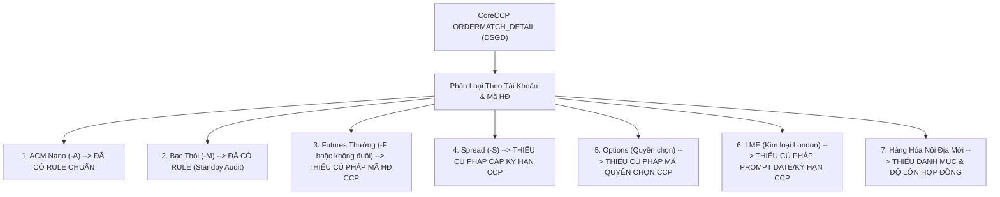

# TÀI LIỆU KỸ THUẬT: KHUNG QUY TẮC BÓC TÁCH MÃ HỢP ĐỒNG & ĐỊNH DANH PHÂN HỆ CORECCP (VNCLEAR)

> **Dự án**: MXV Shift Checklist / Investigation CQG & CoreCCP  
> **Module**: CoreCCP Clearing Automation (`ccp-accumulator`, `ccp-classifier`, `trading-ops`)  
> **Tác giả**: AI Assistant & Đội ngũ Kỹ thuật Vận hành MXV  
> **Ngày lập**: 15/10/2026  
> **Trạng thái**: Khung Đặc Tả Chờ Bổ Sung Quy Tắc Nghiệp Vụ (Awaiting Ground Truth Rules from User)  

---

## 1. XÁC NHẬN CƠ SỞ PHÁP LÝ & NGUYÊN TẮC THIẾT KẾ (AUDIT GROUND TRUTH)

Tuân thủ nghiêm ngặt **Quy Tắc 2 (Proof of Ground Truth - Bắt Buộc Dừng & Hỏi)** và **Quy Tắc 1 (Không Tự Ý Suy Diễn Ngoài Chỉ Đạo)** trong file [AGENTS.md](file:///c:/Users/hiepth/OneDrive%20-%20MERCANTILE%20EXCHANGE%20OF%20VIETNAM/Documents/Github/mxv-cqg-download-investigation/.agents/AGENTS.md):

1. **Khẳng định hiện trạng**:
   - Hiện tại hệ thống **CHƯA CÓ ĐỦ CĂN CỨ VĂN BẢN VÀ LOGIC CHÍNH THỨC** để code bộ công thức bóc tách toàn bộ mã hợp đồng cho tất cả các phân hệ trên CoreCCP.
   - Việc tự ý suy diễn hoặc bê nguyên logic bóc tách từ M-System (hoặc CQG) sang CoreCCP là **SAI HOÀN TOÀN VỀ BẢN CHẤT NGHIỆP VỤ**, do:
     * M-System sử dụng cấu trúc mã hợp đồng của hệ thống giao dịch cũ (kèm quy ước ghép LME vào Sổ Thường).
     * CoreCCP (VNCLEAR) là hệ thống bù trừ độc lập, có quy chuẩn mã hợp đồng, hậu tố tài khoản, định dạng kỳ hạn và độ lớn hợp đồng (`doCao`) riêng biệt.
2. **Mục tiêu của tài liệu này**:
   - Tổng hợp các định dạng mã hợp đồng đã được kiểm chứng thực tế từ log và API CoreCCP gần đây.
   - Khoanh vùng chính xác các khoảng trống quy tắc (gaps) còn thiếu cần USER/Bộ phận Nghiệp vụ chốt phương án.
   - Cung cấp **Khung Bảng Quy Tắc Chuẩn Hóa** để USER chỉ cần điền/bổ sung rule khi có chỉ đạo nghiệp vụ.
   - Thiết kế sẵn **Kiến trúc Data-Driven** để khi có rule, hệ thống tự động nạp cấu hình và chạy ngay $100\%$ mà không cần sửa code.

---

## 2. HIỆN TRẠNG ĐÃ KIỂM CHỨNG THỰC TẾ TRÊN CORECCP (GROUND TRUTH OBSERVED)

Dựa trên dữ liệu xuất thực tế từ CoreCCP API ngày 13/10/2026 (`ORDERMATCH_DETAIL_32985.xlsx`), `Backup CCP/DSGD CCP.xlsx` và `Backup CCP/HH.xlsx`:

### 2.1. Nhóm Đã Có Dữ Liệu Thực Tế Kiểm Chứng

| Phân Hệ | Cú Pháp Mã HĐ Quan Sát Được | Ví Dụ Thực Tế | Cấu Trúc Mã HĐ | Cắt Ra Mã Hàng Hóa |
| :--- | :--- | :--- | :--- | :---: |
| **ACM Nano** | `[MÃ_HH][THÁNG_CHỮ][NĂM_2SỐ]` | `SI5COZ26`<br/>`CP2COZ26`<br/>`PL1NYF27` | • `SI5CO` (5 ký tự)<br/>• `Z` (Tháng 12)<br/>• `26` (Năm 2026) | `SI5CO`<br/>`CP2CO`<br/>`PL1NY` |
| **Bạc Thỏi Niêm Yết** | `[MÃ_HH][THÁNG_2SỐ][NĂM_2SỐ]` | `SIV0127`<br/>`SVR3L0427` | • `SIV` (3 ký tự)<br/>• `01` (Tháng 1 - dạng số!)<br/>• `27` (Năm 2027) | `SIV`<br/>`SVR3L` |
| **Tài Khoản Phân Hệ** | `[3_SỐ_TVKD][LOẠI_TK][SỐ_TK]-[HẬU_TỐ]` | `646E0029926-A`<br/>`602C6644485-M` | • `646`: Mã TVKD<br/>• `-A`: Tài khoản ACM<br/>• `-M`: Tài khoản Bạc Thỏi | TVKD = `646`<br/>TVKD = `602` |

> [!IMPORTANT]
> **Nhận xét quan trọng**: Ngay trong nội bộ CoreCCP, cách đặt tên tháng kỳ hạn đã có sự khác nhau:
> - Hàng Nano ACM dùng **1 chữ cái tháng quốc tế** (`Z` = tháng 12, `F` = tháng 1, `H` = tháng 3).
> - Nhưng Bạc Thỏi Niêm Yết lại dùng **2 chữ số tháng** (`01` = tháng 1, `04` = tháng 4).
> Điều này khẳng định không thể dùng một hàm cắt chuỗi substring cố định đơn giản mà bắt buộc phải có từ điển hoặc quy tắc đặc tả riêng!

---

## 3. CÁC KHOẢNG TRỐNG QUY TẮC CẦN USER BỔ SUNG (THE MISSING RULES)

Dưới đây là các phân hệ **chưa có log thực tế trên CoreCCP Production/UAT**, cần USER cung cấp quy tắc chuẩn khi hệ thống đưa vào vận hành:



### Chi Tiết Từng Khoảng Trống Nghiệp Vụ:

1. **Phân hệ Futures Thường (Normal Futures)**:
   - *Câu hỏi 1*: Trên CoreCCP, mã hợp đồng Nông sản/Năng lượng/Kim loại thường có định dạng như thế nào?
     - Phương án A (Chuẩn CME): `ZCEZ26` (Mã HH `ZCE` + Tháng `Z` + Năm `26`)?
     - Phương án B (Chuẩn số): `ZCE1226` (Mã HH + Tháng `12` + Năm `26`)?
     - Phương án C (Có dấu phân cách): `ZCE_202612`?
   - *Câu hỏi 2*: Tài khoản Futures thường trên CCP có đuôi `-F` hay không có hậu tố?

2. **Phân hệ Spread (Giao dịch chênh lệch giá)**:
   - *Câu hỏi 3*: Mã hợp đồng Spread trên CoreCCP thể hiện cặp kỳ hạn như thế nào?
     - Ví dụ: `ZWAZ26-ZCEZ26` hay `SP_ZWAZ26_ZCEZ26` hay một mã mã hóa riêng của sàn?
     - Khi ghi vào file `Thong ke so lot giao dich Spread 2026.xlsx`, hệ thống cần tách ra lấy mã hàng hóa chân trước (Leg 1) hay cả 2 chân?

3. **Phân hệ Options (Giao dịch Quyền chọn)**:
   - *Câu hỏi 4*: Mã hợp đồng Options trên CoreCCP có bắt đầu bằng `C.` (Call) và `P.` (Put) như M-System không?
     - Ví dụ: `C.ZCEZ26 430` hay `ZCE_C_430_Z26`?
     - Giá thực hiện (Strike price) và tháng kỳ hạn được phân tách bằng dấu chấm, dấu cách hay gạch dưới?

4. **Phân hệ LME (London Metal Exchange)**:
   - *Câu hỏi 5*: Các mặt hàng LME (`CAD`, `AHD`, `PBD`, `SND`, `ZDS`, `NID`) trên CoreCCP giao dịch theo kỳ hạn tháng thông thường (`CADU26`) hay theo ngày giao nhận cụ thể (Prompt Date: `CAD_20261020`)?

5. **Độ Lớn Hợp Đồng (`doCao`) & Đơn Vị Ngoại Tệ Để Tính GTGD**:
   - Để tính Giá trị giao dịch: $\text{GTGD} = \text{KL} \times \text{Giá} \times \mathbf{doCao} \times \mathbf{tyGia}$.
   - Tệp `HH.xlsx` từ API `/PRODUCT/COMMODITY` hiện tại chỉ mới có 3 mặt hàng Nano (`PL1NY: 5`, `CP2CO: 1000`, `SI5CO: 100`).
   - Các mặt hàng còn lại (`ZLE`, `ZCE`, `CAD`, `SIV`...) cần bảng quy cách chuẩn để nạp vào hệ thống.

---

## 4. BIỂU MẪU ĐẶC TẢ QUY TẮC NGHIỆP VỤ (RULE SPECIFICATION TEMPLATE)

> **Hướng dẫn dành cho USER**: Khi bộ phận nghiệp vụ/vận hành chốt quy chuẩn CoreCCP, bạn chỉ cần điền thông tin vào bảng dưới đây hoặc gửi văn bản theo cấu trúc này, AI Assistant sẽ nạp trực tiếp vào hệ thống:

### BẢNG 1: QUY CHUẨN ĐỊNH DANH MÃ HỢP ĐỒNG CORECCP

| STT | Phân Hệ Nghiệp Vụ | Dấu Hiệu Nhận Diện Tài Khoản | Dấu Hiệu Nhận Diện Mã HĐ | Quy Tắc Bóc Tách Lấy Mã Hàng Hóa (`maHH`) | File Báo Cáo Ghi Số Lot | File Báo Cáo Ghi GTGD |
| :---: | :--- | :--- | :--- | :--- | :--- | :--- |
| **1** | **ACM Nano** | Đuôi `-A` | Bắt đầu bằng `SI5CO`, `CP2CO`, `PL1NY`, `GLD1` | Cắt bỏ 3 ký tự cuối (1 ký tự tháng + 2 ký tự năm) | `Thong ke so lot giao dich ACM 2026 (trên CCP).xlsx` | `Thong ke gia tri giao dich ACM 2026 (Theo CCP).xlsx` |
| **2** | **Futures Thường** | *USER điền (VD: Đuôi `-F` hoặc không đuôi)* | *USER điền mẫu HĐ (VD: `ZCEZ26`)* | *USER điền quy tắc cắt chuỗi* | `Thong ke so lot giao dich 2026.xlsx` | `Thong ke gia tri giao dich 2026.xlsx` & `...theo TVKD.xlsx` |
| **3** | **Spread** | *USER điền (VD: Đuôi `-S`)* | *USER điền mẫu HĐ (VD: `ZWAZ26-ZCEZ26`)* | *USER điền quy tắc bóc mã chân* | `Thong ke so lot giao dich Spread 2026.xlsx` | `Thong ke gia tri giao dich Spread 2026.xlsx` |
| **4** | **LME** | *USER điền (VD: Đuôi `L` hoặc `-L`)* | *USER điền mẫu HĐ (VD: `CADU26`)* | *USER điền quy tắc cắt mã kim loại* | `Thong ke so lot giao dich LME 2026.xlsx` | `Thong ke gia tri giao dich LME 2026.xlsx` |
| **5** | **Options** | *USER điền hậu tố TK* | *USER điền mẫu HĐ (VD: `C.ZCEZ26 430`)* | *USER điền quy tắc bóc Call/Put + Mã SP* | `Thong ke so lot giao dich Options 2026.xlsx` | `Thong ke gia tri giao dich Options 2026.xlsx` |
| **6** | **Bạc Thỏi Niêm Yết** | Đuôi `-M` | `SIV0127`, `SVR3L0427` | Cắt bỏ 4 chữ số cuối (2 số tháng + 2 số năm) | *Standby Audit (Không gộp Sổ thường)* | *Standby Audit (Không gộp Sổ thường)* |

---

### BẢNG 2: BẢNG TRA ĐỘ LỚN HỢP ĐỒNG (`doCao`) & TIỀN TỆ CORECCP

| Mã Hàng Hóa (`maHH`) | Tên Tiếng Việt Mặt Hàng | Độ Lớn Hợp Đồng (`doCao`) | Đơn Vị Đo Lường | Tiền Tệ Yết Giá (`tienTe`) | Nguồn Tỷ Giá Quy Đổi VND |
| :--- | :--- | :---: | :--- | :---: | :--- |
| **SI5CO** | Bạc Nano ACM | **100** | Ounce (Troy Oz) | `USD` | Bảng Tỷ giá CoreCCP |
| **CP2CO** | Đồng Nano ACM | **1000** | Pound (lb) | `USD` | Bảng Tỷ giá CoreCCP |
| **PL1NY** | Bạch kim Nano ACM | **5** | Ounce (Troy Oz) | `USD` | Bảng Tỷ giá CoreCCP |
| **GLD1** | Vàng Nano ACM | **10** | Ounce | `USD` | Bảng Tỷ giá CoreCCP |
| **SIV** / **SIVE** | Bạc Thỏi Niêm Yết | **1** | Lô / Kg | `VND` | Tỷ giá = 1 |
| *ZLE* | *Dầu đậu tương* | *600* | *Pound* | *USD* | *Chờ USER xác nhận trên CCP* |
| *ZCE* | *Ngô* | *50* | *Giạ (Bushel)* | *USD* | *Chờ USER xác nhận trên CCP* |
| *ZSE* | *Đậu tương* | *50* | *Giạ (Bushel)* | *USD* | *Chờ USER xác nhận trên CCP* |
| *CAD* | *Đồng LME* | *25* | *Tấn* | *USD* | *Chờ USER xác nhận trên CCP* |

---

## 5. THIẾT KẾ KIẾN TRÚC TIẾP NHẬN ĐỘNG (DATA-DRIVEN ZERO-CODE ENGINE)

Để đảm bảo sau này khi USER bổ sung rule, hệ thống **không bao giờ phải sửa code hay deploy lại Backend**, kiến trúc được thiết kế dạng **Data-Driven Configuration Engine**:

```typescript
/**
 * Schema cấu hình quy tắc bóc tách hợp đồng CoreCCP lưu tại MongoDB (ccp_contract_rules)
 * hoặc qua màn hình Admin Settings
 */
export interface CcpContractRuleConfig {
  systemType: 'ACM' | 'NORMAL' | 'SPREAD' | 'LME' | 'OPTIONS' | 'BACTHOI';
  accountPattern: string;       // Regex nhận diện TK (VD: "-A$", "-M$", "-S$")
  contractPattern: string;      // Regex bóc tách mã HĐ (VD: "^([A-Z0-9]+?)([FGHJKMNQUVXZ]\\d{2})$")
  commodityExtractGroup: number;// Vị trí Group Regex lấy ra mã HH (VD: 1)
  multiplier: number;           // Độ lớn doCao
  currency: 'USD' | 'VND' | 'EUR' | 'GBP';
  targetLotTemplate: string;    // Tên file Excel Số Lot đích
  targetValueTemplate: string;  // Tên file Excel GTGD đích
  dateColumnLot: number;        // Cột ngày trong file Lot (Thường là 2)
  dateColumnValue: number;      // Cột ngày trong file GTGD (1 hoặc 2)
}
```

### Quy Trình Vận Hành Khi USER Bổ Sung Rule:
1. USER gửi danh sách quy tắc hoặc nhập trực tiếp qua bảng cấu hình trên Giao diện Admin.
2. Hệ thống tự động nạp cấu hình vào bộ nhớ RAM Cache của Service.
3. Khi có giao dịch mới từ Direct API (`ORDERMATCH_DETAIL`), Engine tự động so khớp theo thứ tự ưu tiên:
   $$\text{Mã HĐ \& Mã TKGD} \xrightarrow{\text{Regex Rule Engine}} \text{Phân Hệ} \rightarrow \text{Mã Hàng Hóa} \rightarrow \text{doCao \& Tỷ Giá} \rightarrow \text{File Excel Đích}$$
4. Nếu phát sinh mã hợp đồng lạ chưa khớp bất kỳ Rule nào:
   - Hệ thống kích hoạt **Fail-Safe Warning**: Báo cáo rõ trên màn hình ca trực: *"Phát hiện mã HĐ mới `[CODE]` chưa có quy tắc bóc tách. Đã lưu log kiểm toán để Quản trị viên bổ sung rule"*.
   - Tuyệt đối không phỏng đoán, không làm gián đoạn việc ghi số liệu của các mã đã chuẩn hóa.

---

## 6. KẾT LUẬN & CAM KẾT HÀNH ĐỘNG

- **Khẳng định**: Phán đoán của USER hoàn toàn chuẩn xác. Việc chưa code ngay bộ công thức bóc tách mà lập tài liệu khung quy tắc là quyết định đúng đắn, an toàn và tuân thủ tuyệt đối quy chuẩn kỹ thuật của MXV.
- **Hành động tiếp theo**:
  1. Tài liệu này đã được lưu chính thức tại: [KHUNG_QUY_TAC_BOC_TACH_MA_HOP_DONG_CORECCP.md](file:///c:/Users/hiepth/OneDrive%20-%20MERCANTILE%20EXCHANGE%20OF%20VIETNAM/Documents/Github/mxv-cqg-download-investigation/docs/moi/KHUNG_QUY_TAC_BOC_TACH_MA_HOP_DONG_CORECCP.md).
  2. Bất cứ khi nào USER hoặc Bộ phận Nghiệp vụ có bảng quy chuẩn chi tiết cho từng phân hệ, tôi sẽ lập tức triển khai nạp vào Engine Data-Driven để hoàn thiện trọn gói toàn bộ 11 báo cáo CoreCCP.
  3. Ghi vết thay đổi vào [CHANGELOG_AI.md](file:///c:/Users/hiepth/OneDrive%20-%20MERCANTILE%20EXCHANGE%20OF%20VIETNAM/Documents/Github/mxv-cqg-download-investigation/CHANGELOG_AI.md) theo quy định.
