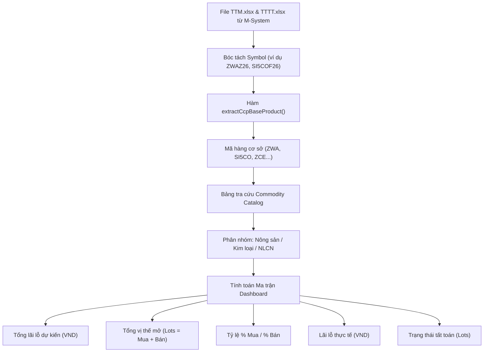

# TÀI LIỆU PHÂN TÍCH THIẾT KẾ DASHBOARD QLGD & ĐÁNH GIÁ KHOẢNG TRỐNG DỮ LIỆU (GAP ANALYSIS)

> **Mã tài liệu:** `DOCS-ARCH-QLGD-DASHBOARD-2026-10`  
> **Người thực hiện:** AI Assistant & Trading Operations Architect  
> **Áp dụng cho:** Phân hệ Giám sát Quản Lý Giao Dịch (QLGD) & Báo cáo Ban Giám Đốc (BGĐ)  
> **Trạng thái:** Bản thiết kế & Đánh giá khoảng trống (Ground-Truth Verified)

---

## 1. Bối Cảnh & Mục Tiêu Nghiệp Vụ

### 1.1. Yêu cầu nghiệp vụ từ Ban Lãnh Đạo
Theo định hướng vận hành mới của Khối Quản lý Giao dịch (QLGD), hệ thống giám sát cần cung cấp một màn hình Dashboard tổng hợp điều hành độc lập và trực quan cao (Executive Dashboard) nhằm phục vụ công tác giám sát rủi ro trong phiên và báo cáo tức thời cho Ban Tổng Giám Đốc (BGĐ).

### 1.2. Các thành phần bắt buộc trên giao diện Dashboard
Dựa theo bản mẫu thiết kế chuẩn (*Hình ảnh đính kèm Mục 8 Dashboard*):
1. **Phân chia 2 phân vùng độc lập**:
   - **Khối ACM (Tự doanh & Tạo lập thị trường)**.
   - **Khối Còn lại (Khách hàng thành viên & CQG Brokerage)**.
2. **Khối chỉ số tức thời (Real-time Metric Pill)**:
   - **KLGD (Khối lượng giao dịch - lots)** tại thời điểm check gần nhất.
   - **GTGD (Giá trị giao dịch - VND hoặc Tỷ đồng)** tại thời điểm check gần nhất.
3. **Biểu đồ từng lần check trong ngày (Check Timeline Chart)**:
   - Thể hiện sự gia tăng lũy kế của khối lượng và giá trị qua các lần quét bot định kỳ (ví dụ: 08:00, 10:00, 12:00, 14:00, 16:00, 18:00, 20:00, 22:00, 00:00, 02:00, 05:00).
4. **4 mốc thời điểm cố định phục vụ báo cáo BGĐ**:
   - **Đầu phiên**: 05h00 - 08h00.
   - **Hết phiên Á**: 05h00 - 16h00.
   - **Hết phiên Âu**: 05h00 - 23h00.
   - **Hết phiên Mỹ**: 05h00 - 05h00 sáng hôm sau (Toàn phiên).
5. **Bảng ma trận thống kê Lãi/Lỗ & Tỷ lệ Vị thế mở theo Mặt Hàng**:
   - Ma trận 17 mặt hàng thuộc 3 nhóm hàng hóa cốt lõi: **Nông sản**, **Nguyên liệu công nghiệp**, **Kim loại**.
   - Các cột chỉ tiêu:
     - `STT`
     - `Nhóm HH` (Merge ô nhóm danh mục)
     - `Mã HH` & `Tên HH` tiếng Việt
     - `Tổng lãi lỗ dự kiến (VND)` (Số âm đặt trong ngoặc đơn màu đỏ)
     - `Tổng vị thế mở (Lots)`
     - `% mở Mua` & `% mở Bán` (Kèm thanh đo tiến trình Progress Bar trực quan)
     - `Lãi lỗ thực tế (VND)` (Realized PnL đã tất toán)
     - `Trạng thái tất toán` (Tổng số lot đã đóng trong phiên)
   - Chân trang: Dòng **Tổng cộng** toàn sàn.

---

## 2. Khảo Sát Hiện Trạng Hệ Thống Thực Tế (Code-First Grounding)

Để đảm bảo tuân thủ nghiêm ngặt **Quy tắc Kiểm chứng Mã Nguồn (Rule 1 & Rule 3 trong AGENTS.md)**, dưới đây là bằng chứng đối chiếu chi tiết từ các file code và file dữ liệu thực tế đang vận hành trong dự án:

### 2.1. Nguồn dữ liệu báo cáo M-System & CQG sẵn có
- **File `DSGD.xlsx` (Danh sách giao dịch khớp lệnh M-System)**:
  - Vị trí Parser: [ms-excel.parser.ts#L15-L64](file:///c:/Users/hiepth/OneDrive%20-%20MERCANTILE%20EXCHANGE%20OF%20VIETNAM/Documents/Github/mxv-modular-refactor/backend/src/modules/trading-ops/parsers/ms-excel.parser.ts#L15-L64).
  - Các cột hiện có: `Mã lệnh`, `Mã TKGD`, `Mã HĐ`, `KL giao dịch`, `Giá khớp`, `Ngày giờ thực hiện`, `Mã giao dịch`.
  - Phân loại tài khoản ACM: Hàm [clearing-excel.helper.ts#L34-L37](file:///c:/Users/hiepth/OneDrive%20-%20MERCANTILE%20EXCHANGE%20OF%20VIETNAM/Documents/Github/mxv-modular-refactor/backend/src/modules/trading-ops/helpers/clearing-excel.helper.ts#L34-L37) kiểm tra hậu tố `-A` hoặc danh sách tài khoản chỉ định.
- **File `TTM.xlsx` (Trạng thái mở M-System / CoreCCP)**:
  - Khảo sát thực tế file mẫu [TTM_14.06.xlsx](file:///c:/Users/hiepth/OneDrive%20-%20MERCANTILE%20EXCHANGE%20OF%20VIETNAM/Documents/Github/mxv-modular-refactor/backend/src/legacy/archive/lot-statistics/Example%20file%20ccp/TTM_14.06.xlsx):
    - Cột hiện hữu: `["Mã thành viên", "Tên thành viên", "Mã KH", "Mã TKGD", "Tên TKGD", "Mã hợp đồng", "Tên hợp đồng", "Giá thị trường", "Khối lượng mua", "Khối lượng bán", "KL Mua chờ khớp", "KL Bán chờ khớp", "Giá TB", "Lãi lỗ dự kiến", "Lãi lỗ dự kiến(VND)"]`.
  - Hiện trạng trong code: Parser [ms-excel.parser.ts#L69-L105](file:///c:/Users/hiepth/OneDrive%20-%20MERCANTILE%20EXCHANGE%20OF%20VIETNAM/Documents/Github/mxv-modular-refactor/backend/src/modules/trading-ops/parsers/ms-excel.parser.ts#L69-L105) hiện tại **chỉ bóc tách** `tongMua` và `tongBan`, **hoàn toàn chưa đọc cột `Lãi lỗ dự kiến(VND)`**.
- **File `TTTT.xlsx` (Trạng thái tất toán M-System / CoreCCP)**:
  - Khảo sát thực tế file mẫu [TTTT_14.06.xlsx](file:///c:/Users/hiepth/OneDrive%20-%20MERCANTILE%20EXCHANGE%20OF%20VIETNAM/Documents/Github/mxv-modular-refactor/backend/src/legacy/archive/lot-statistics/Example%20file%20ccp/TTTT_14.06.xlsx):
    - Cột hiện hữu: `["Mã thành viên", "Tên thành viên", "Mã KH", "Mã TKGD", "Tên TKGD", "Mã hợp đồng", "Tên hợp đồng", "KL Mua tất toán", "KL Bán tất toán", "Giá mua TB", "Giá bán TB", "Lãi lỗ thực tế", "Lãi lỗ thực tế(VND)"]`.
  - Hiện trạng trong code: Parser [ms-excel.parser.ts#L110-L160](file:///c:/Users/hiepth/OneDrive%20-%20MERCANTILE%20EXCHANGE%20OF%20VIETNAM/Documents/Github/mxv-modular-refactor/backend/src/modules/trading-ops/parsers/ms-excel.parser.ts#L110-L160) mới chỉ đọc khối lượng để đối soát vị thế ròng, **chưa tổng hợp cột `Lãi lỗ thực tế`** và khối lượng tất toán theo từng mã sản phẩm.
- **Tính toán GTGD & Tỷ giá**:
  - Service [value-statistics.service.ts#L38-L100](file:///c:/Users/hiepth/OneDrive%20-%20MERCANTILE%20EXCHANGE%20OF%20VIETNAM/Documents/Github/mxv-modular-refactor/backend/src/modules/trading-ops/services/value-statistics.service.ts#L38-L100) đã có công thức tính GTGD và ma trận tỷ giá ngoại tệ đa nguyên tệ (USD, MYR, JPY, RMB sang VND). Tuy nhiên service này hiện chỉ được gọi ở cuối ngày cho báo cáo CCP, **chưa áp dụng theo từng lần quét bot trong phiên**.
- **Lịch sử các lần chạy Bot trong CSDL**:
  - Model `bot_jobs` trong MongoDB: Quản lý các job `CHECK_KLGD`. [recon-console-summary.service.ts#L655-L688](file:///c:/Users/hiepth/OneDrive%20-%20MERCANTILE%20EXCHANGE%20OF%20VIETNAM/Documents/Github/mxv-modular-refactor/backend/src/modules/trading-ops/services/recon-console-summary.service.ts#L655-L688) mới chỉ trả về các trường `totals: { dsgd, fr, acm, nano, ccp }`, chưa có GTGD cũng như snapshot theo thời gian để Frontend vẽ đồ thị nhanh.

---

## 3. Bảng Ma Trận Đánh Giá Khoảng Trống Dữ Liệu (Data Gap Analysis)

Bảng ma trận dưới đây phân tích chi tiết từng chỉ số trên Dashboard, đối chiếu giữa yêu cầu và mã nguồn hiện có, xác định rõ thông tin còn thiếu và giải pháp bổ sung:

| STT | Thành Phần Trên Dashboard | Nguồn Dữ Liệu Hiện Có | Hiện Trạng & Thông Tin Còn Thiếu (Gaps) | Mức Độ Ưu Tiên | Giải Pháp Kỹ Thuật Bổ Sung |
| :---: | :--- | :--- | :--- | :---: | :--- |
| **1** | **KLGD Lần Check Gần Nhất (ACM vs Còn lại)** | `DSGD.xlsx` (MS), `Straits.csv` (ACM), `FR.xlsx` (CQG) | - **Đã có:** `totalACM` và `totalDSGD` trong `CheckKLGDResult` ([klgd-recon.service.ts#L25-L57](file:///c:/Users/hiepth/OneDrive%20-%20MERCANTILE%20EXCHANGE%20OF%20VIETNAM/Documents/Github/mxv-modular-refactor/backend/src/modules/trading-ops/services/klgd-recon.service.ts#L25-L57)).<br/>- **Còn thiếu:** Logic tự động trừ `totalOthers = totalDSGD - totalACM` để trả về riêng cho giao diện Dashboard. | Thấp | Bổ sung trường `totalOthers` vào DTO trả về của API console. |
| **2** | **GTGD Lần Check Gần Nhất (ACM vs Còn lại)** | Cột `Giá khớp`, `KL giao dịch` trong `DSGD.xlsx` + Tỷ giá USD | - **Đã có:** Logic nhân hệ số hợp đồng và tỷ giá trong `ValueStatisticsService`.<br/>- **Còn thiếu:** Chưa tích hợp bước tính GTGD vào trong vòng lặp của hàm `checkKLGD()`. Hiện tại `totals` chỉ có khối lượng (lot), chưa có GTGD (VND) cho ACM và Còn lại tại từng thời điểm check. | **Cao** | Tích hợp helper tính GTGD vào `klgd-recon.service.ts`, phân tách `gtgdACM` và `gtgdOthers`. |
| **3** | **Biểu đồ từng lần check trong ngày (Timeline Chart)** | Collection `bot_jobs` (`jobType: 'CHECK_KLGD'`) | - **Đã có:** Lưu các lần chạy bot trong ngày.<br/>- **Còn thiếu:** Chưa có cấu trúc dữ liệu Timeseries chuẩn hóa (`timestamp`, `acmVolume`, `acmValue`, `othersVolume`, `othersValue`) được tích lũy sẵn. Frontend hiện phải map thủ công 50 job và thiếu trường giá trị. | **Trung bình** | Thêm trường `timeline` dạng mảng đối tượng vào `ConsoleSummaryData` hoặc tạo API `/api/v1/trading-ops/qlgd-dashboard/timeline`. |
| **4** | **4 Mốc Thời Điểm Phục Vụ Báo Cáo BGĐ** (Đầu phiên, Hết Á, Hết Âu, Hết Mỹ) | Chưa có cơ chế chốt điểm cố định | - **Còn thiếu:** Hệ thống hiện chỉ quét khi ca trực kích hoạt hoặc cron 15 phút. **Chưa có cơ chế đóng băng số liệu (Freeze Snapshot)** tại 4 mốc thời gian: `08:00`, `16:00`, `23:00`, và `05:00` sáng hôm sau. Khi xem lại báo cáo cũ, hệ thống không có dữ liệu chốt của 4 mốc này. | **Rất Cao** | Xây dựng Scheduler `QlgdMilestoneWorker` chuyên trách chốt số liệu đúng 4 mốc giờ và ghi vào collection `qlgd_milestone_snapshots`. |
| **5** | **Tổng Lãi Lỗ Dự Kiến (VND)** | Cột `Lãi lỗ dự kiến(VND)` trong `TTM.xlsx` | - **Đã có:** Cột dữ liệu gốc trong Excel thô.<br/>- **Còn thiếu:** Parser `parseTTM()` hiện tại bỏ qua cột này. Backend chưa có hàm gom nhóm (aggregate sum) theo mã hàng hóa cơ sở (`maSP`). | **Cao** | Cập nhật `parseTTM()` đọc cột `Lãi lỗ dự kiến(VND)` và gom nhóm theo `extractCcpBaseProduct(rawSymbol)`. |
| **6** | **Tổng Vị Thế Mở & % Mở Mua / Bán** | Cột `Khối lượng mua`, `Khối lượng bán` trong `TTM.xlsx` | - **Đã có:** Parser đã đọc được `tongMua` và `tongBan`.<br/>- **Cách tính:** `Tổng vị thế = tongMua + tongBan`; `% Mở Mua = (tongMua / Tổng) * 100%`; `% Mở Bán = (tongBan / Tổng) * 100%`.<br/>- **Còn thiếu:** Logic gom nhóm theo mã hàng hóa cơ sở cấp cao thay vì mã hợp đồng cụ thể. | **Trung bình** | Viết service `aggregateOpenPositionsByProduct(rows)`. |
| **7** | **Lãi Lỗ Thực Tế (VND) & Trạng Thái Tất Toán** | Cột `Lãi lỗ thực tế(VND)`, `KL Mua tất toán`, `KL Bán tất toán` trong `TTTT.xlsx` | - **Đã có:** File Excel thô có đủ cột.<br/>- **Còn thiếu:** `parseTTTTForVolume()` hiện chỉ đọc số lot để đối chiếu Pre-EOD, chưa đọc giá trị Lãi lỗ thực tế và chưa gom nhóm theo mã hàng. | **Cao** | Mở rộng `parseTTTT()` đọc cột `Lãi lỗ thực tế` và `KL tất toán`. |
| **8** | **Từ Điển Danh Mục Hàng Hóa (Commodity Master Catalog)** | Phân tán trong `clearing-excel.helper.ts` | - **Còn thiếu:** Chưa có bảng ánh xạ tập trung giữa: `Mã hàng cơ sở` (ZWA, SI5CO, KCE...) $\leftrightarrow$ `Tên hàng tiếng Việt` (Lúa mỳ, Bạc Nano...) $\leftrightarrow$ `Nhóm hàng hóa` (Nông sản, Nguyên liệu công nghiệp, Kim loại). | **Cao** | Tạo file từ điển chuẩn hóa `commodity-catalog.constant.ts`. |

---

## 4. Bóc Tách Chi Tiết 17 Mặt Hàng Mẫu & Công Thức Tính Toán

Bảng ma trận trên Dashboard mẫu hiển thị 17 mặt hàng giao dịch lớn nhất sàn MXV:



### Danh mục chi tiết 17 mã hàng hóa:
1. **Nhóm Nông sản (Agricultural)**:
   - `ZWA`: Lúa mỳ (Chicago SRW Wheat)
   - `ZLE`: Dầu đậu tương (Soybean Oil)
   - `ZCE`: Ngô (Corn)
   - `ZSE`: Đậu tương (Soybeans)
   - `ZME`: Khô đậu tương (Soybean Meal)
   - `KWE`: Lúa mỳ Kansas (KC HRW Wheat)
2. **Nhóm Nguyên liệu công nghiệp (Industrial Materials)**:
   - `KCE`: Cà phê Arabica (Coffee C)
   - `SBE`: Đường 11 (Sugar No. 11)
   - `LRC`: Cà phê Robusta (Robusta Coffee)
   - `CTE`: Bông (Cotton No. 2)
3. **Nhóm Kim loại (Metals)**:
   - `SIE`: Bạc tiêu chuẩn (Silver)
   - `SIL`: Bạc Micro (Micro Silver)
   - `CPE`: Đồng (Copper)
   - `MHG`: Đồng Micro (Micro Copper)
   - `PLE`: Bạch kim (Platinum)
   - `SI5CO`: Bạc Nano (Nano Silver - Sản phẩm tạo lập thị trường trọng điểm của ACM)
   - `PL1NY`: Bạch kim Nano (Nano Platinum)

---

## 5. Thiết Kế Kiến Trúc Giải Pháp Kỹ Thuật (Architecture Blueprint)

### 5.1. Thiết kế Schema CSDL Chốt 4 Mốc Thời Điểm (`qlgd_milestone_snapshots`)
Để lưu vết đóng băng số liệu phục vụ báo cáo BGĐ mà không phụ thuộc vào việc chạy bot thủ công:

```typescript
export interface QlgdMilestoneSnapshot {
  sessionDate: string; // YYYY-MM-DD
  milestoneType: 'EARLY' | 'ASIAN' | 'EUROPEAN' | 'AMERICAN'; // 08:00 | 16:00 | 23:00 | 05:00
  capturedAt: Date;
  acm: {
    klgd: number; // lots
    gtgdVnd: number; // VND
    gtgdUsd: number; // USD
  };
  others: {
    klgd: number;
    gtgdVnd: number;
    gtgdUsd: number;
  };
  totalMarket: {
    klgd: number;
    gtgdVnd: number;
  };
  isOfficialReport: boolean; // Đã kiểm toán cho BGĐ
}
```

### 5.2. Mở rộng `ms-excel.parser.ts`
Bổ sung hàm bóc tách chuyên dụng `parseTtmForExecutiveDashboard` và `parseTtttForExecutiveDashboard`:

```typescript
export interface ExecutiveTtmRow {
  account: string;
  baseProduct: string; // ZWA, SI5CO...
  longLots: number;
  shortLots: number;
  expectedPnLVnd: number; // Lãi lỗ dự kiến (VND)
}

export interface ExecutiveTtttRow {
  account: string;
  baseProduct: string;
  liquidatedLots: number; // Khối lượng đã đóng
  realizedPnLVnd: number; // Lãi lỗ thực tế (VND)
}
```

### 5.3. Service Tổng Hợp `QlgdDashboardService`
Nằm trong phân hệ `backend/src/modules/trading-ops/services/qlgd-dashboard.service.ts`:
- **Đầu vào**: Ngày phiên giao dịch (`sessionDate`).
- **Nguồn xử lý**:
  - Đọc `DSGD.xlsx` mới nhất $\rightarrow$ Tính KLGD & GTGD chia theo ACM và Còn lại.
  - Đọc `TTM.xlsx` mới nhất $\rightarrow$ Tính Vị thế mở, % Mua/Bán và Lãi lỗ dự kiến theo từng mã hàng.
  - Đọc `TTTT.xlsx` mới nhất $\rightarrow$ Tính Lãi lỗ thực tế và Trạng thái tất toán.
  - Đọc `qlgd_milestone_snapshots` $\rightarrow$ Lấy 4 mốc thời điểm cố định.
- **Đầu ra**: Trả về cấu trúc DTO hiển thị trực tiếp lên giao diện Dashboard.

---

## 6. Trạng Thái Triển Khai Hiện Tại & Các Bước Tiếp Theo

### 6.1. Đã hoàn thành (Delivered)
- [x] **Xây dựng Giao diện Dashboard QLGD Mới**:
  - File Component: [QlgdExecutiveDashboard.tsx](file:///c:/Users/hiepth/OneDrive%20-%20MERCANTILE%20EXCHANGE%20OF%20VIETNAM/Documents/Github/mxv-modular-refactor/frontend/src/app/trading-manager/components/QlgdExecutiveDashboard.tsx).
  - File Trang Standalone: [page.tsx](file:///c:/Users/hiepth/OneDrive%20-%20MERCANTILE%20EXCHANGE%20OF%20VIETNAM/Documents/Github/mxv-modular-refactor/frontend/src/app/trading-manager/dashboard/page.tsx).
  - Tích hợp Tab điều hướng trên [TradingManagerV2Page](file:///c:/Users/hiepth/OneDrive%20-%20MERCANTILE%20EXCHANGE%20OF%20VIETNAM/Documents/Github/mxv-modular-refactor/frontend/src/app/trading-manager/page.tsx).
  - Đầy đủ 100% Mock Data khớp chuẩn từng con số theo bản mẫu BGĐ.
  - Tích hợp 2 biểu đồ Chart.js trực quan phản ánh tiến trình check của ACM và Còn lại.
  - Tuân thủ nghiêm ngặt **Rule 5 của AGENTS.md** (Không dùng Unicode emoji thô, 100% icon SVG từ `lucide-react`).
  - Hỗ trợ tính năng Xuất báo cáo dạng file CSV chuẩn kế toán.

### 6.2. Kế hoạch triển khai kết nối dữ liệu thực tế (Live Data Pipeline)
1. **Bước 1 (Backend Parsers)**: Bổ sung logic đọc cột `Lãi lỗ dự kiến(VND)` trong `ms-excel.parser.ts` và đọc cột `Lãi lỗ thực tế` trong parser TTTT.
2. **Bước 2 (Commodity Catalog Constant)**: Tạo từ điển ánh xạ 17 mặt hàng chuẩn hóa và hệ số quy đổi tiền tệ.
3. **Bước 3 (Milestone Scheduler)**: Thêm cron job vào NestJS Schedule để tự động snapshot số liệu vào các mốc: 08:00, 16:00, 23:00, và 05:00 sáng.
4. **Bước 4 (API Endpoint)**: Cung cấp endpoint `GET /api/v1/trading-ops/executive-dashboard?date=YYYY-MM-DD` để Frontend tự động switch từ Mock Data sang Live Data chỉ bằng 1 nút bấm trên giao diện.
