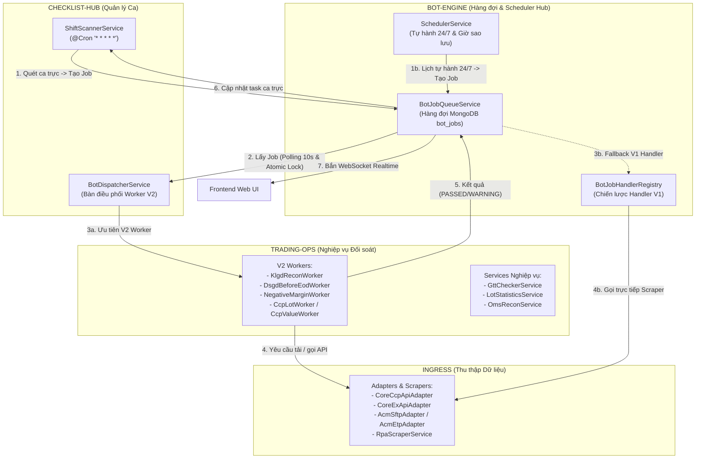

# TÀI LIỆU BÓC TÁCH TOÀN DIỆN PHÂN HỆ BOT-ENGINE & LỘ TRÌNH TÁI THIẾT KẾ (REBUILD / SUNSETTING)

> **Mục tiêu**: Cung cấp bức tranh giải phẫu chi tiết 100% mã nguồn phân hệ `bot-engine` (21 files, từng hàm, từng API và mối quan hệ liên module). Tài liệu đóng vai trò là "Bản vẽ kỹ thuật hoàn công" để phục vụ lập trình viên đập đi xây lại từ đầu một cách sạch sẽ hoặc loại bỏ hoàn toàn các thành phần dư thừa kế thừa từ Monolith V1.  
> **Thời gian lập**: 26/10/2026  
> **Nguyên tắc**: Code-First Grounding — 100% dẫn chứng trực tiếp từ mã nguồn thực tế, không phỏng đoán.

---

## PHẦN 1: BẢN ĐỒ TỔNG QUAN & TƯƠNG QUAN HỆ THỐNG

### 1.1. Vai trò của `bot-engine` trong hệ thống
Phân hệ `bot-engine` (`backend/src/modules/bot-engine`) ban đầu được thiết kế trong Monolith V1 như một "tổng kho" chứa mọi thứ liên quan đến tự động hóa: từ cào dữ liệu Playwright, kết nối SFTP, giải mã mật khẩu, chạy script Python, bóc tách email, đến quản lý hàng đợi và quét ca trực.

Khi hệ thống chuyển đổi sang **Modular Monolith V2**, các phân hệ chuyên trách đã ra đời:
- **`ingress`**: Chuyên trách thu thập dữ liệu ngoài (Scrapers, REST API Adapters, SFTP).
- **`trading-ops`**: Chuyên trách bóc tách, tính toán và đối soát nghiệp vụ (KLGD, DSGD Before EOD, Margin, CCP Lot/Value).
- **`checklist-hub`**: Chuyên trách quản lý ca trực và điều phối Worker (`ShiftScannerService`, `BotDispatcherService`).

Do quá trình chuyển đổi thực hiện theo phương pháp cuốn chiếu, `bot-engine` hiện tại đóng vai trò là **Trạm trung chuyển lai (Hybrid Transit Hub)** giữa V1 và V2.

---

## PHẦN 2: BÓC TÁCH CHI TIẾT TỪNG FILE MÃ NGUỒN (21 FILES)

---

### NHÓM I: TRỤC HÀNG ĐỢI & LẬP LỊCH NỀN (CORE ENGINE)

#### 1. `bot-job-queue.service.ts` (1.038 dòng)
* **Vị trí**: [bot-job-queue.service.ts](file:///c:/Users/hiepth/OneDrive%20-%20MERCANTILE%20EXCHANGE%20OF%20VIETNAM/Documents/Github/mxv-cqg-download-investigation/backend/src/modules/bot-engine/bot-job-queue.service.ts)
* **Trách nhiệm**: Quản lý vòng đời của bản ghi `bot_jobs` trong MongoDB.
* **Chi tiết từng hàm**:
  - `onModuleInit()` / `onModuleDestroy()` (L70-L113): Khởi tạo 2 timer chạy ngầm: `queueInterval` (polling mỗi 10 giây gọi `processQueue`) và `cleanupInterval` (mỗi 5 phút gọi `cleanupStuckJobs`).
  - `enqueue(jobType, payload, maxAttempts, options)` (L122-L155): Đưa Job mới vào DB với status `PENDING`. Gọi `BotJobDedupHelper.checkJobConflict()` để chặn spam Job trong khoảng thời gian cooldown. Sau đó gọi `syncJobToChecklist(saved, 'PENDING')`.
  - `executeJobDirectly(job)` (L160-L172): Thực thi tức thì không qua hàng đợi (dành cho CLI hoặc Agent test).
  - `processQueue()` (L178-L490): Trọng tâm xử lý của worker:
    - Sử dụng `botJobModel.findOneAndUpdate({ status: 'PENDING' }, { $set: { status: 'PROCESSING', lockedBy, lockedAt } })` để khóa Job nguyên tử (Atomic Lock), chống race condition đa tiến trình.
    - **Queue Guard** (L208-L289): Tự động chuyển status sang `CANCELLED` nếu ca trực đã đóng (`status === 'COMPLETED'`) hoặc tác vụ thẩm định đã được người dùng tích chọn thủ công.
    - **Dispatcher Bridge** (L345-L424): Kiểm tra `botDispatcher.hasWorker(capabilityKey)`. Nếu có, bàn giao cho `BotDispatcherService` (V2). Nếu không có, tìm trong `BotJobHandlerRegistry` (V1).
    - **Real-time Log Flush** (L323-L342): Cứ mỗi 1.5 giây đẩy log mới ra DB và bắn WebSocket `emitJobLogUpdated`.
  - `cancelJob(jobId, reason)` (L492-L572): Hủy một Job. Nếu job đang `PROCESSING`, kích hoạt `abortController.abort()` và gọi các hàm dọn dẹp tài nguyên đã đăng ký (`registerCleanup`).
  - `cleanupStuckJobs(isStartup)` (L578-L650): Quét các Job bị treo ở `PROCESSING` quá 15 phút, giải phóng lock và chuyển về `PENDING` (nếu còn lượt thử) hoặc `FAILED`.
  - `syncJobToChecklist(job, status, error)` (L701-L954): Cập nhật trạng thái task trong ca trực (`shift_logs`):
    - Đổi trạng thái: `IN_PROGRESS`, `PASSED`, `NEEDS_ATTENTION`, `WAITING`, `FAILED`.
    - **Parent Task Propagation** (L870-L891): Tự động cập nhật Task Cha (`parentTaskIdSnapshot`) khi Task Con hoàn tất.
    - **Human Override Guard** (L893-L911): Tuyệt đối không ghi đè `FAILED`/`ABORTED` lên task mà nhân viên ca trực đã xác nhận hoàn thành thủ công.
    - **WebSocket Emission** (L956-L990): Bắn socket `DASHBOARD_UPDATED` và `JOB_STATUS_UPDATED`.
  - Tra cứu: `getJobForTask()`, `getLatestCompletedJobByType()`, `hasActiveJobByType()`, `getJobById()`.
* **Định hướng khi Rebuild**: Bóc tách hàm `syncJobToChecklist` và phần WebSocket sang một service chuyên trách bên `checklist-hub`. Giữ file này thành một Queue Engine thuần túy (~200 dòng).

---

#### 2. `scheduler.service.ts` (463 dòng)
* **Vị trí**: [scheduler.service.ts](file:///c:/Users/hiepth/OneDrive%20-%20MERCANTILE%20EXCHANGE%20OF%20VIETNAM/Documents/Github/mxv-cqg-download-investigation/backend/src/modules/bot-engine/scheduler.service.ts)
* **Trách nhiệm**: Lập lịch thực thi các tác vụ tự động theo thời gian.
* **Chi tiết từng hàm**:
  - `handleAutonomousKlgdRun()` (L44-L121): `@Cron('* * * * *')`. Kiểm tra master switch `bot_auto_recon_enabled`, tần suất `bot_periodic_check_frequency` (mặc định 60p), market weekend guard `isMarketWeekendClosed`. Đẩy job `CHECK_KLGD` độc lập cho Trading Manager 24/7 không phụ thuộc ca trực.
  - `handleAutonomousPeriodicBackupRun()` (L127-L248): `@Cron('* * * * *')`. Kiểm tra chu kỳ sao lưu (mặc định 60p). Đẩy các job: `FILE_AUDIT_MS`, `FILE_AUDIT_CQG`, `DOWNLOAD_CCP_REPORT` (FULL), `DOWNLOAD_CE_REPORT` (FULL).
  - `checkSchedule()` (L253-L461): `@Cron('* * * * *')`. Đọc mốc giờ cố định từ CSDL: `bot_backup_time` (05:30), `bot_stat_time` (06:30). Đẩy các job sao lưu cuối ngày và chạy thống kê số lot/giá trị.
    - **Đoạn mã trùng lặp** (L366-L442): Tìm `shiftLogModel.findOne({ status: 'PENDING' })` rồi cố gắng map `jobPayload.taskId = matchedTask.taskId`. Logic này bị trùng lặp hoàn toàn với `ShiftScannerService` bên `checklist-hub`.
* **Định hướng khi Rebuild**: Loại bỏ đoạn quét ca trực `activeShift`. Giữ service này chuyên trách chạy các job tự hành độc lập 24/7 (Autonomous Standalone Runner).

---

#### 3. `bot-engine.service.ts` (195 dòng)
* **Vị trí**: [bot-engine.service.ts](file:///c:/Users/hiepth/OneDrive%20-%20MERCANTILE%20EXCHANGE%20OF%20VIETNAM/Documents/Github/mxv-cqg-download-investigation/backend/src/modules/bot-engine/bot-engine.service.ts)
* **Trách nhiệm**: File rỗng ruột còn sót lại sau khi chuyển giao logic quét ca sang `checklist-hub`.
* **Chi tiết từng hàm**:
  - `handleBotChecks()` (L21-L26): Hàm rỗng ghi log bỏ qua.
  - `parseMaturityEmail(htmlBody)` (L31-L141): Parse HTML email đáo hạn hợp đồng.
  - `parseEmailText(content)` (L146-L194): Parse text email đáo hạn hợp đồng.
* **Định hướng khi Rebuild**: **Xóa bỏ hoàn toàn**. Hai hàm parse email đã có sẵn trong `TeamsNotifierService` ([teams-notifier.service.ts#L417](file:///c:/Users/hiepth/OneDrive%20-%20MERCANTILE%20EXCHANGE%20OF%20VIETNAM/Documents/Github/mxv-cqg-download-investigation/backend/src/modules/notifications/teams-notifier.service.ts#L417)). Không có class nào trong dự án inject service này.

---

#### 4. `core/job-handler.interface.ts` & `core/job-handler.registry.ts`
* **Vị trí**: [core/job-handler.interface.ts](file:///c:/Users/hiepth/OneDrive%20-%20MERCANTILE%20EXCHANGE%20OF%20VIETNAM/Documents/Github/mxv-cqg-download-investigation/backend/src/modules/bot-engine/core/job-handler.interface.ts) & [core/job-handler.registry.ts](file:///c:/Users/hiepth/OneDrive%20-%20MERCANTILE%20EXCHANGE%20OF%20VIETNAM/Documents/Github/mxv-cqg-download-investigation/backend/src/modules/bot-engine/core/job-handler.registry.ts)
* **Trách nhiệm**: Triển khai Strategy Pattern cho các Handler V1:
  - `IBotJobHandler`: Interface yêu cầu mảng `jobTypes: string[]` và hàm `execute(job, context)`.
  - `BotJobHandlerRegistry`: Lưu trữ danh sách handler trong Map và cung cấp phương thức `getHandler(jobType)`.
* **Định hướng khi Rebuild**: Có thể thay thế hoàn toàn bằng `BotDispatcherService` (V2) với interface `IBotWorker`.

---

#### 5. `helpers/bot-job-dedup.helper.ts` (3.223 bytes)
* **Vị trí**: [helpers/bot-job-dedup.helper.ts](file:///c:/Users/hiepth/OneDrive%20-%20MERCANTILE%20EXCHANGE%20OF%20VIETNAM/Documents/Github/mxv-cqg-download-investigation/backend/src/modules/bot-engine/helpers/bot-job-dedup.helper.ts)
* **Trách nhiệm**: Kiểm tra xung đột trước khi tạo Job. Ngăn chặn việc sinh liên tục nhiều Job giống nhau trong vòng 15 phút cooldown hoặc khi đang có Job cùng loại chạy dở.
* **Định hướng khi Rebuild**: Giữ lại làm utility dùng chung cho Hàng đợi.

---

#### 6. `helpers/bot-path.helper.ts` (14.682 bytes)
* **Vị trí**: [helpers/bot-path.helper.ts](file:///c:/Users/hiepth/OneDrive%20-%20MERCANTILE%20EXCHANGE%20OF%20VIETNAM/Documents/Github/mxv-cqg-download-investigation/backend/src/modules/bot-engine/helpers/bot-path.helper.ts)
* **Trách nhiệm**: Cung cấp các hàm phân giải đường dẫn và ngày phiên:
  - `resolveTradingSessionDate(input, { sessionStartStr })`: Phân giải ngày giao dịch nghiệp vụ (nếu trước mốc 05:00 sáng thì tính là phiên hôm trước).
  - `isMarketWeekendClosed(date, { sessionStartStr })`: Xác định thị trường đóng cửa cuối tuần (từ sáng thứ Bảy đến sáng thứ Hai) để tạm dừng các job tự động.
  - `resolveDailySubfolder(basePath, date)`: Tự động ghép cấu trúc thư mục dạng `YYYY/TMM.YYYY/DD.MM`.
  - `resolveStoragePathCrossPlatform(p)`: Chuẩn hóa đường dẫn tương thích giữa Windows và Linux Ubuntu.
  - `parseJobPayload(job)`: Xử lý an toàn chuyển đổi Mongoose Map sang Object thuần.
* **Định hướng khi Rebuild**: Chuyển file này sang thư mục dùng chung `backend/src/shared/helpers/` vì toàn bộ hệ thống đều cần dùng.

---

#### 7. `helpers/scheduler-config-seeder.helper.ts` (9.998 bytes)
* **Vị trí**: [helpers/scheduler-config-seeder.helper.ts](file:///c:/Users/hiepth/OneDrive%20-%20MERCANTILE%20EXCHANGE%20OF%20VIETNAM/Documents/Github/mxv-cqg-download-investigation/backend/src/modules/bot-engine/helpers/scheduler-config-seeder.helper.ts)
* **Trách nhiệm**: Khởi tạo dữ liệu cấu hình mặc định cho bảng lịch chạy `bot_scheduler_config` trong CSDL `system_settings` khi hệ thống chạy lần đầu. Cung cấp hàm `getRecommendedMarketCloseDownloadTime()` tính toán giờ tải theo mùa đông/hè.

---

### NHÓM II: CÁC CONTROLLER API (6 CONTROLLERS)

#### 1. `controllers/bot-jobs.controller.ts` (238 dòng)
* **Vị trí**: [controllers/bot-jobs.controller.ts](file:///c:/Users/hiepth/OneDrive%20-%20MERCANTILE%20EXCHANGE%20OF%20VIETNAM/Documents/Github/mxv-cqg-download-investigation/backend/src/modules/bot-engine/controllers/bot-jobs.controller.ts)
* **Prefix route**: `@Controller('api/v1/bot-engine')`
* **Chi tiết API**:
  - `GET jobs/:id/download-zip` (L63-L210): Tìm toàn bộ file báo cáo sinh ra từ Job (trong thư mục tạm hoặc thư mục backup ngày), nén lại thành file zip và trả về luồng tải cho Client.
  - `POST jobs/:id/submit-captcha` (L215-L236): Tiếp nhận mã Captcha gõ tay từ giao diện Web khi bot bị vướng Captcha (hiện đã được giải tự động qua Gemini AI Key).

---

#### 2. `controllers/bot-config.controller.ts` (821 dòng)
* **Vị trí**: [controllers/bot-config.controller.ts](file:///c:/Users/hiepth/OneDrive%20-%20MERCANTILE%20EXCHANGE%20OF%20VIETNAM/Documents/Github/mxv-cqg-download-investigation/backend/src/modules/bot-engine/controllers/bot-config.controller.ts)
* **Prefix route**: `@Controller('api/v1/bot-engine')`
* **Chi tiết API**:
  - `GET config` (L34-L265): Đọc cấu hình thông tin đăng nhập các hệ thống đối tác từ `system_settings` và che mặt nạ mật khẩu dạng `********`.
  - `POST config` (L270-L598): Nhận mật khẩu mới, mã hóa AES-256 (`encrypt`) và lưu vào CSDL `system_settings`.
  - Các endpoint kiểm tra kết nối (Test Login):
    - `POST test-connection`: Thử đăng nhập M-System.
    - `POST test-connection-cqg`: Thử đăng nhập CQG Price (mxvprice).
    - `POST test-connection-cqg1`: Thử đăng nhập CQG Trade 1.
    - `POST test-connection-cqg3`: Thử đăng nhập CQG Trade 2.
    - `POST test-connection-acm`: Thử đăng nhập ACM Web/SFTP.
    - `POST test-connection-ccp`: Thử đăng nhập CoreCCP.
    - `POST test-connection-ce`: Thử đăng nhập CoreEX.

---

#### 3. `controllers/bot-ingress.controller.ts` (179 dòng)
* **Vị trí**: [controllers/bot-ingress.controller.ts](file:///c:/Users/hiepth/OneDrive%20-%20MERCANTILE%20EXCHANGE%20OF%20VIETNAM/Documents/Github/mxv-cqg-download-investigation/backend/src/modules/bot-engine/controllers/bot-ingress.controller.ts)
* **Prefix route**: `@Controller('api/v1/bot-engine')`
* **Chi tiết API**:
  - `POST trigger-cast-download` (L49-L64): Đẩy job tải số dư CQG CAST (`DOWNLOAD_CAST`).
  - `POST audit-ce-backup` (L72-L119): Quét kiểm tra trạng thái 10 file báo cáo CoreEX trong thư mục backup ngày.
  - `POST trigger-ce-download` (L125-L150): Đẩy job tải báo cáo CoreEX (`DOWNLOAD_CE_REPORT`).
  - `POST trigger-acm-download` (L156-L177): Đẩy job tải và kiểm tra file ACM (`FILE_AUDIT_ACM`).
* **Định hướng khi Rebuild**: Chuyển toàn bộ file này sang phân hệ `ingress` (tạo `backend/src/modules/ingress/controllers/`).

---

#### 4. `controllers/bot-agent.controller.ts` (319 dòng)
* **Vị trí**: [controllers/bot-agent.controller.ts](file:///c:/Users/hiepth/OneDrive%20-%20MERCANTILE%20EXCHANGE%20OF%20VIETNAM/Documents/Github/mxv-cqg-download-investigation/backend/src/modules/bot-engine/controllers/bot-agent.controller.ts)
* **Prefix route**: `@Controller('api/v1/bot-engine/agent')`
* **Chi tiết API**: Giao tiếp với tool RPA Agent chạy trên máy trạm Windows của nhân viên:
  - `POST login`: Xác thực Agent bằng API Key và sinh Session Token.
  - `POST heartbeat`: Nhận thông tin nhịp tim sống của máy trạm (RAM, CPU, Platform).
  - `GET poll-jobs`: Máy trạm lấy Job về thực thi cục bộ.
  - `POST jobs/:id/report`: Máy trạm gửi báo cáo tiến độ và log về server.
  - `POST jobs/:id/upload`: Máy trạm đẩy file kết quả lên server.

---

#### 5. `controllers/bot-gtt.controller.ts` (119 dòng)
* **Vị trí**: [controllers/bot-gtt.controller.ts](file:///c:/Users/hiepth/OneDrive%20-%20MERCANTILE%20EXCHANGE%20OF%20VIETNAM/Documents/Github/mxv-cqg-download-investigation/backend/src/modules/bot-engine/controllers/bot-gtt.controller.ts)
* **Prefix route**: `@Controller('api/v1/bot-engine')`
* **Chi tiết API**: Tiếp nhận upload file thủ công cho đối soát Giá thanh toán:
  - `POST gtt-upload`: Lưu file `GTT.xlsx`.
  - `POST market-csv-upload`: Lưu file `market.csv`.
  - `POST commodity-upload`: Lưu file `hang_hoa.xlsx`.
* **Định hướng khi Rebuild**: Bản chất các file này phục vụ đối soát GTT của `trading-ops`. Nên chuyển file này sang `backend/src/modules/trading-ops/controllers/`.

---

#### 6. `controllers/bot-macro.controller.ts` (387 dòng)
* **Vị trí**: [controllers/bot-macro.controller.ts](file:///c:/Users/hiepth/OneDrive%20-%20MERCANTILE%20EXCHANGE%20OF%20VIETNAM/Documents/Github/mxv-cqg-download-investigation/backend/src/modules/bot-engine/controllers/bot-macro.controller.ts)
* **Prefix route**: `@Controller('api/v1/bot-engine')`
* **Chi tiết API**: Quản lý việc chạy macro VBA Excel (.xlsm) qua script Python:
  - `GET/POST macro-lot/config`: Cấu hình đường dẫn file macro số lot và python executable.
  - `POST trigger-lot-macro`: Đẩy job `RUN_LOT_MACRO`.
  - `GET/POST macro-value/config`: Cấu hình đường dẫn file macro giá trị.
  - `POST trigger-value-macro`: Đẩy job `RUN_VALUE_MACRO`.
* **Định hướng khi Rebuild**: Logic thống kê lot và giá trị đã được viết lại bằng TypeScript thuần trong `trading-ops` (`CcpLotWorker` và `CcpValueWorker`). File này có thể chuyển sang `trading-ops` hoặc bỏ hẳn khi ngừng dùng macro VBA.

---

### NHÓM III: CÁC HANDLER THỰC THI V1 (5 HANDLERS)

#### 1. `handlers/file-audit.handler.ts` (973 dòng)
* **Vị trí**: [handlers/file-audit.handler.ts](file:///c:/Users/hiepth/OneDrive%20-%20MERCANTILE%20EXCHANGE%20OF%20VIETNAM/Documents/Github/mxv-cqg-download-investigation/backend/src/modules/bot-engine/handlers/file-audit.handler.ts)
* **JobTypes xử lý**: `FILE_AUDIT_MS`, `FILE_AUDIT_CQG`, `FILE_AUDIT_ACM`, `FILE_AUDIT_CCP`, `FILE_AUDIT_CE`, `DOWNLOAD_CQG_BACKUP`.
* **Chi tiết logic**:
  - `handleFileAuditMsJob`: Quét thư mục sao lưu M-System đối chiếu với danh mục `REQUIRED_MS_FILES`. Nếu thiếu file nào, tự kích hoạt `ingressService.download('MS')` để cào bù.
  - `handleFileAuditCqgJob`: Quét 4 cặp file thô của CQG (`FR1/FR2`, `PS1/PS2`, `OP1/OP2`, `OD1/OD2`). Nếu đủ cặp thô mà chưa có file gộp (`FR.xlsx`...) $\rightarrow$ gọi `cqgMergerService.mergeCqgFiles()`. Nếu thiếu file thô $\rightarrow$ kích hoạt crawler tải bù.
  - `handleFileAuditAcmJob`: Kiểm tra file `Straits*.csv`. Nếu thiếu, kích hoạt tải bù qua ETP/SFTP hoặc Playwright Web.
  - `handleFileAuditCcpJob` & `handleFileAuditCeJob`: Quét 25 file CoreCCP và 10 file CoreEX.
* **Định hướng khi Rebuild**: Logic audit và tải bù này thuộc 100% về phân hệ `ingress` (thu thập và thẩm định dữ liệu đầu vào).

---

#### 2. `handlers/rpa-download.handler.ts` (189 dòng)
* **Vị trí**: [handlers/rpa-download.handler.ts](file:///c:/Users/hiepth/OneDrive%20-%20MERCANTILE%20EXCHANGE%20OF%20VIETNAM/Documents/Github/mxv-cqg-download-investigation/backend/src/modules/bot-engine/handlers/rpa-download.handler.ts)
* **JobTypes xử lý**: `RPA_DOWNLOAD_REPORTS`.
* **Chi tiết logic**: Nhận danh sách các mã báo cáo M-System (`targets`) và ngày phiên $\rightarrow$ gọi `ingressService.download('MS', ...)` để thực hiện cào/tải và ghi log chi tiết.

---

#### 3. `handlers/ccp-ce-download.handler.ts` (134 dòng)
* **Vị trí**: [handlers/ccp-ce-download.handler.ts](file:///c:/Users/hiepth/OneDrive%20-%20MERCANTILE%20EXCHANGE%20OF%20VIETNAM/Documents/Github/mxv-cqg-download-investigation/backend/src/modules/bot-engine/handlers/ccp-ce-download.handler.ts)
* **JobTypes xử lý**: `DOWNLOAD_CCP_REPORT`, `DOWNLOAD_CE_REPORT`.
* **Chi tiết logic**: Phân giải ngày bắt đầu/kết thúc và thư mục lưu $\rightarrow$ gọi `ingressService.download('CCP')` hoặc `ingressService.download('CORE_EX')`.

---

#### 4. `handlers/cast-download.handler.ts` (106 dòng)
* **Vị trí**: [handlers/cast-download.handler.ts](file:///c:/Users/hiepth/OneDrive%20-%20MERCANTILE%20EXCHANGE%20OF%20VIETNAM/Documents/Github/mxv-cqg-download-investigation/backend/src/modules/bot-engine/handlers/cast-download.handler.ts)
* **JobTypes xử lý**: `DOWNLOAD_CAST`.
* **Chi tiết logic**: Mở Playwright đăng nhập web CQG CAST $\rightarrow$ tải file `Accounts_Balances.xlsx` $\rightarrow$ copy và đổi tên lưu vào thư mục sao lưu CQG của ca trực.

---

#### 5. `handlers/verify-email.handler.ts` (183 dòng)
* **Vị trí**: [handlers/verify-email.handler.ts](file:///c:/Users/hiepth/OneDrive%20-%20MERCANTILE%20EXCHANGE%20OF%20VIETNAM/Documents/Github/mxv-cqg-download-investigation/backend/src/modules/bot-engine/handlers/verify-email.handler.ts)
* **JobTypes xử lý**: `VERIFY_EMAIL_STATUS`.
* **Chi tiết logic**: Đăng nhập M-System Admin tải báo cáo lịch sử gửi email sao kê dạng Excel $\rightarrow$ lọc các dòng gửi trong ngày có tiêu đề chứa "sao kê" $\rightarrow$ tính số lượng gửi thành công/thất bại $\rightarrow$ gửi tin nhắn thông báo kết quả qua Telegram bot.

---

### NHÓM IV: WATCHERS & DỊCH VỤ GIÁM SÁT HỆ THỐNG NGOÀI

#### 1. `watchers/email-watcher.service.ts` (1.026 dòng)
* **Vị trí**: [watchers/email-watcher.service.ts](file:///c:/Users/hiepth/OneDrive%20-%20MERCANTILE%20EXCHANGE%20OF%20VIETNAM/Documents/Github/mxv-cqg-download-investigation/backend/src/modules/bot-engine/watchers/email-watcher.service.ts)
* **Trách nhiệm**: Kết nối hòm thư Microsoft 365 Exchange bằng Graph API OAuth2 Client Credentials để giám sát email tự động:
  - `checkEmailTask(target, condition)`: Tìm email theo tiêu đề (`filterSubject`) và người gửi (`filterSender`) nhận được trong vòng 12 giờ qua.
  - Tải file đính kèm từ email và lưu vào thư mục sao lưu.
  - Có chế độ giả lập (`checkMockEmail`) đọc từ file `mock-emails.json` khi chạy local không có cấu hình Azure AD.

---

#### 2. `watchers/oms-watcher.service.ts` (962 dòng)
* **Vị trí**: [watchers/oms-watcher.service.ts](file:///c:/Users/hiepth/OneDrive%20-%20MERCANTILE%20EXCHANGE%20OF%20VIETNAM/Documents/Github/mxv-cqg-download-investigation/backend/src/modules/bot-engine/watchers/oms-watcher.service.ts)
* **Trách nhiệm**: Tự động hóa trình duyệt Playwright để kiểm tra trạng thái EOD & Tạo lập thị trường (MM):
  - Đăng nhập vào CoreCCP (`coreccp.vnclear.vn`) và CoreEX.
  - Điều hướng vào màn hình Quản lý ngày giao dịch để kiểm tra cờ EOD đã hoàn thành chưa.
  - Điều hướng vào Sổ lệnh MM để kiểm tra số lượng lệnh của các tài khoản Market Maker.

---

#### 3. `services/agent-heartbeat.service.ts` (69 dòng)
* **Vị trí**: [services/agent-heartbeat.service.ts](file:///c:/Users/hiepth/OneDrive%20-%20MERCANTILE%20EXCHANGE%20OF%20VIETNAM/Documents/Github/mxv-cqg-download-investigation/backend/src/modules/bot-engine/services/agent-heartbeat.service.ts)
* **Trách nhiệm**: Chạy ngầm định kỳ mỗi 60 giây. Nếu một RPA Agent bị mất nhịp tim quá 3 phút $\rightarrow$ gửi email cảnh báo mất kết nối cho đội ngũ IT vận hành.

---

#### 4. `utils/crypto.ts` (49 dòng)
* **Vị trí**: [utils/crypto.ts](file:///c:/Users/hiepth/OneDrive%20-%20MERCANTILE%20EXCHANGE%20OF%20VIETNAM/Documents/Github/mxv-cqg-download-investigation/backend/src/modules/bot-engine/utils/crypto.ts)
* **Trách nhiệm**: Cung cấp 2 hàm mã hóa đối xứng AES-256-CBC:
  - `encrypt(text)`: Mã hóa mật khẩu lưu vào CSDL MongoDB.
  - `decrypt(hash)`: Giải mã mật khẩu để bot sử dụng khi đăng nhập các hệ thống.

---

#### 5. `constants/required-files.constant.ts` & `constants/bot-task-registry.ts`
* **Vị trí**: [constants/](file:///c:/Users/hiepth/OneDrive%20-%20MERCANTILE%20EXCHANGE%20OF%20VIETNAM/Documents/Github/mxv-cqg-download-investigation/backend/src/modules/bot-engine/constants)
* **Trách nhiệm**: 
  - `required-files.constant.ts`: Danh mục tĩnh định nghĩa tên file chuẩn cần có (`REQUIRED_MS_FILES`, `REQUIRED_CCP_FILES`, `REQUIRED_CE_FILES`, `ACM_REPORT_CONFIGS`).
  - `bot-task-registry.ts`: Danh mục định nghĩa toàn bộ các năng lực Bot (`BOT_TASK_REGISTRY`), thời gian cam kết dịch vụ (SLA) và ánh xạ loại tác vụ.

---

## PHẦN 3: MA TRẬN TÁI CẤU TRÚC (NƠI CHUYỂN VỀ KHI REBUILD)

Dưới đây là bảng quy hoạch chính xác từng file và chức năng nếu bạn muốn phân rã `bot-engine`:

| File hiện tại trong `bot-engine` | Bản chất nghiệp vụ | Phân hệ đích nên chứa khi Rebuild |
| :--- | :--- | :--- |
| **`bot-ingress.controller.ts`** | API kích hoạt tải file đầu vào | `modules/ingress/controllers/` |
| **`rpa-download.handler.ts`** | Tải báo cáo M-System | `modules/ingress/scrapers/` & `services/` |
| **`ccp-ce-download.handler.ts`**| Tải báo cáo CoreCCP & CoreEX | `modules/ingress/scrapers/` & `services/` |
| **`cast-download.handler.ts`** | Tải báo cáo số dư CQG CAST | `modules/ingress/scrapers/` |
| **`file-audit.handler.ts`** | Kiểm tra đủ file & kích hoạt tải bù | `modules/ingress/services/` |
| **`bot-gtt.controller.ts`** | Upload file GTT, market.csv, hang_hoa | `modules/trading-ops/controllers/` |
| **`bot-macro.controller.ts`** | Chạy macro VBA thống kê lot & giá trị | `modules/trading-ops/controllers/` (hoặc bỏ hẳn vì đã có V2 native) |
| **`verify-email.handler.ts`** | Bóc tách lịch sử gửi mail sao kê | `modules/trading-ops/workers/` |
| **`email-watcher.service.ts`** | Giám sát hòm thư M365 | `modules/checklist-hub/workers/` |
| **`oms-watcher.service.ts`** | Giám sát EOD & MM CoreCCP/CoreEX | `modules/trading-ops/workers/` |
| **`bot-engine.service.ts`** | Zombie service (parse mail trùng lặp) | **XÓA HẲN** |
| **`scheduler.service.ts` (đoạn quét ca)** | Quét ca trực trùng lặp | **XÓA BỎ ĐOẠN QUÉT CA** (đã có `ShiftScannerService`) |
| **`bot-job-queue.service.ts`** | Quản lý hàng đợi nền | **GIỮ LẠI LÕI QUEUE**, bóc tách phần sync ca trực sang `checklist-hub` |

---

## PHẦN 4: LỘ TRÌNH 3 BƯỚC ĐẬP ĐI XÂY LẠI (CLEAN REBUILD)

Nếu bạn quyết định làm sạch hoặc code lại từ đầu phân hệ này:

### Bước 1: Di dời các Controller & Handler về đúng phân hệ chủ quản
1. Tạo thư mục `backend/src/modules/ingress/controllers/` và chuyển các API tải file của `bot-ingress.controller.ts` sang đó.
2. Di dời `bot-gtt.controller.ts` và `bot-macro.controller.ts` sang phân hệ `trading-ops`.
3. Gắn router alias `@Controller(['api/v1/<tên_mới>', 'api/v1/bot-engine'])` để đảm bảo 100% Frontend không bị lỗi 404.

### Bước 2: Tinh giản Hàng đợi & Lịch chạy tự hành
1. Xóa file `bot-engine.service.ts`.
2. Cắt bỏ đoạn quét `activeShift` trong `scheduler.service.ts#L366-L442`, chỉ giữ lại chức năng Autonomous Runner (KLGD 60p/lần và Backup cuối ngày).
3. Tách logic đồng bộ Checklist (`syncJobToChecklist`) ra khỏi `bot-job-queue.service.ts` thành `BotJobShiftSyncService` đặt bên `checklist-hub`.

### Bước 3: Chuyển đổi toàn diện sang V2 Workers (Loại bỏ V1 Handlers)
1. Chuyển các handler trong `handlers/` thành các Worker triển khai `IBotWorker`.
2. Đăng ký trực tiếp vào `BotDispatcherService` bên `checklist-hub`.
3. Khi tất cả các tác vụ đã có Worker V2, xóa bỏ hoàn toàn thư mục `handlers/` và `core/` trong `bot-engine`. Phân hệ `bot-engine` lúc này sẽ chỉ còn duy nhất 1 service hàng đợi siêu nhẹ (~150 dòng).

---
*Tài liệu này được biên soạn đầy đủ, chính xác theo hiện trạng mã nguồn ngày 26/10/2026.*
