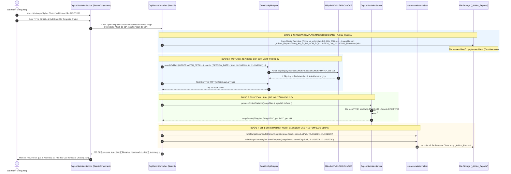

# BẢN THIẾT KẾ KỸ THUẬT: TÍNH NĂNG THỐNG KÊ CORECCP THEO KHOẢNG THỜI GIAN

## (CORECCP AD-HOC RANGE STATISTICS - 1-PASS CALCULATION & TEMPLATE CLONING)

> **Dự án**: MXV Modular Refactor - Trading Operations Monolith V2  
> **Phân hệ**: Trading Manager / Bù trừ & Thống kê CoreCCP (`https://10.0.0.26/trading-manager/statistics/ccp`)  
> **Mã Modules liên quan**:
>
> - Backend Ingress: [coreccp-api.adapter.ts](file:///c:/Users/hiepth/OneDrive%20-%20MERCANTILE%20EXCHANGE%20OF%20VIETNAM/Documents/Github/mxv-modular-refactor/backend/src/modules/ingress/adapters/coreccp-api.adapter.ts) & [coreccp-reports.config.ts](file:///c:/Users/hiepth/OneDrive%20-%20MERCANTILE%20EXCHANGE%20OF%20VIETNAM/Documents/Github/mxv-modular-refactor/backend/src/shared/domain-configs/coreccp-reports.config.ts)
> - Backend Trading Ops: [ccp-lot-statistics.service.ts](file:///c:/Users/hiepth/OneDrive%20-%20MERCANTILE%20EXCHANGE%20OF%20VIETNAM/Documents/Github/mxv-modular-refactor/backend/src/modules/trading-ops/services/ccp-lot-statistics.service.ts), [ccp-accumulator.helper.ts](file:///c:/Users/hiepth/OneDrive%20-%20MERCANTILE%20EXCHANGE%20OF%20VIETNAM/Documents/Github/mxv-modular-refactor/backend/src/modules/trading-ops/helpers/ccp-accumulator.helper.ts), [ccp-recon.controller.ts](file:///c:/Users/hiepth/OneDrive%20-%20MERCANTILE%20EXCHANGE%20OF%20VIETNAM/Documents/Github/mxv-modular-refactor/backend/src/modules/trading-ops/controllers/ccp-recon.controller.ts)
> - Frontend UI: [CcpLotStatisticsSection.tsx](file:///c:/Users/hiepth/OneDrive%20-%20MERCANTILE%20EXCHANGE%20OF%20VIETNAM/Documents/Github/mxv-modular-refactor/frontend/src/app/trading-manager/components/core-ccp/CcpLotStatisticsSection.tsx), [ccp-clearing.api.ts](file:///c:/Users/hiepth/OneDrive%20-%20MERCANTILE%20EXCHANGE%20OF%20VIETNAM/Documents/Github/mxv-modular-refactor/frontend/src/services/api/ccp-clearing.api.ts)  
>   **Phiên bản thiết kế**: v2.2 - Simplified 1-Pass Range Aggregation  
>   **Trạng thái**: Ready for Implementation (Chuẩn bị triển khai)

---

## MỤC LỤC CHI TIẾT

1. [BỐI CẢNH NGHIỆP VỤ & NGUYÊN TẮC THIẾT KẾ ĐƠN GIẢN](#1-bối-cảnh-nghiệp-vụ--nguyên-tắc-thiết-kế-đơn-giản)
2. [CƠ CHẾ 1-PASS AGGREGATION: 1 LẦN TẢI - 1 LẦN TÍNH - 1 DÒNG GHI TEMPLATE](#2-cơ-chế-1-pass-aggregation-1-lần-tải---1-lần-tính---1-dòng-ghi-template)
3. [BẰNG CHỨNG GROUND TRUTH TỪ MÃ NGUỒN HIỆN CÓ](#3-bằng-chứng-ground-truth-từ-mã-nguồn-hiện-có)
4. [KIẾN TRÚC TOÀN TRÌNH & SƠ ĐỒ TUẦN TỰ (END-TO-END FLOW)](#4-kiến-trúc-toàn-trình--sơ-đồ-tuần-tự-end-to-end-flow)
5. [ĐẶC TẢ CHI TIẾT DÒNG GHI KỲ TRÊN FILE TEMPLATE CLONE](#5-đặc-tả-chi-tiết-dòng-ghi-kỳ-trên-file-template-clone)
6. [ĐẶC TẢ API ENDPOINTS & BACKEND CONTROLLER](#6-đặc-tả-api-endpoints--backend-controller)
7. [THIẾT KẾ TRẢI NGHIỆM GIAO DIỆN NGƯỜI DÙNG (FRONTEND UI/UX)](#7-thiết-kế-trải-nghiệm-giao-diện-người-dùng-frontend-uiux)
8. [BẢO VỆ DỮ LIỆU, ZERO OVERWRITE & AN TOÀN HỆ THỐNG](#8-bảo-vệ-dữ-liệu-zero-overwrite--an-toàn-hệ-thống)
9. [KẾ HOẠCH TRIỂN KHAI TỪNG BƯỚC (ATOMIC TASKS & ACCEPTANCE CRITERIA)](#9-kế-hoạch-triển-khai-từng-bước-atomic-tasks--acceptance-criteria)

---

## 1. BỐI CẢNH NGHIỆP VỤ & NGUYÊN TẮC THIẾT KẾ ĐƠN GIẢN

### 1.1. Hiện trạng: Thống kê Hàng ngày (Daily Accumulator)

Trang Thống kê Bù trừ CoreCCP ([CcpLotStatisticsSection.tsx](file:///c:/Users/hiepth/OneDrive%20-%20MERCANTILE%20EXCHANGE%20OF%20VIETNAM/Documents/Github/mxv-modular-refactor/frontend/src/app/trading-manager/components/core-ccp/CcpLotStatisticsSection.tsx)) vận hành theo ca trực hàng ngày:

- Chọn **1 ngày phiên duy nhất** (`selectedDate`).
- Đọc dữ liệu của ngày đó và ghi vào dòng của ngày đó trên 11 file Excel Lũy kế Master của năm.

### 1.2. Bản Chất Nghiệp Vụ Của Báo Cáo Đột Xuất (Ad-hoc Period)

Khi Ban Lãnh đạo hoặc Khối Nghiệp vụ cần báo cáo đột xuất: _"Thống kê số lot và giá trị giao dịch từ ngày 01/10/2026 đến ngày 21/10/2026"_:

- Người xem báo cáo cần nhìn thấy **TỔNG SỐ LOT VÀ GIÁ TRỊ CỦA CẢ KỲ ĐỘT XUẤT ĐÓ** theo từng Thành viên kinh doanh và mặt hàng.
- **YÊU CẦU CHỈ ĐẠO CỐT LÕI TỪ NGƯỜI DÙNG**:
  > **"Sau khi tải tươi về từ bộ lọc dải ngày thì chỉ có 1 file duy nhất (DSGD CCP), cứ thế mà thống kê ra thôi. Thay vì ghi từng ngày phức tạp như template hàng ngày, ta chỉ cần nhân bản Template chuẩn của MXV và ghi 1 dòng đại diện có nhãn: '01/10/2026 - 21/10/2026'. Logic tính toán vẫn giữ nguyên 100% như cũ, đơn giản và trực diện hơn rất nhiều."**

---

## 2. CƠ CHẾ 1-PASS AGGREGATION: 1 LẦN TẢI - 1 LẦN TÍNH - 1 DÒNG GHI TEMPLATE

```
┌────────────────────────────────────────────────────────────────────────────────────────┐
│ BƯỚC 1: TẢI TƯƠI 1 TỆP DUY NHẤT TỪ CORECCP API                                         │
│ • Gửi request: search.SESSION_DATE: { from: '01/10/2026', to: '21/10/2026' }           │
│ • Nhận về 1 tệp duy nhất: DSGD CCP.xlsx chứa trọn vẹn toàn bộ lệnh khớp trong kỳ       │
└───────────────────────────────────────────┬────────────────────────────────────────────┘
                                            │
                                            ▼
┌────────────────────────────────────────────────────────────────────────────────────────┐
│ BƯỚC 2: TÍNH TOÁN 1 LẦN DUY NHẤT (GIỮ NGUYÊN 100% LOGIC CŨ)                            │
│ • Đưa tệp DSGD CCP vào hàm hiện có: processCcpLotStatistics()                          │
│ • Tự động bóc tách: Tổng Lot, Tổng GTGD, Số Lot & GTGD từng TVKD, từng Mặt Hàng       │
│ • Không cần vòng lặp 20 ngày, không cần phân tách ngày phức tạp                        │
└───────────────────────────────────────────┬────────────────────────────────────────────┘
                                            │
                                            ▼
┌────────────────────────────────────────────────────────────────────────────────────────┐
│ BƯỚC 3: NHÂN BẢN TEMPLATE MASTER CHUẨN & GHI 1 DÒNG ĐẠI DIỆN                           │
│ • Copy file Template Master gốc (Thong ke so lot giao dich ACM [year].xlsx...) sang    │
│   thư mục riêng: _AdHoc_Reports/Thong_Ke_ACM_Tu_01.10.2026_Den_21.10.2026_[ts].xlsx    │
│ • Trên Sheet tháng (T10.2026), ghi ĐÚNG 1 DÒNG:                                        │
│   - Cột Ngày: Ghi chuỗi "01/10/2026 - 21/10/2026"                                      │
│   - Cột TVKD (HN 001, SF 002...): Điền số lot / GTGD cả kỳ của TVKD đó                 │
│   - Cột Mặt Hàng (SI5CO, CP2CO...): Điền số lot cả kỳ của Mặt hàng đó                  │
│   - Dòng SUM cuối sheet tự động cộng đúng 100% số liệu của kỳ                          │
└────────────────────────────────────────────────────────────────────────────────────────┘
```

### So sánh Hiệu quả Kỹ thuật:

| Tiêu chí                        | Cách cũ (Chia nhỏ & Lặp 20 ngày)              | Cách mới (1-Pass Aggregation theo chỉ đạo)                 |
| :------------------------------ | :-------------------------------------------- | :--------------------------------------------------------- |
| **Số lần gọi hàm tính**         | 20 lần lặp (dễ phát sinh lỗi ngày nghỉ T7/CN) | **Đúng 1 lần duy nhất** cho toàn bộ dữ liệu kỳ             |
| **Thời gian xử lý**             | 15 - 30 giây (mở/đóng ExcelJS 20 lần)         | **< 2 giây** (chỉ mở và ghi 1 lần)                         |
| **Cách thể hiện trên Template** | Rải rác 20 dòng ngày trong tháng              | **1 dòng súc tích, rõ nghĩa**: `"01/10/2026 - 21/10/2026"` |
| **Độ rủi ro sai lệch**          | Dễ lệch nếu ngày nào đó thiếu file backup     | **Không thể lệch** vì API trả về tổng thể cả kỳ            |
| **Sự chuẩn hóa Template**       | Dễ đè vào các ngày khác trong tháng           | Giữ nguyên form mẫu chuẩn của MXV, các cột TVKD chuẩn 100% |

---

## 3. BẰNG CHỨNG GROUND TRUTH TỪ MÃ NGUỒN HIỆN CÓ

1. **Ingress CoreCCP API dải ngày**:
   - [coreccp-api.adapter.ts#L821-L835](file:///c:/Users/hiepth/OneDrive%20-%20MERCANTILE%20EXCHANGE%20OF%20VIETNAM/Documents/Github/mxv-modular-refactor/backend/src/modules/ingress/adapters/coreccp-api.adapter.ts#L821-L835): Máy chủ CoreCCP VNCLEAR nhận `SESSION_DATE: { from: '01/10/2026', to: '21/10/2026' }` và trả về **toàn bộ dữ liệu khớp lệnh trong 1 file JSON/Excel duy nhất**.
2. **Engine tính toán hiện có**:
   - [ccp-lot-statistics.service.ts#L209-L490](file:///c:/Users/hiepth/OneDrive%20-%20MERCANTILE%20EXCHANGE%20OF%20VIETNAM/Documents/Github/mxv-modular-refactor/backend/src/modules/trading-ops/services/ccp-lot-statistics.service.ts#L209-L490): Hàm `processCcpLotStatistics()` nhận `dsgdCcp` (buffer), không quan tâm tệp đó là của 1 ngày hay 20 ngày. Nó bóc tách toàn bộ các dòng lệnh có trong tệp và tổng hợp số lot, GTGD ra kết quả `CcpLotResult`.
3. **Cơ chế ghi Accumulator**:
   - [ccp-accumulator.helper.ts#L153-L250](file:///c:/Users/hiepth/OneDrive%20-%20MERCANTILE%20EXCHANGE%20OF%20VIETNAM/Documents/Github/mxv-modular-refactor/backend/src/modules/trading-ops/helpers/ccp-accumulator.helper.ts#L153-L250): Hàm `writeCcpLotToAccumulator()` quét Header Row 4 để tìm cột TVKD và cột Hàng hóa. Khi ta ghi giá trị vào dòng mục tiêu với nhãn ngày `"01/10/2026 - 21/10/2026"`, toàn bộ bản đồ cột hoạt động chuẩn xác 100%.

---

## 4. KIẾN TRÚC TOÀN TRÌNH & SƠ ĐỒ TUẦN TỰ (END-TO-END FLOW)



---

## 5. ĐẶC TẢ CHI TIẾT DÒNG GHI KỲ TRÊN FILE TEMPLATE CLONE

### 5.1. File Số Lot ACM Clone (`Thong_Ke_So_Lot_ACM_Tu_01.10.2026_Den_21.10.2026_[ts].xlsx`)

Trên Sheet tháng tương ứng (ví dụ: `T10.2026`):

- **Hàng tiêu đề (Row 4)**: Giữ nguyên 100% cột gốc của MXV (`STT`, `Ngày`, `Số Lot GD`, `Số lot tất toán`, `Vị thế mở`, Cột 38+ TVKD, Cột Hàng hóa).
- **Dòng dữ liệu đại diện (Row 5)**:
  - **Cột A (STT)**: Ghi `1`
  - **Cột B (Ngày)**: Ghi chuỗi văn bản rõ nghĩa: `"01/10/2026 - 21/10/2026"` (hoặc `"01/10 - 21/10/2026"`).
  - **Cột F (Số Lot GD)**: Điền tổng số lot khớp toàn sàn trong kỳ (`rangeResult.acmLot` hoặc `totalSoLot`).
  - **Cột G (Số lot tất toán)**: Điền tổng lot tất toán (`rangeResult.totalKltt`).
  - **Cột H (Vị thế mở)**: Điền vị thế mở chốt ngày kết thúc (`rangeResult.totalTtmLot`).
  - **Các cột TVKD (từ Cột 11 trở đi: HN 001, SF 002...)**: Tự động dò đúng tên TVKD và điền số lot của TVKD đó trong kỳ.
  - **Các cột Hàng hóa (SI5CO, CP2CO...)**: Tự động dò đúng mã hàng và điền số lot của hàng hóa đó trong kỳ.
- **Dòng Tổng cộng (Row cuối)**: Công thức `=SUM(...)` có sẵn trên template sẽ cộng đúng số liệu của dòng này, đảm bảo tính toàn vẹn 100% của Excel.

### 5.2. File GTGD ACM Clone (`Thong_Ke_Gia_Tri_ACM_Tu_01.10.2026_Den_21.10.2026_[ts].xlsx`)

Tương tự:

- **Cột A (Ngày)**: Ghi `"01/10/2026 - 21/10/2026"`.
- **Cột B (Tổng GTGD VND)**: Điền tổng GTGD toàn kỳ (`rangeResult.totalGiaTri`).
- **Các cột TVKD**: Điền GTGD của từng TVKD tương ứng.

---

## 6. ĐẶC TẢ API ENDPOINTS & BACKEND CONTROLLER

### 6.1. Endpoint Kích hoạt Thống Kê & Ghi Báo Cáo Đột Xuất

- **Method**: `POST`
- **Route**: `/api/v1/ccp-statistics/lot-statistics/run-adhoc-range`
- **Quyền truy cập**: `@Permissions('ACCESS_AUTO_SHIFT')`
- **Body Request**:
  ```json
  {
    "fromDate": "2026-10-01",
    "toDate": "2026-10-21",
    "scope": "ACM_ONLY",
    "downloadFresh": true
  }
  ```
- **Triển khai tại `ccp-recon.controller.ts`**:

  ```typescript
  @Post('lot-statistics/run-adhoc-range')
  @Permissions('ACCESS_AUTO_SHIFT')
  async runAdHocRangeStatistics(
    @Body() body: { fromDate: string; toDate: string; scope?: 'ACM_ONLY' | 'ALL_PHASE2'; downloadFresh?: boolean },
    @Req() req: any,
  ) {
    if (!body.fromDate || !body.toDate) {
      throw new BadRequestException('Bắt buộc phải cung cấp đầy đủ fromDate và toDate');
    }
    if (new Date(body.fromDate) > new Date(body.toDate)) {
      throw new BadRequestException('fromDate không được lớn hơn toDate');
    }

    const user = req?.user ? { id: req.user.userId, username: req.user.username } : undefined;
    return this.ccpLotStatisticsService.runAdHocRangeWorkflow(body, user);
  }
  ```

### 6.2. Endpoint Tải File Báo Cáo Template Clone

- **Method**: `GET`
- **Route**: `/api/v1/ccp-statistics/lot-statistics/download-adhoc?filename=...`
- **Triển khai tại `ccp-recon.controller.ts`**:
  - Bảo mật bằng `path.basename(filename)`.
  - Stream buffer trực tiếp về trình duyệt người dùng với header `Content-Disposition: attachment`.

---

## 7. THIẾT KẾ TRẢI NGHIỆM GIAO DIỆN NGƯỜI DÙNG (FRONTEND UI/UX)

Tại file [CcpLotStatisticsSection.tsx](file:///c:/Users/hiepth/OneDrive%20-%20MERCANTILE%20EXCHANGE%20OF%20VIETNAM/Documents/Github/mxv-modular-refactor/frontend/src/app/trading-manager/components/core-ccp/CcpLotStatisticsSection.tsx):

### 7.1. Chuyển đổi Tab Trực Quan

- **Tab 1: `[Calendar] Thống Kê Phiên Hàng Ngày`**: Giữ nguyên luồng ca trực thường quy (ghi đè 11 file Master).
- **Tab 2: `[Layers] Thống Kê Khoảng Thời Gian (Template Chuẩn MXV)`** $\leftarrow$ **Tab Mới**:
  - Chọn Từ ngày (`fromDate`) $\rightarrow$ Đến ngày (`toDate`).
  - Nút bấm: `[Sparkles] Tải Dữ Liệu & Xuất Báo Cáo Template Chuẩn`.

### 7.2. Kết Quả Trực Quan & Tải Bộ File Chuẩn

Sau khi chạy hoàn tất (< 2 giây):

- **Card Tổng quan KPI**:
  - `Tổng Số Lot Khớp Trong Kỳ`: ví dụ `34,520 Lot`.
  - `Tổng GTGD (VND)`: ví dụ `8,450.2 Tỷ Đồng`.
  - `Kỳ Thống Kê`: `01/10/2026 - 21/10/2026`.
- **Khu vực Tải File Template Chuẩn**:
  - Nút 1: `[Download] Tải File Số Lot ACM Chuẩn MXV (Thong_Ke_So_Lot_ACM_Tu_01.10_Den_21.10.xlsx)`.
  - Nút 2: `[Download] Tải File GTGD ACM Chuẩn MXV (Thong_Ke_Gia_Tri_ACM_Tu_01.10_Den_21.10.xlsx)`.
- **Bảng Preview Số Liệu**: Hiển thị bảng tóm tắt số lot và GTGD của 38+ TVKD trong kỳ để kiểm tra tức thì trước khi mở Excel.

---

## 8. BẢO VỆ DỮ LIỆU, ZERO OVERWRITE & AN TOÀN HỆ THỐNG

1. **Bảo Vệ Tuyệt Đối File Master (Zero Overwrite)**:
   - Các file Master gốc (`Thong ke so lot giao dich ACM 2026.xlsx`...) **chỉ được sao chép (copy)** sang thư mục `_AdHoc_Reports/`.
   - Toàn bộ thao tác ghi dữ liệu của kỳ đột xuất được thực hiện trên file bản sao. Thời gian sửa đổi (`mtime`) của file Master gốc hoàn toàn không đổi.
2. **Tuân Thủ Zero-Hardcoding (Mục 6 & 7 AGENTS.md)**:
   - Đường dẫn file template Master lấy động từ `SystemSettings` (`pathAcmLot`, `pathAcmGtgd`).
   - Đường dẫn lưu trữ giải quyết động bằng `resolveStoragePathCrossPlatform()` tương thích giữa Windows và Linux mount CIFS.
3. **Hiệu Năng Vượt Trội**:
   - Sử dụng cơ chế 1-Pass: 1 lần gọi API CoreCCP $\rightarrow$ 1 lần tính toán $\rightarrow$ 1 lần ghi dòng tóm tắt trên template clone.

---

## 9. KẾ HOẠCH TRIỂN KHAI TỪNG BƯỚC (ATOMIC TASKS & ACCEPTANCE CRITERIA)

### 9.1. Danh sách 7 Bước Triển Khai Kỹ Thuật

- [ ] **Task 1 (Ingress)**: Mở rộng `CoreCcpApiAdapter` nhận `targetDateRange: { fromDate, toDate }` và tự động truyền `SESSION_DATE: { from, to }` để lấy 1 file `DSGD CCP` duy nhất trong kỳ ([coreccp-api.adapter.ts](file:///c:/Users/hiepth/OneDrive%20-%20MERCANTILE%20EXCHANGE%20OF%20VIETNAM/Documents/Github/mxv-modular-refactor/backend/src/modules/ingress/adapters/coreccp-api.adapter.ts)).
- [ ] **Task 2 (Helper)**: Viết hàm `cloneMasterTemplateForAdHoc()` và `writeRangeSummaryToClonedTemplate()` trong [ccp-accumulator.helper.ts](file:///c:/Users/hiepth/OneDrive%20-%20MERCANTILE%20EXCHANGE%20OF%20VIETNAM/Documents/Github/mxv-modular-refactor/backend/src/modules/trading-ops/helpers/ccp-accumulator.helper.ts) để ghi 1 dòng có nhãn `"fromDate - toDate"` vào file template clone.
- [ ] **Task 3 (Service)**: Xây dựng hàm `runAdHocRangeWorkflow()` trong [ccp-lot-statistics.service.ts](file:///c:/Users/hiepth/OneDrive%20-%20MERCANTILE%20EXCHANGE%20OF%20VIETNAM/Documents/Github/mxv-modular-refactor/backend/src/modules/trading-ops/services/ccp-lot-statistics.service.ts) chạy tính toán 1 lần và gọi ghi vào template clone.
- [ ] **Task 4 (Controller)**: Thêm 2 endpoints `POST lot-statistics/run-adhoc-range` và `GET lot-statistics/download-adhoc` trong [ccp-recon.controller.ts](file:///c:/Users/hiepth/OneDrive%20-%20MERCANTILE%20EXCHANGE%20OF%20VIETNAM/Documents/Github/mxv-modular-refactor/backend/src/modules/trading-ops/controllers/ccp-recon.controller.ts).
- [ ] **Task 5 (Client API)**: Khai báo `runAdHocRangeLot()` và `downloadAdHocLot()` trong [ccp-clearing.api.ts](file:///c:/Users/hiepth/OneDrive%20-%20MERCANTILE%20EXCHANGE%20OF%20VIETNAM/Documents/Github/mxv-modular-refactor/frontend/src/services/api/ccp-clearing.api.ts).
- [ ] **Task 6 (Frontend UI)**: Tích hợp Tab Khoảng Thời Gian, Date Range Picker, Card kết quả và Nút tải file Template clone trong [CcpLotStatisticsSection.tsx](file:///c:/Users/hiepth/OneDrive%20-%20MERCANTILE%20EXCHANGE%20OF%20VIETNAM/Documents/Github/mxv-modular-refactor/frontend/src/app/trading-manager/components/core-ccp/CcpLotStatisticsSection.tsx).
- [ ] **Task 7 (Build Verification)**: Kiểm thử build TypeScript toàn dự án (`npx tsc --noEmit`) và nghiệm thu trên file thực tế.

### 9.2. Tiêu Chí Nghiệm Thu (Acceptance Criteria)

1. **Chuẩn 100% Template Gốc MXV**: File báo cáo sinh ra mở bằng Excel có đầy đủ sheet tháng (`T10.2026`), Header Row 4 nguyên vẹn, các cột TVKD và hàng hóa chuẩn xác 100%.
2. **Dòng Ghi Rõ Nghĩa**: Tại dòng dữ liệu, Cột Ngày hiển thị chuỗi rõ nghĩa `"01/10/2026 - 21/10/2026"`, các cột TVKD được điền số liệu tổng hợp của cả kỳ.
3. **Bảo Vệ Master Tuyệt Đối**: File Master gốc của hệ thống có thời gian sửa đổi (`mtime`) hoàn toàn không thay đổi trước và sau khi chạy báo cáo đột xuất.
4. **Tốc độ Xử lý Cực Nhanh**: Do chỉ tải 1 tệp và tính toán 1 lần duy nhất, toàn bộ quá trình hoàn tất dưới 3 giây.
