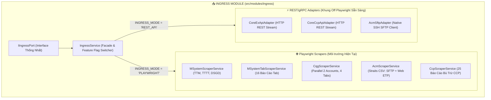

# ĐẶC TẢ THIẾT KẾ CHI TIẾT & TỐI ƯU HÓA BỘ CRAWLER INGRESS
## TỐI ƯU TỐC ĐỘ TẢI BÁO CÁO CQG DESKTOP, M-SYSTEM SESSION ALB, ACM STRAITS & CORECCP

---

> **Mã tài liệu**: `MXV-INGRESS-CRAWLER-SPEC-2026-V1`  
> **Phiên bản**: 1.0 (Ban hành ngày 13/10/2026)  
> **Cơ sở thực chứng**: [test_cqg_tab_downloads_fast.js](file:///c:/Users/hiepth/OneDrive%20-%20MERCANTILE%20EXCHANGE%20OF%20VIETNAM/Documents/Github/mxv-cqg-download-investigation/backend/src/scripts/test_cqg_tab_downloads_fast.js), [cqg-scraper.service.ts](file:///c:/Users/hiepth/OneDrive%20-%20MERCANTILE%20EXCHANGE%20OF%20VIETNAM/Documents/Github/mxv-cqg-download-investigation/backend/src/modules/ingress/scrapers/cqg-scraper.service.ts), [ms-scraper.service.ts](file:///c:/Users/hiepth/OneDrive%20-%20MERCANTILE%20EXCHANGE%20OF%20VIETNAM/Documents/Github/mxv-cqg-download-investigation/backend/src/modules/ingress/scrapers/ms-scraper.service.ts), [rpa-downloader.service.ts](file:///c:/Users/hiepth/OneDrive%20-%20MERCANTILE%20EXCHANGE%20OF%20VIETNAM/Documents/Github/mxv-cqg-download-investigation/backend/src/modules/bot-engine/rpa-downloader.service.ts) và Quy chuẩn [AGENTS.md](file:///c:/Users/hiepth/OneDrive%20-%20MERCANTILE%20EXCHANGE%20OF%20VIETNAM/Documents/Github/mxv-cqg-download-investigation/.agents/AGENTS.md).

---

## 1. TỔNG QUAN PHÂN HỆ INGRESS & NGUYÊN TẮC BÓC TÁCH

Trong kiến trúc Monolith V1, toàn bộ hành vi web scraping của 4 hệ thống đối tác (`M-System`, `CQG`, `ACM`, `CoreCCP`) bị nhồi nhét vào **1 file duy nhất `rpa-downloader.service.ts` dài 5.382 dòng code (204KB)**. Điều này gây ra các vấn đề nghiêm trọng:
- Khó bảo trì, sửa lỗi scraper của CQG dễ gây lỗi ngầm cho M-System.
- Không thể tối ưu tài nguyên riêng lẻ (ví dụ: CQG cần bộ nhớ lớn cho đồ họa Canvas/WebGL trong khi ACM chỉ cần tải 1 file CSV).
- Không có ranh giới rõ ràng để chuyển sang gọi REST API thật khi sàn MXV mở cổng API.

👉 **Kiến trúc Ingress Modular Monolith V2**:
- Phân tách thành 5 Scraper độc lập nằm trong `src/modules/ingress/scrapers/`.
- Thống nhất một Cổng giao tiếp chung `IIngressPort` và Facade `IngressService`.
- Tách riêng các REST API Adapters (`CoreExApiAdapter`, `CoreCcpApiAdapter`, `AcmSftpAdapter`) sẵn sàng tắt Playwright khi có API chính thức.



---

## 2. ĐẶC TẢ CHI TIẾT TỐI ƯU CRAWLER CQG DESKTOP WEB

### 2.1. Thách Thức Kỹ Thuật Đặc Thù Của CQG Desktop
CQG Desktop là ứng dụng Single Page Application (SPA) viết trên nền tảng Angular/WebComponents, sử dụng giao diện dạng dashboard nhiều widget:
1. **Tràn bộ nhớ & Phình to DOM**: Khi mở đồng thời nhiều widget (Fills, Positions, Orders, Purchase & Sales), DOM phình to khiến Chromium bị đơ hoặc crash tab.
2. **Xung đột phiên đăng nhập (Session Conflict)**: Tài khoản CQG bị dùng chung hoặc bị rớt mạng thường xuyên hiển thị popup `"Another session is active"` / `"Take over"`.
3. **Popup thông báo Snack-bar**: Các thông báo hệ thống màu đen che khuất nút click xuất file Excel.
4. **Cần đồng bộ 2 tài khoản (CQG1 & CQG2)**: Dữ liệu lệnh và vị thế được chia trên 2 tài khoản CQG khác nhau, đòi hỏi phải tải gần như cùng một thời điểm.

---

### 2.2. Cơ Chế Tối Ưu Tốc Độ & Toàn Vẹn Dữ Liệu (`test_cqg_tab_downloads_fast.js`)

#### 1. Đóng Popup Thông Báo Tự Động (`dismissCqgNotifications`)
- Sử dụng selector kép và DOM removal để loại bỏ triệt để các thông báo che khuất:
  ```javascript
  const closeBtn = page.locator(
    "//wpfe-multi-snack-bar-container//wpfe-dialog-close-button//button | //button[contains(@class,'wpfe-dialog-close-button-button')]"
  );
  if (await closeBtn.isVisible().catch(() => false)) {
    await closeBtn.click({ timeout: 1500, force: true }).catch(() => {});
  }
  await page.evaluate(() => {
    document.querySelectorAll('wpfe-multi-snack-bar-container').forEach((el) => el.remove());
  }).catch(() => {});
  ```

#### 2. Chiếm Quyền Phiên Tự Động Khi Xung Đột (`waitForCqgDashboardLogo`)
- Khi đăng nhập gặp thông báo tài khoản đang online ở máy khác, bot tự động tìm và click các nút giải phóng phiên:
  - Selectors: `button:has-text("Take over")`, `button:has-text("Logoff")`, `button:has-text("Disconnect")`, `button:has-text("Continue")`, `.wpfe-dialog button.btn-primary`.
  - Giúp bot tự phục hồi mà không cần can thiệp thủ công từ con người.

#### 3. Cơ Chế Tải Tuần Tự & Dọn Dẹp Widget Ngay Lập Tức (Open ➔ Export ➔ Close Widget)
- Thay vì mở cùng lúc 4 widget làm tràn giao diện, script xử lý lần lượt từng tab:
  1. Bấm mở Widget mục tiêu (ví dụ: `Fills`).
  2. Chờ dữ liệu bảng hiển thị (`waitForCqgNotLoading`).
  3. Bấm icon Export Excel (`button[aria-label*="Export"]` hoặc menu 3 chấm).
  4. Lắng nghe sự kiện `page.waitForEvent('download')` và lưu file về đĩa với kích thước $> 2.5KB$.
  5. **Bấm nút đóng tab widget ngay lập tức**: Trả lại layout ban đầu cho dashboard, bảo vệ RAM và giải phóng WebGL contexts.

#### 4. Khởi Chạy Song Song 2 Tài Khoản CQG1 & CQG2 (`cqg-scraper.service.ts`)
- Khởi tạo 2 browser contexts độc lập trên 2 cookie jar riêng biệt:
  ```typescript
  const [context1, context2] = await Promise.all([
    browser.newContext({ viewport: { width: 1600, height: 900 } }),
    browser.newContext({ viewport: { width: 1600, height: 900 } }),
  ]);
  ```
- Tải song song:
  - Tài khoản 1: `FR1`, `PS1`, `OP1`, `OD1`.
  - Tài khoản 2: `FR2`, `PS2`, `OP2`, `OD2`.
- Kiểm tra chênh lệch thời gian tạo file giữa 2 tài khoản: Nếu lệch $> 120$ giây thì cảnh báo dữ liệu không cùng thời điểm cắt phiên.

---

### 2.3. Quy Tắc Tự Động Ghép 4 Cặp File Thô CQG (`cqg-merger.service.ts`)

Sau khi tải về 8 file thô, `CqgMergerService` tự động ghép thành 4 file chuẩn:

| Cặp File Thô | File Đích | Nghiệp Vụ | Quy Tắc Ghép Bắt Buộc Bảo Tồn 100% |
| :--- | :--- | :--- | :--- |
| `FR1.xlsx` + `FR2.xlsx` | **`FR.xlsx`** | Giao dịch khớp lệnh | **Cắt bỏ 2 dòng footer tổng kết** (`rows.slice(0, -2)`). Chuẩn hóa hậu tố tài khoản: `F$` $\rightarrow$ `""`, `L$` $\rightarrow$ `"-L"`, `S$` $\rightarrow$ `"-S"`. |
| `PS1.xlsx` + `PS2.xlsx` | **`PS.xlsx`** | Vị thế & Tất toán | Ghép cả 3 sheets: `Purchases`, `Sales`, `Open Positions`. Chuẩn hóa mã hợp đồng. |
| `OP1.xlsx` + `OP2.xlsx` | **`OP.xlsx`** | Trạng thái mở | Ghép danh sách hợp đồng đang nắm giữ qua đêm. |
| `OD1.xlsx` + `OD2.xlsx` | **`Od.xlsx`** | Sổ lệnh | Ghép toàn bộ lịch sử lệnh (Filled, Working, Cancelled). |

---

## 3. ĐẶC TẢ CHI TIẾT TỐI ƯU CRAWLER M-SYSTEM

### 3.1. Cơ Chế Giữ Session Cookie AWS ALB
Hệ thống M-System chạy phía sau AWS Application Load Balancer (ALB). Khi bot click nút "Kết xuất", trình duyệt gửi request tới ASP.NET backend. Nếu mất session cookie ALB, request sẽ bị văng về trang đăng nhập hoặc trả về trang lỗi 403:
- **Giải pháp bảo toàn**: Trích xuất và tiêm ngược cookie `AWSELB` và `AWSELBCORS` vào phiên Playwright:
  ```typescript
  const cookies = await context.cookies();
  const albCookie = cookies.find(c => c.name === 'AWSELB');
  ```

### 3.2. Phân Rã M-System: 3 Báo Cáo Lõi vs 16 Báo Cáo Tab
- **Nhóm Lõi (`ms-scraper.service.ts`)**: Tải 3 file then chốt phục vụ đối soát trong phiên:
  1. `TTM.xlsx`: Trạng thái mở trong phiên.
  2. `TTTT.xlsx`: Trạng thái tất toán trong phiên.
  3. `DSGD.xlsx`: Danh sách giao dịch khớp lệnh trong phiên.
- **Nhóm Mở Rộng (`ms-tab-scraper.service.ts`)**: Tải 16 báo cáo chuyên sâu (Futures, LME, Spread, Options, TLKQHSKQ, NR, DSLDK, DSLCK...) phục vụ kiểm toán cuối ngày và thống kê vĩ mô.

---

## 4. ĐẶC TẢ CHI TIẾT BỘ TẢI ACM STRAITS (SFTP & WEB FALLBACK)

### 4.1. Quy Tắc Nhận Diện File Chuẩn
- **File Hợp Lệ**: Tên file **BẮT BUỘC PHẢI CHỨA TỪ KHÓA `Straits`** (ví dụ: `Straits.csv`, `Straits_13102026.csv`).
- **Nghiêm cấm tuyệt đối**: Không nhận diện file `Fill.xlsx` hay `Order.xlsx` làm dữ liệu đối chiếu ACM vì cấu trúc cột không tương thích.

### 4.2. Cơ Chế Fallback Kép Tự Động
1. **Ưu tiên 1 (Native SFTP)**: Sử dụng `AcmSftpAdapter` kết nối qua cổng 22 SFTP của Straits Financial để kéo file CSV trực tiếp (tốc độ $< 2$ giây, không cần giao diện).
2. **Ưu tiên 2 (Playwright ETP Web)**: Nếu kết nối SFTP bị timeout/lỗi mạng, hệ thống tự động fallback sang `AcmScraperService` mở trình duyệt ETP Web, giải captcha bằng OCR và tải file về.

---

## 5. ĐẶC TẢ CHI TIẾT CRAWLER CORECCP 25 BÁO CÁO

### 5.1. Cơ Chế Phân Trang & Đảm Bảo Đủ 25 File
Hệ thống CoreCCP phân chia báo cáo bù trừ thành nhiều trang danh mục:
- Bot tự động quét qua từng trang bảng (`Next Page`), trích xuất link và tải tuần tự.
- **Rào chắn nghiệm thu**: Sau khi tải xong, kiểm tra số lượng file trong thư mục: nếu $< 25$ file thì lập tức retry tải các file thiếu (`test_ccp_download_failed_files.js`), không báo thành công ảo nếu thiếu dữ liệu.

---

## 6. DANH MỤC LỆNH CHẠY TEST ĐỘC LẬP CHO NGƯỜI DÙNG

Tuân thủ **Quy tắc 8 của AGENTS.md** (*Người dùng tự chạy test script, AI không tự kích hoạt chạy ngầm*), dưới đây là các lệnh kiểm thử chuẩn hóa cho từng crawler:

| Phân Hệ | File Script Kiểm Thử | Lệnh Chạy Trên Terminal | Mục Đích Kiểm Thử |
| :--- | :--- | :--- | :--- |
| **CQG (Speed)** | `test_cqg_tab_downloads_fast.js` | `node src/scripts/test_cqg_tab_downloads_fast.js --headed --all` | Test tải nhanh cả 4 tab CQG (FR, PS, OP, OD), tự động dọn widget, kiểm tra MD5 và số dòng Excel. |
| **CQG (1 Tab)** | `test_cqg_tab_downloads_fast.js` | `node src/scripts/test_cqg_tab_downloads_fast.js --headed --key=FR` | Chỉ test riêng tab Khớp lệnh FR1 (nhanh nhất). |
| **CQG (2 TK)** | `test_cqg_parallel_standalone.js`| `node src/scripts/test_cqg_parallel_standalone.js --headed` | Test mở song song 2 tài khoản CQG1 và CQG2. |
| **M-System Core**| `test_ms_download_ttm_tttt.js` | `node src/scripts/test_ms_download_ttm_tttt.js --headed` | Test tải 2 file cốt lõi TTM & TTTT. |
| **M-System 20** | `test_ms_download_all_20_reports.js`| `node src/scripts/test_ms_download_all_20_reports.js --headed` | Test tải trọn bộ 20 báo cáo M-System. |
| **CoreCCP** | `test_ccp_download_25_files.js` | `node src/scripts/test_ccp_download_25_files.js --headed` | Test tải đủ 25 file báo cáo bù trừ CoreCCP. |
| **ACM Straits** | `test_ce_acm_backup_flow.js` | `node src/scripts/test_ce_acm_backup_flow.js --headed` | Test luồng tải Straits CSV từ ACM. |
