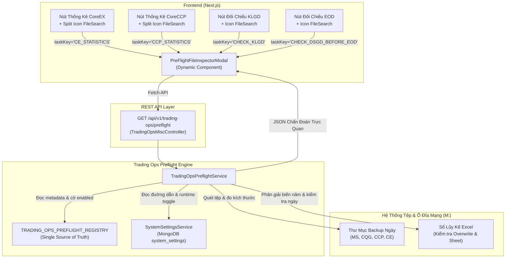
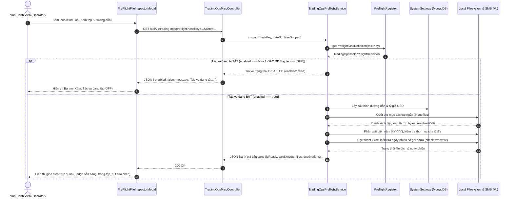

# BẢN THIẾT KẾ KIẾN TRÚC & TRIỂN KHAI TẬP TRUNG: PRE-FLIGHT REGISTRY & INSPECTION ENGINE
## Phân Hệ Vận Hành Giao Dịch (Trading Ops) - Chuẩn Modular Monolith V2

---

## 1. Bối Cảnh & Vấn Đề (Problem Statement)

Trong hệ thống vận hành giao dịch MXV (**Trading Ops**), các tác vụ đối chiếu, kiểm tra dữ liệu và chạy báo cáo thống kê đều phụ thuộc chặt chẽ vào:
1. **Tệp đầu vào (Input Files)**: Được crawler/bot tự động tải về hoặc sao lưu từ các đối tác và hệ thống giao dịch (M-System, CQG, CoreCCP VNCLEAR, CoreEX ACM Nano, Straits CSV) lưu tại các thư mục backup ngày (`M:\Trading\Trading\2026\Backup hang ngay\...`).
2. **Tệp đầu ra / Sổ lũy kế (Destination Accumulator Files)**: Các file Excel lưu trữ dài hạn trên ổ đĩa mạng nội bộ (`M:\Trading\Trading\2026\Bao cao so lieu GD 2026\...`) với quy tắc phân giải biến động năm/tháng (`${YYYY}`, `${MM}`).

### 1.1. Hiện trạng phân mảnh trước đây
- Trước khi chuẩn hóa, logic kiểm tra file trước khi chạy (Pre-Flight File Inspection) bị **viết rải rác cục bộ** trong từng Service riêng lẻ:
  - `ce-lot-statistics.service.ts`: Tự viết logic quét file DSGD, TTM, GTT, tỷ giá và kiểm tra file Số Lot/GTGD ACM.
  - `ccp-lot-statistics.service.ts`: Tự viết logic quét file DSGD, TTM, TTTT và kiểm tra 11 file lũy kế CoreCCP.
- Mỗi module lại mở một endpoint riêng ở Controller (`@Get('lot-statistics/preflight')`), tạo thêm hàm gọi API riêng ở Frontend, và giao diện Modal phải phụ thuộc vào biến phân hệ tĩnh (`system === 'CE' ? ... : ...`).

### 1.2. Thách thức khi mở rộng hệ thống
Phân hệ `trading-ops` sở hữu **hơn 10+ đầu API và tác vụ vận hành cốt lõi**:
1. `CHECK_KLGD`: Đối chiếu Khớp lệnh trong phiên (M-System vs CQG).
2. `CHECK_DSGD_BEFORE_EOD`: Đối chiếu 3 bên trước EOD (MS vs CCP vs CQG).
3. `SCAN_NEGATIVE_MARGIN`: Quét tài khoản âm ký quỹ sau phiên EOD.
4. `CE_STATISTICS`: Thống kê Số Lot & Giá trị giao dịch CoreEX (ACM Nano).
5. `CCP_STATISTICS`: Thống kê Số Lot & Giá trị giao dịch CoreCCP (Toàn thị trường).
6. `SESSION_OPEN_SYNC`: Đồng bộ dữ liệu đầu phiên CoreEX - CoreCCP - TT.
7. `RECON_GTT`: Đối chiếu giao dịch thỏa thuận.
8. `CHECK_CQG_SYNC`: Ghép nối và đối chiếu số dư CQG.

> **Nếu tiếp tục viết rải rác**: Khi thêm 1 tác vụ mới, lập trình viên phải sửa qua 4-5 file khác nhau (Service, Controller, Endpoints, API Client, UI Component). Code bị trùng lặp, vi phạm nguyên tắc DRY (Don't Repeat Yourself), khó kiểm soát tính toàn vẹn và **không thể bật/tắt (toggle ON/OFF) tập trung khi một tác vụ tạm ngưng hoặc không còn dùng tới**.

---

## 2. Triết Lý Thiết Kế & Nguyên Tắc Kiến Trúc (Architecture Principles)

Thiết kế này tuân thủ nghiêm ngặt **Quy chuẩn Kiến trúc Động & Chống Hardcode (Mục 6 & 7 trong AGENTS.md)** và hợp nhất hoàn toàn vào [bot-task-registry.ts](file:///c:/Users/hiepth/OneDrive%20-%20MERCANTILE%20EXCHANGE%20OF%20VIETNAM/Documents/Github/mxv-modular-refactor/backend/src/modules/bot-engine/constants/bot-task-registry.ts):

```
┌────────────────────────────────────────────────────────────────────────────────────────┐
│ 1. DUY NHẤT 1 MASTER REGISTRY (BOT_TASK_REGISTRY)                                     │
│    - Không tách rời 2 Registry độc lập! Toàn bộ hệ thống chỉ có DUY NHẤT 1 Master      │
│      Registry quản lý tập trung năng lực (Capabilities) và `preflightSpec` tùy chọn.   │
│    - `TRADING_OPS_PREFLIGHT_REGISTRY` là dynamic view trích xuất từ Master Registry.  │
├────────────────────────────────────────────────────────────────────────────────────────┤
│ 2. DUY NHẤT 1 BỘ TỪ ĐIỂN MẪU TỆP (TRADING_FILE_PATTERNS - ZERO PATTERN DRIFT)          │
│    - Không code regex ở 2 nơi riêng biệt! Cả Pre-flight Engine và Worker xử lý thật   │
│      bắt buộc phải import và dùng chung `TRADING_FILE_PATTERNS`.                      │
│    - Tự động bỏ qua tệp tạm của Excel (`~$...`) qua helper `matchTradingFileName`.     │
├────────────────────────────────────────────────────────────────────────────────────────┤
│ 3. KHÔNG GẮN PRE-FLIGHT TRÀN LAN (CHỈ CHO TÁC VỤ HEAVY I/O)                            │
│    - Chỉ gắn `preflightSpec` cho 5 tác vụ đọc file thô từ ổ đĩa hoặc ghi đè sổ        │
│      lũy kế Excel: Thống Kê CoreCCP, Thống Kê CoreEX, Đối Chiếu KLGD, Đối Chiếu EOD,  │
│      Quét Ký Quỹ Âm.                                                                   │
│    - Các tác vụ nhẹ (API, lookup DB, crawler, đồng bộ tỷ giá) TUYỆT ĐỐI không gắn.     │
├────────────────────────────────────────────────────────────────────────────────────────┤
│ 4. DYNAMIC FEATURE FLAGS & ON/OFF TOGGLING                                            │
│    - Mỗi tác vụ và tệp con đều có cờ `enabled: boolean`.                              │
│    - Khi một tác vụ không còn dùng tới: chỉ cần chỉnh `enabled: false` (OFF).        │
│    - Hỗ trợ `toggleSettingKey` để Admin có thể bật/tắt runtime từ CSDL MongoDB.        │
├────────────────────────────────────────────────────────────────────────────────────────┤
│ 5. UNIFIED SERVICE ENGINE & SINGLE ENDPOINT                                           │
│    - 1 Service duy nhất: `TradingOpsPreflightService`.                                │
│    - 1 API Endpoint duy nhất: `GET /api/v1/trading-ops/preflight?taskKey=...&date=...` │
├────────────────────────────────────────────────────────────────────────────────────────┤
│ 6. ZERO FRONTEND DUPLICATION                                                          │
│    - 1 Component duy nhất: `<PreFlightFileInspectorModal taskKey="..." />`             │
│    - Tự động thích ứng giao diện theo metadata trả về từ Master Registry.             │
└────────────────────────────────────────────────────────────────────────────────────────┘
```

---

## 3. Sơ Đồ Kiến Trúc Hệ Thống (Architecture Diagrams)

### 3.1. Sơ Đồ Khối Tương Tác Giữa Các Thành Phần



### 3.2. Sơ Đồ Luồng Xử Lý Tuần Tự (Sequence Flow)



---

## 4. Chi Tiết Cấu Trúc Dữ Liệu & Schema Định Nghĩa

### 4.1. File Quản Lý Tập Trung: `trading-ops-preflight.registry.ts`
Vị trí: [backend/src/modules/trading-ops/constants/trading-ops-preflight.registry.ts](file:///c:/Users/hiepth/OneDrive%20-%20MERCANTILE%20EXCHANGE%20OF%20VIETNAM/Documents/Github/mxv-modular-refactor/backend/src/modules/trading-ops/constants/trading-ops-preflight.registry.ts)

#### Cấu trúc Interface:
```typescript
/**
 * Đặc tả yêu cầu cho từng tệp đầu vào (Input File)
 */
export interface PreflightFileSpec {
  id: string;                      // Định danh tệp (VD: 'dsgd', 'ttm', 'gtt')
  name: string;                    // Tên hiển thị người dùng (VD: 'Tệp Khớp Lệnh (DSGD)')
  role: string;                    // Vai trò nghiệp vụ của tệp
  patterns: (RegExp | string)[];  // Danh sách regex / pattern nhận diện trong thư mục ngày
  required: boolean;               // Bắt buộc hay tùy chọn (optional)
  sourceCategory: 'CCP' | 'CE' | 'MS' | 'CQG' | 'COMMON'; // Thư mục sao lưu nguồn
  enabled?: boolean;               // Cờ bật/tắt kiểm tra riêng tệp này nếu không dùng tới
}

/**
 * Đặc tả yêu cầu cho từng sổ lũy kế / file đầu ra (Accumulator File)
 */
export interface PreflightAccumulatorSpec {
  key: string;                     // Key định danh (VD: 'pathNormalLot', 'ce_path_acm_lot')
  label: string;                   // Tên sổ hiển thị (VD: 'Sổ Lũy Kế Số Lot Giao Dịch Thường')
  settingKey: string;              // Tên key lưu đường dẫn trong MongoDB system_settings
  defaultPattern: string;          // Đường dẫn mặc định chứa biến năm ${YYYY}
  checkOverwriteRule?: 'DATE_IN_SHEET' | 'FILE_EXISTS' | 'MONTHLY_FILE' | 'NONE';
  group?: 'LOT' | 'VALUE' | 'RECON' | 'EOD' | 'ALL'; // Nhóm nghiệp vụ
  enabled?: boolean;               // Cờ bật/tắt kiểm tra đường dẫn này nếu không dùng tới
}

/**
 * Định nghĩa đầy đủ cho một Tác Vụ Pre-flight trong Trading Ops
 */
export interface TradingOpsTaskPreflightDefinition {
  taskKey: string;                 // Mã tác vụ duy nhất (VD: 'CE_STATISTICS', 'CHECK_KLGD')
  jobType?: string;                // Khớp với BOT_TASK_REGISTRY nếu là tác vụ Bot
  botCheckType?: string;           // Khớp với Template Ca Trực
  displayName: string;             // Tên hiển thị nghiệp vụ
  description: string;             // Mô tả tác vụ
  category: 'STATISTICS' | 'RECONCILIATION' | 'SESSION_OPEN' | 'POST_EOD' | 'INGRESS';
  /**
   * CỜ BẬT/TẮT TẬP TRUNG (Feature Flag):
   * true = BẬT kiểm tra trước khi chạy.
   * false = TẮT (OFF) - Khi tác vụ này không dùng tới thì off được.
   */
  enabled: boolean;
  /**
   * Key cấu hình động trong MongoDB để Admin có thể bật/tắt (toggle) runtime
   */
  toggleSettingKey?: string;
  inputFiles: PreflightFileSpec[];
  accumulators?: PreflightAccumulatorSpec[];
  extraChecks?: ('USD_EXCHANGE_RATE' | 'RAW_CQG_PAIR_MERGE' | 'SETTLEMENT_PRICE')[];
}
```

---

## 5. Ma Trận Danh Mục Tác Vụ Đã Đăng Ký (Task Matrix)

Dưới đây là bảng tổng hợp các tác vụ hiện có trong `TRADING_OPS_PREFLIGHT_REGISTRY`:

| STT | `taskKey` | Tên Tác Vụ | Phân Loại | Cờ `enabled` | Input Files | Sổ Lũy Kế (Accumulators) | Extra Checks |
| :---: | :--- | :--- | :---: | :---: | :--- | :--- | :---: |
| 1 | **`CE_STATISTICS`** | Thống Kê Số Lot & GTGD CoreEX (ACM Nano) | `STATISTICS` | `true` | `DSGD`, `TTM`, `GTT`, `HH` | `ce_path_acm_lot`<br/>`ce_path_acm_gtgd` | `USD_EXCHANGE_RATE` |
| 2 | **`CCP_STATISTICS`** | Thống Kê Số Lot & GTGD CoreCCP | `STATISTICS` | `true` | `DSGD`, `TTM`, `TTTT` | 10 sổ Normal, ACM, Spread, LME, Options + DSGD tháng | `USD_EXCHANGE_RATE` |
| 3 | **`CHECK_KLGD`** | Đối Chiếu Khớp Lệnh Trong Phiên (MS vs CQG) | `RECONCILIATION` | `true` | MS `TKGD`, CQG `FR` | _(Không có - Read Only)_ | `RAW_CQG_PAIR_MERGE` |
| 4 | **`CHECK_DSGD_BEFORE_EOD`** | Đối Chiếu DSGD 3 Bên Trước EOD | `RECONCILIATION` | `true` | MS `DSGD`, CCP `DSGD`, CQG `FR` | _(Không có - Read Only)_ | _Không_ |
| 5 | **`SCAN_NEGATIVE_MARGIN`** | Quét Tài Khoản Âm Ký Quỹ (Post-EOD) | `POST_EOD` | `true` | CCP `Margin Detail`, `Net Position` | _(Không có - Read Only)_ | _Không_ |
| 6 | **`SESSION_OPEN_SYNC`** | Đồng Bộ Đầu Phiên (CE - CCP - TT) | `SESSION_OPEN` | `true` | CCP `GTT` | _(Không có)_ | _Không_ |
| 7 | **`RECON_GTT`** | Đối Chiếu Giao Dịch Thỏa Thuận (GTT) | `RECONCILIATION` | `true` | CCP `GTT Report` | _(Không có)_ | _Không_ |

---

## 6. Cơ Chế Bật/Tắt Tập Trung (ON/OFF Feature Flag)

Theo yêu cầu của người dùng: *"quản lý tập trung vì sau nếu không dùng tới thì off được"*, cơ chế này được thiết kế theo 2 tầng kiểm soát linh hoạt:

### 6.1. Tầng 1: Tắt cứng ở mã nguồn (Static Code Level)
Trong file [trading-ops-preflight.registry.ts](file:///c:/Users/hiepth/OneDrive%20-%20MERCANTILE%20EXCHANGE%20OF%20VIETNAM/Documents/Github/mxv-modular-refactor/backend/src/modules/trading-ops/constants/trading-ops-preflight.registry.ts):
```typescript
  RECON_GTT: {
    taskKey: 'RECON_GTT',
    displayName: 'Đối Chiếu Giao Dịch Thỏa Thuận (GTT)',
    enabled: false, // <-- ĐẶT FALSE ĐỂ OFF TÁC VỤ NÀY
    ...
  }
```

### 6.2. Tầng 2: Tắt mềm lúc đang chạy qua CSDL (Runtime Dynamic Level)
Mỗi tác vụ được liên kết với một `toggleSettingKey` trong bảng `system_settings`:
- Khi Admin thiết lập `enable_preflight_ce_statistics = 'OFF'` trên giao diện Admin Setting hoặc qua CSDL MongoDB:
  - Service `TradingOpsPreflightService` tự động phát hiện giá trị `'OFF'`, `'0'`, `'FALSE'` hoặc `'DISABLED'`.
  - Service trả về ngay lập tức cấu trúc:
    ```json
    {
      "taskKey": "CE_STATISTICS",
      "enabled": false,
      "status": "DISABLED",
      "canExecute": false,
      "isReady": false,
      "summaryBadge": {
        "variant": "muted",
        "label": "Tác vụ đang TẮT (OFF)",
        "description": "Tác vụ Thống Kê Số Lot & GTGD CoreEX (ACM Nano) hiện đang tắt trong cấu hình hệ thống."
      }
    }
    ```
- **Phản hồi UI**: Giao diện Modal chuyển sang trạng thái Banner Xám (Muted Banner) với thông báo cảnh báo rõ ràng, không gây lỗi và không bắt buộc người vận hành phải quét file khi tác vụ không hoạt động.

---

## 7. Hướng Dẫn Mở Rộng Thêm Tác Vụ Mới Trong 5 Phút (Extension Guide)

Khi phân hệ Trading Ops có thêm bất kỳ đầu API hoặc nghiệp vụ mới nào cần kiểm tra tệp (ví dụ tác vụ `CHECK_EOD_CCP`), lập trình viên **chỉ cần thực hiện đúng 2 bước sau**:

### Bước 1: Khai báo vào Registry (Không cần viết Service / Controller)
Mở [backend/src/modules/trading-ops/constants/trading-ops-preflight.registry.ts](file:///c:/Users/hiepth/OneDrive%20-%20MERCANTILE%20EXCHANGE%20OF%20VIETNAM/Documents/Github/mxv-modular-refactor/backend/src/modules/trading-ops/constants/trading-ops-preflight.registry.ts) và thêm vào object `TRADING_OPS_PREFLIGHT_REGISTRY`:

```typescript
  CHECK_EOD_CCP: {
    taskKey: 'CHECK_EOD_CCP',
    jobType: 'CHECK_EOD_CCP',
    botCheckType: 'CHECK_EOD_CCP',
    displayName: 'Đối Chiếu Kết Quả EOD CoreCCP',
    description: 'Kiểm tra tệp sao kê số dư cuối ngày EOD CoreCCP',
    category: 'POST_EOD',
    enabled: true,
    toggleSettingKey: 'enable_preflight_check_eod_ccp',
    inputFiles: [
      {
        id: 'eod_summary',
        name: 'Báo Cáo Tổng Hợp Số Dư EOD CCP',
        role: 'Số dư tiền và ký quỹ cuối ngày của các thành viên bù trừ',
        patterns: [/.*EOD.*Summary.*\.xlsx$/i, /.*EOD.*\.xlsx$/i],
        required: true,
        sourceCategory: 'CCP',
        enabled: true,
      },
    ],
  },
```

### Bước 2: Gắn Nút Icon Kiểm Tra Trên Màn Hình Frontend
Mở component giao diện tương ứng (ví dụ màn hình `SessionOpenSection.tsx` hoặc `DsgdBeforeEodSection.tsx`), gắn nút `<FileSearch />` và render:

```tsx
<button 
  type="button" 
  onClick={() => setInspectorOpen(true)} 
  title="Xem thông tin các file sẽ chạy và kiểm tra đường dẫn"
>
  <FileSearch size={16} />
</button>

<PreFlightFileInspectorModal
  isOpen={inspectorOpen}
  onClose={() => setInspectorOpen(false)}
  taskKey="CHECK_EOD_CCP"
  targetDate={selectedDate}
  token={token}
/>
```

> **Hoàn tất 100%!** Hệ thống tự động:
> - Tự định tuyến thư mục ngày.
> - Tự tìm file theo Regex.
> - Tự đo kích thước file.
> - Tự kiểm tra đường dẫn ổ đĩa mạng.
> - Tự xử lý trạng thái Bật/Tắt (ON/OFF).
> - Không phải viết thêm 1 dòng code logic kiểm tra nào trong backend hay frontend!

---

## 8. Trạng Thái Triển Khai Thực Tế & Kiểm Chứng

1. **Mã nguồn đã hoàn tất**:
   - [trading-ops-preflight.registry.ts](file:///c:/Users/hiepth/OneDrive%20-%20MERCANTILE%20EXCHANGE%20OF%20VIETNAM/Documents/Github/mxv-modular-refactor/backend/src/modules/trading-ops/constants/trading-ops-preflight.registry.ts): Đã khởi tạo và chứa 7 tác vụ chuẩn.
   - [trading-ops-preflight.service.ts](file:///c:/Users/hiepth/OneDrive%20-%20MERCANTILE%20EXCHANGE%20OF%20VIETNAM/Documents/Github/mxv-modular-refactor/backend/src/modules/trading-ops/services/trading-ops-preflight.service.ts): Đã đăng ký vào `TradingOpsModule`.
   - [trading-ops-misc.controller.ts](file:///c:/Users/hiepth/OneDrive%20-%20MERCANTILE%20EXCHANGE%20OF%20VIETNAM/Documents/Github/mxv-modular-refactor/backend/src/modules/trading-ops/controllers/trading-ops-misc.controller.ts): Cung cấp 2 API RESTful tập trung (`GET preflight` và `GET preflight/tasks`).
   - [endpoints.ts](file:///c:/Users/hiepth/OneDrive%20-%20MERCANTILE%20EXCHANGE%20OF%20VIETNAM/Documents/Github/mxv-modular-refactor/frontend/src/services/api/endpoints.ts) & [trading-ops.api.ts](file:///c:/Users/hiepth/OneDrive%20-%20MERCANTILE%20EXCHANGE%20OF%20VIETNAM/Documents/Github/mxv-modular-refactor/frontend/src/services/api/trading-ops.api.ts): Đã bổ sung client API gọi tập trung.
   - [PreFlightFileInspectorModal.tsx](file:///c:/Users/hiepth/OneDrive%20-%20MERCANTILE%20EXCHANGE%20OF%20VIETNAM/Documents/Github/mxv-modular-refactor/frontend/src/app/trading-manager/components/shared/PreFlightFileInspectorModal.tsx): Đã nâng cấp hỗ trợ `taskKey`, hiển thị trạng thái ON/OFF và render động.
   - [CeLotStatisticsSection.tsx](file:///c:/Users/hiepth/OneDrive%20-%20MERCANTILE%20EXCHANGE%20OF%20VIETNAM/Documents/Github/mxv-modular-refactor/frontend/src/app/trading-manager/components/ce-acm/CeLotStatisticsSection.tsx) & [CcpLotStatisticsSection.tsx](file:///c:/Users/hiepth/OneDrive%20-%20MERCANTILE%20EXCHANGE%20OF%20VIETNAM/Documents/Github/mxv-modular-refactor/frontend/src/app/trading-manager/components/core-ccp/CcpLotStatisticsSection.tsx): Đã tích hợp và truyền `taskKey="CE_STATISTICS"` & `taskKey="CCP_STATISTICS"`.

2. **Kết quả kiểm tra Build**:
   - `npm run build` (Backend NestJS): **Exit Code 0 (Thành công)**.
