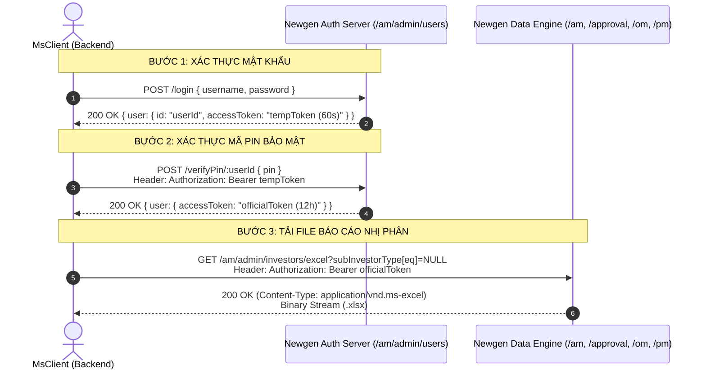

# ĐẶC TẢ KỸ THUẬT PHÂN HỆ M-SYSTEM API INGRESS CLIENT

## 1. Kiến Trúc Xác Thực 2 Lớp (2-Step Authentication) của Newgen Admin



---

## 2. Thông Số Cấu Hình

| Tham Số | Giá Trị Mặc Định DEV | Ý Nghĩa |
| :--- | :--- | :--- |
| `baseUrl` | `https://api-dev.newgen.dev` | Host REST API backend |
| `adminUrl` | `https://admin-dev.msystem.newgen.dev` | Host frontend web admin (dùng làm Origin/Referer) |
| `username` | `mxvhieptruong` | Tên đăng nhập quản trị viên |
| `password` | `Taovipko0!` | Mật khẩu tài khoản |
| `pin` | `269696` | Mã PIN 6 chữ số xác thực lớp 2 |

---

## 3. Danh Mục Headers Bắt Buộc

Khi gửi request tải file từ M-System API, backend Newgen yêu cầu các headers sau:
```http
Authorization: Bearer <officialToken>
Origin: https://admin-dev.msystem.newgen.dev
Referer: https://admin-dev.msystem.newgen.dev/
Accept: application/json, text/plain, */*
User-Agent: Mozilla/5.0 (Windows NT 10.0; Win64; x64) AppleWebKit/537.36
```
